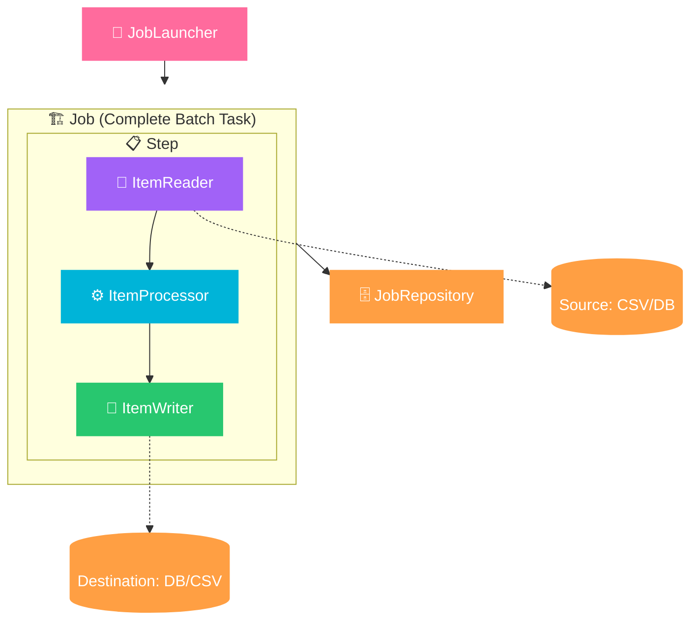
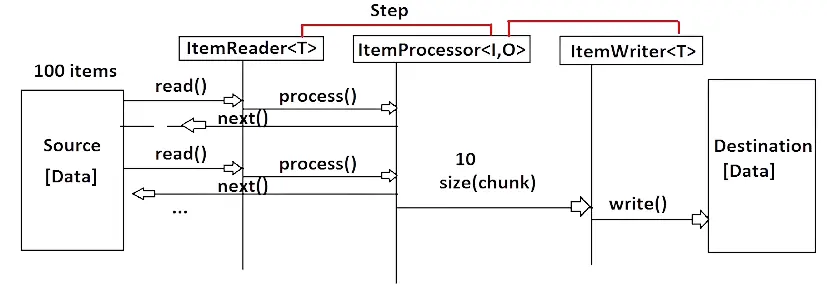
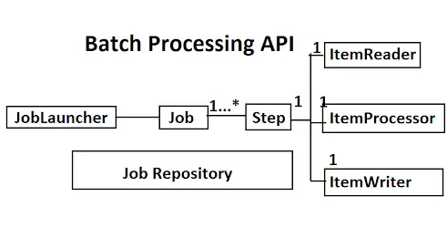
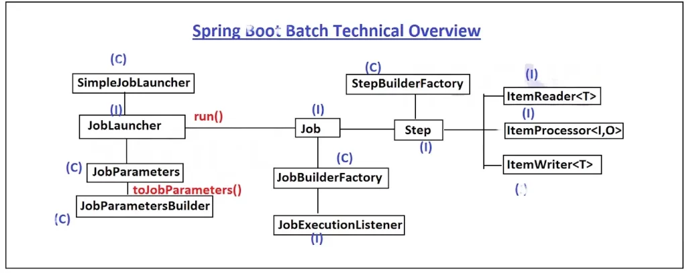
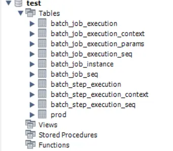

# Spring Boot Batch API Introduction

**Spring Boot Batch API Introduction** | Batch API: Processing large data sets and transferring from source to destination. Source/Destination can be Database, FileSystem.

- [Batch Processing API Details](#1-batch-processing-api-details)
- [Spring Boot Technical View of Batch API](#2-spring-boot-technical-view-of-batch-api)
- [ItemReader and ItemWriter Implementation Classes](#3-itemreader-and-itemwriter-implementation-classes)
- [JobRepository](#4-jobrepository)
- [Scheduling the Batch](#5-scheduling-the-batch)

---

## 1. Batch Processing API Details

🛠️ **Examples:**

- 💾 Job#1: MySQL Database to CSV (Excel) File
- 📂 Job#2: CSV to MongoDB Import

🔗 **Also see:**

- [CSV To MySQL Database Spring Boot Batch API Example](./02_CSV_To_MySQL_Database_Spring_Boot_Batch_API_Example.md)
- [CSV to MongoDB Spring Boot Batch Example](./03_CSV_to_MongoDB_Spring_Boot_Batch_Example.md)
- [MySQL to CSV Spring Boot Batch Example](./04_MySQL_to_CSV_Spring_Boot_Batch_Example.md)
- [MongoDB to CSV Spring Boot Batch Example](./05_MongoDB_to_CSV_Spring_Boot_Batch_Example.md)
- [MySQL to XML Spring Boot Batch Example](./06_MySQL_to_XML_Spring_Boot_Batch_Example.md)

### JDBC Batch API vs Spring Boot Batch API

| Feature | JDBC Batch API 🅰️ | Spring Boot Batch API 🅱️ |
|---------|-------------------|--------------------------|
| **Purpose** | Executes multiple Insert/Update SQLs simultaneously using one network call | Transfers/processes data from source to destination |
| **Example** | 5 Students insert using one n/w call | Data Export, Database Migration, Report generation |
| **Scope** | SQL execution optimization | Full read-process-write pipeline |

### Batch Architecture



🧠 **In Simple Words:**

- 📖 **ItemReader** — Reads data from the source and gives data to the processor.
- ⚙️ **ItemProcessor** — Processes (calculate, logic checking, etc.) data given by the Reader.
- 💾 **ItemWriter** — Writes data to the destination, data given by the processor.
- 🚀 **JobLauncher** — Starts execution of the Job.
- 🗄️ **JobRepository** — Memory that holds executed Job details (status, start and end time, etc.).

📝 **Note:** 1 Step = 1 Reader + 1 Processor + 1 Writer



### Chunk-Based Processing


- 📖 Reader and Processor are executed **once per record/item**.
- 💾 Writer is executed **based on a chunk** (size) given by the programmer. Chunk is the maximum limit for one network call.



🛠️ **Example 1:** Source has 100 items, chunk size = 50

| Component 🔧 | Executions 🔢 | Calculation 🧮 |
|--------------|--------------|----------------|
| **Reader** | 100 times | Once per item |
| **Processor** | 100 times | Once per item |
| **Writer** | 2 times | 100 / 50 = 2 |

🛠️ **Example 2:** Source has 100 items, chunk size = 30

| Component 🔧 | Executions 🔢 | Details 📋 |
|--------------|--------------|------------|
| **Reader** | 100 times | Once per item |
| **Processor** | 100 times | Once per item |
| **Writer** | 4 times | Items 1-30, 31-60, 61-90, 91-100 |

🔑 **Key Point:** Reader GenericType (e.g., `String`) and Processor Input Type (e.g., `String`) must match because reader output becomes processor input. Processor Output Type (e.g., `Employee`) and Writer Generic Type (e.g., `Employee`) must match because processor output becomes writer input.

📝 **Note:** To create one step you need:

- 🏷️ Step Name
- 📖 Reader object
- ⚙️ Processor object
- 💾 Writer object

**Dependency** (`pom.xml`):

```xml
<dependency>
    <groupId>org.springframework.boot</groupId>
    <artifactId>spring-boot-starter-batch</artifactId>
</dependency>
```

The `org.springframework.batch.item` package contains these functional interfaces:

| Interface 🏷️ | Method Signature 📋 |
|--------------|---------------------|
| **`ItemReader`** | `T read() throws Exception, UnexpectedInputException, ParseException, NonTransientResourceException;` |
| **`ItemProcessor`** | `O process(@NonNull I item) throws Exception` |
| **`ItemWriter`** | `void write(@NonNull Chunk chunk) throws Exception` |

📦 All above interfaces are given by Spring Boot Batch API inside package `org.springframework.batch.item`. Spring Batch API has already provided implementation classes for `ItemReader` and `ItemWriter` interfaces (e.g., `FlatFileItemReader`, `JdbcCursorItemReader`, `JpaItemWriter`, `MongoItemWriter`, etc.).

⚠️ **Caution:** Process logic depends on the concept/data that we are working with. Therefore `ItemProcessor` implementation classes are **not** provided — we have to develop them ourselves.

---

## 2. Spring Boot Technical View of Batch API



| # | Component 🔧 | Type 🏷️ | Description 📋 |
|---|-------------|---------|----------------|
| 1 | **`ItemReader<T>`** | Interface | Reads data from source (Database, FileSystem). Implementation class given by Spring Batch API — just configure the existing class. |
| 2 | **`ItemProcessor<I,O>`** | Interface | We must define our own implementation class with custom logic. |
| 3 | **`ItemWriter<T>`** | Interface | Writes data to destination (DB, File). Implementation class given by Spring Batch API — just configure the existing class. |
| 4 | **`Step`** | Interface | A collection of name + chunk + Reader obj + Processor obj + Writer obj. |
| 5 | **`StepBuilderFactory`** | Class | Creates Step objects. Auto-configured by Batch API — directly `@Autowired`. |
| 6 | **`Job`** | Interface | A collection of Steps name + step caller (Incrementor) + listener object (optional) + step objects in order. |
| 7 | **`JobBuilderFactory`** | Class | Creates Job objects. Auto-configured by Batch API — directly `@Autowired`. |
| 8 | **`JobExecutionListener`** | Interface | Optional. Executes logic (fine time, batch status, etc.) before starting and after finishing job processing. We define the impl class. |
| 9 | **`JobLauncher`** | Interface | Calls/executes Job objects. Impl class `SimpleJobLauncher` is auto-configured — directly `@Autowired`. |
| 10 | **`JobParameters`** | Class | Created using `JobParametersBuilder`. Passes input to Job (key=val, e.g., clientId, AppVersion, DB Location). Can be empty. |

💡 **Tip:** Generally in Spring framework using the properties file is not a must. But in Spring Boot almost all config inputs are given using properties only. Batch API was designed using Spring, so `JobParameters` was added. After Spring Boot, it is used very little — we can pass property directly using the properties file. But providing info of `JobParameters` while running the `JobLauncher` is compulsory.

### BatchStatus Enum

| Status 🏷️ | Meaning 📋 |
|-----------|-----------|
| ✅ **COMPLETED** | Successfully done |
| 🔄 **STARTING** | About to start batch processing |
| ▶️ **STARTED** | Job runner is called |
| ⏸️ **STOPPING** | About to finish the last step |
| ⏹️ **STOPPED** | Job runner completed |
| ❌️ **FAILED** | Exception in batch process |
| ⚠️ **ABANDONED** | Job execution stopped because of problems in server/force stop of server/DB not responding |
| ❓ **UNKNOWN** | Unable to find the problem, check log files |

---

## 3. ItemReader and ItemWriter Implementation Classes

Following implementation classes of `ItemReader` and `ItemWriter` are used with the following combinations. See more: <https://docs.spring.io/spring-batch/reference/>

| Source/Destination 📂 | ItemReader 📖 | ItemWriter 💾 |
|-----------------------|--------------|---------------|
| **CSV** | `FlatFileItemReader` | `FlatFileItemWriter` |
| **JDBC** | `JdbcCursorItemReader` | `JdbcBatchItemWriter` |
| **MongoDB** | `MongoItemReader` | `MongoItemWriter` |
| **JPA** | `JpaPagingItemReader` | `JpaItemWriter` |
| **XML** | `StaxEventItemReader` | `StaxEventItemWriter` |
| **JSON** | `JsonItemReader` | `JsonFileItemWriter` |

---

## 4. JobRepository

🗄️ Repository means memory — here tables are created for storing details of executed batches.

On application startup Spring Batch will create the following additional tables:

- `batch_job_execution`
- `batch_job_execution_context`
- `batch_job_execution_params`
- `batch_job_execution_seq`
- `batch_job_instance`
- `batch_job_seq`
- `batch_step_execution`
- `batch_step_execution_context`
- `batch_step_execution_seq`



### Schema Initialization Options

| Property Value 🔧 | Behavior 📋 |
|-------------------|------------|
| **`spring.batch.initialize-schema=embedded`** | Uses H2 Database as repository (default value) — avoids table creation in your main DB |
| **`spring.batch.initialize-schema=never`** | Does not store batch details in any database |
| **`spring.batch.initialize-schema=always`** | Creates tables in external databases such as MySQL or Oracle |

The `initialize-schema` internally uses the following enum:

```java
DataSourceInitializationMode {
    ALWAYS, EMBEDDED, NEVER
}
```

### Sample Queries

1️⃣ **Fetch instance ID using job name:**

```sql
SELECT JOB_INSTANCE_ID FROM batch_job_instance WHERE JOB_NAME='csv-job';
```

2️⃣ **Fetch Date and Time + Status data using Instance ID:**

```sql
SELECT START_TIME, END_TIME, STATUS FROM batch_job_execution
WHERE JOB_INSTANCE_ID IN (
    SELECT JOB_INSTANCE_ID FROM batch_job_instance
    WHERE JOB_NAME='csv-job'
);
```

3️⃣ **Fetch Job Execution ID using Instance ID:**

```sql
SELECT JOB_EXECUTION_ID FROM batch_job_execution
WHERE JOB_INSTANCE_ID IN (
    SELECT JOB_INSTANCE_ID FROM batch_job_instance
    WHERE JOB_NAME='csv-job'
);
```

4️⃣ **Fetch Step details using Job Execution:**

```sql
SELECT STEP_NAME, START_TIME, END_TIME, STATUS
FROM batch_step_execution
WHERE JOB_EXECUTION_ID IN(
    SELECT JOB_EXECUTION_ID FROM batch_job_execution
    WHERE JOB_INSTANCE_ID IN (
        SELECT JOB_INSTANCE_ID FROM batch_job_instance
        WHERE JOB_NAME='csv-job'
    )
);
```

### Job Auto-Execution

🔑 **Key Point:** The property `spring.batch.job.enabled` controls whether jobs execute on application startup. Default value is `true`.

🔧 **Configuration** (`application.properties`):

```properties
spring.batch.job.enabled=false
```

> ⚠️ **Warning:** Set this to `false` if you wrote a Controller/Runner class for `JobLauncher` — otherwise the batch will run twice (once on startup, once from your controller).

---

## 5. Scheduling the Batch

To schedule the Batch we can use the scheduler concept.

1️⃣ **Add `@EnableScheduling` at the Starter class.**

2️⃣ **Create a class to execute Batch:**

```java
package com.knowprogram.demo.controller;

import org.springframework.batch.core.Job;
import org.springframework.batch.core.JobParameters;
import org.springframework.batch.core.JobParametersBuilder;
import org.springframework.batch.core.JobParametersInvalidException;
import org.springframework.batch.core.launch.JobLauncher;
import org.springframework.batch.core.repository.JobExecutionAlreadyRunningException;
import org.springframework.batch.core.repository.JobInstanceAlreadyCompleteException;
import org.springframework.batch.core.repository.JobRestartException;
import org.springframework.beans.factory.annotation.Autowired;
import org.springframework.scheduling.annotation.Scheduled;
import org.springframework.stereotype.Component;

@Component
public class ProductBatch {

    @Autowired
    private JobLauncher jobLauncher;

    @Autowired
    private Job job;

    @Scheduled(cron = "0 0 13 * * *")
    public void execute() throws JobExecutionAlreadyRunningException,
            JobRestartException,
            JobInstanceAlreadyCompleteException,
            JobParametersInvalidException {
        JobParameters params = new JobParametersBuilder()
                .addLong("time", System.currentTimeMillis())
                .toJobParameters();
        jobLauncher.run(job, params);
    }

}
```

💡 **Tip:** You can pass the cron value as an expression:

```java
@Scheduled(cron = "${my.input.data}")
```

🔧 **Configuration** (`application.properties`):

```properties
my.input.data=0 0 13 * * *
```
