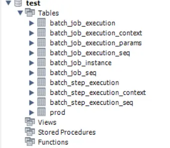
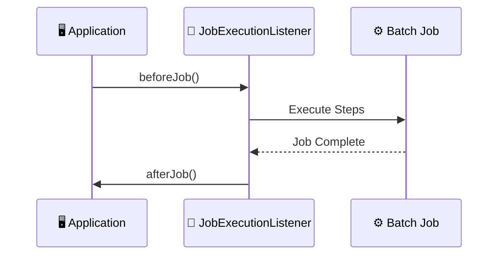

# CSV To MySQL Database Spring Boot Batch API Example

**CSV File To MySQL Database Spring Boot Batch API Example** | It is mostly asked interview questions in Spring Boot Batch API. Also see related tutorials below.

- [Tokenization and FlatFileItemReader](#1-tokenization-and-flatfileitemreader)
- [ItemReader Sample Code](#2-itemreader-sample-code)
- [ItemProcessor for Tax and Discount](#3-itemprocessor-for-tax-and-discount)
- [ItemWriter with RepositoryItemWriter](#4-itemwriter-with-repositoryitemwriter)
- [Loading Files from Different Locations](#5-loading-files-from-different-locations)
- [Batch Configuration Properties](#6-batch-configuration-properties)
- [CSV File TO MySQL Database Example in Spring Boot Batch API](#7-csv-file-to-mysql-database-example-in-spring-boot-batch-api)
- [Using JpaItemWriter](#8-using-jpaitemwriter)
- [Execute Before And After the Job](#9-execute-before-and-after-the-job)
- [Using Subclass In Batch API](#10-using-subclass-in-batch-api)

---

## 1. Tokenization and FlatFileItemReader

🔗 **Related Tutorials:**

- [Spring Boot Batch API Introduction](./01_Spring_Boot_Batch_API_Introduction.md)
- [CSV to MongoDB Spring Boot Batch Example](./03_CSV_to_MongoDB_Spring_Boot_Batch_Example.md)
- [MySQL to CSV Spring Boot Batch Example](./04_MySQL_to_CSV_Spring_Boot_Batch_Example.md)
- [MongoDB to CSV Spring Boot Batch Example](./05_MongoDB_to_CSV_Spring_Boot_Batch_Example.md)
- [MySQL to XML Spring Boot Batch Example](./06_MySQL_to_XML_Spring_Boot_Batch_Example.md)

**Tokenize:** Convert one String into multiple Strings using one separator symbol (delimiter, . – / +). Example: `"Hello-World-Welcome-To-KnowProgram"`, after tokenize: `"Hello"`, `"World"`, `"Welcome"`, `"To"`, `"KnowProgram"`.

Assume we have a CSV file `products.csv` (comma-separated values) and contains `id`, `code`, and `cost`. We want to convert this data into a database table. For this, we will use `FlatFileItemReader` which converts given data (text file data) into the required object format. It reads data line by line.


It performs the following operations:

1. 📄 Read file name + location using `setResource()`
2. 📖 Read data line by line using `setLineMapper()`. One line in file is one string object internally like `String s = "10,PEN,300.0"`. Here, `LineMapper` is an interface so we will use its implementation class: `DefaultLineMapper`.
3. ✂️ Tokenize data by comma using `setLineTokenize()`. One line data should be converted into values which can be done using `LineTokenizer(I)`. One of its implementation class is `DelimitedLineTokenizer(C)`. The default delimiter is COMMA (,). We can even use any other char like `/`, `.`, `-`, etc.
4. 🏷️ Provide names to values (variable names).
5. 🔧 Convert the above variables' data into one class object using `setFieldSetMapper()` `{id=10, code=PEN, cost=300.0}` implementation class `BeanWrapperFieldSetMapper(C)`. It means creating objects and setting data based on variable names.

---

## 2. ItemReader Sample Code

🛠️ **Reader and LineMapper beans:**

```java
@Bean
ItemReader<Product> reader(){
    FlatFileItemReader<Product> itemReader = new FlatFileItemReader<>();
    itemReader.setResource(new ClassPathResource("products.csv"));
    itemReader.setName("csv-reader");
    itemReader.setLinesToSkip(1); // to skip heading
    itemReader.setLineMapper(lineMapper());
    return itemReader;
}

private LineMapper<Product> lineMapper() {
    DefaultLineMapper<Product> lineMapper = new DefaultLineMapper<>();

    DelimitedLineTokenizer tokenizer = new DelimitedLineTokenizer();
    tokenizer.setDelimiter(",");
    // variables name
    tokenizer.setNames("prodId", "prodCode", "prodCost");
    tokenizer.setStrict(false);

    BeanWrapperFieldSetMapper<Product> mapper = new BeanWrapperFieldSetMapper<>();
    mapper.setTargetType(Product.class);

    lineMapper.setFieldSetMapper(mapper);
    lineMapper.setLineTokenizer(tokenizer);
    return lineMapper;
}
```

---

## 3. ItemProcessor for Tax and Discount

We will define `ProductProcessor` which will calculate tax and discount. The output of previous steps will become input to the `ProductProcessor` and the `ProductProcessor` will produce an object containing fields `id`, `code`, `cost`, `tax`, and `discount`.

🛠️ **Processor logic:**

```java
@Override
public Product process(Product item) throws Exception {
    // JDK 10 # local variable type inference
    // [best datatype is decided at compile time]
    var cost = item.getProdCost();

    // calculations
    var tax = cost * 12 / 100.0;
    var disc = cost * 8 / 100.0;

    item.setProdTax(tax);
    item.setProdDiscount(disc);

    return item;
}
```

---

## 4. ItemWriter with RepositoryItemWriter

Next, we will store the data into the database. For this we will use Spring Data JPA and `RepositoryItemWriter` class. It will store data into the collection. Using it, perform the following operations:

1. 🗄️ Map appropriate repository
2. 💾 Assign the method that will be used to save the data

🛠️ **Writer bean:**

```java
@Bean
ItemWriter<Product> writer() {
    RepositoryItemWriter<Product> writer = new RepositoryItemWriter<>();
    writer.setRepository(productRepository);
    writer.setMethodName("save");
    return writer;
}
```

---

## 5. Loading Files from Different Locations

A file can be loaded from different places. Spring Boot has provided `Resource(I)` (`org.springframework.core.io`) interface that can be used to store filename and the location of the file.

| Source 📁 | Class 🏷️ | Example 🛠️ |
|-----------|----------|------------|
| **`/src/main/resources` folder** | `ClassPathResource` | `Resource r1 = new ClassPathResource("abcd.csv");` |
| **Computer drives (outside project)** | `FileSystemResource` | `Resource r2 = new FileSystemResource("d:/mydata/abcd.csv");` |
| **Internet location** | `UrlResource` | `Resource r3 = new UrlResource("http://s3.amazon.bucket/sourcekp/abcd.csv");` |

---

## 6. Batch Configuration Properties

When we start the Batch example then the Batch will be executed itself by the starter class on startup. To prevent that, and execute it only when we call the API, add the following key in the properties file:

```properties
spring.batch.job.enabled=false
```

To inform Batch API to create table for additional information, add:

```properties
spring.batch.jdbc.initialize-schema=always
```

📝 **Note:** On application startup, the above configuration will create the following tables:

| Batch Metadata Tables 🗄️ |
|--------------------------|
| `batch_job_execution` |
| `batch_job_execution_context` |
| `batch_job_execution_params` |
| `batch_job_execution_seq` |
| `batch_job_instance` |
| `batch_job_seq` |
| `batch_step_execution` |
| `batch_step_execution_context` |
| `batch_step_execution_seq` |



---

## 7. CSV File TO MySQL Database Example in Spring Boot Batch API

Create a spring starter project `SpringBootBatchCSVToMySQL` with the following dependencies:

📦 `Lombok`, `Spring Batch`, `MySQL`, `Spring Data JPA`, `Spring Web`

🏗️ **Project Structure — Different classes/interfaces:**

| # | Component 📋 | Type 🏷️ |
|---|-------------|---------|
| 1 | Model class | `@Entity` |
| 2 | Repository Interface | `JpaRepository` |
| 3 | Processor class | `ItemProcessor` |
| 4 | **BatchConfig** | `@Configuration` |
| 5 | Controller class | `@RestController` |
| 6 | Properties file | `application.properties` |
| 7 | CSV file | `products.csv` |

### CSV Data File

Keep `products.csv` file in the `src/main/resources` folder.

📄 **`products.csv`:**

```csv
id,code,cost
10,PEN,200.0
11,BOOK,500.0
12,BOTTLE,600.0
13,MOBILE,1500.0
14,MOUSE,300.0
15,KEYBOAD,900.0
16,BAG,600.0
```

### Application Properties

🔧 **`application.properties`:**

```properties
# DB details
spring.datasource.url=jdbc:mysql://localhost:3306/test
spring.datasource.username=root
spring.datasource.password=root

# JPA info
spring.jpa.show-sql=true
spring.jpa.hibernate.ddl-auto=update
spring.jpa.properties.hibernate.format_sql=true

# disable job run at startup
spring.batch.job.enabled=false
spring.batch.jdbc.initialize-schema=always
```

### Model Class

🏷️ **`Product.java`:**

```java
package com.knowprogram.demo.model;

@Data
@AllArgsConstructor
@NoArgsConstructor
@Entity
@Table(name = "prod")
public class Product {

    @Id
    @Column(name = "pid")
    private Integer prodId;

    @Column(name = "pname")
    private String prodCode;

    @Column(name = "pcost")
    private Double prodCost;

    @Column(name = "ptax")
    private Double prodTax;

    @Column(name = "pdiscount")
    private Double prodDiscount;
}
```

### Repository Interface

💾 **`ProductRepository.java`:**

```java
package com.knowprogram.demo.repo;

import org.springframework.data.jpa.repository.JpaRepository;
import com.knowprogram.demo.model.Product;

public interface ProductRepository extends JpaRepository<Product, Integer> { }
```

### Processor Implementation Class

⚙️ **`ProductProcessor.java`:**

```java
package com.knowprogram.demo.processor;

import org.springframework.batch.item.ItemProcessor;
import com.knowprogram.demo.model.Product;

public class ProductProcessor implements ItemProcessor<Product, Product> {

    @Override
    public Product process(Product item) throws Exception {
        // JDK 10 # local variable type inference
        // [best datatype is decided at compile time]
        var cost = item.getProdCost();

        // calculations
        var tax = cost * 12 / 100.0;
        var disc = cost * 8 / 100.0;

        item.setProdTax(tax);
        item.setProdDiscount(disc);

        return item;
    }

}
```

### Config Class

🔧 **`BatchConfig.java`:**

```java
package com.knowprogram.demo.config;

import org.springframework.batch.core.Job;
import org.springframework.batch.core.Step;
import org.springframework.batch.core.job.builder.JobBuilder;
import org.springframework.batch.core.repository.JobRepository;
import org.springframework.batch.core.step.builder.StepBuilder;
import org.springframework.batch.item.ItemProcessor;
import org.springframework.batch.item.ItemReader;
import org.springframework.batch.item.ItemWriter;
import org.springframework.batch.item.data.RepositoryItemWriter;
import org.springframework.batch.item.file.FlatFileItemReader;
import org.springframework.batch.item.file.LineMapper;
import org.springframework.batch.item.file.mapping.BeanWrapperFieldSetMapper;
import org.springframework.batch.item.file.mapping.DefaultLineMapper;
import org.springframework.batch.item.file.transform.DelimitedLineTokenizer;
import org.springframework.beans.factory.annotation.Autowired;
import org.springframework.context.annotation.Bean;
import org.springframework.context.annotation.Configuration;
import org.springframework.core.io.ClassPathResource;
import org.springframework.core.task.SimpleAsyncTaskExecutor;
import org.springframework.core.task.TaskExecutor;
import org.springframework.transaction.PlatformTransactionManager;

import com.knowprogram.demo.model.Product;
import com.knowprogram.demo.processor.ProductProcessor;
import com.knowprogram.demo.repo.ProductRepository;

@Configuration
public class BatchConfig {

    @Autowired
    private ProductRepository productRepository;

    @Bean
    ItemReader<Product> reader(){
        FlatFileItemReader<Product> itemReader = new FlatFileItemReader<>();
        itemReader.setResource(new ClassPathResource("products.csv"));
        itemReader.setName("csv-reader");
        itemReader.setLinesToSkip(1); // to skip heading
        itemReader.setLineMapper(lineMapper());
        return itemReader;
    }

    private LineMapper<Product> lineMapper() {
        DefaultLineMapper<Product> lineMapper = new DefaultLineMapper<>();

        DelimitedLineTokenizer tokenizer = new DelimitedLineTokenizer();
        tokenizer.setDelimiter(",");
        // variables name
        tokenizer.setNames("prodId", "prodCode", "prodCost");
        tokenizer.setStrict(false);

        BeanWrapperFieldSetMapper<Product> mapper = new BeanWrapperFieldSetMapper<>();
        mapper.setTargetType(Product.class);

        lineMapper.setFieldSetMapper(mapper);
        lineMapper.setLineTokenizer(tokenizer);
        return lineMapper;
    }

    @Bean
    ItemProcessor<Product, Product> processor() {
        return new ProductProcessor();
    }

    @Bean
    ItemWriter<Product> writer() {
        RepositoryItemWriter<Product> writer = new RepositoryItemWriter<>();
        writer.setRepository(productRepository);
        writer.setMethodName("save");
        return writer;
    }

    @Bean
    Step step(JobRepository repository, PlatformTransactionManager transactionManager) {
        return new StepBuilder("csv-step", repository)
                .<Product, Product>chunk(10, transactionManager)
                .reader(reader())
                .processor(processor())
                .writer(writer())
                .taskExecutor(taskExecutor()) // to make Batch asynchronous
                .build();
    }

    // to make Batch asynchronous
    private TaskExecutor taskExecutor() {
        SimpleAsyncTaskExecutor asyncTaskExecutor = new SimpleAsyncTaskExecutor();
        asyncTaskExecutor.setConcurrencyLimit(10);
        return asyncTaskExecutor;
    }

    @Bean(name = "csvJob")
    Job job(JobRepository jobRepository, PlatformTransactionManager transactionManager) {
        return new JobBuilder("csv-job", jobRepository)
                .flow(step(jobRepository, transactionManager))
                .end()
                .build();
    }
}
```

### Controller Class

🌐 **`ProductBatchController.java`:**

```java
@RestController
package com.knowprogram.demo.controller;

public class ProductBatchController {

    @Autowired
    private JobLauncher jobLauncher;

    @Autowired
    private Job job;

    @GetMapping("/startBatch")
    public String startBatch() throws JobExecutionAlreadyRunningException,
        JobRestartException,
        JobInstanceAlreadyCompleteException,
        JobParametersInvalidException {
        JobParameters params = new JobParametersBuilder()
             .addLong("time", System.currentTimeMillis())
             .toJobParameters();

        JobExecution run = jobLauncher.run(job, params);
        return run.getStatus().toString();
    }

}
```

---

## 8. Using JpaItemWriter

In the above example, we have used the `RepositoryItemWriter` class which needs repository information therefore we have added `ProductRepository`. But if our task is simple then we can use `JpaItemWriter` in place of `RepositoryItemWriter`.

> 💡 **Tip:** **Remove** the `ProductRepository` interface and its injection from the `BatchConfig` file. Inject the `EntityManagerFactory` and change the logic in the `writer()` bean method.

| Feature ⚖️ | `RepositoryItemWriter` 🅰️ | `JpaItemWriter` 🅱️ |
|------------|--------------------------|-------------------|
| **Requires** | Repository interface | `EntityManagerFactory` |
| **Complexity** | More setup | Simpler |
| **Use case** | Custom repository logic | Simple persist operations |

🛠️ **Updated BatchConfig with JpaItemWriter:**

```java
@Configuration
public class BatchConfig {

    @Autowired
    private EntityManagerFactory emf;

    // other methods

    @Bean
    ItemWriter<Product> writer() {
        JpaItemWriter<Product> writer = new JpaItemWriter<>();
        writer.setEntityManagerFactory(emf);
        return writer;
    }
}
```

---

## 9. Execute Before And After the Job

If we want to execute something before and after the job then we can take the help of `JobExecutionListener` interface. Create a class implementing `JobExecutionListener` interface and override its `beforeJob()` and `afterJob()` methods.



🛠️ **`MyJobListener.java`:**

```java
package com.knowprogram.demo.listener;

import org.springframework.batch.core.JobExecution;
import org.springframework.batch.core.JobExecutionListener;

public class MyJobListener implements JobExecutionListener {
    @Override
    public void beforeJob(JobExecution jobExecution) {
        System.out.println("MyJobListener.beforeJob()");
    }

    @Override
    public void afterJob(JobExecution jobExecution) {
        System.out.println("MyJobListener.afterJob()");
    }
}
```

Add the `JobExecutionListener` information to the `BatchConfig`.

🔧 **Updated `BatchConfig` with Listener:**

```java
package com.knowprogram.demo.config;

@Configuration
public class BatchConfig {
    // existing code

    @Bean
    JobExecutionListener listener() {
        return new MyJobListener();
    }

    @Bean(name = "csvJob")
    Job job(JobRepository jobRepository, PlatformTransactionManager transactionManager) {
        return new JobBuilder("csv-job", jobRepository)
                .listener(listener())
                .flow(step(jobRepository, transactionManager))
                .end()
                .build();
    }
}
```

---

## 10. Using Subclass In Batch API

Let us see these scenarios with subclass. Later we are going to use them in the `BatchConfig` file to reduce the number of methods. Assume we have a class `A`.

```java
class A {
}
```

### Subclass Patterns

| # | Pattern 📋 | Code 🛠️ | Description 📖 |
|---|-----------|---------|---------------|
| 1 | **Creating object** | `A a = new A();` | Normal object creation |
| 2 | **Anonymous inner class + object** | `A a = new A() {};` | Subclass to `A` without name, with additional logic |
| 3 | **Anonymous inner class + instance block + object** | `A a = new A() { { } };` | Instance block inside anonymous class |
| 4 | **Anonymous inner class + instance block + local scope + object** | `A a = new A() { { { } } };` | Instance block with local scope block |

🧠 **In Simple Words:**

- Anonymous class is mostly used for single-use/task purposes.
- Anonymous code executes faster compared to normal subclass, but coding is a bit more complex.
- When writing an anonymous class you cannot define a constructor, so you use the **instance block** instead.
- Instead of creating a normal subclass and using it, the anonymous approach is the fastest way of creating and using a subclass.

Another way of defining an instance block in the class `A` along with inner class:

```java
new A() {
  {
     // instance block
  }
}
```

> 📝 **Note:** Why do we need an instance block here? When we are writing an anonymous class then we cannot define the constructor so we have to use the instance block. We will use this pattern in Batch API.

### Demo Example

🛠️ **Full demo class:**

```java
class A {
    public A() {
        System.out.println("A.A()");
    }
}

public class Demo {
    public static void main(String[] args) {
        A a = new A();
        System.out.println(a.getClass().getName()); // A
        A a1 = new A() {};
        System.out.println(a1.getClass().getName()); // Demo$1
        A a2 = new A() {
            {
                System.out.println("Sub Type - Instance Block");
            }
        };
        System.out.println(a2.getClass().getName()); // Demo$2
    }
}
```

📤 **Output:**

```
A.A()
A
A.A()
Demo$1
A.A()
Sub Type – Instance Block
Demo$2
```

💡 **Explanation:** For the code `new A() {}` internally one subclass is created without any name (nameless/anonymous) but Java gives numbers while accessing only. The internal code looks like:

```java
class $1 extends A {
   ...
}
```

And object is created at the same time: `new $1();`

### Updated BatchConfig with Subclasses

We can **remove** the `ProductProcessor` and `MyJobListener` classes because we will include their logic in the `BatchConfig` class itself.

> 🔑 **Key Point:** This approach uses anonymous inner classes with instance blocks to inline all batch component logic directly in `BatchConfig`.

🔧 **Updated `BatchConfig` file with subclasses:**

```java
@Configuration
public class BatchConfig {

    @Autowired
    private EntityManagerFactory emf;

    @Bean
    ItemReader<Product> reader() {
        FlatFileItemReader<Product> itemReader = new FlatFileItemReader<>();
        itemReader.setResource(new ClassPathResource("products.csv"));
        itemReader.setName("csv-reader");
        itemReader.setLinesToSkip(1); // to skip heading

        itemReader.setLineMapper(new DefaultLineMapper<>() {
            {
                setLineTokenizer(new DelimitedLineTokenizer() {
                    {
                        setDelimiter(DELIMITER_COMMA);
                        // variables name
                        setNames("prodId", "prodCode", "prodCost");
                        setStrict(false);
                    }
                });
                setFieldSetMapper(new BeanWrapperFieldSetMapper<>() {
                    {
                        setTargetType(Product.class);
                    }
                });
            }
        });

        return itemReader;
    }

    @Bean
    ItemProcessor<Product, Product> processor() {
        return item -> {
            item.setProdTax(item.getProdCost() * 0.12);
            item.setProdDiscount(item.getProdCost() * 0.08);
            return item;
        };
    }

    @Bean
    ItemWriter<Product> writer() {
        JpaItemWriter<Product> writer = new JpaItemWriter<>();
        writer.setEntityManagerFactory(emf);
        return writer;
    }

    @Bean
    Step step(JobRepository repository, PlatformTransactionManager transactionManager) {
        return new StepBuilder("csv-step", repository)
                .<Product, Product>chunk(10, transactionManager)
                .reader(reader())
                .processor(processor()).writer(writer())
                .taskExecutor(new SimpleAsyncTaskExecutor() {
                    private static final long serialVersionUID = 1L;
                    {
                        setConcurrencyLimit(10);
                    }
                })
                .build();
    }

    @Bean
    JobExecutionListener listener() {
        return new JobExecutionListener() {
            @Override
            public void beforeJob(JobExecution jobExecution) {
                System.out.println("MyJobListener.beforeJob()");
            }

            @Override
            public void afterJob(JobExecution jobExecution) {
                System.out.println("MyJobListener.afterJob()");
            }
        };
    }

    @Bean(name = "csvJob")
    Job job(JobRepository jobRepository, PlatformTransactionManager transactionManager) {
        return new JobBuilder("csv-job", jobRepository)
                .listener(listener())
                .flow(step(jobRepository, transactionManager))
                .end()
                .build();
    }
}
```
