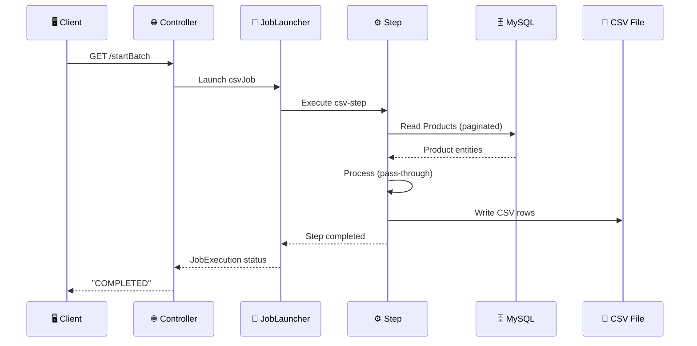

# MySQL to CSV Spring Boot Batch Example

**MySQL to CSV Spring Boot Batch Example** | Previously we have seen Spring Boot Batch examples of [CSV to MySQL](./02_CSV_To_MySQL_Database_Spring_Boot_Batch_API_Example.md), and [CSV to MongoDB](./03_CSV_to_MongoDB_Spring_Boot_Batch_Example.md). Now let us see MySQL to CSV file through Spring Boot Batch.

- [Related Tutorials](#1-related-tutorials)
- [Project Setup](#2-project-setup)
- [Application Properties](#3-application-properties)
- [Model Class](#4-model-class)
- [Repository Interface](#5-repository-interface)
- [Batch Configuration](#6-batch-configuration)
- [Controller](#7-controller)
- [JpaPagingItemReader and EntityManagerFactory](#8-jpapagingitemreader-and-entitymanagerfactory)

---

## 1. Related Tutorials

- 📖 [Spring Boot Batch API Introduction](./01_Spring_Boot_Batch_API_Introduction.md)
- 💾 [CSV To MySQL Database Spring Boot Batch API Example](./02_CSV_To_MySQL_Database_Spring_Boot_Batch_API_Example.md)
- 🗄️ [CSV to MongoDB Spring Boot Batch Example](./03_CSV_to_MongoDB_Spring_Boot_Batch_Example.md)
- 📤 [MongoDB to CSV Spring Boot Batch Example](./05_MongoDB_to_CSV_Spring_Boot_Batch_Example.md)
- 📄 [MySQL to XML Spring Boot Batch Example](./06_MySQL_to_XML_Spring_Boot_Batch_Example.md)

---

## 2. Project Setup

Create a Spring starter project with the following dependencies:

| Dependency 📦 | Purpose 📋 |
|---------------|-----------|
| **Lombok** | Reduce boilerplate code (getters, setters, constructors) |
| **Spring Batch** | Batch processing framework |
| **Spring Data JPA** | Database access and ORM |
| **MySQL** | MySQL database driver |
| **Spring Web** | REST API support |


---

## 3. Application Properties

🔧 **Configuration** (`application.properties`):

```properties
# DB details
spring.datasource.url=jdbc:mysql://localhost:3306/test
spring.datasource.username=root
spring.datasource.password=root

# JPA info
spring.jpa.show-sql=true
spring.jpa.hibernate.ddl-auto=update
spring.jpa.properties.hibernate.format_sql=true

# disable job run at startup
spring.batch.job.enabled=false
spring.batch.jdbc.initialize-schema=always
```

| Property 🏷️ | Description 📋 |
|-------------|---------------|
| `spring.batch.job.enabled=false` | Prevents batch job from running automatically at startup |
| `spring.batch.jdbc.initialize-schema=always` | Creates Spring Batch metadata tables automatically |

---

## 4. Model Class

**Model class** (`Product.java`):

```java
package com.knowprogram.demo.model;

import jakarta.persistence.Column;
import jakarta.persistence.Entity;
import jakarta.persistence.Id;
import jakarta.persistence.Table;
import lombok.AllArgsConstructor;
import lombok.Data;
import lombok.NoArgsConstructor;

@Data
@AllArgsConstructor
@NoArgsConstructor
@Entity
@Table(name = "prod")
public class Product {
    @Id
    @Column(name = "pid")
    private Integer prodId;

    @Column(name = "pname")
    private String prodCode;

    @Column(name = "pcost")
    private Double prodCost;

    @Column(name = "ptax")
    private Double prodTax;

    @Column(name = "pdiscount")
    private Double prodDiscount;
}
```

📝 **Note:** The `@Table(name = "prod")` annotation maps this entity to the `prod` table in the database, and each `@Column` annotation maps fields to their respective column names.

---

## 5. Repository Interface

**Repository** (`ProductRepository.java`):

```java
package com.knowprogram.demo.repository;

import org.springframework.data.jpa.repository.JpaRepository;

import com.knowprogram.demo.model.Product;

public interface ProductRepository extends JpaRepository<Product, Integer> {

}
```

---

## 6. Batch Configuration

**BatchConfig class** (`BatchConfig.java`):

```java
package com.knowprogram.demo.config;

import org.springframework.batch.core.Job;
import org.springframework.batch.core.JobExecution;
import org.springframework.batch.core.JobExecutionListener;
import org.springframework.batch.core.Step;
import org.springframework.batch.core.job.builder.JobBuilder;
import org.springframework.batch.core.repository.JobRepository;
import org.springframework.batch.core.step.builder.StepBuilder;
import org.springframework.batch.item.ItemProcessor;
import org.springframework.batch.item.ItemReader;
import org.springframework.batch.item.ItemWriter;
import org.springframework.batch.item.data.RepositoryItemReader;
import org.springframework.batch.item.file.FlatFileItemWriter;
import org.springframework.batch.item.file.transform.BeanWrapperFieldExtractor;
import org.springframework.batch.item.file.transform.DelimitedLineAggregator;
import org.springframework.beans.factory.annotation.Autowired;
import org.springframework.context.annotation.Bean;
import org.springframework.context.annotation.Configuration;
import org.springframework.core.io.FileSystemResource;
import org.springframework.core.task.SimpleAsyncTaskExecutor;
import org.springframework.data.domain.Sort;
import org.springframework.transaction.PlatformTransactionManager;

import com.knowprogram.demo.model.Product;
import com.knowprogram.demo.repository.ProductRepository;

import java.util.Collections;

@Configuration
public class BatchConfig {

    @Autowired
    private ProductRepository productRepository;

    @Bean
    ItemReader<Product> reader() {
        RepositoryItemReader<Product> reader = new RepositoryItemReader<>();
        reader.setRepository(productRepository);
        reader.setMethodName("findAll");
        reader.setPageSize(10);
        reader.setSort(Collections.singletonMap("prodId", Sort.Direction.ASC));
        return reader;
    }

    @Bean
    ItemProcessor<Product, Product> processor() {
        return item -> item;
    }

    @Bean
    ItemWriter<Product> writer() {
        FlatFileItemWriter<Product> writer = new FlatFileItemWriter<>();
        writer.setResource(new FileSystemResource("products_output.csv"));
        writer.setAppendAllowed(false);
        writer.setLineAggregator(new DelimitedLineAggregator<Product>() {{
            setDelimiter(",");
            setFieldExtractor(new BeanWrapperFieldExtractor<Product>() {{
                setNames(new String[]{"prodId", "prodCode",
                     "prodCost", "prodTax", "prodDiscount"});
            }});
        }});
        return writer;
    }

    @Bean
    Step step(JobRepository repository, PlatformTransactionManager transactionManager) {
        return new StepBuilder("csv-step", repository)
                .<Product, Product>chunk(10, transactionManager)
                .reader(reader())
                .processor(processor())
                .writer(writer())
                .taskExecutor(new SimpleAsyncTaskExecutor() {
                    private static final long serialVersionUID = 1L;

                    {
                        setConcurrencyLimit(10);
                    }
                })
                .build();
    }

    @Bean
    JobExecutionListener listener() {
        return new JobExecutionListener() {
            @Override
            public void beforeJob(JobExecution jobExecution) {
                System.out.println("MyJobListener.beforeJob()");
            }

            @Override
            public void afterJob(JobExecution jobExecution) {
                System.out.println("MyJobListener.afterJob()");
            }
        };
    }

    @Bean(name = "csvJob")
    Job job(JobRepository jobRepository, PlatformTransactionManager transactionManager) {
        return new JobBuilder("csv-job", jobRepository)
                .listener(listener())
                .flow(step(jobRepository, transactionManager))
                .end()
                .build();
    }
}
```

🔑 **Key Points:**

- 📥 **Reader** — Uses `RepositoryItemReader` to read `Product` entities from MySQL, paginated with page size 10 and sorted by `prodId`
- ⚙️ **Processor** — Pass-through processor that returns items unchanged (no transformation needed)
- 📤 **Writer** — Uses `FlatFileItemWriter` to write comma-delimited CSV to `products_output.csv`
- 🚀 **Async Execution** — `SimpleAsyncTaskExecutor` with concurrency limit of 10 enables parallel chunk processing
- 👂 **Listener** — `JobExecutionListener` logs messages before and after job execution

---

## 7. Controller

**Controller** (`ProductBatchController.java`):

```java
@RestController
package com.knowprogram.demo.controller;

public class ProductBatchController {

    @Autowired
    private JobLauncher jobLauncher;

    @Autowired
    private Job job;

    @GetMapping("/startBatch")
    public String startBatch() throws JobExecutionAlreadyRunningException,
        JobRestartException,
        JobInstanceAlreadyCompleteException,
        JobParametersInvalidException {
        JobParameters params = new JobParametersBuilder()
             .addLong("time", System.currentTimeMillis())
             .toJobParameters();

        JobExecution run = jobLauncher.run(job, params);
        return run.getStatus().toString();
    }

}
```

💡 **Tip:** The `time` parameter with `System.currentTimeMillis()` ensures each job execution is unique, allowing the same job to be triggered multiple times.



---

## 8. JpaPagingItemReader and EntityManagerFactory

Instead of using `RepositoryItemReader` and `ProductRepository`, we can use `JpaPagingItemReader` and `EntityManagerFactory`. In that case, we won't need the `ProductRepository` interface therefore we can remove the `ProductRepository`.

**Alternative BatchConfig using JpaPagingItemReader:**

```java
@Configuration
public class BatchConfig {

    @Autowired
    private EntityManagerFactory entityManagerFactory;

    @Bean
    ItemReader<Product> reader() {
        JpaPagingItemReader<Product> reader = new JpaPagingItemReader<>();
        reader.setEntityManagerFactory(entityManagerFactory);
        reader.setQueryString("SELECT p FROM Product p");
        reader.setPageSize(10);
        return reader;
    }

    // others
}
```

| Approach ⚖️ | Reader Type 📥 | Dependency 📦 | Query Style 🔍 |
|-------------|---------------|--------------|----------------|
| **RepositoryItemReader** | `RepositoryItemReader` | `ProductRepository` | Spring Data methods (`findAll`) |
| **JpaPagingItemReader** | `JpaPagingItemReader` | `EntityManagerFactory` | JPQL queries (`SELECT p FROM Product p`) |

> 💡 **Tip:** Use `JpaPagingItemReader` when you need custom JPQL queries or want to avoid creating a repository interface. Use `RepositoryItemReader` when you already have a Spring Data repository in your project.
