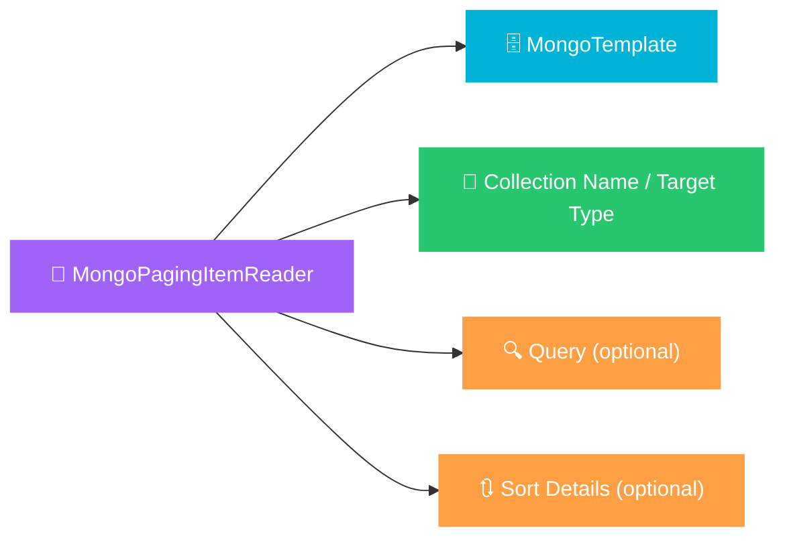

# MongoDB to CSV Spring Boot Batch Example

**MongoDB to CSV Spring Boot Batch Example** | Previously we have seen Spring Boot Batch examples of [CSV to MySQL](./02_CSV_To_MySQL_Database_Spring_Boot_Batch_API_Example.md), [CSV to MongoDB](./03_CSV_to_MongoDB_Spring_Boot_Batch_Example.md), and [MySQL to CSV](./04_MySQL_to_CSV_Spring_Boot_Batch_Example.md). Now let us see MongoDB to CSV file through Spring Boot Batch. Also see:- [Spring Boot Batch API Introduction](./01_Spring_Boot_Batch_API_Introduction.md), [MySQL to XML Spring Boot Batch Example](./06_MySQL_to_XML_Spring_Boot_Batch_Example.md)

- [MongoPagingItemReader Overview](#1-mongopagingitemreader-overview)
- [MongoDB to CSV Spring Boot Batch](#2-mongodb-to-csv-spring-boot-batch)
- [Project Setup and Dependencies](#3-project-setup-and-dependencies)
- [Setup Data in MongoDB](#4-setup-data-in-mongodb)
- [Application Properties](#5-application-properties)
- [Model Class](#6-model-class)
- [Batch Config Class](#7-batch-config-class)
- [Controller Class](#8-controller-class)
- [Output](#9-output)

---

## 1. MongoPagingItemReader Overview

For MongoDB, `MongoPagingItemReader` is the implementation class of the `ItemReader` interface.



`MongoPagingItemReader` takes the following inputs:

- 🗄️ `MongoTemplate` — The template for MongoDB operations
- 📁 Collection name / target type
- 🔍 Projection / where condition query (optional)
- 🔃 Sorting details (optional)

---

## 2. MongoDB to CSV Spring Boot Batch


---

## 3. Project Setup and Dependencies

Create a Spring starter project with the following dependencies:

| Dependency 📦 | Purpose 📋 |
|---------------|-----------|
| **Lombok** | Reduces boilerplate code |
| **Spring Batch** | Batch processing framework |
| **Spring Data MongoDB** | MongoDB integration |
| **H2 Database** | In-memory database for batch metadata |
| **Spring Web** | REST API support |

Different classes/files needed:

- 🏷️ Model class
- ⚙️ Batch Config
- 🔧 Properties file
- 🌐 Controller class

---

## 4. Setup Data in MongoDB

**MongoDB insert script:**

```javascript
db.user.insertMany([
    {"userId": 101, "userName": "John", "userRole": "ADMIN", "userDept": "DEV"},
    {"userId": 102, "userName": "Jane", "userRole": "MGR", "userDept": "QA"},
    {"userId": 103, "userName": "Mike", "userRole": "SE", "userDept": "DEV"},
    {"userId": 104, "userName": "Alice", "userRole": "SEQ", "userDept": "QA"},
    {"userId": 105, "userName": "Bob", "userRole": "DER", "userDept": "QA"}
]);
```

---

## 5. Application Properties

🔧 **Configuration** (`application.properties`):

```properties
spring.data.mongodb.host=localhost
spring.data.mongodb.port=27017
spring.data.mongodb.database=sample
spring.batch.job.enabled=false
```

📝 **Note:** Setting `spring.batch.job.enabled=false` prevents the batch job from running automatically at startup. We will trigger it manually via a REST endpoint.

---

## 6. Model Class

**Model class** (`User.java`):

```java
package com.knowprogram.demo.model;

import lombok.AllArgsConstructor;
import lombok.Data;
import lombok.NoArgsConstructor;

@Data
@AllArgsConstructor
@NoArgsConstructor
public class User {
    private Integer userId;
    private String userName;
    private String userRole;
    private String userDept;
}
```

---

## 7. Batch Config Class

**Batch Config class** (`BatchConfig.java`):

```java
@Configuration
public class BatchConfig {

    @Autowired
    private MongoTemplate mongoTemplate;

    @Bean
    ItemReader<User> reader() {
        MongoPagingItemReader<User> reader = new MongoPagingItemReader<>();
        reader.setTemplate(mongoTemplate);
        reader.setTargetType(User.class);
        reader.setCollection("user");
        // reader.setQuery("{eid: {$lt: 10}}");
        reader.setQuery("{ }");
        reader.setSort(new HashMap<String, Direction>() {
            private static final long serialVersionUID = 1L;
            {
                put("_id", Direction.DESC);
            }
        });
        return reader;
    }

    @Bean
    ItemProcessor<User, User> processor() {
        return item -> item;
    }

    @Bean
    ItemWriter<User> writer() {
        FlatFileItemWriter<User> writer = new FlatFileItemWriter<>();
        writer.setResource(new FileSystemResource("V:/myouts/usersmongodb.csv"));
        writer.setLineAggregator(new DelimitedLineAggregator<>() {
            {
                setDelimiter(",");
                setFieldExtractor(new BeanWrapperFieldExtractor<>() {
                    {
                        setNames(new String[] { "userId", "userName",
                                        "userRole", "userDept" });
                    }
                });
            }
        });
        return writer;
    }

    @Bean
    Step step(JobRepository repository, PlatformTransactionManager transactionManager) {
        return new StepBuilder("csv-step", repository)
                .<Product, Product>chunk(10, transactionManager)
                .reader(reader())
                .processor(processor()).writer(writer())
                .taskExecutor(new SimpleAsyncTaskExecutor() {
                    private static final long serialVersionUID = 1L;
                    {
                        setConcurrencyLimit(10);
                    }
                })
                .build();
    }

    @Bean
    JobExecutionListener listener() {
        return new JobExecutionListener() {
            @Override
            public void beforeJob(JobExecution jobExecution) {
                System.out.println("MyJobListener.beforeJob()");
            }

            @Override
            public void afterJob(JobExecution jobExecution) {
                System.out.println("MyJobListener.afterJob()");
            }
        };
    }

    @Bean(name = "csvJob")
    Job job(JobRepository jobRepository, PlatformTransactionManager transactionManager) {
        return new JobBuilder("csv-job", jobRepository)
                .listener(listener())
                .flow(step(jobRepository, transactionManager))
                .end()
                .build();
    }
}
```

🔑 **Key Points:**

- 📖 **Reader** — `MongoPagingItemReader` reads data from the `user` collection in MongoDB, sorted by `_id` descending
- ⚙️ **Processor** — A pass-through processor that returns items unchanged
- 📝 **Writer** — `FlatFileItemWriter` writes to a CSV file using `DelimitedLineAggregator` with comma separator
- 🚀 **Step** — Configured with a chunk size of 10 and async task executor with concurrency limit of 10
- 👂 **Listener** — Logs messages before and after the job executes

---

## 8. Controller Class

**Controller class** (`ProductBatchController.java`):

```java
@RestController
package com.knowprogram.demo.controller;

public class ProductBatchController {

    @Autowired
    private JobLauncher jobLauncher;

    @Autowired
    private Job job;

    @GetMapping("/startBatch")
    public String startBatch() throws JobExecutionAlreadyRunningException,
        JobRestartException,
        JobInstanceAlreadyCompleteException,
        JobParametersInvalidException {
        JobParameters params = new JobParametersBuilder()
             .addLong("time", System.currentTimeMillis())
             .toJobParameters();

        JobExecution run = jobLauncher.run(job, params);
        return run.getStatus().toString();
    }
}
```

💡 **Tip:** The `time` parameter with `System.currentTimeMillis()` ensures each job invocation gets unique parameters, allowing re-execution of the batch job.

---

## 9. Output

After running the application and calling the API at `/startBatch`, it generates the `usersmongodb.csv` file with the following data:

📤 **Output** (`usersmongodb.csv`):

```
105,Bob,DER,QA
104,Alice,SEQ,QA
103,Mike,SE,DEV
101,John,ADMIN,DEV
102,Jane,MGR,QA
```

> 📝 **Note:** The records appear in descending order by `_id` because of the sort configuration in the `MongoPagingItemReader`.
