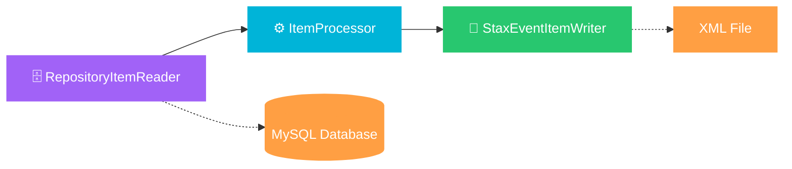

# MySQL to XML Spring Boot Batch Example

**MySQL to XML Spring Boot Batch** | Previously we have seen Spring Boot Batch examples of [CSV to MySQL](./02_CSV_To_MySQL_Database_Spring_Boot_Batch_API_Example.md), [CSV to MongoDB](./03_CSV_to_MongoDB_Spring_Boot_Batch_Example.md), [MySQL to CSV](./04_MySQL_to_CSV_Spring_Boot_Batch_Example.md), and [MongoDB to CSV](./05_MongoDB_to_CSV_Spring_Boot_Batch_Example.md). Now let us see MySQL to XML file through Spring Boot Batch. Also see: [Spring Boot Batch API Introduction](./01_Spring_Boot_Batch_API_Introduction.md)

- [JAXB and Spring OXM](#1-jaxb-and-spring-oxm)
- [Project Setup and Dependencies](#2-project-setup-and-dependencies)
- [Application Properties](#3-application-properties)
- [Model Class](#4-model-class)
- [Repository](#5-repository)
- [Batch Configuration](#6-batch-configuration)
- [Controller](#7-controller)
- [Generated XML Output](#8-generated-xml-output)

---

## 1. JAXB and Spring OXM

We will need JAXB (Java Architecture for XML Binding) for this. It provides two operations:

- 🔄 **Marshalling:** Converting Java Object to XML Format.
- 🔃 **Unmarshalling:** Converting XML to Java Object Format.


To do marshalling and unmarshalling we can use `Spring OXM` (Object XML Mapping) dependency which internally uses JAXB.

---

## 2. Project Setup and Dependencies

Create a Spring starter project `SpringBoot2MySQLToXML` with the following dependencies: `Batch API, Lombok, MySQL, Spring Data JPA, and Spring Web`. Also add the below dependencies:

**Spring OXM:**

```xml
<dependency>
    <groupId>org.springframework</groupId>
    <artifactId>spring-oxm</artifactId>
</dependency>
```

**JAXB-API:**

```xml
<dependency>
    <groupId>javax.xml.bind</groupId>
    <artifactId>jaxb-api</artifactId>
</dependency>
```

**XML.BIND-API:**

```xml
<dependency>
    <groupId>jakarta.xml.bind</groupId>
    <artifactId>jakarta.xml.bind-api</artifactId>
</dependency>
```

**JAXB-RUNTIME:**

```xml
<dependency>
    <groupId>org.glassfish.jaxb</groupId>
    <artifactId>jaxb-runtime</artifactId>
</dependency>
```

| Dependency 📦 | Purpose 📋 |
|---------------|-----------|
| **Spring OXM** | Object XML Mapping — wraps JAXB for marshalling/unmarshalling |
| **JAXB-API** | Core JAXB API for XML binding annotations |
| **XML.BIND-API** | Jakarta namespace version of XML binding API |
| **JAXB-RUNTIME** | GlassFish JAXB runtime implementation |

📝 **Note:** In the model class, we must add `@XmlRootElement` then its object will be eligible for marshalling/unmarshalling.

---

## 3. Application Properties

🔧 **Configuration** (`application.properties`):

```properties
# DB details
spring.datasource.url=jdbc:mysql://localhost:3306/test
spring.datasource.username=root
spring.datasource.password=root

# JPA info
spring.jpa.show-sql=true
spring.jpa.hibernate.ddl-auto=update
spring.jpa.properties.hibernate.format_sql=true

# disable job run at startup
spring.batch.job.enabled=false
spring.batch.jdbc.initialize-schema=always
```

---

## 4. Model Class

**Model class** (`Product.java`):

```java
package com.knowprogram.demo.model;

import jakarta.persistence.Column;
import jakarta.persistence.Entity;
import jakarta.persistence.Id;
import jakarta.persistence.Table;
import jakarta.xml.bind.annotation.XmlRootElement;
import lombok.AllArgsConstructor;
import lombok.Data;
import lombok.NoArgsConstructor;

@Data
@AllArgsConstructor
@NoArgsConstructor
@Entity
@Table(name = "prod")
@XmlRootElement(name="product")
public class Product {
    @Id
    @Column(name = "pid")
    private Integer prodId;

    @Column(name = "pname")
    private String prodCode;

    @Column(name = "pcost")
    private Double prodCost;

    @Column(name = "ptax")
    private Double prodTax;

    @Column(name = "pdiscount")
    private Double prodDiscount;
}
```

- 🏷️ `@Entity` and `@Table(name = "prod")` — Maps the class to the `prod` database table.
- 🔗 `@XmlRootElement(name="product")` — Makes the object eligible for JAXB marshalling/unmarshalling.
- 🗂️ `@Column` — Maps each field to the corresponding database column.

---

## 5. Repository

**Repository** (`ProductRepository.java`):

```java
package com.knowprogram.demo.repository;

import org.springframework.data.jpa.repository.JpaRepository;

import com.knowprogram.demo.model.Product;

public interface ProductRepository extends JpaRepository<Product, Integer> {

}
```

---

## 6. Batch Configuration



**BatchConfig** (`BatchConfig.java`):

```java
package com.knowprogram.demo.config;

import java.util.Collections;

import org.springframework.batch.core.Job;
import org.springframework.batch.core.JobExecution;
import org.springframework.batch.core.JobExecutionListener;
import org.springframework.batch.core.Step;
import org.springframework.batch.core.job.builder.JobBuilder;
import org.springframework.batch.core.repository.JobRepository;
import org.springframework.batch.core.step.builder.StepBuilder;
import org.springframework.batch.item.ItemProcessor;
import org.springframework.batch.item.ItemReader;
import org.springframework.batch.item.ItemWriter;
import org.springframework.batch.item.data.RepositoryItemReader;
import org.springframework.batch.item.xml.StaxEventItemWriter;
import org.springframework.beans.factory.annotation.Autowired;
import org.springframework.context.annotation.Bean;
import org.springframework.context.annotation.Configuration;
import org.springframework.core.io.FileSystemResource;
import org.springframework.core.task.SimpleAsyncTaskExecutor;
import org.springframework.data.domain.Sort;
import org.springframework.oxm.jaxb.Jaxb2Marshaller;
import org.springframework.transaction.PlatformTransactionManager;

import com.knowprogram.demo.model.Product;
import com.knowprogram.demo.repository.ProductRepository;

@Configuration
public class BatchConfig {

    @Autowired
    private ProductRepository productRepository;

    @Bean
    ItemReader<Product> reader() {
        RepositoryItemReader<Product> reader = new RepositoryItemReader<>();
        reader.setRepository(productRepository);
        reader.setMethodName("findAll");
        reader.setPageSize(10);
        reader.setSort(Collections.singletonMap("prodId", Sort.Direction.ASC));
        return reader;
    }

    @Bean
    ItemProcessor<Product, Product> processor() {
        return item -> item;
    }

    @Bean
    Jaxb2Marshaller marshaller() {
        Jaxb2Marshaller marshaller = new Jaxb2Marshaller();
        marshaller.setClassesToBeBound(Product.class);
        return marshaller;
    }

    @Bean
    ItemWriter<Product> writer() {
        // Stax = Streaming API for XML (JAXB)
        StaxEventItemWriter<Product> writer = new StaxEventItemWriter<>();
        // XML file location
        writer.setResource(new FileSystemResource("V:/myouts/product_data.xml"));
        writer.setMarshaller(marshaller());
        writer.setRootTagName("products");
        return writer;
    }

    @Bean
    Step step(JobRepository repository, PlatformTransactionManager transactionManager) {
        return new StepBuilder("csv-step", repository)
                .<Product, Product>chunk(10, transactionManager)
                .reader(reader())
                .processor(processor())
                .writer(writer())
                .taskExecutor(new SimpleAsyncTaskExecutor() {
                    private static final long serialVersionUID = 1L;

                    {
                        setConcurrencyLimit(10);
                    }
                })
                .build();
    }

    @Bean
    JobExecutionListener listener() {
        return new JobExecutionListener() {
            @Override
            public void beforeJob(JobExecution jobExecution) {
                System.out.println("MyJobListener.beforeJob()");
            }

            @Override
            public void afterJob(JobExecution jobExecution) {
                System.out.println("MyJobListener.afterJob()");
            }
        };
    }

    @Bean(name = "csvJob")
    Job job(JobRepository jobRepository, PlatformTransactionManager transactionManager) {
        return new JobBuilder("csv-job", jobRepository)
                .listener(listener())
                .flow(step(jobRepository, transactionManager))
                .end()
                .build();
    }
}
```

🔑 **Key Points:**

- 📖 `RepositoryItemReader` — Reads data from MySQL using `ProductRepository.findAll()` with pagination (page size 10).
- ⚙️ `ItemProcessor` — Pass-through processor that returns the item as-is.
- 📄 `Jaxb2Marshaller` — Converts `Product` Java objects into XML format.
- 💾 `StaxEventItemWriter` — Writes XML output using the Streaming API for XML (StAX) with JAXB marshalling.
- ⚡ `SimpleAsyncTaskExecutor` — Enables concurrent processing with a concurrency limit of 10.
- 👂 `JobExecutionListener` — Logs messages before and after the job runs.

---

## 7. Controller

**Controller** (`ProductBatchController.java`):

```java
@RestController
package com.knowprogram.demo.controller;

public class ProductBatchController {

    @Autowired
    private JobLauncher jobLauncher;

    @Autowired
    private Job job;

    @GetMapping("/startBatch")
    public String startBatch() throws JobExecutionAlreadyRunningException,
        JobRestartException,
        JobInstanceAlreadyCompleteException,
        JobParametersInvalidException {
        JobParameters params = new JobParametersBuilder()
             .addLong("time", System.currentTimeMillis())
             .toJobParameters();

        JobExecution run = jobLauncher.run(job, params);
        return run.getStatus().toString();
    }

}
```

- 🌐 The `/startBatch` endpoint triggers the batch job manually.
- 🕐 `System.currentTimeMillis()` is used as a unique job parameter so the job can be re-run.

---

## 8. Generated XML Output

📤 **Output** (`product_data.xml`):

```xml
<?xml version="1.0" encoding="UTF-8"?>
<products>
    <product>
        <prodCode>BOOK</prodCode>>
        <prodCost>500.0</prodCost>
        <prodDiscount>40.0</prodDiscount>
        <prodId>11</prodId>
        <prodTax>60.0</prodTax>
    </product>>
    <product>
        <prodCode>PEN</prodCode>
        <prodCost200.0
        </prodCost>
        <prodDiscount>16.0</prodDiscount>
        <prodId>10</prodId>
        <prodTax>24.0</prodTax>
    </product>
    <product>
        <prodCode>MOUSE</prodCode>
        <prodCost>300.0</prodCost>
        <prodDiscount>24.0</prodDiscount>
        <prodId>14</prodId>
        <prodTax>36.0</prodTax>
    </product>
    <product>
        <prodCode>BOTTLE</prodCode>
        <prodCost>600.0</prodCost>
        <prodDiscount>48.0</prodDiscount>
        <prodId>12</prodId>
        <prodTax>72.0</prodTax>
    </product>
    <product>
        <prodCode>KEYBOAD</prodCode>
        <prodCost>900.0</prodCost>
        <prodDiscount>72.0</prodDiscount>
        <prodId>15</prodId>
        <prodTax>108.0</prodTax>
    </product>
    <product>
        <prodCode>MOBILE</prodCode>
        <prodCost>1500.0</prodCost>
        <prodDiscount>120.0</prodDiscount>
        <prodId>13</prodId>
        <prodTax>180.0</prodTax>
    </product>
    <product>
        <prodCode>BAG</prodCode>
        <prodCost>600.0</prodCost>
        <prodDiscount>48.0</prodDiscount>
        <prodId>16</prodId>
        <prodTax>72.0</prodTax>
    </product>
</products>
```
