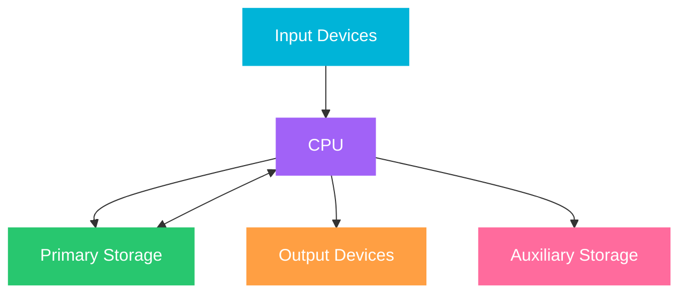
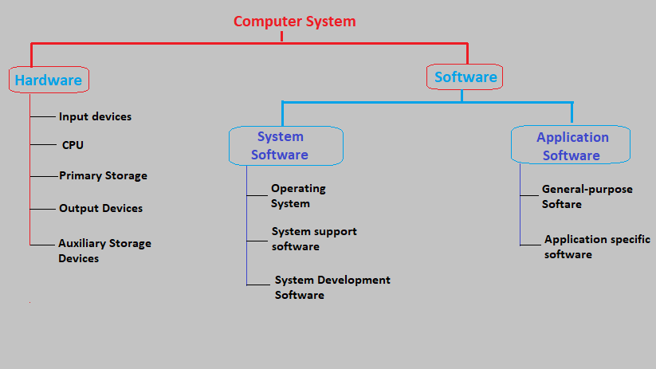
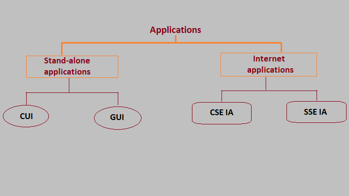
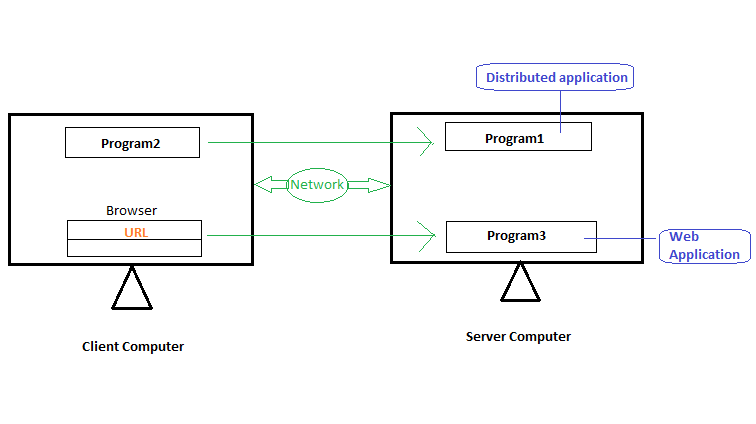
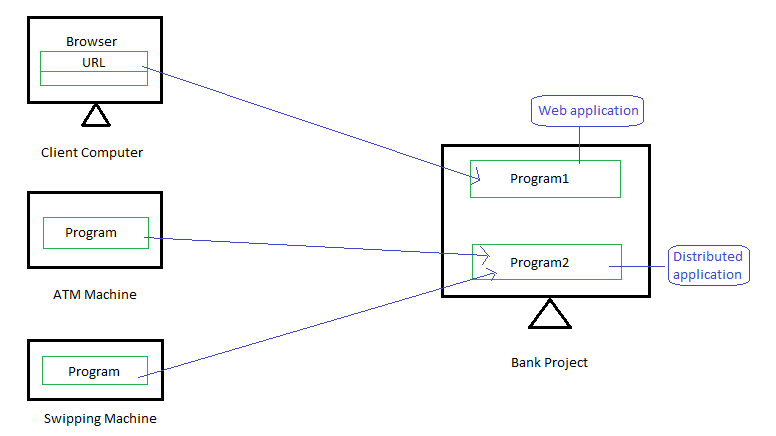

# Computer Systems

**Computer Systems** | Hardware and software components, platform dependency, types of applications, and distributed vs web applications.

- [Computer Hardware](#computer-hardware)
- [Computer Software](#computer-software)
- [Platform Dependent and Independent in Computer Systems](#platform-dependent-and-independent-in-computer-systems)
- [Types of Applications in Computer Systems](#types-of-applications-in-computer-systems)
- [Some Questions Based on Computer Systems](#some-questions-based-on-computer-systems)
- [Distributed Application vs Web Applications](#distributed-application-vs-web-applications)

---

## 1. Computer Hardware

The computer systems have two major components: hardware and software. Computer hardware is the physical equipment and software is the collection of programs (instructions) that allow the hardware to do its job.

The hardware component of the computer system consists of five parts.

- ⌨️ **Input Devices:** It takes programs and data into the computer. Examples of input devices are keyboard, mouse, pen or stylus, touch screen, and an audio input unit.
- 🧠 **Central Processing Unit (CPU):** It is responsible for executing instructions such as arithmetic calculations, comparisons among data, and movement of data inside the system.
- 💾 **Primary Storage:** It is also known as the main memory. It is the place where the programs and data are stored temporarily during processing.
- 🖥️ **Output Devices:** The output device is usually a monitor or a printer to show output. If the output is shown on the computer, we say we have a soft copy and if it is printed on the printer, we say we have a hard copy.
- 📀 **Auxiliary Storage Devices:** It is also known as secondary storage, is used for both input and output. It is the place where the programs and data are stored permanently.

---

## 2. Computer Software

The set of instructions is called a program. The set of programs is called **software** or as per the IT industry, the software is a digitalized and automated process.

When the environment is having graphical user interface then it is called digitalized and when the task is completed without human interface then it is called automated. We are having basically two types of software, **System software**, and **application software**.

### System Software

In computer systems, software consists of programs that manage the computer hardware resources and provides the interface between the user and the hardware but does nothing to directly serve the users needs. These programs can be divided into three classes: the operating system, system support software, and system development software.

- 🖥️ **Operating System (OS):** It provides services such as a user interface, file and database access, and interfaces to communication systems. The primary purpose of this software is to keep the system operating in an efficient manner while allowing users access to the system.
- 🔧 **System Support Software:** It provides system utility services like sort programs and disk format programs. It also provides other operating services. Operating services consists of programs that provide performance statistics for the operational staff and security monitors to protect the system and data.
- 💻 **System Development Software:** It includes the language translators that convert programs into machine language for execution.

### Application Software

In Computer Systems application software is directly responsible for helping the users to solve their problems. It can be divided into two classes: general-purpose software and application-specific software.

- 📦 **General-Purpose Software:** It can be purchased from a software developer and used for more than one application. Examples include database management systems, word processors, and computer-aided design systems. They can solve a variety of user computing problems, that is why it labeled as general-purpose Software.
- 🎯 **Application-specific Software:** It can be used for its intended purpose. A general ledger system used by accountants and a material requirements planning system used by a manufacturing organization are examples of application-specific software. They can be used only for the task for which they were designed; they can't be used for another generalized task.

---

## 3. Platform Dependent and Independent in Computer Systems

A **platform** is a hardware or software environment in computer systems in which a program is loaded and executed. For instance, the computer platform is an operating system + hardware devices.

For C/C++ programs platform is OS. It means C and C++ programs are directly executed by the operating system. Java program platform is JVM, .NET program platform is CLR, HTML program platform is Browser. It means these three programs are not directly executed by OS.

There are two types of applications platform-dependent and platform-independent.

### Platform Dependent

An application/program that is developed and compiled in one operating system but it does not execute in another operating system then that application is called platform dependent application/program. The programming language used to develop that application or program is called platform dependent programming language. C, C++ are platform-dependent programming languages because these languages compiled code does not run in another operating system. If we write a C program in Windows and compiled it, then that compiled code will only work in the Windows operating system, not in Linux or Mac operating system.

### Platform Independent

It is the opposite of platform-dependent application. An application that is developed and compiled in one operating system and it can run in all operating system then that application is called platform-independent application. The language used to write that application is called platform-independent language. Java is a platform-independent programming language. If we write a program using Java then after compilation it generates byte code, which does not depend upon the operating system and it runs in all platforms.

> 📝 **Note:** If any language program is directly executed by OS then it is platform dependent program. If any language program is not directly executed by OS, rather it is executed by a mediator layer software like JVM then the program is called a platform-independent program.

**Q) Why C, C++ programming languages were developed as platform-dependent, why not as platform-independent?**

**Ans:** When C/C++ programming languages were developed there was no internet that's why they are platform-dependent languages. Platform independency features only require for developing internet-based applications.

---

## 4. Types of Applications in Computer Systems

Based on the way of execution of programs, all available applications can be divided into two types: **Stand-alone application** and **Internet applications**.

### Stand-alone Applications

An application that can only be executed in a local system with a local call is called stand-alone applications. In simple words, a program that can be accessed only in one computer in which it is installed by a single user is called a standalone application. Stand-alone applications need installation and they are compatible with the single operating system only. The stand-alone application can not be accessible from the remote user via a network. Example: VLC, Google Chrome, Atom.

To use the VLC program, installation is necessary. Without installing VLC we can't use it and access it. VLC for windows is different from VLC in Android because in Windows it has `.exe` and in Android, it has another extension.

There are two types of standalone applications in computer systems:

1. CUI (Character user interface) based standalone applications
2. GUI (Graphical user interface) based standalone applications

#### CUI

CUI stands for the character user interface. An application that reads input from the end-user by providing text-based character messages is called the CUI application.

CUI application doesn't have any special windows, it executed directly in the cmd window or terminal. It doesn't have different fonts, colors, graphics images and It can read one value at a time to application. It can't provide complete information to the end-user. After entering input, we can't change it. Because value is already submitted to the application. After the output display, program execution is terminated, we must run again this program for other inputs. In Java, it can be developed by using CMD line args application and the buffered reader or using a Scanner or by using console.

#### GUI

GUI stands for the graphical user interface. An application that reads input values from end-user by providing a separate window with the required number of labels, text boxes, buttons is called GUI application. By default, every internet application is a GUI application while because in internet application from the client system to server system we must pass all input values at a time.

GUI provides different font, colors, graphics, and images. It can read and pass all input values at a time to application. It can provide complete information and more clarity to end-user. We can change value because the value is not submitted to the application. After the output display program is not terminated, we can use some currently running program for new inputs.

---

### Internet Applications

An application that can be executed in a local system with a local call and also from a remote computer via network call (request) is called internet application. The Internet application is multiple computers and multiple user's application.

In Java, the main method class is a stand-alone application. It can't be accessible from other computers through the network (LAN/WAN/MAN). So, by default, every Java program is a standalone application. If we attach or plug this program from Applet, servlet or JSP then this application can be accessed and executed via the internet from other computers. Otherwise, all Java programs are a standalone program.

Internet applications can be divided into two parts.

1. Client-side executing internet applications (CSE IA)
2. Server-side executing internet applications (SSE IA)

#### Client-side Executing Internet Applications (CSE IA)

An application that resides in a server system, When a client sends the request and that is downloaded and executed in client computer via network call is called Client-side executing internet applications. Example: a login page, registration page, and every HTML page. Mobile apps installed inside our mobile phone are also client-side executing internet application. Whenever we go to any website for login, first our browser sends the request to the server through the internet, after that login page (which is at server system) downloaded to our browser and then we (client) enter user id and password. So, execution is done in the client system.

#### Server-side Executing Internet Applications (SSE IA)

An application that resides in the server system and that is executed directly in the server system via network call and sending the response (output) back to the client is called Server-side executing internet applications. Java, .NET, PHP and other internet supporting languages programming code are server-side executing applications. For example, user registration, login data validation and some calculations, data storing, retrieving, updating and deleting from database programs are server-side executing internet applications. For example: When we enter user id and password on any website, that website checks that user id and password validation. This validation happens in the server system, not in our system. If inputted user id and password match with database (which is at server system) then server send the response and redirect us to home page otherwise we get "user-id/password is incorrect".

---

#### Purpose of Client-side and Server-side Application

- 🖥️ Client-side execution application is used for running a program in the client system to read input and display output to a remote user throughout the world.
- 🌐 The server-side executing application is used for processing requests and preparing responses. Processing requests means reading inputs from the remote user, verify or validating these inputs right or wrong. If the right (correct) then performing some calculation by interacting with the database, generating output. These processes are called processing requests. Preparing response means generating a dynamic HTML page with the given output is called preparing response.

---

## 5. Some Questions Based on Computer Systems

**Q1) Why C, C++ programming languages cannot support internet application development?**

**Ans:** C and C++ are platform-dependent languages so, they cannot support internet application software.

**Q2) What is the main feature of a programming language to develop an internet application?**

**Ans:** Platform independency, because an internet application must run in all operating systems irrespective of where it is compiled.

---

## 6. Distributed Application vs Web Applications

A server program that can be directly accessed through a program from the client computer then it is called a **distributed application**.

A server program that can be accessed from a browser through URL then it is called **web application** or web component.

All bank applications are both distributed and web applications. We can access our bank account through the ATM machine and Swiping machine which is distributed application and using a browser through URL we can also access it.

| Feature | Distributed Application 🏗️ | Web Application 🌐 |
|---------|---------------------------|-------------------|
| **Access Method** | Directly through a program | Through a browser via URL |
| **Client Requirement** | Specific client program | Any web browser |
| **Example** | ATM machine, Swiping machine | Online banking portal |

If you enjoyed this post, share it with your friends. Do you want to share more information about the topic discussed above or do you find anything incorrect? Let us know in the comments. Thank you!
