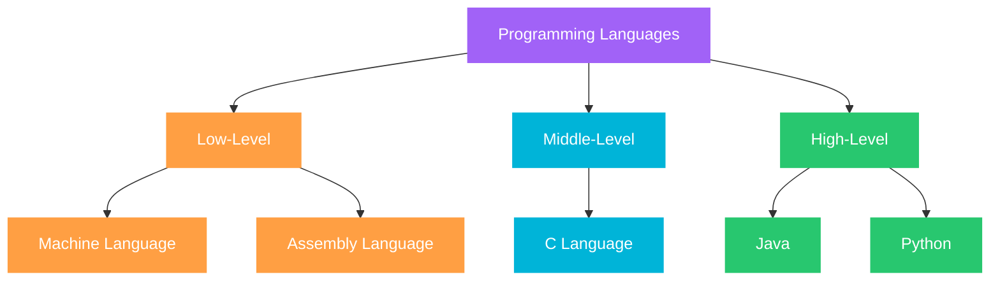

# Basic of Programming Language

**Basic of Programming Language** | Programs, programming languages, levels of languages, compilers, interpreters, and static vs dynamic typing.

- [Program and Programming](#program-and-programming)
- [Language and Programming Language](#language-and-programming-language)
- [Types of Programming Language](#types-of-programming-language)
- [Some Terminology in Programming Languages](#some-terminology-in-programming-languages)
- [Compiler, Interpreter and Assembler](#compiler-interpreter-and-assembler)
- [Static and Dynamic Programming Language](#static-and-dynamic-programming-language)
- [Statically Typed vs Dynamically Typed Languages](#statically-typed-vs-dynamically-typed-languages)
- [The Need for a Programming Language](#the-need-for-a-programming-language)

---

## 1. Program and Programming

A **program** is a set of instructions that grouped together to complete a task or tasks.

**C program example:**

```c
#include<stdio.h>
int main()
{
   printf("Welcome to KnowProgram.\n");
   return 0;
}
```

In the above program, every single line is called an instruction or statement.

The process of writing a program to solve the given problem is called **Programming**.

---

## 2. Language and Programming Language

**Language** is a set of instructions or, the medium of expression of thoughts. Example of languages are English, Hindi e.t.c

A **programming language** is an artificial language designed to express computations that can be performed by a machine, particularly by a computer. It can be used to create programs that control the behavior of a machine, to express algorithms precisely, or as a mode of human communication.

The programming language is the way of communication between the user and a computer. Examples of programming language are C, C++, Java, Python e.t.c

---

## 3. Types of Programming Language

There are three types of Programming languages: Low, middle and High-level language.



### Low-Level Programming Language

It is very close to the machine and difficult to understand by users/humans. Low-level language is machine-dependent and not portable. Machine Language and Assembly Language come under low-level language.

- 🔢 **Machine Language:** This is a sequence of instructions written in the form of binary numbers consisting of 1's and 0's to which the computer responds directly. The Control processing unit (CPU) directly understands machine instructions and hence no translation is required. It is very close to the machine that's why it takes less execution time. But it difficult to use, debug, and modify.
- 🏷️ **Assembly Languages or Symbolic Languages:** Assembly language instructions contain English-like abbreviations called mnemonics representing elementary computer operations like MOVE, ADD, SUB e.t.c. An assembler is a translator that takes input in the form of the assembly language program and produces machine language code as its output. Writing a program in assembly language is easier than writing in machine language, But hard with respect to high-level language. Programming is also time-consuming. The programmers should know all about the logical structure of the computer.

### Middle-level Programming Language

The middle-level programming language is intermediate between low level and high-level programming languages. These are not very close to human but we can understand. The middle-level programming language is in simple English. Example of the middle-level programming language in C:

**C program example:**

```c
//C program to print Hello World
#include<stdio.h>
int main()
{
   printf("Hello World!\n");
   return 0;
}
```

### High-level Programming Language

The high-level programming language is very closer to humans. Their programming style and context is easier to learn and implement. Some high-level programming languages like COBOL, FORTRAN, and BASIC have instructions that are similar to human languages. The machine can't directly understand high-level programming language, it needs a Compiler that converts or translates high-level language instructions into machine level language instructions. The high-level programming language is easy to debug and ease in the development of software. It is portable also. Examples are: Java, Python

**Java program example:**

```java
//Hello World! Program in Java
//FirstProgram.java
class FirstProgram{
  public static void main(String[] args){
     System.out.println("Hello, World");
  }
}
```

| Feature | Low-Level 🔢 | Middle-Level ⚙️ | High-Level 🚀 |
|---------|-------------|----------------|--------------|
| **Readability** | ❌️ Difficult | ⚠️ Moderate | ✅ Easy |
| **Portability** | ❌️ Not portable | ⚠️ Limited | ✅ Portable |
| **Speed** | ✅ Very fast | ✅ Fast | ⚠️ Moderate |
| **Examples** | Machine code, Assembly | C | Java, Python |

---

## 4. Some Terminology in Programming Languages

- 📄 **Source code:** Developer write programs according to the programming language syntax, these programs are called Source code.
- ⚙️ **Compiler:** It is a translation program that converts source code into machine language at once.
- 🔄 **Interpreter:** It is also a translation program like a compiler, but it converts source code to machine language line by line.
- 💾 **Compiled Code:** Compiler generated a program that is converted from source code is called Compiled code.
- 🔨 **Compilation:** The process of translating source code into compiled code is called compilation code.
- ▶️ **Execution:** It is the process of running compiled code to get output.
- 🖥️ **Executable code:** Operating system understandable readily executable program (windows understand `.exe` files). That program is called executable code. After execution Executable code generated.
- 🚨 **Compile-time error:** The error thrown by the compiler at the time of compilation is called compile-time errors. These errors are raised due to syntax mistakes, like spelling mistakes, wrong usage of keywords, etc.
- 💥 **Runtime error:** The errors are thrown at the time of execution are called runtime errors or executions. These errors are raised due to logical mistakes like dividing integer number with 0 etc.

---

## 5. Compiler, Interpreter and Assembler

Compiler, interpreter and assembler are translators. Those are used for converting source code to machine level language. These translators are developed by using C and C++ programming languages.

Compiler and interpreter are used for converting high-level language to machine level language but assembler is used for converting low-level language to machine level language.

Compiler and interpreter both convert high-level language to machine level language but both have a difference in working principle. The compiler checks syntaxes and if there is any error found, it doesn't stop, it goes for next word and so on. After checking complete code it displays all errors, If there is no error then it converts source code to machine level code at once. The assembler also working the same and converts source code at once.

The interpreter works line by line. It checks the syntax in the first line, if there is any error then it stops checking the next line until the error fixed, and displays the error. It converts source code to machine level code line by line not at once.

| Feature | Compiler ⚙️ | Interpreter 🔄 | Assembler 🏗️ |
|---------|-----------|--------------|-------------|
| **Input** | High-level language | High-level language | Assembly language |
| **Conversion** | All at once | Line by line | All at once |
| **Error Display** | All errors after full scan | Stops at first error | All errors after full scan |
| **Speed** | ✅ Faster execution | ❌️ Slower execution | ✅ Fast execution |

---

## 6. Static and Dynamic Programming Language

If we want to call a language is dynamic we must allocate multiple copies memory and add more features without modifying source code.

**C** is a static programming language because we can't allocate multiple copies of memory for one variable declaration and we can't add more functionality without modifying source code. But, we can achieve dynamic features using dynamic memory allocation.

**Java** is a dynamic programming language because we can allocate multiple copies of memory for the same variable at the execution time by using the `new` keyword. Once we develop the project then we can add more features and modify existing features dynamically without modifying source code. It is because of OOP concepts, inheritance and polymorphism.

In any programming language, the compiler is only responsible for verifying the syntax and converting the source code either into machine code or bytecode. The compiler will not allocate memory for the variable. Memory is allocated only at execution time by the runtime system of the language.

> 💡 **Tip:** GSM mobiles are an example of dynamic nature. It can accept any SIM card without modifying its software. On the other hand, CDMA mobile is an example of a static nature. It can accept only one type of SIM. If we want to change the SIM of another company, then we must modify the software on mobile.

---

## 7. Statically Typed vs Dynamically Typed Languages

**Statically typed language**, where each variable and expression type is already known at compile time is called statically typed language. In a statically typed language, Once a variable is declared to be of certain data type then it can't hold variable of other data types. Example: C, C++, Java e.t.c

`int x = 10;`

Now, the variable `x` can't hold the value of other data types except integer and we can't modify the data type of variable `x`.

**Dynamically typed language**, these languages can receive different data types over time. Example: Python, Ruby

`x = 10`, `x = 50.2`, `x = 'A'`, all are valid for dynamically typed language. We can store any value (integer, float, character, string) in a variable. If previously, we have written `y = 10.5` and now we have written `y = "String"` then it is valid. It will not give any error.

| Feature | Statically Typed 🔒 | Dynamically Typed 🔓 |
|---------|-------------------|---------------------|
| **Type Checking** | At compile time | At runtime |
| **Type Change** | ❌️ Not allowed | ✅ Allowed |
| **Examples** | C, C++, Java | Python, Ruby |

---

## 8. The Need for a Programming Language

Every programming language is meant for developing a program to implement an operation to be performed by the computer.

Basically, the programming language is invented for automating business operations to be performed by the computer. Automation will give several benefits over manual operations. Using automation business can run 24*7, 365 days and good relations with customers due to the secured, accurate, efficient and fast transaction.

An operation contains below five activities.

1. Reading and storing values.
2. Performing validations and calculations.
3. Throwing errors for wrong input values.
4. Generating results and returning results for correct input values.
5. Finally displaying result or error message to end-user.

Every programming language provides the same fundamental concepts to perform above five activities to implement the logic for an operation on developing a program.

- 📊 **Data types:** For creating a variable and objects for storing values in a program.
- ➕ **Operators:** For performing validations and calculations to verify the given values are correct or wrong.
- 🔀 **Control flow statements:** For controlling the execution flow of a program based on the given input values. If given values are correct then it allows to execute calculations and if given values are wrong, it allows to execute throwing exception logic.
- 🚨 **Exception handling statements:** For throwing and reporting an exception and further to catch the thrown exception.

> 📝 **Note:** The concepts object and exception handling statements exist only in object-oriented programming languages such as C++, Java, .NET, PHP, Python e.t.c. We don't have object and exception handling statements in C programming language.

If you enjoyed this post, share it with your friends. Do you want to share more information about the topic discussed above or do you find anything incorrect? Let us know in the comments. Thank you!
