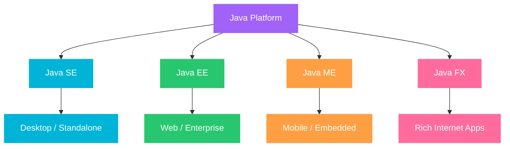

# Java Editions & Concepts – Java SE/EE/ME/FX

**Java Editions & Concepts** | Different editions of Java (SE, EE, ME, FX), their history, concepts, platforms, and applications.

- [Java Editions](#java-editions)
- [History About Java Editions](#history-about-java-editions)
- [Java Concepts](#java-concepts)
- [Difference Between Java SE and Java EE](#difference-between-java-se-and-java-ee)
- [Java Platforms](#java-platforms)
- [Applications of Java Concepts](#applications-of-java-concepts)

---

## 1. Java Editions

SUN Microsystem (now Oracle corp.) divided Java concepts into four categories for easy maintenance and easy distribution to all types of domains like mobile, desktop, and internet applications. In Java, a category is called Edition. So, Java concepts are divided into four editions.

- 🖥️ **Java SE** (**Java Platform Standard Edition**): It has concepts for developing software for Desktop based (standalone) CUI (command user interface) and GUI (graphical user interface) applications, applets, database Interaction application, distributed application, and XML parsing applications.
- 🌐 **Java EE** (**Java Platform Enterprise Edition**): It has concepts to develop software for Web applications, Enterprise applications, and Interoperable applications. These applications are called high-scale applications. Some examples are: banking and insurance-based applications.
- 📱 **Java ME** (**Java Platform Micro Edition**): It has concepts to develop software for consumer electronic devices means embedded systems, like mobile and electronic level applications. Java ME was popular for developing mobile gaming applications. This edition was called micro because these edition programs are embedded in small chips. The program embedded in the chip is called micro (small).
- 🎨 **Java FX** (**Java platform Effects**): Java FX stands for Java platform Effects (Eff=F, ects=X). It provides concepts for developing rich internet applications with more graphics and animations. It's an extension concept to swing applications of Java SE. The Java FX API is included as part of Java SE software. Just by installing Java SE, we will also get Java FX API.

---

## 2. History About Java Editions

In the beginning version of Java 1.0, we don't have editions because in the initial version Java didn't support server-side web programming and enterprise applications development. It was only supporting standalone applications and applets (client-side web programming development). In the beginning version even it didn't support database interaction applications (JDBC).

In the next version, in Java 1.1 it starts supporting DIA (Dedicated Internet Access) development. From Java 1.2 version onwards by using the technology servlet and JSP, the server-side programming support was also added. At that time, Java was supporting all three flavors of application development (mobile, desktop, and internet applications). SUN decided to divide Java concepts into three parts for easy maintenance and development. From Java 1.2 onwards Java had three editions:

- **J2SE** (Java Platform 2 Standard Edition)
- **J2EE** (Java Platform 2 Enterprise Edition)
- **J2ME** (Java Platform 2 Micro Edition)

In the above edition names, the number 2 didn't have any serious significance. It was included in the edition name to inform programmers that the Java editions concepts are given in Java 1.2 version. In the next versions 1.3, 1.4, 1.5 this number 2 created confusion to the Java beginners because it was not matching with the version number. To avoid that confusion from 1.5 version onwards the number 2 was removed and edition name renamed as:

- **Java SE** (Java Platform Standard Edition)
- **Java EE** (Java Platform Enterprise Edition)
- **Java ME** (Java Platform Micro Edition)

In Java 1.4 version, for developing RIA (Rich internet applications) a new edition called Java FX also included.

---

## 3. Java Concepts

In the Java programming language, we mainly learn Java Standard Edition (Java SE). Java is a programming language, platform, and technology. Java SE has language concepts (syntaxes and semantics), platform, and technologies. But the Java EE has its own technologies and own platform. Java EE doesn't provide programming concepts like syntaxes and semantics.

**Java SE Concepts**

Java SE is the root of all software industry technologies including Testing tool (Selenium), SAP/ABAP, Oracle Application forms. You can easily work on any domain-based projects if you are a Java developer as all technologies concepts are similar to Java. In Java SE we learn about these below concepts.

1. [Datatypes](013_Data_Types_in_Java.md), Operators, Control statements
2. OOP (Object-oriented programming)
3. JVM Architecture
4. Garbage Collection
5. String Handling
6. Wrapper Classes
7. Exception Handling
8. Multithreading
9. [IOStreams (File IO)](052_IOStream_in_Java.md)
10. Collections Framework
11. Regular Expressions
12. Reflection API
13. Annotations
14. Inner Classes
15. AWT, Swings, Applet
16. Date, time, and text format
17. Networking (Socket Programming)

**Java SE Technologies**

- JDBC
- XML
- RMI*
- JNDI

**Java EE Technologies**

- Servlet
- JSP
- EJB*
- WebServices
- JSF*

> 📝 **Note:** For RMI, EJB and JSF technologies we have alternate concepts Spring, Hibernate Frameworks, and Micro services, but they developed on the top of Java SE/EE (without learning Java SE/EE we can't learn them).

> 📝 **Note:** **[Android](https://www.android.com/)** was developed by using Java SE concepts, not by using Java ME. Android is an open-source software stack for mobile devices, and it contains an operating system, middleware, and some key applications. "Android" invented by Open Handset Alliance (a group of companies), and is bought by Google in 2005 to develop their mobile "Arsenal". From 2017 onwards for developing Android based mobile application, the official language from Google is Kotlin.

---

## 4. Difference Between Java SE and Java EE

| Feature | Java SE 🖥️ | Java EE 🌐 |
|---------|-----------|-----------|
| **Full Name** | Java Platform Standard Edition | Java Platform Enterprise Edition |
| **Purpose** | Rules and guidelines **for developing standalone applications** and applets. Also provides rules for developing JDK software. | Rules and guidelines **for developing web and enterprise applications (internet-based)** and also for developing server software. |
| **Foundation** | **Base edition for all Java editions**. All other Java editions can't work without Java SE. | Developed on top of Java SE, and always uses Java SE. |
| **Software Required** | **JDK software is sufficient** for compiling and executing. | **Must have server and JDK software** for compiling and executing. |
| **Provides** | Programming **language** concepts, its own **platform**, and **technologies**. | Only its own **platform** and **technologies**. No programming language concepts. |
| **Implemented By** | JDK software **by SUN Microsystems**. | Server software **by SUN Microsystems** and also by **Apache, IBM, BEA Systems, JBoss, etc.** |
| **Application Type** | Standalone applications only. | Web/enterprise/internet-based applications (with the help of Java SE). |
| **Logic** | Develops logic for business operations. | Provides an environment to execute Java SE development logic through the internet as a web application. |

---

## 5. Java Platforms

For compiling and executing Java applications every edition has its own execution platforms. Java SE platform is JRE and the Java EE platform is server software (Tomcat, Weblogic e.t.c). Java ME platform is MDK.

For developing, compiling, and executing stand-alone applications we must install JDK with JRE software. For developing, compiling, and executing Java EE web and enterprise applications, we must install server software with JDK. JDK for compiling and server software for executing. For developing, compiling, and executing Java ME applications we must install MDK software.

---

## 6. Applications of Java Concepts

Using Java SE and Java EE we can develop different types of applications. They are,

**Java SE**

- 🖥️ Standalone Application
- 💾 Database interaction Application (JDBC)
- 📄 Integrated Application (XML)
- 🔗 Distributed Application (RMI)
- 🌐 Web-supportive applications (Applets) (It is outdated and nobody is using)

**Java EE**

- 🌐 Web Application (Servlets/JSPs/JSF)
- 🏗️ Enterprise Application (EJB)
- 🔗 Interoperable Application (Webservices)

If you enjoyed this post, share it with your friends. Do you want to share more information about the topic discussed above or do you find anything incorrect? Let us know in the comments. Thank you!
