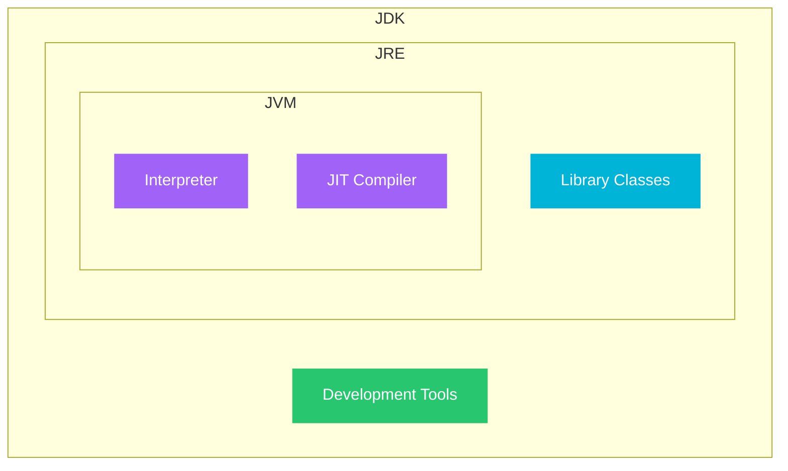
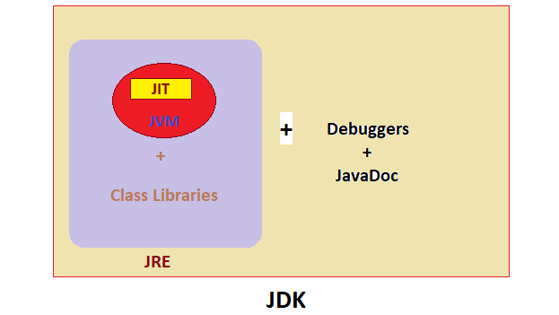

# JDK vs JRE vs JVM vs JIT

**JDK vs JRE vs JVM vs JIT** | Understanding the Java Development Kit, Runtime Environment, Virtual Machine, and Just-In-Time compiler.

- [What is JVM?](#what-is-jvm)
- [What is JRE?](#what-is-jre)
- [What is JDK?](#what-is-jdk)
- [What is JIT?](#what-is-jit)
- [Differences Between JDK vs JRE vs JVM vs JIT](#differences-between-jdk-vs-jre-vs-jvm-vs-jit)
- [Where JDK vs JRE vs JVM Were Used?](#where-jdk-vs-jre-vs-jvm-were-used)
- [MCQ on JDK vs JRE vs JVM vs JIT](#mcq-on-jdk-vs-jre-vs-jvm-vs-jit)

Here we will discuss JDK vs JRE vs JVM vs JIT in the Java programming language. What are these and where are they used for Java Programs?

- 🔧 **JDK** provides an environment to **develop and run Java applications**.
- ▶️ **JRE** provides an environment just to **run Java applications**.
- 🖥️ **JVM** is responsible to **run the Java program line by line.**
- ⚡ **JIT** helps interpreter for **executing Java byte code fastly.**

---

## 1. What is JVM?

**JVM** (**Java Virtual Machine**) is an abstract machine that enables our computer to run a java program.

When we run a Java program, the compiler checks the syntax of the source code file. If there is any mistake then the compiler gives a compile-time error otherwise it converts source code to byte code. Byte code is the native language of the Java Virtual Machine. Our operating system doesn't understand this byte code. This byte code is only understandable by JVM. **JVM translates byte code into native machine code** (a set of instructions that a computer's CPU executes directly).

**JVM** is a Java platform because it is responsible to execute our Java byte code. It **provides interpreter + JIT** using which we can run Java byte code by converting them into current OS machine language. The interpreter is responsible to run a Java program line by line.

---

## 2. What is JRE?

**Java runtime environment (JRE)** is a software package that **provides Java class libraries, along with Java virtual machine (JVM), and other components to run applications** written in Java programming.

**JRE is part of JVM**. Using JRE, we can only execute already developed applications, we can not develop new applications and also we can not modify the existing applications.

---

## 3. What is JDK?

JDK stands for **Java Development Kit**. It is a software development kit **used to develop applications in Java**. When we download JDK, then JRE also came among it. In addition to JRE, JDK also contains a number of development tools (compilers, Javadoc, java Debugger e.t.c).

JDK contains development tools (compiler) and runtime environment (JVM). So using JDK we can **develop, compile and execute new applications** and also we can modify existing applications.

---

## 4. What is JIT?

The **JIT** stands for **Just in Time** compiler. It is responsible to **help the interpreter** for executing Java byte code fastly. Basically, JIT will **improve the performance of Java program execution**. It is part of hotspot technology.

---

## 5. Differences Between JDK vs JRE vs JVM vs JIT

**JIT is part of JVM, whereas JVM is part of JRE, and JRE is part of JDK.**

**Relationship formulas:**

```
JVM = Interpreter + JIT
JRE = JVM + Library classes
JDK = JRE + Development Tools
```





The below table gives the major differences between JDK vs JRE vs JVM vs JIT.

| Feature | JDK 🔧 | JRE ▶️ | JVM 🖥️ |
|---------|--------|--------|--------|
| **Full Name** | Java Development Kit | Java Runtime Environment | Java Virtual Machine |
| **Contains** | JRE, compilers, Javadoc, Java debugger, e.t.c. | JVM, Java class libraries, and other components to run Java applications. | Interpreter + JIT. |
| **Platform** | Platform-dependent | Platform-dependent | Platform-independent |
| **Purpose** | Develop, compile and execute Java applications. | Run already developed Java applications. | Executes Java byte code and provides an environment for executing it. |

---

## 6. Where JDK vs JRE vs JVM Were Used?

There are different environments that existed in real-time projects development,

1️⃣ **Development environment:** Here developers will work to develop new programs. Hence we should install **JDK** in the development environment.

2️⃣ **Testing environment:** Here testers will work to test the project, which means they just need to execute the project, not to modify or develop the project. Hence, **JRE** installation is enough.

3️⃣ **Production environment:** Here end-users will work to use the project, which means they just execute the project to complete their transactions. Hence **JRE** installation is enough.

The JDK contains JRE, and JRE contains JVM therefore JVM (Java virtual machine) is used in all the above environments.

> 📝 **Note:** From the Java 11 version onwards JRE is not available, only JDK is used for all purposes.

---

## 7. MCQ on JDK vs JRE vs JVM vs JIT

Based on the above-discussed point on JDK vs JRE vs JVM vs JIT, let us see some MCQ on JDK vs JRE vs JVM vs JIT.

**Question-1) What is the incorrect statement about JDK, JRE, JVM, and JIT?**

1. JIT is Just In Time Compiler and it is inside the JVM.
2. Java Compiler is included in JDK (Java Development Kit).
3. JRE contains JVM and the java class libraries and the run-time libraries.
4. JVM contains JRE and the java class libraries and the run-time libraries.

> **Answer:** 4) JVM contains JRE and the java class libraries and the run-time libraries.

---

**Question-2) Which of the following is the correct order of smallest entity to the largest entity?**

1. JVM => JRE => JDK => JIT
2. JIT => JVM => JRE => JDK
3. JDK => JRE => JVM => JIT
4. None of these

> **Answer:** 2) JIT => JVM => JRE => JDK;  
> JIT is part of JVM, whereas JVM is part of JRE, and JRE is part of JDK.

---

**Question-3) What is true about JDK and JRE?**

1. JRE came along with JDK installation.
2. JDK came along with JRE installation.
3. JRE contains the Java compiler for compiling the Java source code.
4. None of these.

> **Answer:** 1) JRE came along with JDK installation.

---

**Question-4) Which component is used to compile, debug and execute Java programs?**

1. JDK
2. JRE
3. JVM
4. JIT

> **Answer:** 3) JVM

---

**Question-5) Which of the following component is responsible to run the Java program?**

1. JDK
2. JRE
3. JVM
4. JIT

> **Answer:** 2) JRE

---

**Question-6) Which of the following component converts byte code to machine-specific code?**

1. JDK
2. JRE
3. JVM
4. JIT

> **Answer:** 3) JVM

---

**Question-7) Which of the following component improve the performance of Java program execution?**

1. JDK
2. JRE
3. JVM
4. JIT

> **Answer:** 3) JIT

---

If you enjoyed this post, share it with your friends. Do you want to share more information about the topic discussed above or do you find anything incorrect? Let us know in the comments. Thank you!
