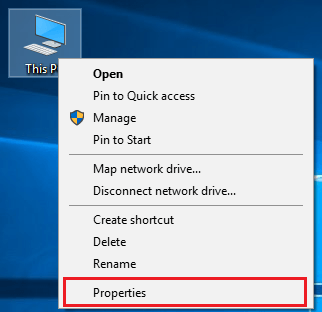
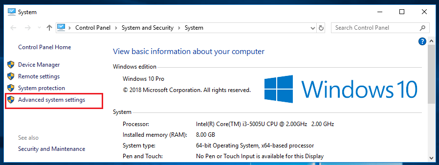
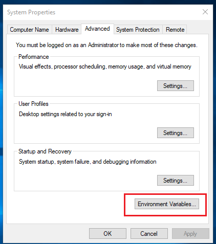
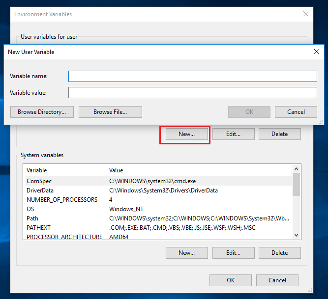
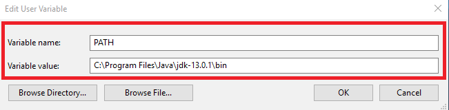

# How to Run Java Program

**How to Run Java Program** | Running Java programs online and installing Oracle JDK on Windows with step-by-step setup instructions.

- [Run Java Program Online](#run-java-program-online)
- [Run Java Program in Windows by Installing Oracle JDK](#run-java-program-in-windows-by-installing-oracle-jdk)

---

## 1. Run Java Program Online

How to run a Java program on a computer? We can run a Java program online or we can install Java virtual machine (JVM) in our computer system.

There are several sites that allow us to run a Java program online. But online compilers have some limitations like we can't work with files. It is not a good idea to always use them. Some sites are [ideone.com](https://ideone.com/), [onlinegbd.com](https://www.onlinegdb.com/), [Codepad](https://www.remoteinterview.io/), [CodeChef](https://www.codechef.com/ide)

---

## 2. Run Java Program in Windows by Installing Oracle JDK

1️⃣ **Step 1 — Download JDK:**

To Run Java programs in windows, [Download the latest version of JDK](https://www.oracle.com/java/technologies/downloads/) from the Oracle website. Download `.exe` or `.zip` file.

2️⃣ **Step 2 — Install JDK:**

Install the downloaded `.exe` file. Or, for `.zip` file just extract it.

Now, JDK is installed on your system.

Just by installing software, its [binary and library files](005_JDK_vs_JRE_vs_JVM_vs_JIT.md) are not available from other directories automatically. We must update environment variables with that software binary and binary file path. Now, let us update the environment variables.

> 📝 **Note:** If you are installing **Java SE** using `.exe` file which is only for Windows OS then the Oracle JDK offers "installers" (msi, rpm, deb, etc.) which not only place the JDK binaries in your system but also contain update rules and in some cases handle some common configurations like set common environmental variables (such as, `JAVA_HOME` in Windows) and establish file associations (such as, use java to launch `.jar` files). The **Java SE Windows** installer provides `java.exe`, `javaw.exe`, `javac.exe`, and `jshell.exe` commands in a system location so that users can run Java applications without needing to provide the path to the Oracle JDK's installation folder. So, **you can directly go to Step 7** to check the installation is done correctly or not. No need to follow Step 3 to Step 6.

3️⃣ **Step 3 — Go to Advanced System Settings:**

**My Computer -> Properties -> Advanced System Settings**





4️⃣ **Step 4 — Click on Environment Variables:**



5️⃣ **Step 5 — Create a Path:**

In this Window, in the User variables section or System variables section, we must create a Path.



There are some differences between creating path variables in the user variables section vs system variables section. Learn more: [Different ways to set the Java path](008_Different_ways_to_set_the_Java_path.md)

6️⃣ **Step 6 — Add Variable Name and Value:**

Add, Variable name = `path`

The Variable value is a location where Java is installed. By default, Java is installed in `C:\Program Files\Java\jdk\bin` Or, `C:\Program Files(x86)\Java\jdk\bin`.

In case, you have installed java at another location, then add that path.



Click on OK, save the settings. You have done.

7️⃣ **Step 7 — Verify Installation:**

Now, check the installation is done correctly or not. Open, Command prompt (cmd) and type `java -version`

**Check Java version:**

```bash
> java -version
java version "13.0.1" 2020-01-14
Java(TM) SE Runtime Environment (build 13.0.1+8)
Java HotSpot(TM) 64-Bit Server VM (build 13.0.1+8, mixed mode, sharing)
```

In order to make sure whether the compiler is set up, type `javac` in command prompt. You will see a list related to javac.

**Check javac:**

```bash
>  javac
Usage: javac <options> <source files>
where possible options include:
...........
...........
```

If you enjoyed this post, share it with your friends. Do you want to share more information about the topic discussed above or do you find anything incorrect? Let us know in the comments. Thank you!
