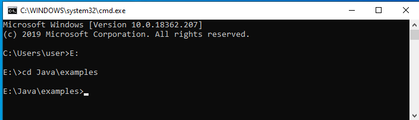
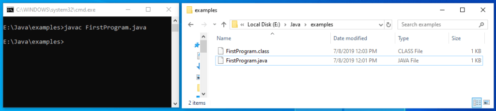
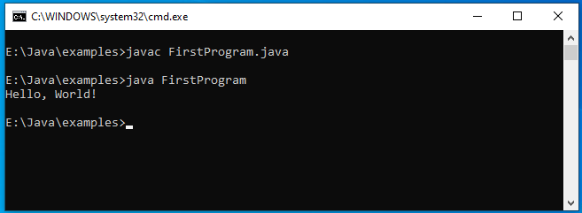
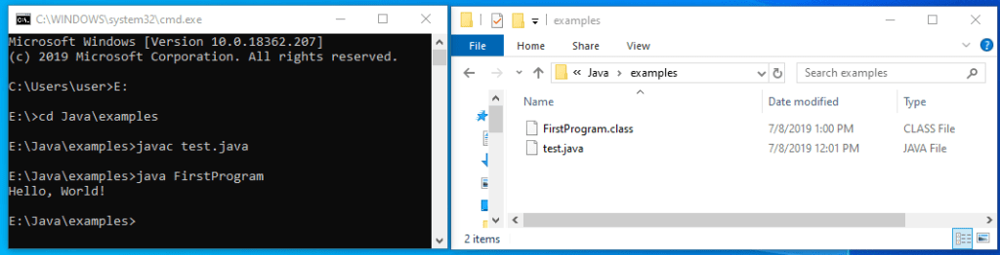

# Java Hello World Program

**Java Hello World Program** | A simple program that displays "Hello World", source code phases, javac and java commands, coding style, and file naming rules.

- [Simple Hello World Program in Java](#simple-hello-world-program-in-java)
- [Explanation of Java Hello World Program](#explanation-of-java-hello-world-program)
- [The javac Command](#the-javac-command)
- [The java Command](#the-java-command)
- [Should Class Name and File Name Be the Same?](#should-class-name-and-file-name-be-the-same)
- [Executing Java Program Without Generating Bytecode File](#executing-java-program-without-generating-bytecode-file)
- [Saving .class File in Another Directory](#saving-class-file-in-another-directory)
- [Compile-time and Runtime Errors](#compile-time-and-runtime-errors)
- [Use a Consistent Style](#use-a-consistent-style)

**Software required for developing Java program:**

1. 📝 **Text editor:** for typing and saving the Java code. Examples of text editor software are [notepad](https://www.microsoft.com/en-us/p/windows-notepad/9msmlrh6lzf3), [Editplus](https://www.editplus.com/), [Atom](https://atom.io/), [Textpad](https://www.textpad.com/home), [Notepad++](https://notepad-plus-plus.org/downloads/) e.t.c
2. 🔧 **JDK:** for compiling and executing the Java program
3. 🖥️ **Command prompt:** for executing `javac`, `java`, and another command

To develop Java programs we need any text editor like notepad, atom e.t.c. Using a text editor we will write the program and save it into the folder. After this, using command prompt we will compile and run the java program. The command prompt is just for the view and to take command purpose. It will take input and display output. Compilation and execution happen with the help of JDK. JDK has compiler and JVM.

Instead of using that different software, you can also use **IDE** like [Eclipse](https://www.eclipse.org/ide/). IDE is a software program that can be used for editing, compilation, and execution of the program. Using IDE like Eclipse you can do all things at a single place. Eclipse is the most popular IDE for Java.

> 💡 **Tip:** It is recommended to start your Java journey with text editors and after learning basic programs and concepts in Java, move to IDE. In this way, you will remember syntaxes very easily.

**Essential statements of Java program:**

To develop, compile, execute and print output on the console or monitor every Java program must have below 3 statements:

1. 📦 **Class block:** only class allows us to define the method with logic.
2. ▶️ **The main method:** It is the initial point of class logic execution.
3. 🖨️ **Print statement:** All kinds of data are printed using this statement.


---

## 1. Simple Hello World Program in Java

A Java hello world program is a simple program that displays "Hello, World!" on the screen. It is a very simple program, which is often used to introduce a new programming language to a newbie.

1️⃣ **Step 1 — Write the code:**

Open any text editor (like notepad) and write the code for Java hello world program.

**FirstProgram.java:**

```java
//Hello, World program in Java
class FirstProgram{
    public static void main(String[] args){
        System.out.println("Hello, World!");
    }
}
```

Now, save the Java hello world program as `FirstProgram.java` in any folder of your computer. Here, we will save it in folder `E:\Java\examples\`

2️⃣ **Step 2 — Navigate to the folder:**

Open Command prompt (cmd), and go to the folder where you had saved the above program.

Our program is in `E:\Java\examples\` folder so, we will write these below commands given in the image

```bash
C:\Users\user> E:
E:\> cd Java\examples
E:\Java\Examples>
```



3️⃣ **Step 3 — Compile the program:**

Compile the program using the command `javac FirstProgram.java`

```bash
> javac FirstProgram.java
```



Notice, previously we had only one file `FirstProgram.java` in our folder. Now, we have also one another file `FirstProgram.class`

4️⃣ **Step 4 — Run the program:**

Run the new file `FirstProgram.class` with the command `java FirstProgram`

```bash
> java FirstProgram
```

📤 **Output:**

```
Hello, World!
```



---

## 2. Explanation of Java Hello World Program

**Comment line:**

```java
//Hello, World program in Java
```

This statement is a comment, and it is optional. Any line starting with `//` is a comment which is completely ignored by the compiler. It is used for better understanding and functionality of the program.

**Class definition:**

```java
class FirstProgram {
    //---
}
```

Java is an object-oriented programming language. Every java program starts with a class definition. In our program, the name of the class is `FirstProgram`.

**Main method:**

```java
public static void main(String[] args){
    //---
}
```

This is the main method of Java programs. Every Java program must contain the main method, without the main method we can't execute a Java program. Here, the execution starts from the main method. Notice that the main method is inside the class definition. The main method should accessible everywhere in the program so, its accessibility is `public`. The `public`, `private`, `default`, and `protected` are access modifiers.

**Print statement:**

```java
System.out.println("Hello, World!");
```

This statement will print the string inside the quotation marks, i.e. Hello, World! to the standard output screen. The `System` is a pre-defined class, `out` is an object inside the System class and `println()` is a method of object out. Notice that this statement is inside the main method and the main method is inside the class definition. Semicolon used at the end of the statement indicates that the statement is completed.

---

### Source Code

The program we have written is called source code. Text editors are used for developing the source code. The source code is written in Java programming language so, the source code will save with extension `.java`. That's why we saved our program as `FirstProgram.java`. The source code is platform-independent. If we have written source code in a Windows operating system then we can use the same file in another operating system also, no need to write the second time. Java's slogan is WORA (Write once, Run anywhere).

### Compilation Phase

JDK has both compiler and JVM. Using command prompt we can communicate with the compiler to translate the source code. This can be done by the command `javac`, javac is a program itself. The compiler takes the source code and checks the syntax of the source code file. If there is any syntax error or spelling mistake occur then the compiler will give compile time error otherwise it will convert source code to byte code. This byte code will be saved in our system as `Name_Of_Class.class`. In our program, the name of the class is `FirstProgram` so, we get a file `FirstProgram.class` in the current directory where source code was present. This `.class` file is generated by the compiler. Byte code is also platform-independent.

### Execution Phase

A `.class` file doesn't contain code that is native to our computer processor. Instead, it contains bytecodes. The byte code is the native language of the Java Virtual Machine. Our operating system doesn't understand this byte code. This byte code is only understandable by JVM. So, using another command `java` we can execute the `.class` file. The `java` is also a program like `javac`. If there is any logical error is present then we get a runtime error (runtime error is also called Exception) by JVM otherwise JVM translates the byte code into native machine language (set of instructions that a computer's CPU executes directly). In this phase, no file will be created and output came into the screen. After, completion of the execution phase, the generated machine language is destroyed.


🔑 **Key Points:**

- Java programs are compiled and executed by using Java binary files `javac` and `java`. We call these two binary files as "tools" in short form. These two tools are used from the command prompt.
- Where Java files must be stored, in Java software (JDK) installed folder or in some other directory? It is not recommended to store Java source files in Java software installed directory, because if we uninstall current Java software for installing the next version, then all our source files will also be deleted. So for security reasons, it is always recommended to store Java source files in another directory, not in Java software (JDK) installed directory.

Commands used for compilation and execution of the Java program are `javac` and `java`. Now, we will discuss both commands.

---

## 3. The javac Command

The `javac` command is used to compile a single or group of Java source files (`.java` files).

**Syntax for compiling one Java source file:**

```bash
javac [options] file.java
```

**Syntax for compiling multiple Java source files:**

```bash
javac [options] file1.java file2.java file3.java
```

**Syntax for compiling all Java source files in the current directory:**

```bash
javac [options] *.java
```

**Various options for javac command:**

| Option 🏷️ | Used For 📋 |
|-----------|------------|
| `-version` | JDK version information |
| `-d` | Directory (Save `.class` file in particular directory) |
| `-cp` | To set classpath |
| `-verbose` | Output messages about what the compiler is doing |

> 💡 **Tip:** To see all the options of the javac command type `javac --help` command in cmd.

---

## 4. The java Command

The `java` command is used to run a Java program.

**Syntax to execute a class:**

```bash
java [options] ClassName [args...]
```

**Various options for java command:**

| Option 🏷️ | Used For 📋 |
|-----------|------------|
| `-version` | JDK version information |
| `-D` | Set system properties |
| `-cp` | To set classpath |

> 💡 **Tip:** To see other syntax and options of java command use `java --help` command.

> 📝 **Note:** Using `javac` command, we can compile any number of java source files but using `java` command we can run only one `.class` file at a time.

---

## 5. Should Class Name and File Name Be the Same?

In the Java hello world program, the name of the class was `FirstProgram` and the file name was `FirstProgram.java`. So, we used the same name for the class and also for the name of the file. But, it is not mandatory. We can use a different name for class and file. See the below example:

**Test.java:**

```java
//Test.java
class FirstProgram{
    public static void main(String[] args){
        System.out.println("Hello, World!");
    }
}
```

Save this file as `Test.java` and compile it. The file generated by the compiler will `FirstProgram.class`, execute it.

```bash
> javac Test.java
> java FirstProgram
```

📤 **Output:**

```
Hello, World!
```



**When an error occurs?**

The error only came, if we declare the class as `public`.

**Test1.java:**

```java
// Test1.java
public class FirstProgram{
     public static void main(String[] args){
         System.out.println("Hello, World!");
     }
 }
```

**Compilation error:**

```bash
> javac Test1.java
test1.java:1: error: class FirstProgram is public,
should be declared in a file named FirstProgram.java
 public class FirstProgram{
        ^
 1 error
```

> 🔑 **Key Point:** **_The name of the file and class may be different, but if we declare the class as public then the file name and class name must be the same._**

> ⚠️ **Caution:** If you are working with any **IDE** to develop, compile and run Java program then also you can get an error. In IDE, the compilation and execution phase done with shortcut keys, not by manually given commands. Shortcut keys are configured as, for compilation `javac <filename>` and for execution `java <filename>`. Due to this configuration, you will get an error. **_So, it is recommended to use the same name for the File and the Class._**

---

## 6. Executing Java Program Without Generating Bytecode File

Previously we learned, the source code is compiled and then the generated byte code executed by the JVM. Some languages like Python and scripting languages don't need two-phase, their programs directly execute without generating a new file. From **Java 11** onwards **we can directly execute Java program** also. Compilation and execution both are done using a single command `java`.

**FirstProgram.java:**

```java
//FirstProgram.java
//Hello, World program in Java
class Hello{
    public static void main(String[] args){
        System.out.println("Hello, World!");
    }
}
```

**Run directly:**

```bash
> java FirstProgram.java
Hello, World!
```

No `.class` file will be generated by the compiler and Java program executes directly. By this way, learning the Java programs become more easy for beginners. They can execute Java programs only in one step.

If there is any syntax error is present in the program then we got the compile-time error and if any logical error is present then we get an exception.

**Filename and class name in this case:**

Notice that in this program, file name and the class name was different. So, if we are using only `java` command for both compilation and execution then it is not necessary that filename and class name should be the same. When we were working with `javac` command for compilation and `java` command for execution then there was a limitation that if the class is declared as public then the filename and class name should be the same. But, it is also not necessary if we use only `java` command for both compilation and execution.

**Test.java:**

```java
//Test.java
public class Hello{
    public static void main(String[] args){
        System.out.println("Hello, World!");
    }
}
```

Compile and execute it using: `java Test.java`

📤 **Output:**

```
Hello, World!
```

---

## 7. Saving .class File in Another Directory

When we compile our Java program using `javac` command, compiler check syntax and if no error found then it generates bytecode (translation of `.java` file) and saves it into `Classname.class` file in the current working directory (where `.java` file was present). Now the question is, can we save the `.class` file generated by the compiler into another file or directory? Yes, it is possible. For this purpose, we must use `-d` option of Java compiler as shown below:

**Syntax:**

```bash
javac -d path_of_folder_or_directory Example.java
```

For example, we have a program `FirstProgram.java`

**FirstProgram.java:**

```java
//FirstProgram.java
//Hello, World program in Java
class Hello{
    public static void main(String[] args){
        System.out.println("Hello, World!");
    }
}
```

`FirstProgram.java` is saved in folder `D:\Java` and we want to save compiler-generated file `Hello.class` into another directory `C:\program` then we will write below command,

```bash
D:\Java> javac -d C:\program FirstProgram.java
```

By using, above command option `-d C:\program` we are informing the compiler to save `.class` file in C drive and "program" folder.

> 📝 **Note:** `javac -d . FirstProgram.java` is same as `javac FirstProgram.java`

Here the dot (`.`) represents the current working directory.

**Java 9 version enhancement in `-d` option:**

Up to Java 8 version, we must explicitly create the folder (in our case "program" inside C drive) then only `.class` file will be saved in the "program" folder. If the folder is not available then compiler throw error: directory is not found. From Java 9 version onwards we don't need to create the folder "program" explicitly. If the "program" folder is not available there then the compiler automatically itself creates it.

We can also execute the `.class` file saved in another directory from the current working directory. For this purpose, we need to set classpath variables. We will discuss it later in the topic: [Setting classpath environment variables](008_Different_ways_to_set_the_Java_path.md)

---

## 8. Compile-time and Runtime Errors

The error thrown by the compiler at the time of compilation is called **compile-time errors**. These errors are raised due to syntax mistakes, like spelling mistakes, the wrong usage of keywords, missing semicolon (`;`) at the end of the statements, etc.

The errors thrown by the JVM at the time of execution are called **runtime errors** or **exceptions**. These errors are raised due to logical mistakes, like executing class without a main method, accessing array values with the wrong index, dividing integer number with 0, etc.

---

## 9. Use a Consistent Style

There are many styles to write programs. But, given above is standard and most code you run across will most likely be written that way. We, suggest you adopt the Java standard from the start.

**Standard style (recommended):**

```java
// Standard style
class FirstProgram{
     public static void main(String[] args){
         System.out.println("Hello, World!");
     }
 }
```

Standard style is better than the below styles,

**Allman style (not recommended):**

```java
// don't use this style
class FirstProgram
 {
     public static void main(String[] args)
     {
         //It is recommended to not use this style
     }
 }
```

**Whitesmiths style (not recommended):**

```java
// don't use this style
class FirstProgram
     {
         public static void main(String[] args)
             {
                 //Also, don't use this style
             }
     }
```

If you enjoyed this post, share it with your friends. Do you want to share more information about the topic discussed above or do you find anything incorrect? Let us know in the comments. Thank you!
