# Different Ways to Set the Java Path

**Different Ways to Set the Java Path** | Temporary and permanent settings, environment variables, system variables, and best practices for Java path configuration.

- [What is the Need to Set the Path in Java?](#what-is-the-need-to-set-the-path-in-java)
- [Temporary Settings](#temporary-settings)
- [Permanent Setting](#permanent-setting)
- [Important Points to Set the Java Path Variable](#important-points-to-set-the-java-path-variable)
- [When We Should Use Temporary Setting of the Path Variable?](#when-we-should-use-temporary-setting-of-the-path-variable)
- [Important Points on Environment and System Variables](#important-points-on-environment-and-system-variables)
- [Other Points on the Java Path Variable](#other-points-on-the-java-path-variable)

To make the binary files of certain locations executable from any location of the computer without copying them physically to other locations, we must add the original location of those files to the path variable. Similarly, to use the java tools we need to set the java path.

The path variable is a mediator between the programmer and the command prompt window. The programmer should set the path variable by storing the binary file path (bin folder path). Command prompt need path variable to find and execute binary files of software.

---

## 1. What is the Need to Set the Path in Java?

One question can come in our mind that after installing JDK, why we set environment variables? Without setting environment variables, open command prompt (cmd) and run `javac` command.

**Error without path set:**

```bash
> java -version
'java' is not recognized as an internal or external command,
operable program or batch file.
```

Is it working? No, because the `javac` tool is not available for the command prompt. The command prompt searches for the `javac` tool in the current directory and also in the path variable. But the `javac` tool is available in the bin folder of the JDK installation directory.

Observe the error message it means `javac` file is not available outside of Java software installed directory. Just by installing software, its binary and library files are not available from directories automatically. To solve this problem and to access all Java files throughout the operating system from all folders we must update path variables.

**Different ways to set the Java path variable:**

There are two types of setting the path variable to solve the above problem: _temporary settings_, and _permanent settings_.

---

## 2. Temporary Settings

**For Windows:**

The syntax to set the path variable in Java only for current command prompt,

**Syntax:**

```bash
set path=<path_of_JDK_bin_folder>;%path%
```

**Or:**

```bash
path=<path_of_JDK_bin_folder>;%path%
```

**Example:**

```bash
> set path=C:\Program Files\Java\jdk\bin;%path%
```

Java is by default installed at `C:\Program Files\Java\jdk\`. In case, you have installed java at another location, then add that path.

**For Linux:**

The syntax for the temporary setting of path variable for the Linux operating system (Ubuntu),

**Syntax:**

```bash
$ export PATH=<path_of_JDK_bin_folder>:PATH
```

**Example:**

```bash
$ export PATH=/usr/lib/jvm/java-13-oracle/bin:PATH
```

Java is by default installed at `/usr/lib/jvm/java-13-oracle/bin`. In case, you have installed java at another location, then add that path.

**Verify Linux setup:**

```bash
know@program:~$ java -version
java version "13.0.2" 2020-01-14
Java(TM) SE Runtime Environment (build 13.0.2+8)
Java HotSpot(TM) 64-Bit Server VM (build 13.0.2+8, mixed mode, sharing)

know@program:~$ export PATH=/usr/lib/jvm/jdk1.8.0_231/bin:PATH

know@program:~$ java -version
java version "1.8.0_231"
Java(TM) SE Runtime Environment (build 1.8.0_231-b11)
Java HotSpot(TM) 64-Bit Server VM (build 25.231-b11, mixed mode)
```

Also see: [Java environment path in ubuntu](https://stackoverflow.com/questions/9612941/how-to-set-java-environment-path-in-ubuntu)

---

### Problems and Advantage with Temporary Settings

These settings are lost after closing the command prompt window. For every new command prompt window or terminal, we must do this setup again and again.

To save these settings permanently in the operating system and for using these settings from all command prompt windows even after windows restart, we must save path settings permanently in environment variables.

> 💡 **Tip:** When we have more than one JDK of different versions installed in our operating system, then the temporary setting is very helpful for us. For example, our computer has both JDK 1.8 and JDK 13, and JDK 13 is by default compiler for Java program (due to permanent setting). Now, we need to run a Java program using the JDK 1.8 version then we should use temporary settings.

---

## 3. Permanent Setting

The permanent settings can be done at two levels, one for a single user and another for all users of one operating system.

### Permanent Setting Using the Environment Variable

If you want to environment variable setting only for a single user (Or, only one user is in your system) then we need to do below setting. Generally, we do these settings at the time of the installation of JDK.

Environment settings done at installation time is enough for a single user.

1️⃣ **Step 1 — Go to Advanced System Settings:**

**My PC -> Properties -> Advanced system settings**
or,
**Control Panel -> System and Security -> System -> Advance system settings**

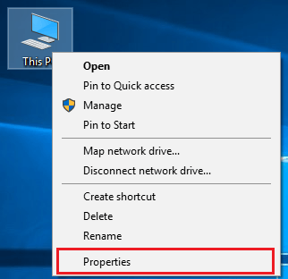

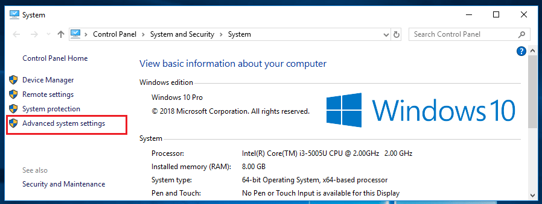

2️⃣ **Step 2 — Click on Environment Variables:**

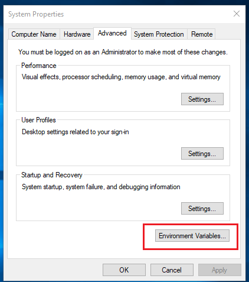

In this Window, in the User variables section, we will create/update the path. If the path already exists then we will update it else we will create a new variable.

3️⃣ **Step 3 — Copy the bin folder path:**

Go to the JDK installation folder and copy the path of the bin folder.

By default, Java is installed in `C:\Program Files\Java\jdk\bin` Or, `C:\Program Files(x86)\Java\jdk\bin`. In case, you have installed java at another location, then copy that path.

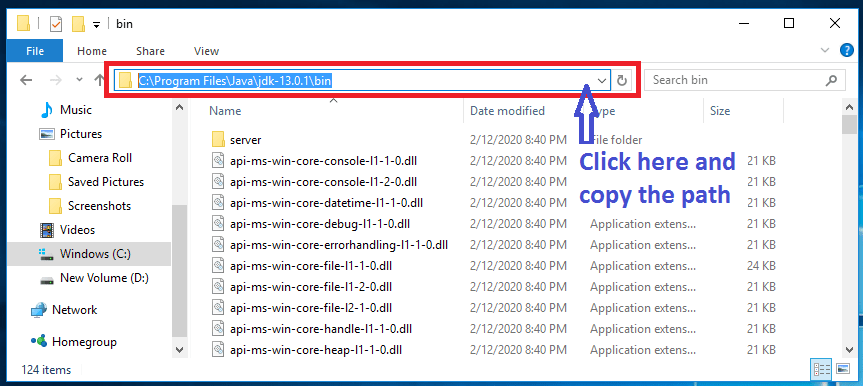

4️⃣ **Step 4 — Check if path variable exists:**

Check the path variable already exist or not. If exist then select it and click on the "edit" button, else create new.

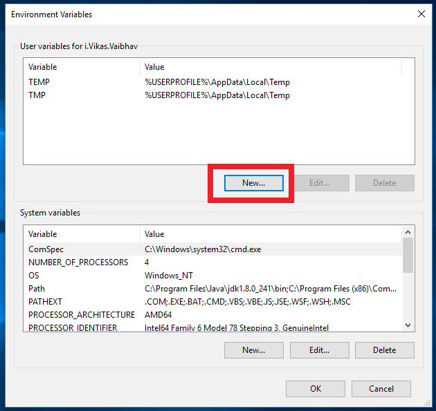

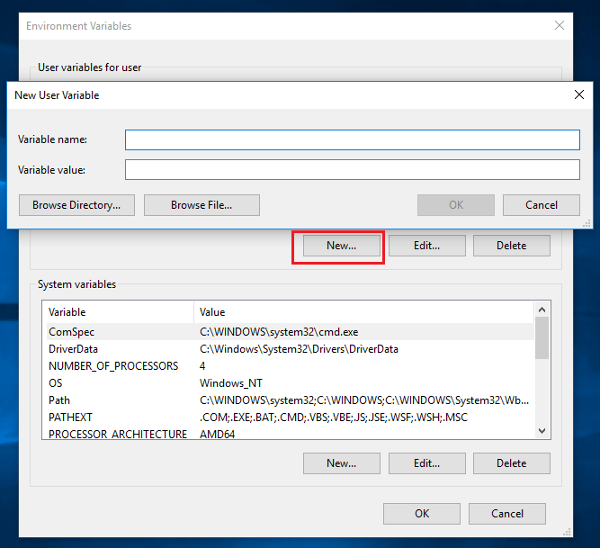

5️⃣ **Step 5 — Add the bin folder path:**

The syntax for updating the path variable and its value is,

**If editing existing path:**

```properties
Variable Name: PATH
Variable Value: <JAVA_HOME>\bin;<old_values>
```

If you are editing the path variable (path variable already exists), then don't disturb the previous values. In this just add the Java-bin path to first and click on ok.

```properties
Variable Value: C:\Program Files\Java\jdk-13.0.1\bin;<old_values>
```

**If creating new:**

```properties
Variable Name: PATH
Variable Value: <JAVA_HOME>\bin
```

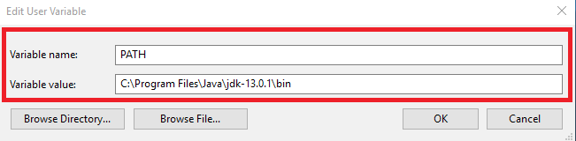

Click on all OK, save the settings. You have done. Now, it's time to check the installation is done correctly or not. Open, new command prompt (cmd) and type `java -version`

**Verify setup:**

```bash
> java -version
java version "13.0.1" 2019-10-15
Java(TM) SE Runtime Environment (build 13.0.1+9)
Java HotSpot(TM) 64-Bit Server VM (build 13.0.1+9, mixed mode, sharing)
```

In order to make sure whether the compiler is set up, type `javac` command in the command prompt. You will see a list related to the javac command.

---

### Permanent Settings Using the System Variable

If your system has more than one user then from the command prompt you can't access the tools available in the bin folder of JDK, like `javac`/`java` in other users except the user have settings.

Permanently settings for the operating system is similar to the settings for the one user. It can be done using these steps:

1️⃣ **Step 1:** Copy the path of the bin folder of JDK.

2️⃣ **Step 2:** Go to My Computer -> Properties -> Advance System Settings -> Environment variables. In the System variable settings, click on the path and edit button.

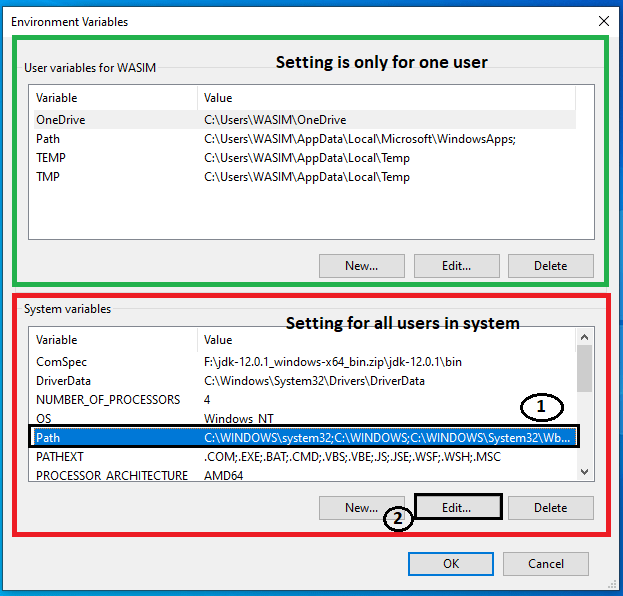

3️⃣ **Step 3:** A new window will appear. Now, click on the New button and paste the path variable of java software.

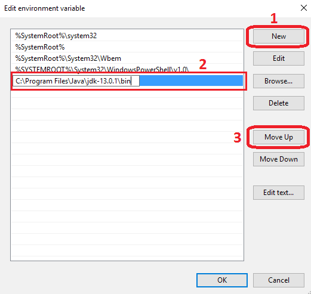

4️⃣ **Step 4:** Java path should be top of all environment variable So, click on "Move up" up to Java path came on top. Click on all OK buttons.

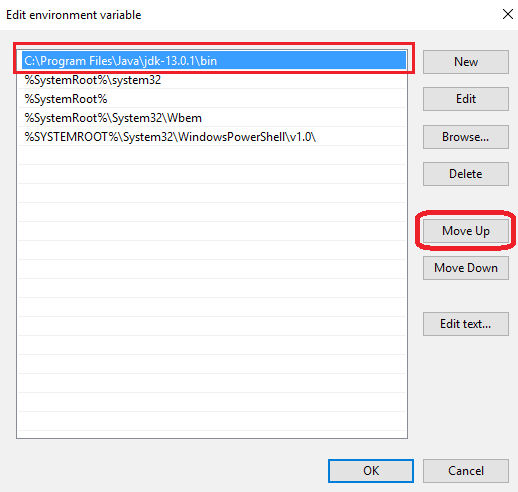

To verify the setup type `javac` in cmd and run it. Now, `javac` and all other Java files are also available for another user in the System.

---

## 4. Important Points to Set the Java Path Variable

1. **Which setting is best for us?**

> 💡 **Tip:** **_If you are a beginner then it is recommended to do permanent settings using System variable._** This setting will be used by all the users of the computer. The permanent settings for the environment variable are done only for the single user, the other users of the computer don't access tools available in the bin directory of JDK.

2. It is optional to add the current directory in the path variable.

The syntax for the variable value is: `<JAVA_HOME>\bin;<old_values>`
Here, the semicolon is used as a separator.

Sometimes we also add the current working directory in the path variable as,
variable value = `<JAVA_HOME>\bin;<old_values>;.`

Here the dot represents the current working directory. Generally, we never place our Java files (`.java`/`.class`) in the bin folder of the JDK. It is optional to add the current working directory (`.`) in the path variable.

3. **Role of the semicolon in the path variable.**

The semicolon in the path variable is a separator. It is used to separate one variable value from another variable value. Note that we should not place the semicolon at the last of the variable value, it is equal to not adding that value in the path variable value.

### Why We Should Set the Java Path at the Beginning of the Existing Values?

You can observe, we tell that the syntax of the variable value is `<JAVA_HOME>\bin;<old_values>` but it is not true. We can also use `<old_values>;<JAVA_HOME>\bin` syntax. In the permanent settings for the multiple users, we move up the path at the top, it is not compulsory to do this.

There is a reason to place the bin folder of JDK in the first beginning of the path variable. There is a chance that the one older value in the path variable is removed then in that case, our computer doesn't consider the remaining variable values. The computer checks only up to the correct values of the path variable. In this case, if we place the bin folder of JDK at the last in the path variable values, then the computer will not found the bin folder of JDK. Hence, it is always recommended to place the JDK's bin folder in the first place of the path variable.

---

## 5. When We Should Use Temporary Setting of the Path Variable?

When there are multiple JDKs are installed in the system and we want to work with different JDKs then, In this case, the temporary setting is very useful for us. Let us understand it by an example:

At the time of post writing, the latest version is JAVA SE 13.0. But there are many technologies like servlet, JDBC, Spring e.t.c which are working with JAVA SE 8.0. To work with these technologies we must have JDK 1.8 installed in our computer system, and to get familiar with the latest features of Java generally, we also installed the latest JDK in the computer system.

Now, most of the time we are working with technologies using JDK 1.8, and only sometimes we are working with the latest JDK. So, the bin folder of JDK 1.8 is used in the path variable.

In this case by default tools of the `JDK1.8\bin` will be used by the computer. To use the latest JDK, we must set the path of the latest JDK's bin folder using temporary settings.

**Switching JDK versions:**

```bash
C:\> java -version
java version "1.8.0_241"
Java(TM) SE Runtime Environment (build 1.8.0_241-b07)
Java HotSpot(TM) 64-Bit Server VM (build 25.241-b07, mixed mode)

C:\> path=C:\Program Files\Java\jdk-13.0.1\bin;%path%

C:\> java -version
java version "13.0.1" 2019-10-15
Java(TM) SE Runtime Environment (build 13.0.1+9)
Java HotSpot(TM) 64-Bit Server VM (build 13.0.1+9, mixed mode, sharing)
```

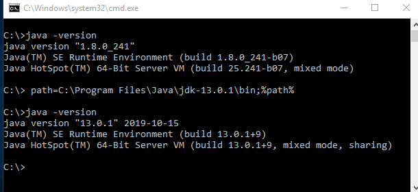

Every temporary setting is reflected only in one command prompt. Whenever we exit from that command prompt then the setting will be lost.

---

## 6. Important Points on Environment and System Variables

1. The environment and system variable names are not case-sensitive.
2. The values added to the environment variables from advanced system settings (permanent settings) will remain permanent whereas the value of the environment variable added to the CMD prompt will remain temporary.
3. The user environment variables are specified to currently logged-in Windows users, whereas System environment variables are visible to all the windows users.
4. Multiple values added to the environment variables must be separated with a semicolon `;` symbol.
5. It is recommended to add new value to the environment variable at the beginning of the existing values.
6. The values added to environment variables will not be reflected in the already opened command prompt/terminal so, we must open a new CMD prompt/terminal.

---

## 7. Other Points on the Java Path Variable

If the Oracle database is installed in our computer system then, in the path variable value we must always place the JDK bin folder path before the Oracle bin folder. Because oracle software also contains Java software, which may be an older version than our JDK installed software. If we placed the Oracle software path before the JDK software path then programs are compiled by the JDK of Oracle database software and the programs will not be executed.

> ⚠️ **Caution:** We don't set path variables for running a game software because we don't need to run game software from the command prompt window. The game software runs from its own window by double-clicking the shortcut icon on the desktop. We must set a path variable only for that software that requires a command prompt window to run the software.

If you enjoyed this post, share it with your friends. Do you want to share more information about the topic discussed above or do you find anything incorrect? Let us know in the comments. Thank you!
