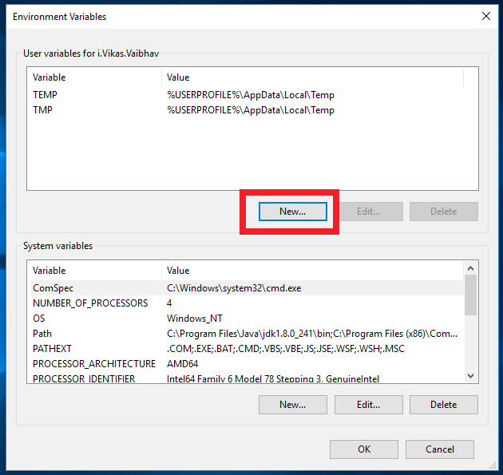
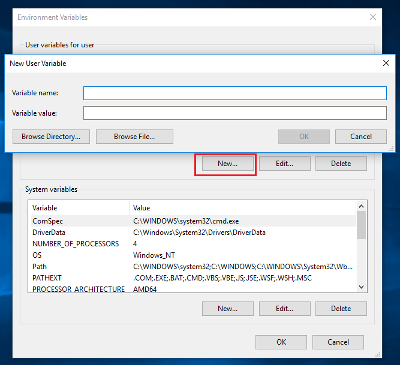

# Different Ways to Set Java Classpath Environment Variables in Windows

**Different Ways to Set Java Classpath Environment Variables** | Understanding classpath, why it's needed, four ways to set it, and the difference between path and classpath.

- [What is Java Classpath?](#what-is-java-classpath)
- [Why Do We Need to Set Java Classpath?](#why-do-we-need-to-set-java-classpath)
- [Different Ways to Set Java Classpath](#different-ways-to-set-java-classpath)
- [Set Java Classpath Using the Java Command Options](#set-java-classpath-using-the-java-command-options)
- [Set Java Classpath for One Command Prompt Window](#set-java-classpath-for-one-command-prompt-window)
- [Permanent Settings for the User](#permanent-settings-for-the-user)
- [Permanent Classpath Settings for the System](#permanent-classpath-settings-for-the-system)
- [Importance of Adding Current Directory in Java Classpath](#importance-of-adding-current-directory-in-java-classpath)
- [When Do We Need to Set Java Classpath?](#when-do-we-need-to-set-java-classpath)
- [Important Points on Environment Variables](#important-points-on-environment-variables)
- [Difference Between Path and Classpath in Java](#difference-between-path-and-classpath-in-java)
- [Setting Classpath vs Copying the File to the ext Folder](#setting-classpath-vs-copying-the-file-to-the-ext-folder)

---

## 1. What is Java Classpath?

The classpath is a purely Java-related environment variable. If our Java application is using third party APIs or user-defined APIs (other than JDK APIs) then those API related directories or jar files must be added to the classpath environment variable to make Java tools recognizing and using the APIs.

Classpath is used for finding library files of software, i.e. the `.class` file for Java software. Classpath is a mediator between the programmer and the compiler. The programmer will set the classpath variable by storing the software libraries' file path. JVM needs a classpath variable while executing our class file for finding library files that are used from our class.

---

## 2. Why Do We Need to Set Java Classpath?

Take an example, the `.class` file is not in the current working directory. Now, can we execute it from the current working directory? No, because by default JVM search for the `.class` file in the current working directory only. If classes are saved in a different directory, for executing them from the current directory we must set the classpath.

It is used for setting the path for classes when they are available in a different directory. When we set classpath then JVM also searches the file in the given classpath, only not in the current working directory.

> ⚠️ **Caution:** If we want to access classes stored in one folder from another folder then, we must set classpath by storing this folder path. If we don't set classpath then we can get an error `Could not find symbol class` or `Java.lang.classNotFoundException` or `Could not find or load main class`.

---

## 3. Different Ways to Set Java Classpath

There are four different ways to set Java classpath.

1. 🔄 Temporary settings using java command options
2. 🖥️ Temporary settings for one cmd
3. 👤 Permanent settings by using environment settings (Only for one user)
4. 🌐 Permanent settings by using system settings (For all users)

---

## 4. Set Java Classpath Using the Java Command Options

The java commands options to set Java classpath for one command prompt are:

```bash
-cp or, -classpath or, --class-path
```

**Demonstrating the java command options:**

To test these java command options, write simple HelloWorld program, compile it.

**HelloWorld.java:**

```java
//HelloWorld.java
public class HelloWorld {
   public static void main(String[] args){
      System.out.println("Hello World");
   }
}
```

Compile the above file with below command, it will save the `.class` file in the `C:\Testing\JavaProgram` folder.

```bash
> javac -d C:\Testing\JavaProgram HelloWorld.java
```

> 📝 **Note:** If you are working with JDK version 1.0 to 1.8 then you must explicitly create the folders "Testing", and "JavaProgram" inside the C drive, then only `.class` file will be saved in given folder else compiler will throw below errors:

**Error example:**

```bash
javac: directory not found:  C:\Testing\JavaProgram
Usage: javac <options> <source files>
use -help for a list of possible options
```

From Java 9.0 version onwards we no need to create the folder explicitly. If the folder is not available then the compiler we create it.

Now open command prompt window, and it executes the `HelloWorld.class` from any location by using java command options,

**Using different classpath options:**

```bash
> java -cp C:\Testing\JavaProgram HelloWorld
Hello World

> java -classpath C:\Testing\JavaProgram HelloWorld
Hello World

> java --class-path C:\Testing\JavaProgram HelloWorld
Hello World
```

The output will be the same for the above three command options.

Among four ways to set java classpath, this way is a commonly used approach because dependent classes are varied from command to command.

**Limitation of setting java classpath using java command options:**

By using java command options `-cp` / `-classpath` / `--class-path`, we can set classpath only for current command line (single command line only). In the next command line, again we need to set the classpath. In the next command line, if we execute class directly then we will get an exception: `class not found exception`

**Limitation example:**

```bash
> java -cp C:\Testing\JavaProgram HelloWorld
Hello World

> java HelloWorld
Error: Could not find or load main class HelloWorld
Caused by: java.lang.ClassNotFoundException: HelloWorld
```

---

## 5. Set Java Classpath for One Command Prompt Window

We can set java classpath for one command prompt window. For this use below command,

**Set classpath for one window:**

```bash
> set classpath=C:\Testing\JavaProgram;%classpath%;.

> java HelloWorld
Hello World
```

> ⚠️ **Caution:** Using this temporary setting we can set classpath **only for one command prompt window**. In that command prompt window, we can access classpath from all command lines. But, if we open another command prompt window then we can't access those settings for the classpath. If we close the current command prompt window (where the temporary setting for classpath was done), then we can't access that classpath. Again, we need to set the classpath.

If we want to make path settings to all cmd windows, we must set a classpath setting permanently.

---

## 6. Permanent Settings for the User

Go to My Computer -> Properties -> Advance System Settings -> Environment variables. In the user variables section, click on the new button (If the classpath variable is already available then click on "edit" and please don't disturb the old values.)



**Creating a new variable:**

```properties
Variable Name: CLASSPATH
Variable Value: C:\Testing\JavaProgram;.
```



**If updating/editing existing classpath:**

```properties
Variable Name: CLASSPATH
Variable Value: C:\Testing\JavaProgram;<Old_values>;.
```

If you are updating/editing the classpath variable value then add the `C:\Testing\JavaProgram` at the beginning and don't disturb the old values, leave them to remain as it is.

> 💡 **Tip:** In both of the cases don't forget to add `;.` at last. It is a good practice to add the dot (`.`) at the last. Here the semicolon (`;`) is a separator, and dot (`.`) represents the current directory.

Open a new command prompt and execute the `HelloWorld.class` file using java tool.

**Verify:**

```bash
> java HelloWorld
Hello World
```

Now, the JVM will check `.class` in the all classpath folders. In our case the `HelloWorld.class` is available in the `C:\Testing\JavaProgram` and this value is at the beginning of the variable value. So, JVM will execute it.

From anywhere and any command prompt, we can execute all `.class` files which are inside the `C:\Testing\JavaProgram`. This permanent setting will be preserved after the system restart also.

**Limitation of setting Java classpath in user variables:**

This classpath setting will be available for a single user of the computer system. Only that user can access those files for which users these are done. If your computer has only one user then you can happily use these settings. But for more than one user, we should go next setting: Permanent settings for the system.

---

## 7. Permanent Classpath Settings for the System

Go to My Computer -> Properties -> Advance System Settings -> Environment variables. In the system variables section, click on the new button (If the classpath variable is already available then click on "edit" and please don't disturb the old values.)

The settings are similar as we have done in for the user variables.

**Creating a new variable:**

```properties
Variable Name: CLASSPATH
Variable Value: C:\Testing\JavaProgram;.
```

**If updating/editing existing classpath:**

```properties
Variable Name: CLASSPATH
Variable Value: C:\Testing\JavaProgram;<Old_values>;.
```

In both of the case don't forget to add `;.` at last. Now, the classpath setting is available for all the users of the computer. All the users of the computer can access the classpath settings.

**Q) If the classpath setting is done by both permanent and temporary, then the first priority will be given to whom?**
**Ans:** Temporary settings.

**Q) When both system and user settings are done then first priority will be given to whom?**
**Ans:** User setting. When the user variables setting is available for the java classpath then system variables setting will not be taken.

**Q) Among the four approaches, which is recommended?**
**Ans:** When we are installing permanent software in one system then the permanent setting for system variables is recommended.

---

## 8. Importance of Adding Current Directory in Java Classpath

While setting classpath we had given dot at the end of the variable values, the dot represents the current directory. The adding current directory to the classpath is very important. The JVM searches for `.class` only the locations given in the classpath settings.

Take an example, do classpath settings and don't add the current directory (dot and semicolon) at the last. Now, develop a Java application, compile it and try to execute it.

Is the `.class` file executed successfully? No. You will get an exception: Could not find or load main class Test

**Without current directory in classpath:**

```properties
Variable Name: CLASSPATH
Variable Value: C:\Testing\JavaProgram
```

**Test.java:**

```java
//Test.java
public class Test {
  public static void main(String[] args){
     System.out.println("Test class");
  }
}
```

**Error:**

```bash
> javac Test.java
> java Test
Error: Could not find or load main class Test
```

Why this error is coming? The JVM searches for the `Test.class` file only inside the `C:\Testing\JavaProgram` folder, not in the current working directory. The `Test.class` is not available in the `C:\Testing\JavaProgram` folder so JVM gives exception: Could not find or load main class Test

Now, add `;.` in the classpath and open new command prompt and try to execute the `Test.class`. This time JVM executes `Test.class` files successfully.

**With current directory in classpath:**

```properties
Variable Name: CLASSPATH
Variable Value: C:\Testing\JavaProgram;.
```

Open new command prompt window, Go to the folder where `Test.class` is available and execute it using java tool.

```bash
> java Test
Test class
```

If we are adding current directory (dot) in the classpath variable value then compiler first search the `Test.class` in the `C:\Testing\JavaProgram`. If it is available then JVM will execute it else the JVM will search into the second value folder. Here the second value is the current working directory (dot). So, the JVM will search for the `Test.class` in the current working directory, it is available hence JVM will execute it.

---

## 9. When Do We Need to Set Java Classpath?

As you are working on the Java domain. Later whenever you install software that is used for Java application development in that situations you need to set the classpath.

For example, you want to develop a servlet application (Java-based web-application which is used to develop websites), in that case, servlet API files should be accessible to the JDK and it can be done by using setting classpath.

There are many similar situations when you need to set the classpath. Another example is of working with JDBC application, in that case, jar file (collection of java files like a zip file) of oracle driver should be accessible to the JDK.

---

## 10. Important Points on Environment Variables

1. The environment variables are not case-sensitive. So, `classpath`/`CLASSPATH`/`ClassPath`, etc all are allowed.
2. The values added from advanced system settings will remain permanent whereas the values added to the command prompt will remain temporary.
3. The user environment variables settings are specified to currently logged in window users, whereas the system environment variables settings are available for all the users of the windows operating system.
4. Multiple values added to the environment variables must be separated by using the semicolon.
5. The values added to the environment variables will not reflect to the old command prompts. We must open a new command prompt window.
6. It is recommended to add new values to the environment variable at the beginning of the existing values. If we are adding the new values at the end of the environment variable and one value at the middle is broken/wrong then JVM stop searches after that middle value. Hence it is always recommended to add new values at the beginning.

---

## 11. Difference Between Path and Classpath in Java

We have discussed path and classpath in Java. Now, we will see the difference between path and classpath in Java.

The [path](008_Different_ways_to_set_the_Java_path.md) is used by a command prompt (OS) for finding software binary files. It is used for accessing binary files of the software from different directories of the operating system irrespective of the directory on which they are installed.

Classpath is used by compiler and JVM for finding `.class` files (libraries and API) when classes are required to access from different directories of the operating system. We must set classpath by saving the folder path address in which `.class` files are available.

| Feature | path 🔧 | classpath 📚 |
|---------|--------|-------------|
| **Purpose** | Locating binary files of software | Locating library files of software |
| **Stores** | The bin folder path | The lib/jar folder path |
| **Used By** | CMD for finding binary files from different software | Compiler and JVM for finding library files |
| **Scope** | All software installed on our computer including OS | Only Java and its related software |
| **Error Indication** | `'___' is not recognized` error | `Can not find symbol` or `CouldNotFoundExecption` or `could not load main class` error |
| **Dot Semicolon** | ❌️ `.;` not required | ✅ `.;` is required |

---

## 12. Setting Classpath vs Copying the File to the ext Folder

There is one alternative for classpath. Copy the file and paste it into the `<JAVA_HOME>\jre\lib\ext` folder.

After JDK 1.8 there was no JRE folder given explicitly in the JAVA_HOME, discussion about copying the file into the ext folder is worthless. But currently many technology working on JDK 1.8 and in JDK 1.8 ext folder is available, hence we should discuss this point.

At the time of JDK installation, we set the path variable for JDK, so all files of JAVA_HOME are available for `javac` and `java` tools. When we copy our file into the ext folder then it will be treated as the file of JDK software. In this way, we can access the file, no need to set the classpath. But it is **not recommended** to copy the file to the ext folder.

| Feature | Classpath 🔧 | Copying to ext Folder 📂 |
|---------|------------|------------------------|
| **File Types** | Both directories and jar files | Only jar files |
| **Java Version** | ✅ Works in all versions | ⚠️ Works only up to Java 8 |
| **Reflection** | New command prompt only | Both old and new command prompt |
| **Multi-JDK** | Used by multiple JDK versions | Must add separately for each version |
| **ClassLoader** | ApplicationClassLoader | Extension ClassLoader |
| **Copy Behavior** | Refers to original location (no copy) | Takes a physical copy to ext folder |

> ⚠️ **Caution:** If the file is of big size 1GB/2GB then copying the file into the ext folder is not a good approach, we are just wasting the space.

If you enjoyed this post, share it with your friends. Do you want to share more information about the topic discussed above or do you find anything incorrect? Let us know in the comments. Thank you!
