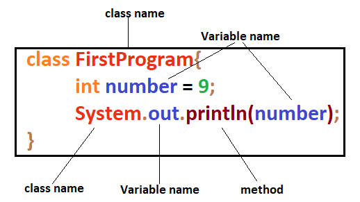
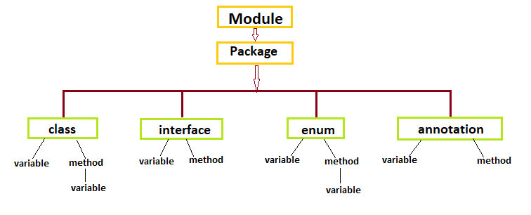

# Tokens in Java

**Tokens in Java** | The smallest units in a Java program that can't be divided further — identifiers, keywords, literals, operators, and special symbols.

- [Identifiers](#identifiers)
- [Keywords](#keywords)
- [Literals](#literals)
- [Operators](#operators)
- [Special Symbols](#special-symbols)
- [Java Basic Elements](#java-basic-elements)

Java supports five different tokens:

1. 🏷️ Identifiers
2. 🔑 Keywords
3. 📊 Literals
4. ➕ Operators
5. 🔣 Special Symbols

Every word or symbol written in the below Java program will come under any one of the above five tokens.

**Token example:**

```java
class Test{
   public static void main(String[] args) {
      int number=9;
      double variable=1.5;
      System.out.println(number+variable);
      System.out.println(variable==number);
      System.out.println("Hello");
   }
}
```

---

## 1. Identifiers

The name of the basic programming element is called Identifier. The [identifiers in Java](012_Identifiers_in_Java.md) are used for identifying or finding a programming element from other parts of the program or project.

There are certain rules for defining an identifier. If we define any basic programming element without a name then we will get a compile-time error: _\<identifier\> expected._



---

## 2. Keywords

A predefined identifier that has special meaning in a Java program outside comment and string is called a Keyword. Or, A keyword is a reserved word in Java language inside the compiler and JVM that perform a unique and special operation. A word that is created as part of the compiler and JVM software to represent a value is called Reserved words.

In Java, there are **64 reserved words**, **among them 51** are **keywords**, **3** are **literals** and **10 restricted words** are there.

Reserved words (64):

- 🔑 Keywords (51)
- 📊 Literals (3)
- 🔒 Restricted words (10)

Keywords are used to communicate with compiler and JVM to perform one special operation on our program.

**Table with all Java keywords:**

| Column 1 🏷️ | Column 2 🏷️ | Column 3 🏷️ |
|-------------|-------------|-------------|
| `_` | `extends` | `protected` |
| `abstract` | `final` | `public` |
| `assert` | `finally` | `return` |
| `boolean` | `float` | `short` |
| `break` | `for` | `static` |
| `byte` | `goto` | `strictfp` |
| `case` | `if` | `super` |
| `catch` | `implements` | `switch` |
| `char` | `import` | `synchronized` |
| `class` | `instanceof` | `this` |
| `const` | `int` | `throw` |
| `continue` | `interface` | `throws` |
| `default` | `long` | `transient` |
| `do` | `native` | `try` |
| `double` | `new` | `void` |
| `else` | `package` | `volatile` |
| `enum` | `private` | `while` |

---

## 3. Literals

Any constant value in the program is called a literal. [Literals in Java](015_Java_Literals.md) are used to represent value or assign variables value. Examples of literals: `9`, `9.5`, `'a'`, `"a"`, `true`, `false`, `null`, and e.t.c.

**Types of literals in Java:**

Based on the different types of data we store in the program, Java supports 7 types of literals. These are,

- Integral literals
- Floating-point literals
- Character literals
- Conditional literals
- String literals
- Null Literals

**Integral, floating-point, and character literals:**

| Data Types 📋 | Literals Example 🛠️ |
|--------------|-------------------|
| **byte** | `(byte)9`, `(byte)50` e.t.c. |
| **short** | `(short)10`, `(short)50` e.t.c. |
| **int** | `9`, `5`, `50`, `800` e.t.c. |
| **long** | `9L`, `10L`, `55L` e.t.c. |
| **float** | `5.0F`, `9.0F`, `50.5F` e.t.c. |
| **double** | `5.0`, `50.5`, `95.2` e.t.c. |
| **char** | `'A'`, `'a'`, `'5'`, `'@'`, `'$'` e.t.c. |

**Other Literals:**

| Literals 📋 | Example 🛠️ |
|------------|-----------|
| **Conditional literals (boolean)** | `true`, `false` |
| **String literals** | `"a"`, `"Hello"` e.t.c. |
| **Null literal** | `null` |

---

## 4. Operators

In Java Operators are given to perform various mathematical operations. The different operators in Java are,

- [Arithmetic Operators](019_Arithmetic_Operators_in_Java.md)
- [Increment and Decrement Operators](020_Increment_and_Decrement_Operators_in_Java.md)
- Assignment Operators
- Relational Operators
- Logical Operators
- Ternary Operators
- Bitwise Operators
- Shift Operators
- Instanceof operator

**Arithmetic Operators:**

Arithmetic Operators used to perform mathematical operations. The arithmetic operators in Java can operate on any built-in data type. These are,

| Operator ➕ | Meaning 📋 |
|-----------|-----------|
| **`+`** | Addition |
| **`-`** | Subtraction |
| **`*`** | Multiplication |
| **`/`** | Division |
| **`%`** | Modulus |

**Increment and Decrement Operators:**

Increment and decrement operators in Java are also known as unary operators because they operate on a single operand. The increment operator (`++`) adds 1 to its operand and decrement operator (`--`) subtracts one.

| Operator 🏷️ | Meaning 📋 |
|-------------|-----------|
| **`++`** | Increment Operator |
| **`--`** | Decrement Operator |

---

## 5. Special Symbols

Special Symbols: These symbols having some special meaning in the program. These are total 12 special symbols: `( ) { } [ ] ; , . ... @ ::`

| Special Symbol 🔣 | Used For 📋 |
|------------------|------------|
| **`()`** | Generally it is used for method calls and method parameters. |
| **`{}`** | It is used to indicate the start and end of a block of the code containing more than one executable statement. |
| **`[]`** | It is used for array element reference. |
| **`;`** | Used to terminate the statement. |
| **`,`** | Used to separate two values. |
| **`.`** | It is used to access data of an object. |
| **`...`** | It is used with var args. |
| **`@`** | Used with annotation. |
| **`::`** | Used to call a method by referring to it with the help of its class directly. |

🔑 **Key Points:**

- `::` (double colon) is a separator, not an operator in Java. It is used for referencing method and constructor. It was given in the Java 1.8 version.
- The arrow (`->`) is a lambda expression, not a separator in Java, and it was also given in the Java 1.8 version.
- The separators `...` and `@` were given in Java 1.5 version.

---

## 6. Java Basic Elements

Java supports 10 programming elements for implementing object-oriented programming concepts by using Java language.



1. 📦 **Module** (from Java 9 onwards): used for grouping related packages and their classes.
2. 📁 **package:** It is a folder used to group related classes, interfaces, and enums. It is also used to separate new classes from existed classes if both have the same name.
3. 🏗️ **class:** It is used for declaring real-world objects. An _abstract class_ is used for declaring some operations and implementing some other. A _concrete class_ is used for implementing all operations. The _final class_ is used for implementing all operations and to stop creating subclasses.
4. 📜 **Interface:** It is used only for declaring object operation.
5. 🔢 **enum** (from Java 1.5 onwards): It is meant for declaring named constants.
6. 🏷️ **annotation** (from Java 1.5 onwards): It is used for providing a description and configurational values.
7. 💾 **Variable:** it is a named memory location used to store Java data, such as numbers, characters, strings, etc.
8. ⚙️ **Method:** It is a sub-block of a class used to implement the logic of object operations. Rule: Logic should be placed only inside a method, can't be placed at the class level directly.
9. 🔨 **Constructor:** It is used for initializing the object.
10. 📋 **Block:** It is also used for initializing an object.

> 📝 **Note:** Constructor and block are allowed only inside a class and enum.

The interface is a fully unimplemented class, it is used for defining set object operations. Whereas class is fully implemented, it is used for implementing object operations.

Enum was introduced in Java 5 version to create a set of named constants for creating menu kind of items such as Restaurant, Bar menu.

If you enjoyed this post, share it with your friends. Do you want to share more information about the topic discussed above or do you find anything incorrect? Let us know in the comments. Thank you!
