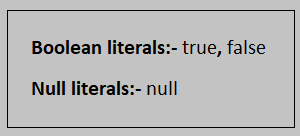

# Java All Keywords List

**Java All Keywords List** | Complete list of 64 reserved words in Java — 51 keywords, 3 literals, and 10 restricted words categorized by usage.

- [Java Keywords List](#java-keywords-list)
- [Important Points](#important-points)
- [Unused Keywords in Java](#unused-keywords-in-java)
- [Table with All Java Keywords](#table-with-all-java-keywords)
- [Reserved Literals in Java](#reserved-literals-in-java)
- [Restricted Words in Java](#restricted-words-in-java)

A predefined identifier that has special meaning in a Java program outside comment and string is called a Keyword. Or, A keyword is a reserved word in Java language inside the compiler and JVM that perform a unique and special operation. A word that is created as part of the compiler and JVM software to represent a value is called Reserved words. We will see the complete list of Java keywords in detail.

In Java, there are **64 reserved words**, **among them 51** are **keywords**, **3** are **literals** and **10 restricted words** are there.

Reserved words (64):

- 🔑 Keywords (51)
- 📊 Literals (3)
- 🔒 Restricted words (10)

Keywords are used to communicate with compiler and JVM to perform one special operation on our program.

---

## 1. Java Keywords List

We can categorize Java keywords list based on their uses.

### 1) Keywords Used for Data Types or Return Types (9)

**Integer values:**

```java
byte
short
int
long
```

**Floating point values:**

```java
float
double
```

**Non-numeric values:**

```java
char
boolean
void
```

Among these 9 Java keywords list, the first 8 are used for both data type and return values. But `void` is used only for the return type. If the method doesn't return any value then the return type of the method is `void`.

### 2) Keywords Used in Control Statements (11)

**Used in conditional statements:**

```java
if
else
switch
case
default
```

**Keywords used in loop:**

```java
do
while
for
```

**Keywords used in control transfer:**

```java
break
continue
return
```

### 3) Keywords Used for Modifiers (11)

**Modifiers:**

```java
static
final
abstract
native
transient
volatile
synchronized
strictfp
```

**Access Modifiers:**

```java
private
protected
public
```

> 📝 **Note:** The "default" is not a keyword. When we don't use any accessibility modifier while declaring class/methods then by default its accessibility within the package.

### 4) Keywords Used While Defining a Java Class (7)

**Class related keywords:**

```java
class
interface
enum
```

**Inheritance relationship related keywords:**

```java
extends
implements
```

**Package related keywords:**

```java
import
package
```

### 5) Object Related Keywords (4)

**Object representation:**

```java
this
super
instanceof
new
```

### 6) Keywords Used in Exception Handling (6)

```java
try
catch
finally
throw
throws
assert
```

### 7) Unused Keywords (2)

```java
goto
const
```

### 8) Other Keyword (1)

```java
_
```

---

## 2. Important Points

There are some important points related to Java keywords,

- 🔑 In Java, every keyword is a reserved word but every reserved word is not a keyword.
- ❌️ We can't use a keyword for a user-defined identifier name. It can't be used for variables, methods, class names.
- 📝 Except for underscore (`_`), all remaining keywords are the combination of lowercase letters and doesn't contain any digit and special characters.

Among these keywords, most of them are given in the Java 1.0 version onwards but some of them were introduced later. Those keywords list with java version is given below.

| Keyword 🏷️ | Java Version 📅 |
|------------|----------------|
| **`strictfp`** | 1.2 |
| **`assert`** | 1.4 |
| **`enum`** | 1.5 |
| **`_`** | 9 |

---

## 3. Unused Keywords in Java

Among 51 keywords, 49 keywords are used keywords and 2 are unused keywords. The unused keywords are: **goto** and **const**.

In Java, `goto` doesn't have any special meaning, so it might be used as an identifier. If we use the `goto` keyword as an identifier, then the programmers coming from C, C++, and Python will get confusion. It had already created a lot of problems in many languages. Therefore, it is not allowed to use the `goto` keyword in Java.

In C/C++ the `const` keyword is used to define the variables as constant. In Java `final` keyword is already there to define constant, which is applicable on variables/methods. So, the `const` keyword is also not allowed in Java.

From the Java 9 version onwards we **can't use a single underscore (`_`) as an identifier** either for naming a class/variable/method or any other programming element. But identifiers like `hello_world` are valid because it is using underscore. Underscore (`_`) is added as a keyword for not getting conflicts with other languages like Python. We can use Java 9 JVM either for running Python or Java-based programs. To run Python programs in JVM software a new rule is created that is: underscore (`_`) is not allowed as an identifier as per Python rule. So, the same rule is implemented in Java compiler software.

> ⚠️ **Caution:** Java doesn't require `goto`, `const` and `_` keywords hence they aren't implemented. Even though they aren't required, Java designers created them as keywords for stopping Java programmers to use them as user-defined identifiers in their programs. If we use them in our Java program then we will get a compile-time error.

---

## 4. Table with All Java Keywords

| Column 1 🏷️ | Column 2 🏷️ | Column 3 🏷️ |
|-------------|-------------|-------------|
| `_` | `extends` | `protected` |
| `abstract` | `final` | `public` |
| `assert` | `finally` | `return` |
| `boolean` | `float` | `short` |
| `break` | `for` | `static` |
| `byte` | `goto` | `strictfp` |
| `case` | `if` | `super` |
| `catch` | `implements` | `switch` |
| `char` | `import` | `synchronized` |
| `class` | `instanceof` | `this` |
| `const` | `int` | `throw` |
| `continue` | `interface` | `throws` |
| `default` | `long` | `transient` |
| `do` | `native` | `try` |
| `double` | `new` | `void` |
| `else` | `package` | `volatile` |
| `enum` | `private` | `while` |

---

## 5. Reserved Literals in Java

Boolean literals: `true`, and `false`
Null literals: `null`



These three are reserved words and literals (value), not keywords. Even though these words are not keywords we can't use them as user-defined identifiers. Boolean literals are used for boolean data types. The `null` is the default value for an object reference.

---

## 6. Restricted Words in Java

To support the Java 9 module system and to create and use the module in Java we got 10 restricted keywords. Restricted keywords mean these keywords are meant for use only in module programming. These keywords don't have any meaning in regular programming inside a class/interface program. So, **inside class/interface we can use them as a user-defined identifier**. This facility added to support backward compatibility. It means for not getting errors on the project those are developed using Java 8 or earlier version.

- `module`
- `requires`
- `transitive`
- `exports`
- `open`
- `opens`
- `to`
- `provides`
- `with`
- `uses`

All the above 10 keywords can't be used individually. Some keywords must use in combination with other keywords. We must use the `transitive` keyword in combination with `requires` keyword. We must use the keyword `to` in combination with either `export` or with `opens`. Similarly, `with` must be used with `provides`.

See: Quiz on Java keywords

If you enjoyed this post, share it with your friends. Do you want to share more information about the topic discussed above or do you find anything incorrect? Let us know in the comments. Thank you!
