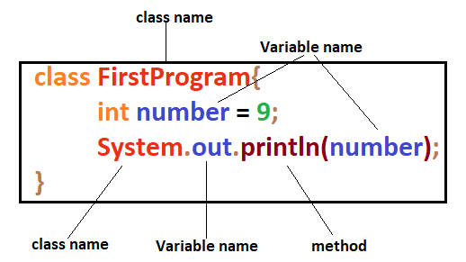
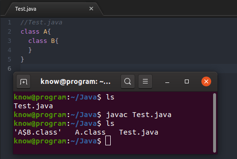

# Identifiers in Java

**Identifiers in Java** | Naming rules for programming elements, use of underscore and dollar sign, predefined names as identifiers, and why identifiers can't start with digits.

- [Rules for Identifiers in Java](#rules-for-identifiers-in-java)
- [Use of Underscore and Dollar in Java](#use-of-underscore-and-dollar-in-java)
- [Why Identifiers in Java Don't Start with a Digit or Having the Digit Only?](#why-identifiers-in-java-dont-start-with-a-digit-or-having-the-digit-only)
- [Predefined Name as Java Identifiers](#predefined-name-as-java-identifiers)

The name of the [basic programming element](010_Tokens_in_Java.md) is called Identifier. Identifiers in Java are used for identifying or finding a programming element from other parts of the program or project.

Keywords are a pre-defined name which has special meaning outside comments and string. If we define any basic programming element without a name then the compiler throws a compile-time error: `<identifier> expected`. In the below image class name, variable names, method names are identifiers.



---

## 1. Rules for Identifiers in Java

There are several rules for defining identifiers in every programming language. In Java the following rules are given:

**1. The identifier should contain only:**

- 🔤 Letters [ (a to z) and (A to Z) ]
- 🔢 Digits (0 to 9)
- 🔣 Special characters (only `$` or `_`)

**2. Identifiers should not start with a digit.** But a digit can be used from the second character onwards.

**Examples:**

```java
1number  // invalid
n1       // valid
num1     // valid
temp122  // valid
```

`1number` is an illegal Java identifier because it starts with a digit, but `n1`, `num1`, `temp122` are valid Java identifiers because digits are placed after the first character.

**3. Java identifiers should not contain any special character except `$` and `_`.** For example: `num$`, `number_one`, `num$_` are valid Java identifiers but `num@`, `#num$` are illegal Java identifiers.

**4. Java identifiers should not contain any space.** Space is also a special character and except `$` and `_` no special characters are allowed. If there is a need to give a gap between words then `_` or `$` can be used. The underscore `_` is also called a connector symbol.

**Examples:**

```java
First Number   // invalid
First_Number   // valid
First$Number   // valid
```

**5. Java identifiers are case sensitive.** The lowercase is different from the upper case.

**Example:**

```java
int number = 10;
int NuMber = 20;
int NUMBER = 30;
int NumbeR = 40;
System.out.println(number); // 10
System.out.println(NuMber); // 20
System.out.println(NUMBER); // 30
System.out.println(NumbeR); // 40
```

**6. The identifier should not contain any keywords and reserved words.**

**7. From Java 9 version onwards single underscore `_` is not allowed as an identifier name.** We can use multiple underscores (`____`) or underscore with a combination of letters/digits/dollar. The identifiers in Java can be started with underscore `_` character. Example: `_____`, `Know_Program`, `_2number`, `_temp` are valid Java identifiers but only `_` is an illegal identifier in Java.

> 📝 **Note:** Predefined class names (like `String`, `Array`), variable names, and method names also can be used as an identifier, but it is not recommended to use them in our program.

> 💡 **Tip:** There is no limitation for the length of the identifiers in the Java language. So, the Java identifiers can be of any length. But it is not recommended to use an identifier having a length of more than 15 characters.

| Rule 📋 | Valid ✅ | Invalid ❌️ |
|---------|---------|-----------|
| **No digit start** | `num1`, `n1` | `1number` |
| **Only $ and _ special chars** | `num$`, `number_one` | `num@`, `#num` |
| **No spaces** | `First_Number` | `First Number` |
| **Case sensitive** | `number` ≠ `NUMBER` | - |
| **No keywords** | `myClass` | `class`, `int` |
| **No single `_`** (Java 9+) | `__`, `_temp` | `_` |

Java Identifiers Quiz

Find Valid Java Keywords

---

## 2. Use of Underscore and Dollar in Java

**Use of underscore in Java:** Most of the time the underscore (`_`) used with `final` variables. In the final variable, all letters should be capital and for more than one word, the words must be connected with `_`. For example: `MIN_BALANCE`, `PI`, `RED`, `BLUE`, `BLACK`, `MAX_PRIORITY`, `INSERT_PRODUCT_QUERY`, and e.t.c.

The [underscore is also used with numeric literals](015_Java_Literals.md). In our real-life for separating digits in number we use comma (`,`) but in Java, we are not allowed to use the comma. The comma (`,`) was already used in Java for separating parameters. As a replacement for comma, we can use `_`. From Java 1.7 onwards we are allowed to place `_` in a number in between digits. This feature makes a number easily understandable and readable. Example: `1_00_000` is valid and more readable compared to `100000`.

The underscore is also used to separate two words in an identifiers. Example: `hello_world_program`. But in Java generally we use camelCase letters, where first character of every word is in capital letter and there is no space between words. Example: `helloWorldProgram`. Both identifiers `hello_world_program` (using underscore), and `helloWorldProgram` (using camelCase) are valid in Java.

**Use of dollar (`$`) in Java:** In regular programming, generally we don't use dollar (`$`). Compiler uses dollar (`$`) for auto-generated names.

For example in the given program we have two classes Class A and B, where class B is the inner class then the compiler generates byte-code files name as `A.class` and `A$B.class`

**Inner class example:**

```java
class A{
  class B{
  }
}
```



---

## 3. Why Identifiers in Java Don't Start with a Digit or Having the Digit Only?

These limitations are given for the following reasons:

- 🖥️ It's a pain to parse electronically.
- 👀 It's a pain for humans to parse.

Let's try to understand some cases where the identifiers in Java starts with a digit or have only a single digit.

**Case 1:**

```java
int 5=9;
System.out.println(5);
```

In 2nd line, the compiler treats this number `5` as variable or integer value. The compiler gets confusion and gives a compile-time error.

**Case 2:**

In programming, we can write the below statement,

```java
int a=9;
int b=a;
```

Now, can we do the same thing with the identifier having only a single digit?

```java
int 5=9;
int b=5;
```

In the second line, what value will compiler store in the variable `b = 5` or `9`? The compiler can't differentiate it and gives a compile-time error.

**Case 3:**

```java
int s = 10;
int 99s = 20;
```

What is the actual value of `s`? This is ambiguous.

Learn more: [why-identifier-not-start-with-a-number](https://stackoverflow.com/questions/1645273/why-can-an-identifier-not-start-with-a-number)

---

## 4. Predefined Name as Java Identifiers

Can we use the predefined name as identifiers name in Java? **Yes we can, but it is not a good programming practice.**

Keywords and reserved words can't be used as an identifier but pre-defined class names, variable names, and method names **can be used** as the identifiers in Java. For example `system`, `out`, and `println` are predefined names but we can use them as an identifier name.

**Predefined names as identifiers:**

```java
class Program{
     public static void main(String[] args) {
        int out = 9;
        long main = 10;
        double println = 10.5;
        System.out.println(out);
        System.out.println(main);
        System.out.println(println);
     }
 }
```

📤 **Output:**

```
9
10
10.5
```

**Why keywords are not used as identifiers in Java programming language?**

Keywords are directly available in JVM so if we use them as our user-defined identifier then JVM can't differentiate them from predefined keywords whereas predefined classes are available in the package so JVM can differentiate our classes from predefined class by using package name.

> 💡 **Tip:** If we create a class with the name `String`, then we must use the pre-defined String name with the package name `java.lang.String`.

### Example-1

**Test.java:**

```java
//Test.java
 class String{
 }
 class Program{
     public static void main(String[] args){
         System.out.println("Hello, World!");
     }
 }
```

```bash
> javac Test.java
```

It creates two files `String.class` and `Program.class`

```bash
> java Program
```

Error: Main method not found in class Program

Why this error occurs? To find this answer we should know how compilation and execution are done in `Test.java` file. The compilation is done successfully because no syntax and grammar mistakes occurred in this program. Due to the command `java Program`, the execution of the program class started.

The first line is `class Program`, the `class` is a keyword and the `program` is an identifier so no logical error. Now, in the second-line `public static void main(String[] args)` where `public` and `static` are keywords, the `void` is a return type, and the `main` is an identifier. Finally, JVM searches for `String`.

🧠 **In Simple Words:**

JVM always searches for any identifier in the following way: Current main method => current class => current Java file => current folder => Java software file (Java\lang). JVM first searches for any identifier in the current main method, then in the current class, after that in the current Java file, then-current folder, if not found then finally it searches in the Java software file (Java\lang).

In this program, JVM found the identifier "String" as a class in the current Java file. So, now the second line is not the main method. Syntax of the 2nd line looks like the main method but it is **not actually the main method**. Here, The string class is user-defined. So, JVM stops execution and gives an exception that the `main method not found`.

This error comes because in the Program class the parameter of the main method is not `java.lang.String`, it is our user-defined class `String`. To execute Program class we must use String class name with package name as `java.lang.String`.

**Fixed version:**

```java
//Test.java
 class String{
 }
 class Program{
     public static void main(java.lang.String[] args){
         System.out.println("Hello, World!");
     }
 }
```

📤 **Output:**

```
Hello, World!
```

---

> ⚠️ **Caution:** It is suggested that use the names in your Java program which makes sense, above valid identifiers are given only for practice purposes.

If you enjoyed this post, share it with your friends. Do you want to share more information about the topic discussed above or do you find anything incorrect? Let us know in the comments. Thank you!
