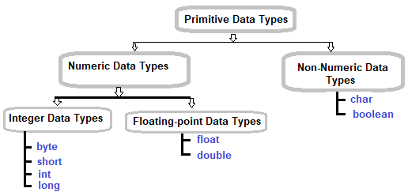
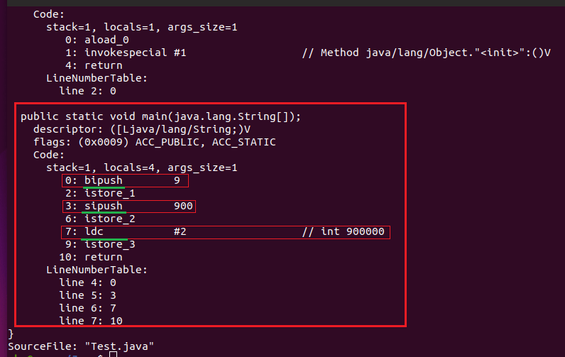

# Data Types in Java

**Data Types in Java** | Understanding primitive and referenced data types, their sizes, ranges, and usage in Java programming.

- [Need for Data Types in Java](#need-for-data-types-in-java)
- [Primitive Data Types in Java](#primitive-data-types-in-java)
- [Byte Data Type in Java](#byte-data-type-in-java)
- [Short Data Type in Java](#short-data-type-in-java)
- [Int Data Type in Java](#int-data-type-in-java)
- [Long Data Type in Java](#long-data-type-in-java)
- [Points on Integer Values](#points-on-integer-values)
- [Double Data Type in Java](#double-data-type-in-java)
- [Float Data Type in Java](#float-data-type-in-java)
- [Special Points on Numeric Values](#special-points-on-numeric-values)
- [Char Data Type in Java](#char-data-type-in-java)
- [Boolean Data Type in Java](#boolean-data-type-in-java)

---

## 1. Need for Data Types in Java

In Java, a keyword that is used for creating variables and objects for storing single or multiple values is called data type.

A variable is a named memory location that is used for storing one value or one object reference. An object is also a memory location but it is used for storing multiple values/objects.

Data types are used to store data temporarily in the computer through a program. In the real world, we have different types of data like integers, floating-point, characters, boolean, arrays, strings, etc. To store all these types of data in the program we must use data types after that, we are able to perform business-required calculations and validations.

Based on storing one or multiple values, Java supports two types of data types:

- 🔢 **Primitive Data type** — used for creating a variable that stores only one value at a time
- 📦 **Referenced Data type** — used for creating an object for storing multiple values of the same type or different type

🧠 **In Simple Words:**
**Primitive data types** store **only one value** at a time. **Referenced data types** store **multiple values** of the same type or different type.

---

## 2. Primitive Data Types in Java

The data types `int`, `double`, `char`, and `boolean` are given based on the type of the value:

- 🔢 **int** — for storing integer values
- 🔟 **double** — for storing floating-point values
- 🔤 **char** — for storing character values
- ✅ **boolean** — for storing logical values `true` and `false`

Using the above four primitive data types we can store any mathematical values. The additional data types `byte`, `short`, `long`, and `float` are given based on the range or precision of the data:

- 📏 **byte** or **short** — used for storing the lesser range integer value
- 📐 **long** — used for storing the larger range integer value
- 🎯 **float** — for storing lesser precision floating-point value



| Primitive Data Type 🔢 | Size 📏 | Default Value 🏷️ | Corresponding Wrapper Class 📦 |
|------------------------|---------|-------------------|-------------------------------|
| **boolean** | 1 bit to 1 byte | `false` | `Boolean` |
| **byte** | 1 byte | `0` | `Byte` |
| **short** | 2 bytes | `0` | `Short` |
| **int** | 4 bytes | `0` | `Integer` |
| **long** | 8 bytes | `0` | `Long` |
| **float** | 4 bytes | `0.0f` | `Float` |
| **double** | 8 bytes | `0.0` | `Double` |
| **char** | 2 bytes | `'\u0000'` | `Character` |

> 📝 **Note:** 8 bits = 1 byte

When JVM encounters data type inside the program then it creates a memory location based on data type size, names with the given name, and stores the assigned value in that memory location. This named memory location is called a variable.

| Data Type 🔢 | Allowed Values 📋 |
|--------------|-------------------|
| **boolean** | `true`, `false` |
| **byte** | -2^7 to 2^7-1 (-128 to 127) |
| **short** | -2^15 to 2^15-1 (-32768 to 32767) |
| **int** | -2^31 to 2^31-1 (-2147483648 to 2147483647) |
| **long** | -2^63 to 2^63-1 (-9223372036854775808 to 9223372036854775807) |
| **float** | -1.7e38 to 1.7e38 (1.40129846432481707e-45 to 3.40282346638528860e+38) |
| **double** | -3.4e38 to 3.4e38 (4.94065645841246544e-324 to 1.79769313486231570e+308) |
| **char** | 0 to 65535 |

> 📝 **Note:** Except for `boolean` and `char`, the remaining Java data types are considered signed data types because they represent both positive and negative values.

**Signed data type example:**

```java
int x1 = 10;     // valid
int x2 = -10;    // valid
char ch1 = 'a';  // valid
char ch2 = -'a'; // invalid
boolean bol1 = true;  // valid
boolean bol2 = -true; // invalid
```

### Example Programs

**Java program to demonstrate all primitive data types:**

```java
class PrimitiveDataTypes {
   public static void main(String[] args) {
      byte b = 9;
      short s = 900;
      int i = 90000;
      long l = 90000000;
      char ch = 'a';
      float f = 10.5F;
      double d = 155.89;
      boolean bol = true;

      System.out.println("byte = " + b);
      System.out.println("short = " + s);
      System.out.println("int = "+ i);
      System.out.println("long = " + l);
      System.out.println("char = " + ch);
      System.out.println("float = " + f);
      System.out.println("double = " + d);
      System.out.println("boolean = " + bol);
   }
}
```

📤 **Output:**

```
byte = 9
short = 900
int = 90000
long = 90000000
char = a
float = 10.5
double = 155.89
boolean = true
```

**Write a Java program to find the sum and average of three integer numbers:**

```java
class PrimitiveDataTypes {
   public static void main(String[] args) {
      int a = 10;
      int b = 20;
      int c = 30;
      int sum = a+b+c;
      double average = sum/3;
      System.out.println("Sum = " + sum + "\t"
                 + "Average = "+average);
   }
}
```

📤 **Output:**

```
Sum = 60	Average = 20.0
```

---

## 3. Byte Data Type in Java

| Property 🏷️ | Value 📋 |
|-------------|---------|
| **Size** | 1 byte |
| **Range** | -2^7 to 2^7-1 (-128 to 127) |
| **Default value** | `0` |
| **Corresponding Wrapper class** | `Byte` |

If we try to assign a value that is not in the range of byte data type then we will get a compile-time error: *error: incompatible types*

```java
byte b1 = -128;  // valid
byte b2 = 10;    // valid
byte b3 = 127;   // valid
byte b4 = 128;   // error
byte b5 = 'a';   // valid
byte b6 = 10.25; // error
```

The ASCII value of the character `'a'` is 97 and it is in the range of byte data type, so `byte b5 = 'a';` is a valid statement.

```java
byte b7 = false; // error
// boolean cannot be converted to byte
```

By default, every integer number is of `int` data type. Therefore, to represent the integer number (example 9) as a `byte` we must explicitly write the below code.

**Variable assignment and casting:**

```java
byte n1 = 9; // variable assignment

// Or,

(byte)9; // casting
// it will convert 9 as int to byte
```

💡 **Tip:** Generally, we don't use the `byte` data type in a regular Java program. If we want to handle data in terms of streams either from the file or streams then `byte` data type is best suitable. The file and network-supported form is a byte. The `byte` data type is mostly used while working with [input-output streams](052_IOStream_in_Java.md).

---

## 4. Short Data Type in Java

It is the most rarely used data type in the Java language. The `short` data type is best suitable for 16-bit microprocessors like 8085 but currently, they are outdated and we have better alternatives. Since 16-bit microprocessors are not used therefore `short` data type is also **outdated**.

| Property 🏷️ | Value 📋 |
|-------------|---------|
| **Size** | 2 bytes |
| **Range** | -2^15 to 2^15-1 (-32,768 to 32,767) |
| **Default value** | `0` |
| **Corresponding Wrapper class** | `Short` |

If we try to assign a value that is not in the range of `short` data type then we will get a compile-time error: *error: incompatible types*

```java
short s1 = 32767;  // valid
short s2 = 32768;  // error
short s3 = 'a';    // valid
short s4 = 900.5;  // error
short s4 = false;  // error
// boolean cannot be converted to short
```

**Representing as short:**

```java
short n2 = 9; // variable assignment

// Or,

(short)9; // casting
// it will convert 9 as int to short
```

---

## 5. Int Data Type in Java

It is the **most used** primitive **data type in Java**. It is used to store an integer value in the Java program.

| Property 🏷️ | Value 📋 |
|-------------|---------|
| **Size** | 4 bytes |
| **Range** | -2^31 to 2^31-1 (-2147483648 to 2147483647) |
| **Default value** | `0` |
| **Corresponding Wrapper class** | `Integer` |

If we try to assign a value that is not in the range of the `int` data type then we will get a compile-time error: *error: incompatible types*

```java
int a1 = -2147483648;  // valid
int a2 = 2147483647;   // valid
int a3 = 2147483648;   // error
int a4 = 2147483648L;  // error
int a5 = 9.5;          // error
int a6 = 'a';          // valid
```

### Comparison with C/C++

Compared to C language, the size of the `int` data type in Java isn't changing from one processor to another processor. In C language, the `int` data type size is changed based on the processor and compiler. For a 16-bit processor, its size is 2 bytes but for a 32-bit/64-bit its size is 4 bytes. Size is changing so we can't get the same result across all systems. In Java, the `int` data type size is always fixed to 4 bytes. Hence we got the same output across all systems even though the processor is changed. Java is robust but C isn't robust.

---

## 6. Long Data Type in Java

Sometimes `int` data type may not enough to **hold big values** like **20! value** or **phone numbers**. Then we should go for a `long` data type. It is used to store large integer numbers. Other examples are: for storing **debit** and **credit card numbers**, **account numbers**, and e.t.c.

| Property 🏷️ | Value 📋 |
|-------------|---------|
| **Size** | 8 bytes |
| **Range** | -2^63 to 2^63-1 (-9223372036854775808 to 9223372036854775807) |
| **Default value** | `0` |
| **Corresponding Wrapper class** | `Long` |

**Representing as long:**

```java
long n3 = 9; // variable assignment
// Or,

(long)9; // casting
// it will convert 9 as int to long

// Or,
9L or 9l  // using suffix L or l
```

> 📝 **Note:** To represent any integer number as a `long` data type we can use the suffix `L` or `l`. The suffix character is only given for the `long` data type, there is no suffix character to represent integer numbers as `byte` & `short`. We must use the cast operator or variable assignment for `byte` and `short` data types.

> 💡 **Tip:** Lowercase `l` (small L) looks like `1` (one) and sometimes it creates confusion, so it is suggested to use the capital letter (`L`) instead of the small letter (`l`) for the `long` data type.

### Errors Due to Long

By default, large integer numbers also consider as `int` type by the Compiler. But large integers are not in the range of `int` data type. Hence when we use a large integer number directly, the compiler will throw an error. The compiler throwing error is "`integer number is too large`"

```java
System.out.println(987654321012345);
// error: integer number too large
```

The compiler considers 987654321012345 as an integer number but this number exceeds the range of the `int` data type, we got an error.

To use a large integer number, we must suffix this number with `L` or `l`. Now, the compiler will treat the number as a `long` type. The number comes under the range of the `long` data type so we don't get any errors.

```java
System.out.println(987654321012345L);
// Output:- 987654321012345
```

The `long` data type has also a range and it does not support a very long number like 100!. In that case, we use the string-referenced data type. `BigDecimal` and `BigInteger` classes are also there to represent large values.

---

## 7. Points on Integer Values

### Errors Due to Integer Data Type in Java

We can get two types of error due to integer data types either "`integer number too large`" or "`incompatible types: possible lossy conversion from <data type1> to <data type2>`".

When we give any integer number then the compiler will check whether that number is in the range of `int` data type or not. If not then we get an error: "`integer number too large`". Else it will check that both sides have the same data type or not.

```java
byte n1 = 987654321012345; // invalid
// integer number too large

byte n1 = 987654321012345L; // error
// error: incompatible types:
// possible lossy conversion from long to byte

short n1 =  987654321012345; // invalid
// integer number too large

short n1 =  987654321012345L; // error
// error: incompatible types:
// possible lossy conversion from long to byte

int n1 =  987654321012345; // invalid
// integer number too large

int n2 =  987654321012345L; // error
// error: incompatible types:
// possible lossy conversion from long to int

long n1 = 987654321012345; // invalid
// integer number too large

long n1 = 987654321012345L; // valid
```

### The Default Data Type of an Integer Number in Java

**By default, every integer number is considered as an `int` data type.** When we use an integer number in a program, then the compiler and JVM will consider this number as an `int` data type.

```java
//Test.java
class Test{
  public static void main(String[] args) {
     m1(9);
  }
  static void m1(byte b){
     System.out.println("Parameter is byte");
  }
  static void m1(short s){
     System.out.println("Parameter is short");
  }
  static void m1(int i){
     System.out.println("Parameter is int");
  }
  static void m1(long l){
     System.out.println("Parameter is long");
  }
}
```

📤 **Output:**

```
Parameter is int
```

In this program, we are using the method overloading concept (We will discuss it later, At this time don't think much about method overloading, it is used here just to prove the concept).

From the main method we call a function `m1()` and method `m1` has a value 9. We don't write anything with 9. So, Compiler and JVM considered the number 9 as an `int` data type. Hence, the method having parameter `int` executed.

### Compiler Code Optimization

We know that `byte`, `short`, and `int` takes 1 byte, 2 bytes, and 4 bytes respectively to store values. The numbers 9, 10, 50 are in the range of `byte` so, we can use `byte` data type instead of `int` data type because `byte` data type should take less memory. But If we use `int` for storing a number for lesser range numbers like 9, 10, 50 e.t.c. then **we don't need to worry about memory loss.**

Compiler software optimizes the code itself to get the best performance by consuming less memory. When we compile the program, compiler software internally verifies how much memory is required for storing the assigned value. It will prepare byte code instructions in `.class` file for JVM.

```java
// Test.java
class Test{
  public static void main(String[] args) {
     int n1 = 9;
     int n2 = 900;
     int n3 = 900000;
  }
}
```

**Verbose output command:**

```bash
> javac Test.java
> java -verbose Test
```



We can observe that 9, 900, and, 900000 were of an `int` data type but for storing these values compiler optimized the code. See more about these instructions [here](https://en.m.wikipedia.org/wiki/Java_bytecode_instruction_listings) and [here](https://stackoverflow.com/questions/50167675/how-does-bipush-work-in-jvm).

---

## 8. Double Data Type in Java

| Property 🏷️ | Value 📋 |
|-------------|---------|
| **Size** | 8 bytes |
| **Range** | -3.4e38 to 3.4e38 (4.94065645841246544e-324 to 1.79769313486231570e+308) |
| **Default value** | `0.0` |
| **Corresponding Wrapper class** | `Double` |

In Java, by default, every floating-point number is of the `double` data type. When we use floating-point numbers then the compiler and JVM will treat the number as a `double` data type. The suffix `D` or `d` is *optional* for the `double` data type. Below all are **valid**:

```java
double d1 = 10;
double d2 = 97.5;
double d3 = 95.5D;
double d4 = 100L;
```

---

## 9. Float Data Type in Java

| Property 🏷️ | Value 📋 |
|-------------|---------|
| **Size** | 4 bytes |
| **Range** | -1.7e38 to 1.7e38 (1.40129846432481707e-45 to 3.40282346638528860e+38) |
| **Default value** | `0.0F` |
| **Corresponding Wrapper class** | `Float` |

We must add suffix `F` or `f` to represent a floating-point number as a `float` data type and to store the floating-point number in a `float` variable.

```java
float n1 = 9.9F;
```

> 📝 **Note:** We can assign floating point numbers directly to the `double` data type but we can't assign them directly to the `float` data type.

```java
float n1 = 9.9;   // Compile-time error, we must use F or f suffix
double n2 = 9.9;  // valid
```

In regular programming calculations, we don't use `float`. If we ensure that the result range is within the range of `float` data type then we can choose a `float` data type for saving memory. Learn More: [Difference between float and double in Java](014_Float_and_Double_in_Java.md)

---

## 10. Special Points on Numeric Values

These points are applicable to `byte`, `short`, `int`, `long`, `float`, and `double` data types in Java.

**1) The assigned value type and its range type must be lesser than the variable type range.**

```java
int n1 = 9;   // valid
int n2 = 9L;  // invalid
```

9 is an `int` type, so it is allowed to store in `int` type variable. `9L` is a `long` type, so it is not allowed to store in `int` type variable. But we can assign `int` type value in lesser range data types i.e. `byte` and `short` type variables.

```java
byte n1 = 9;   // valid
short n2 = 9;  // valid
```

We can't store all integer numbers in the `byte` and `short`-type variables. All data types have a range. We can store only the integers which are in the range of `byte` and `short`.

```java
byte n1 = 300;     // invalid
// byte has range from -128 to 127
short n2 = 60000;  // invalid
// short has range from -32,768 to 32,767
```

**2) To represent integer numbers as byte, short, long, and float type we must use a suffix/prefix or cast operator.**

```java
//Test.java
class Test{
  public static void main(String[] args) {
     int n = 9;

     //int
     m1(n);

     //representing as byte
     byte n1 = 9;
     m1(n1);
     m1( (byte)9 );

     //representing as short
     short n2 = 9;
     m1(n2);
     m1( (short)9 );

     //representing as long
     long n3 = 9;
     m1(n3);
     m1( (long)9 );
     m1(9L);
  }

  static void m1(byte b){
     System.out.println("byte parameter.");
  }
  static void m1(short s){
     System.out.println("short parameter.");
  }
  static void m1(int i){
     System.out.println("int parameter.");
  }
  static void m1(long l){
     System.out.println("long parameter.");
  }
}
```

📤 **Output:**

```
int parameter.
byte parameter.
byte parameter.
short parameter.
short parameter.
long parameter.
long parameter.
long parameter.
```

---

## 11. Char Data Type in Java

| Property 🏷️ | Value 📋 |
|-------------|---------|
| **Size** | 2 bytes |
| **Range** | 0 to 65535 |
| **Default value** | `'\u0000'` |
| **Corresponding Wrapper class** | `Character` |

Any single letter or digit or special character placed inside the single quote is called a character. Example: `'A'`, `'a'`, `'\0'`, `'@'`, e.t.c. Some invalid characters are: A, a, \0, @ (every character must be inside a single quote). In this post, we will discuss the `char` data type in Java.

Every character by default is treated as a `char` data type. To store a single character we need to create a `char` variable. Example:
`char ch1 = 'A';`
`char ch2 = '9';`

**Allowed characters:**

To store a character in `char` data type, inside a single quote:

- ✅ Only one character is allowed
- ✅ Only one space is allowed
- ❌️ Empty (without any character) is not allowed

```java
char ch3 = 'Ab'; // invalid
char ch4 = '';   // invalid, empty
char ch5 = ' ';  // valid, one space is allowed
char ch6 = '  '; // invalid, more than one space
```

The `byte`, `short`, and `int` data types can be assigned to the `char` data type but it must be positive and within the range of the `char` data type.

```java
char ch1 = -97; // error
char ch2 = 97;  // 'a'
char ch3 = 65;  // 'A'
char ch4 = 48;  // '0'
```

🔤 **Char literal can be represented in 4 ways:**

1. Using Character (Ex: `'a'`, `'b'`, and e.t.c.)
2. Integral literal (Ex: 97, 98, and e.t.c.)
3. [Unicode character set](017_Unicode_Character_Set_in_Java.md) (Ex: `'\u0061'`, `'\u0062'` and e.t.c.)
4. Escape character (Example: `'\n'`, `'\t'` and e.t.c.)

**Other errors:**

We can get two types of error due to the `char` data type. If we try to store more than one character in a single quote then we get "error: unclosed character literal" and if we use an empty single quote then we get "`error: empty character literal`".

```java
System.out.println('Ab');
// error: unclosed character literal

System.out.println('   ');
// error: unclosed character literal

System.out.println('');
// error: empty character literal
```

### Char Data Type in Java vs C/C++

Old languages (like C or C++) are ASCII code-based and the number of allowed different ASCII characters is less than or equal to 256. To represent these 256 characters 8 bits are enough hence the size of `char` in old languages is 1 byte.

But Java is Unicode code-based and the number of different Unicode characters is greater than 256 and less than or equal to 65536. To represent these many characters 8 bits may not enough compulsory we should go for 16 bits, hence the size of `char` in Java is 2 bytes.

Java `char` data type is used to represent the Unicode character set. Unicode character set range is 0 - 65535, which occupies 2 bytes of memory. Java supports Unicode character set for developing internationalization (I18N) applications. I18N application means it should display content in the current country's native language in which it is running.

---

## 12. Boolean Data Type in Java

| Property 🏷️ | Value 📋 |
|-------------|---------|
| **Size** | 1 bit to 1 byte |
| **Allowed values** | `true`, `false` |
| **Default value** | `false` |
| **Corresponding Wrapper class** | `Boolean` |

The `boolean` data type in Java is used for representing conditional/logical values `true` and `false`.

The `boolean` data type in Java is incompatible with all other primitive data types, so we can't store those values in the `boolean` data type.

```java
boolean bol1 = true; // valid

// error: incompatible types:
boolean bol2 = 9; // error
// int cannot be converted to boolean

boolean bol3 = 9.99; // error
// double cannot be converted to boolean

boolean bol4 = 'a'; // error
// char cannot be converted to boolean

boolean bol5 = False; // error
boolean bol6 = True; // error
boolean bol7 = "true"; // error
// String cannot be converted to boolean
```

> ⚠️ **Caution:** There are differences between the words `true`, `false` and `True`, `False`. They are not similar, the values `True` and `False` will be treated as variables, therefore they won't be assigned to the `boolean` data type.

**Boolean variable example:**

```java
boolean bol1 = true;
boolean bol2 = false;
```

**Test program:**

```java
//Test.java
class Test{
   public static void main(String[] args) {
      boolean bol1 = true;
      boolean bol2 = false;

      System.out.println(bol1); // true
      System.out.println(bol2);  // false

      System.out.println(true); // true
      System.out.println(false); // false
   }
}
```

**Conditional usage:**

```java
public class B {
   public static void main(String[] args) {
      boolean bol1 = true;
      if(bol1==true)
      System.out.println("It is True");
      else
      System.out.println("It is False");
   }
}
```

📤 **Output:**

```
It is True
```

In general, we will use a `boolean` value for checking conditions. It is mainly used in `if()`, `while()`, `for()` for executing a block of statements either 0 or 1 time or 0 or n times.

In programs, we don't directly place boolean values `true`/`false` in `if()`/`while()`/`for()` statements, rather we place an expression that generates a boolean value `true`/`false` dynamically with the given input values. To generate boolean values dynamically, inside an expression we must use boolean value-generating operators such as relational operators, equality operators, and logical operators.

### Difference Between Boolean Data Type and Others in Java

The `boolean` data type is used in the validations/verifications/checking but not in calculations. It means to confirm whether the given input value is correct or wrong, we will use a `boolean` data type value. Whereas `byte`, `short`, `int`, `long`, `float`, `double`, and `char` are used in calculations to generate output value from given inputs.

### Boolean Data Type in Java vs C/C++

In C language we don't have a `boolean` data type and also we don't have `true` and `false`. In C language we use 0 as false and any +ve or -ve integer as true. Hence in `if()`/`while()`/`for()` conditions we can use an integer number or any expression to execute the block of statement.

| Statement 📝 | C Language 🅰️ | Java Language 🅱️ |
|-------------|--------------|-----------------|
| **`if(0)` / `while(0)`** | ✅ Valid | ❌️ Invalid |
| **`if(1)` / `while(1)`** | ✅ Valid | ❌️ Invalid |
