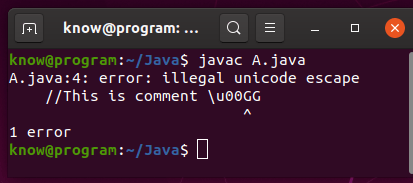

# Unicode Character Set in Java

**Unicode Character Set in Java** | Understanding universal character codes, Unicode representation, and internationalization (I18N) support in Java.

- [How to Represent the Unicode Character Set](#how-to-represent-the-unicode-character-set)
- [Important Points](#important-points)

---

The Unicode stands for **universal characters code**, which contains all countries speaking languages character codes. Unicode character set has 65536 characters from 0 to 65536, so to store it 2 bytes of memory should be allocated.

Unicode character set is used for developing internationalization (I18N) applications. The process of designing web applications in such a way that which provides support for various countries, various languages and various currency automatically without performing any change in the application is called Internationalization (I18N).

🌐 I18N application display content characters on the browser to end-user in that country-specific language. For example, if we open Gmail in Japan, then by default it displays content in Japanese languages. Similarly in France, it displays content in the French language.

---

## 1. How to Represent the Unicode Character Set

The languages that support web application development must support the Unicode character set because web applications are an I18N application. Java supports Unicode character set so, it takes 2 bytes of memory to store `char` data type. To store `char` data type Java uses the Unicode character set.

Unicode is a hexadecimal int type number. So in a Unicode number **allowed characters are 0-9, A-F**. It has a special format that **starts with** `\u` and **ends with** `four characters`. Example: `\uxxxx`

A Unicode character number can be represented as a number, character, and string:

- 🔢 As a number, it can be represented directly using `\uxxxx`
- 🔤 For a character, it can be represented in a single quotation as `'\uxxxx'`
- 📝 Similarly for string, it can be represented in double quotation as `"\uxxxx"`

Like binary, octal, hexadecimal numbers the Unicode number will also be converted into its equivalent decimal number. Actually it is hexadecimal int type.

`int i1 = \u0031;`
is equivalent to
`int i1 = 1;`

The value of hexadecimal 31 in an integer is 49 and the ASCII value of 49 is 1.

`char ch = '\u0031';`
is equivalent to
`char ch = '1';`

`String str = "\u0031";`
is equivalent to
`String str = "1";`

**Unicode to value mapping:**

| Unicode 🔤 | Corresponding Value 📋 |
|-----------|----------------------|
| `\u0030` | 0 |
| `\u0031` | 1 |
| ... | ... |
| `\u0041` | A |
| `\u0042` | B |
| ... | ... |
| `\u0061` | a |
| `\u0062` | b |
| ... | ... |

**Unicode with ASCII details:**

| Unicode 🔤 | ASCII Character 🔠 | ASCII Number 🔢 |
|-----------|-------------------|----------------|
| `'\u0030'` | `'0'` | 48 |
| `'\u0031'` | `'1'` | 49 |
| `'\u0041'` | `'A'` | 65 |
| `'\u0042'` | `'B'` | 66 |
| `'\u0061'` | `'a'` | 97 |
| `'\u0062'` | `'b'` | 98 |

Unicode can form only one character. To form more than one character we should use Unicode literals one after one.

`int n1 = \u0031\u0032\u0033;`
is same as
`int n1 = 123;`

`String s1 = "\u0061\u0062\u0063";`
is same as
`String s1 = "abc";`

**Unicode example program:**

```java
class Unicode{
  public static void main(String[] args) {
     int n = \u0031;
     char ch = '\u0032';
     String str = "\u0033";

     System.out.println(n);
     System.out.println(ch);
     System.out.println(str);
  }
}
```

📤 **Output:**

```
1
2
3
```

**Invalid Unicode example:**

```java
class A{
   public static void main(String[] args) {
     System.out.println("\u00GG");
     // error: illegal unicode escape
   }
 }
```

📤 **Output:**

```
error: illegal unicode escape
```

---

## 2. Important Points

1️⃣ **A Unicode character set that generates the character `'a'`/`'A'` to `'z'`/`'Z'`, must be in single or double quote** else compiler throw error because it will be treated as a variable.

```java
class Unicode{
  public static void main(String[] args) {
     System.out.println(\u0031);

     //error: cannot find symbol
     /* System.out.println(\u0041); */

     System.out.println('\u0041');

     //error: cannot find symbol
     /* System.out.println(\u0041\u0041); */

     System.out.println("\u0041\u0041");
  }
}
```

📤 **Output:**

```
1
A
AA
```

2️⃣ **We can use Unicode character set as a variable name** but it must follow [**identifier rules**](012_Identifiers_in_Java.md) (should not be a digit or any special character). But it is not recommended to use Unicode character set as a variable name, because it is difficult to understand.

```java
class Unicode{
   public static void main(String[] args) {
     int \u0061 = 500;
     System.out.println(\u0061);
     String \u0061\u0061 = "KnowProgram";
     System.out.println(\u0061\u0061);
   }
 }
```

📤 **Output:**

```
500
KnowProgram
```

3️⃣ **We can use Unicode literal inside a program anywhere** but we must use it carefully. We can write a complete Java program only using Unicode literal.

**Complete program in Unicode:**

```java
// A.java

\u0063\u006C\u0061\u0073\u0073 \u0041{
   \u0070\u0075\u0062\u006c\u0069\u0063 \u0073\u0074\u0061\u0074\u0069\u0063 \u0076\u006f\u0069\u0064 \u006d\u0061\u0069\u006e ( \u0053\u0074\u0072\u0069\u006e\u0067[] \u0041) {
     \u0053\u0079\u0073\u0074\u0065\u006d.\u006f\u0075\u0074.\u0070\u0072\u0069\u006e\u0074\u006c\u006e("\u0061\u0061");

   }
}
```

📤 **Output:**

```
aa
```

**The above program is the same as:**

```java
// A.java
class A{
   public static void main(String[] args) {
     System.out.println("aa");
   }
}
```

4️⃣ **We can't place the wrong Unicode literal even inside a comment.** The compiler will keep throwing an error until we remove this wrong literal or correct this literal.

```java
class A{
   public static void main(String[] args) {
     System.out.println("\u0041");
     //This is comment \u00GG
   }
 }
```



> ⚠️ **Caution:** Even in comments, invalid Unicode escapes cause compilation errors. Always verify Unicode values are valid hexadecimal.

5️⃣ **We can suffix char to Unicode literal** but we can't suffix the below characters to a Unicode literal that represents a letter or special characters.

```java
class A{
  public static void main(String[] args) {

     System.out.println(\u0031);
     System.out.println(\u0031L);
     System.out.println(\u0031.0);
     System.out.println(\u0031D);
     System.out.println(\u0031F);

     /*error: cannot find symbol
     System.out.println(\u0041);
     System.out.println(\u0041L);
     System.out.println(\u0071D);
     System.out.println(\u0041F);
     */

  }
}
```

📤 **Output:**

```
1
1
1.0
1.0
1.0
```
