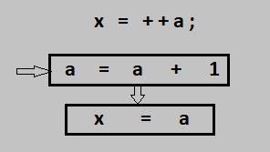
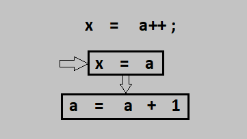
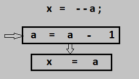
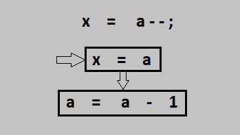

# Increment and Decrement Operators in Java

**Increment and Decrement Operators in Java** | Understanding pre/post increment and decrement unary operators, their behavior, and limitations.

- [Increment Operators (++)](#increment-operators-)
- [Decrement Operators (--)](#decrement-operators---)
- [Limitations](#limitations)
- [Some Important Points on Increment and Decrement Operators in Java](#some-important-points-on-increment-and-decrement-operators-in-java)
- [Increment and Decrement Operators in Java Exercises](#increment-and-decrement-operators-in-java-exercises)

---

Increment and decrement operators in Java are also known as **unary operators** because they operate on a single operand. The increment operator (`++`) adds 1 to its operand and the decrement operator (`--`) subtracts one.

| Operator 🏷️ | Meaning 📋 |
|-------------|-----------|
| **`++`** | Increment Operator |
| **`--`** | Decrement Operator |

**Syntax:**

```java
++variable;    // pre increment operator
variable++;    // post increment operator
--variable;    // pre decrement operator
variable--;    // post decrement operator
```

---

**Summary of expressions:**

| Expression 📝 | Initial Value of `a` 🔢 | Final Value of `a` 🔢 | Value of `x` 📋 |
|------------|------------------------|---------------------|----------------|
| **`x = ++a`** | 4 | 5 | 5 |
| **`x = a++`** | 4 | 5 | 4 |
| **`x = --a`** | 4 | 3 | 3 |
| **`x = a--`** | 4 | 3 | 4 |

---

## 1. Increment Operators (++)

### Pre-Increment Operators in Java (++a)



1️⃣ First, the value of the variable `a` incremented by 1 and store in the memory location of variable `a`.
2️⃣ Second, the value of variable `a` assign to the variable `x`.

```java
 class PreIncrementOperator{
   public static void main(String[] args) {
     int a, x;

     a = 10;
     x= ++a;

     System.out.println("a: "+a);
     System.out.println("x: "+x);
   }
 }
```

📤 **Output:**

```
a: 11
x: 11
```

---

### Post-Increment Operators in Java (a++)



1️⃣ First, the value of the variable `a` will assign to the variable `x`.
2️⃣ Second, the value of the variable `a` will be incremented by 1 and store in the memory location of the variable `a`.

```java
class PostIncrementOperator{
   public static void main(String[] args) {
     int a, x;
     a = 10;
     x = a++;
     System.out.println("a: "+a);
     System.out.println("x: "+x);
   }
 }
```

📤 **Output:**

```
a: 11
x: 10
```

---

## 2. Decrement Operators (--)

### Pre-Decrement Operator in Java (--a)



1️⃣ First, the value of `a` decremented by 1 and store in the memory location of variable `a`.
2️⃣ Second, the value of the variable `a` assigned to the variable `x`.

```java
class PreDecrementOperator{
   public static void main(String[] args) {
     int a, x;
     a = 10;
     x = --a;
     System.out.println("a: "+a);
     System.out.println("x: "+x);
   }
 }
```

📤 **Output:**

```
x: 9
y: 9
```

---

### Post-Decrement Operator in Java (a--)



1️⃣ First, value of variable `a` will assign to the variable `x`.
2️⃣ Second, the value of `a` decremented by 1 and store in the memory location of the variable `a`.

```java
 class PostDecrementOperator{
   public static void main(String[] args) {
     int a, x;
     a = 10;
     x = a--;
     System.out.println("a: "+a);
     System.out.println("x: "+x);
   }
 }
```

📤 **Output:**

```
a: 9
x: 10
```

---

## 3. Limitations

The increment and decrement operators in Java can be applied to every primitive data type except `boolean`. But there are some limitations.

1️⃣ **The Increment and decrement operators in Java only applied on variables (except `final` variables).** It doesn't work with constant values and final variables. If we try to use increment/decrement operators on constant values or final variables, then we will get a compile-time error.

```java
10++; //Compile time error: unexpected type
++10; //Compile time error: unexpected type
```

**Constant value error:**

```java
 class Operators{
     public static void main(String[] args) {
         System.out.println(++9);
         System.out.println(9++);
     }
 }
```

```
> javac Operators.java
Operators.java:3: error: unexpected type
		System.out.println(++9);
		                     ^
  required: variable
  found:    value
Operators.java:4: error: unexpected type
		System.out.println(9++);
		                   ^
  required: variable
  found:    value
2 errors
```

**Final variable error:**

```java
 class FinalVariables{
     static final int a = 5;
     public static void main(String[] args) {
         System.out.println(++a);
         System.out.println(a++);
     }
 }
```

```
> javac Operators.java
Operators.java:4: error: cannot assign a value to final variable a
		System.out.println(++a);
		                     ^
Operators.java:5: error: cannot assign a value to final variable a
		System.out.println(a++);
		                   ^
2 errors
```

> 📝 **Note:** Final variables are also constant because after the initialization value of the final variable can't be modified. So, increment/decrement doesn't work with final variables.

2️⃣ **Nesting of increment and decrement operators in Java is not allowed.**

Guess the output of the below program.

```java
 class Operators {
     public static void main(String[] args) {
         int a = 5;
         int x = ++ (++a);
         System.out.println(x);
     }
 }
```

We will get a compile-time error because the nesting of the increment and decrement operators is not allowed. In this program, due to `++a` the value becomes 6, and now the operation is `int x=++6;` which is invalid.

3️⃣ **Increment and decrement operators in Java don't work on `boolean` and `String` data types.**

```java
boolean bo = true;
bo++; //compile time error:- bad operands boolean

String s1 = "a";
s1++; //Compile time error:- bad operands String
```

4️⃣ **The Increment and decrement operators also don't work on an object reference.**

```java
 class A{}

 class IncDecOperator{
   public static void main(String[] args) {

     A a1 = new A();
     a1++;

     int[] ia = new int[5];
     ia++;
   }
 }
```

```
IncDecOperator.java:5: error: bad operand type A for unary operator '++'
    a1++;
      ^
IncDecOperator.java:8: error: bad operand type int[] for unary operator '++'
    ia++;
      ^
2 errors
```

---

## 4. Some Important Points on Increment and Decrement Operators in Java

After increment and decrement, the [data type](013_Data_Types_in_Java.md) of variable doesn't change. For example: If the variable was `char` data type then after increment/decrement it remains `char` data type.

**Char increment:**

```java
 class Operators {
     public static void main(String[] args) {
         char ch = 'x';
         System.out.println(++ch);
     }
 }
```

📤 **Output:**

```
y
```

**Double increment:**

```java
 class Operators {
     public static void main(String[] args) {
         double a = 5.9;
         System.out.println(++a);
     }
 }
```

📤 **Output:**

```
6.9
```

**Multiple data type demonstration:**

```java
 class IncDecOperator{
   public static void main(String[] args) {

     int x = 10;
     x++;
     System.out.println("x++: "+x);
     ++x;
     System.out.println("++x: "+x);

     long l = 20;
     l++;
     System.out.println("l++: "+l);

     float f = 50.0F;
     ++f;
     System.out.println("++f: "+f);

     double d = 9.0;
     d++;
     System.out.println("d++: "+d);

     char ch = 'a';
     ch++; //Or, ch = (char)(ch+1)
     System.out.println("ch++: "+ch);

     byte b = 1;
     ++b; //Or, b = (byte)(b+1)
     System.out.println("++b: "+b);

     b = 127;
     b++; //Or, b = (byte)(b+1)
     System.out.println("b: "+b);
   }
 }
```

📤 **Output:**

```
x++: 11
++x: 12
l++: 21
++f: 51.0
d++: 10.0
ch++: b
++b: 2
b: -128
```

> 🔑 **Key Point:** When `byte b = 127` is incremented, it overflows to `-128` because the `byte` range is -128 to 127.

---

## 5. Increment and Decrement Operators in Java Exercises

**Find out the output of the below programs?**

**Program1:**

```java
class PostOperator{
   public static void main(String[] args) {

     int x = 10;
     x++;
     System.out.println("x: "+x);

     int y = 10;
     y--;
     System.out.println("y: "+y);

   }
 }
```

📤 **Output:**

```
x: 11
y: 9
```

**Program2:**

```java
 class IncrementOperator1{
   public static void main(String[] args) {
     int x = 1;
     System.out.println("Hi-"+ x++);
     System.out.println("x: "+ x);

     x = 1;
     System.out.println("Hi-"+ ++x);
     System.out.println("x: "+ x);
   }
 }
```

📤 **Output:**

```
Hi-1
x: 2
Hi-2
x: 2
```

**Program3:**

```java
 class IncrementOperator2{
   public static void main(String[] args) {

     int x = 10;
     int y = ++x;
     System.out.println("x: "+ x);
     System.out.println("y: "+ y);

     x = 10;
     y = x++;
     System.out.println("x: "+ x);
     System.out.println("y: "+ y);
   }
 }
```

📤 **Output:**

```
x: 11
y: 11
x: 11
y: 10
```

**Program4:**

```java
 class IncrementOperator3{
   public static void main(String[] args) {
     int x = 10;
     x = ++x;
     System.out.println("x: "+ x);

     x = 10;
     x = x++;
     System.out.println("x: "+ x);
   }
 }
```

📤 **Output:**

```
x: 11
x: 10
```

**Program5:**

```java
 class IncDecOperator{
   public static void main(String[] args) {

     int x = 1;
     int y = x++ + ++x;
     System.out.println("x: "+ x);
     System.out.println("y: "+ y);
     System.out.println();

     x = 1;
     y = x++ + ++x + x++ + x-- + --x + ++x;
     System.out.println("x: "+ x);
     System.out.println("y: "+ y);
     System.out.println();

     x=1;
     y = ++x + --x - x-- + x++ - ++x;
     System.out.println("x: "+ x);
     System.out.println("y: "+ y);
   }
 }
```

📤 **Output:**

```
x: 3
y: 4

x: 3
y: 16

x: 2
y: 0
```
