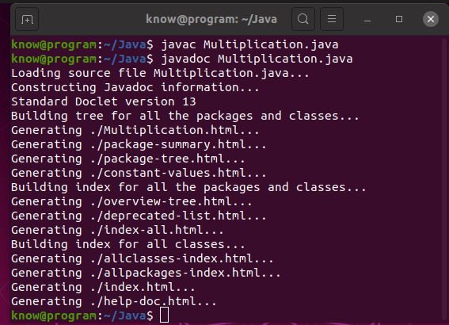
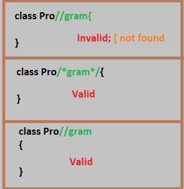
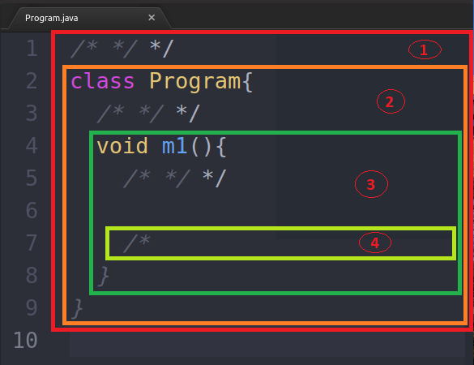
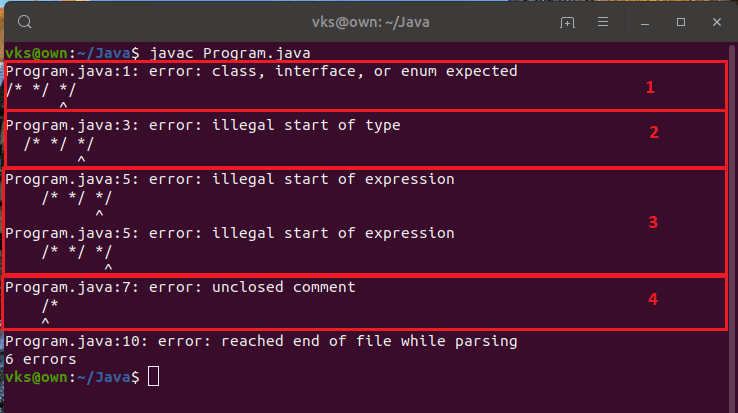
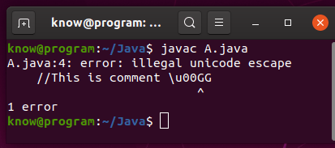

# Different Types of Comments in Java

**Different Types of Comments in Java** | Understanding implementation comments, documentation comments, Javadoc tags, and best practices.

- [Implementation Comments](#implementation-comments)
- [Documentation Comments](#documentation-comments)
- [When We Should Use Implementation Comments and Doc Comments?](#when-we-should-use-implementation-comments-and-doc-comments)
- [Compiler Work for Different Types of Comments in Java](#compiler-work-for-different-types-of-comments-in-java)
- [Error Based on Invalid Comments](#error-based-on-invalid-comments)
- [Use Comments in the Right Way](#use-comments-in-the-right-way)

---

In Java programming, a comment is a piece of code that is not compiled by the compiler. Comments are the portion of the program intended for you and your fellow programmers to understand the code. In simple words, a description of the basic programming element is called comments. There are different types of comments in Java.

🔑 **Key Point:** Comments are totally ignored by Java compilers. The compiler will not generate bytecodes for these comments. So, comments do not appear in the `.class` file.

Java supports two types of comments:

1. 📝 Implementation comments ( `//` and `/* ... */` )
2. 📖 Documentation comments ( `/** ... */` )

---

## 1. Implementation Comments

The **implementation comments** (`//` and `/* ... */`) are used for comments about the particular implementation. In Java, based on the use of implementation comments it can be categorized into four different types. The 4 types of implementation comments in Java are:

1. 📦 Block comment
2. 📝 Single line comment
3. 🏷️ Trailing comments
4. 🔚 End-Of-Line comments

### Block Comment

For providing the description of methods, files, data structures, and algorithms the block comments are used. The block comment can be placed at the beginning of the file, before the method, within a method.

The block comment should be pretended by a blank line to set it apart from the rest of the code.

```java
/*
 * It is an example of block comment.
 */
```

If the block comments are used inside the method then they should be indented to the same level as the code they describe.

```java
void sample() {
   /*
    * It is an example of block comment.
    */
   if(condition) {
      /*
       * The comments inside method should be indented
       * to the same level as the code.
       */
   }
}
```

### Single Line Comment

The single-line comments are used for short comments. It appears on a single line indented to the level of the code that follows.

```java
/* This is an example of single line comment */
```

The single-line comment should be preceded by a blank line. If we are not able to write a comment within a line then we should use block comment instead of a single-line comment.

```java
void sample() {

   /* It is an example of block comment. */
   if(condition) {
      /* comment for the condition */
   }
}
```

### Trailing Comments

It can be used for very short comments. It can be placed on the same line as the code they describe but should be shifted far enough to separate them from the statements. If more than one short comment appears in a chunk of code, they should all be indented to the same tab setting.

```java
if(a==0) {
   return 0;   /* special case */
} else {
   return 1;   /* for postive & negative value of a */
}
```

### End-Of-Line Comments

The end of line comment (`//`) can be used in three places:

1. In place of a single-line comment
2. At the partial line (end-of-line)
3. Consecutive multiple lines for commenting out sections of code

It should not be used on consecutive multiple lines for text comments. But, it can be used in consecutive multiple lines for commenting out sections of code.

```java
void sample(int a, int b) {

   // It is an example of comment
   if( a<0 || b <0 ) {
       return false; //comment
   }
   else return a+b;

   // if( a<0 && b == 0 ){
   //  return 0;
   // } else {
   //  return 1;
   // }

 }
```

---

## 2. Documentation Comments

**Documentation comments are used for describing the specification of the code, from an implementation-free perspective.** We must use document comments for providing the description to programming elements like classes, interfaces, constructors, methods, and fields. The documentation comment should be placed just before the declaration of programming elements.

The documentation comment can be extracted to HTML files using the Javadoc tool.

### Javadoc Comments Example

```java
//This program multiply two numbers
//Multiplication.java

/**
 * Multiplication of two number
 * The Multiplication program implements
 * an application that multiply the two
 * integer numbers and display the output
 * on the screen.
 *
 * @author     Rocco Jerry
 * @version    1.0
 * @since      2019-12-26
 */
public class Multiplication{

   /** This method is used to find
    * the multiplication of two number.
    * @param number1 first parameter of multiply method
    * @param number2 second parameter of multiply method
    * @return int It returns result value
    */
   public static int multiply(int number1, int number2){
       return number1 * number2;
   }

   /**
    * This is main method which make use
    * of multiply method.
    * @param args unused
    */
   public static void main(String[] args) {
      int num1 = 10;
      int num2 = 20;
      int result = multiply(num1, num2);
      System.out.println(num1 + " * " + num2 +" = " + result);
   }
}
```

> 📝 **Note:** Doc comments should not be positioned inside a method or constructor definition block, because Java associates documentation comments with the first declaration after the comment.

### Tags

There are many tags available for documentation comments. Some important and most of the time used tags are given below. They are given in the order, which should be followed for doc comment.

The tags should be included in the following order:

- 🏷️ `@author` (classes and interfaces only, required) — It describes the author of the class. Its syntax `@author name-text`
- 📋 `@version` (classes and interfaces only, required) — It adds a "Version" subheading with the specified version-text to the generated docs when the -version option is used. The syntax is `@version version-text`
- 📥 `@param` (methods and constructors only) — It adds a parameter with the specified parameter-name followed by the specified description to the "Parameters" section. The syntax is `@param parameter-name description`
- 📤 `@return` (methods only) — It adds a "Returns" section with the description text. The syntax is `@return description`
- 🚨 `@exception` — `@throws` is a synonym added in Javadoc 1.2, the syntax is `@throws class-name description`
- 🔗 `@see` — It adds a "See Also" heading with a link or text entry that points to reference. Its syntax `@see reference`
- 📅 `@since` — It adds a "Since" heading with the specified since-text to the generated documentation. The syntax is `@since release`
- 💾 `@serial` (or `@serialField` or `@serialData`)
- ⚠️ `@deprecated` — It adds a comment indicating that this API should no longer be used. The syntax is `@deprecated deprecated-text`

### Generating Doc File

We can generate doc file above program `Multiplication.java`. For generating a doc file from a Java file we will use the command `javadoc`. Like `javac` and `java` commands, `javadoc` is also a java tool. It is used for generating a documentation file (an HTML file). The `javadoc` is also available in the `jdk/bin` folder.

The `javadoc` tool also displays the error message if there is an error that occurred in the doc comment.

```bash
>  javac Multiplication.java
>  javadoc Multiplication.java
```



There are many files generated using the `javadoc` tool. Now, open the `Multiplication.html` file, you will see all documentation of the `Multiplication` class.

💡 **Tip:** We got an enhancement on API doc file generation in the Java 9 version. From Java 9 onwards, for API doc file generation purposes, the Oracle corporation is using HTML5 and jQuery and they provided the search option in the API doc file to find any class easily.

---

## 3. When We Should Use Implementation Comments and Doc Comments?

After generating the API doc file using the `javadoc` tool, the documentation comment will be present in the API doc file.

- ❌️ **We must not use Implementation comments for providing the description to a programming element.** If we use it then there will be no compile-time error, but that description will not be present on the API doc file. Hence, to provide a description of the programming element we must use only the documentation comment.
- ❌️ Similarly, **we must not use documentation comments for the particular implementation.** Here also no compile-time error occurs, but those comments will be available on the doc file.
- ✅ If we need to give information about programming elements that are not related to the documentation then we should use a single line comment or block comment immediately after the declaration.

---

We can place comments anywhere in Java files. We can place comments directly in Java file, inside a class and, inside a method, and even we can place comments inside a class/method/variable name but with care.



---

## 4. Compiler Work for Different Types of Comments in Java

- `//` — Compiler reads and ignores every character after `//` up to the newline. When the newline comes then the compiler starts its own work.
- `/* ... */` — Compiler reads and ignores every character after `/*` and when `*/` comes then it stops ignoring and starts compiling the statements of the Java program.
- `/** ... */` — The statements inside `/** ... */` placed in the java API doc file using the `javadoc` tool. The compiler ignores all the statements from `/**` to `*/`

---

## 5. Error Based on Invalid Comments

We can get four types of error based on invalid comments:

1. 🚨 When an invalid comment is placed directly in a Java file then `error: class, interface, or enum expected`
2. 🚨 If an invalid comment is inside the class then the `error: illegal start of type`
3. 🚨 When an invalid comment is inside the method then we got the `error: illegal start of expression`
4. 🚨 If the comment is inside the method and unclosed then `error: unclosed comment`





> ⚠️ **Caution:** There is an exceptional case with the Unicode character set. We know that any text, words, and characters can be written as a comment, but there is a different case for the Unicode character set. **We can't place wrong Unicode literal even inside a comment.** The compiler will keep throwing an error until we remove this wrong literal or correct this literal. Know more: [Unicode character set in Java](017_Unicode_Character_Set_in_Java.md)

```java
class A{
    public static void main(String[] args) {
      System.out.println("\u0041");
      //This is comment \u00GG
    }
 }
```



---

## 6. Use Comments in the Right Way

Comments should be **used to give overviews of code** and provide additional information that is not readily available in the code itself. Comments should contain only information that is relevant to reading and understanding the program. For example, information about how the corresponding package is built or in what directory it resides should not be included as a comment.

Discussion of nontrivial or non-obvious design decisions is appropriate, but avoid duplicating information that is present in (and clear from) the code. It is too easy for redundant comments to get out of date. In general, avoid any comments that are likely to get out of date as the code evolves.

The frequency of comments sometimes reflects the poor quality of the code. When you feel compelled to add a comment, consider rewriting the code to make it clearer.

> 💡 **Tip:** Comments should not be enclosed in large boxes drawn with asterisks or other characters. Comments should never include special characters such as form-feed and backspace.

---

**Question: Find out the valid and invalid comments from the below list.**

If the Java compiler throws a compilation time error then those comments are invalid.

```
 1. //
 2. /////////////////////
 3. // /*
 4. /*
 5. /* */
 6. /* // */
 7. // /* // */
 8. /* /*       */
 9. /*    */         */
 10. ///*     */       */
 11. /*   /*       */       */
 12. /*   /*       *  /       */
```

> ✅ **Valid Comments for Java are:** 1, 2, 3, 5, 6, 7, 8, 10, 12  
> ❌️ **Invalid Comments are:** 4, 9 and 11

---

For detailed knowledge of the doc comment learn: [How to write Doc comments for the Javadoc Tool](https://www.oracle.com/technical-resources/articles/java/javadoc-tool.html), [Javadoc FAQ](https://www.oracle.com/java/technologies/javase/javadoc-faq.html), [Comments](https://www.oracle.com/java/technologies/javase/codeconventions-comments.html)
