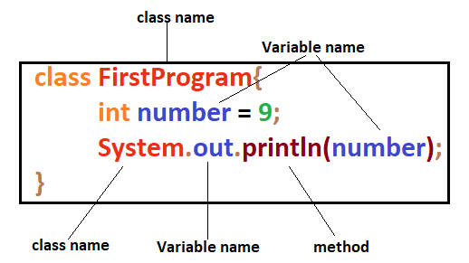
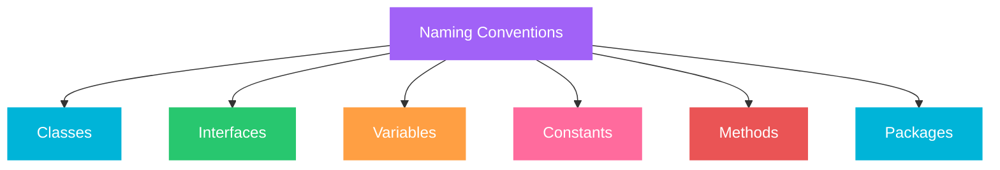

# Java Code Conventions

**Java Code Conventions** | Understanding naming standards for classes, interfaces, variables, constants, methods, packages, and modules.

- [Java Code Conventions for Class and Interfaces](#java-code-conventions-for-class-and-interfaces)
- [Java Code Conventions for Variables and Constants](#java-code-conventions-for-variables-and-constants)
- [Methods](#methods)
- [Package and Module](#package-and-module)

---

The Java code conventions make programs more understandable by making them easier to read. Whenever we are writing code then it is recommended to follow some coding standards and conventions so the readability and maintainability of the code will be improved.

The name of the components should reflect the purpose or functionality of those components. In project development we should choose names for basic programming elements very carefully. The name should be meaningful and relevant to the present context.

For example, if we are developing a project for a bank:

- 🏷️ The class name should be a bank
- 📋 Variable names should be `accountNumber`, `balance`, `username`, `password`, etc.
- ⚙️ Method names should be `withdraw`, `deposit`, `getBalance`, `transferMoney`, etc.

> ⚠️ **Caution:** If we don't follow above coding standards and naming conventions then we don't get any compile-time error and runtime error. But our program is not readable, and not accepted in the project.

🧠 **In Simple Words:** Coding standards and naming conventions are contracts among all Java developers to develop a project with the same styles of code.





---

## 1. Java Code Conventions for Class and Interfaces

### Class

- 🏷️ It represents objects so the name of a class should be a "**Noun**".
- 🔠 The class name should be in title case, which means the first letter should be in the capital. If it contains multiple words then every inner word should start with an uppercase letter.
- 📝 Try to use the class names simple and descriptive.
- 💡 It is recommended to use the whole words. Try to avoid the acronyms and abbreviations unless the abbreviation is much more widely used than the long-form, such as URL or HTML.

For example: `Program`, `Rectangle`, `StringWordsFinder`, `BankAccount`, `String`, `Student`, `Collage`

```java
class Program;
class Rectangle;
class Student;
```

### Interfaces

Interface names are similar to class names. The name of the interface also can be Adjective. Example: `Runnable`, `Serializable`, `Cloneable`, `Moveable`, `Storing`

```java
interface Moveable;
interface Serializable;
interface Runnable;
```

| Element 🏷️ | Case Style 🔠 | Type 📋 | Example 🛠️ |
|------------|-------------|--------|-----------|
| **Class** | TitleCase | Noun | `BankAccount`, `Student` |
| **Interface** | TitleCase | Noun/Adjective | `Runnable`, `Serializable` |

---

## 2. Java Code Conventions for Variables and Constants

### Variables

- 📋 It represents value so, the name should be a "**Countable noun**".
- 🔤 A variable name should be in `camelCaseLetter` (first character of the first word in lowercase and after that first letter of every inner word in uppercase).
- ❌️ The variable name should not start with `_` or `$` characters, even though they are allowed.
- ❌️ One character variable name should be avoided except for the temporary variables.
- 💡 Common names for temporary integer variables are `i`, `j`, `k`, `m`, and `n`. Similarly, common names for temporary characters variables are `c`, `d`, and `e`.

Example: `customerName`, `minimumBalance`, `name`, `age`, `mobileNumber`

```java
int age;
String name;
long mobileNumber;
float minimumBalance;
```

### Constants

Constants are also a variable but they are `final` variables that mean we can't change the value of the variables after initialization. The `static` and `final` modifiers are used for declaring the variables as constant.

- 🏷️ The name of the constants should be a noun.
- 🔠 All characters should be capitalized. If it contains multiple words then words must be separated with underscore `_` symbol.
- ❌️ ANSI constants should be avoided, for ease of debugging.

For example: `MIN_BALANCE`, `PI`, `RED`, `BLUE`, `BLACK`, `MAX_PRIORITY`, `MAX_VALUE`

```java
static final int MAX_VALUE = 10;
static final int MIN_BALANCE = 500;
```

| Element 🏷️ | Case Style 🔠 | Separator 📋 | Example 🛠️ |
|------------|-------------|-----------|-----------|
| **Variable** | camelCase | None | `customerName`, `age` |
| **Constant** | UPPER_CASE | Underscore `_` | `MAX_VALUE`, `PI` |

---

## 3. Methods

- ⚙️ It represents action so the name of the methods should be a "**Verb**".
- 🔤 Method name should be `camelCaseLetter` (first character of the first word in lowercase and after that first letter of every inner word in uppercase). Methods are ended with `()`.

Examples: `print()`, `start()`, `join()`, `getUsername()`, `getPassword()`, `getBalance()`, `findArea()`, `setPassword()`

```java
 print();
 getUsername();
 getPassword();
 findArea();
```

---

## 4. Package and Module

- 📦 It represents group so its name should be a "**Common noun**".
- 🔤 All letters should be lowercase ASCII characters, and its length should be as short as possible.
- 🌐 It should be one of the top-level domain names, currently `com`, `edu`, `gov`, `mil`, `net`, `org`, or one of the English two-letter codes identifying countries.

For example: `io`, `lang`, `util`, `dao`, `beans`, `blogic`, `gui`

The name of module must have two words with `.`:

```java
com.sun.eng
com.apple.quicktime.v2
```

Subsequent components of the package name vary according to an organization's own internal naming conventions. Such conventions might specify that certain directory name components be division, department, project, machine, or login names.

**Summary of all conventions:**

| Element 🏷️ | Case Style 🔠 | Type 📋 | Example 🛠️ |
|------------|-------------|--------|-----------|
| **Class** | TitleCase | Noun | `BankAccount` |
| **Interface** | TitleCase | Noun/Adjective | `Runnable` |
| **Variable** | camelCase | Countable noun | `accountNumber` |
| **Constant** | UPPER_CASE | Noun | `MAX_VALUE` |
| **Method** | camelCase() | Verb | `getBalance()` |
| **Package** | lowercase | Common noun | `com.sun.eng` |

References: [Oracle Java Naming Conventions](https://www.oracle.com/java/technologies/javase/codeconventions-namingconventions.html)
