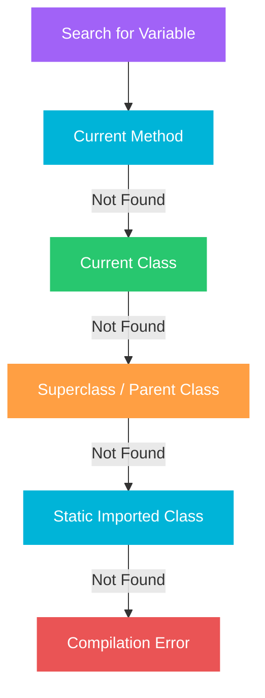

# Static Import in Java

**Static Import in Java** | Understanding static import syntax, execution flow, name conflicts, ambiguity resolution, and comparison with normal import.

- [Execution Flow of Java Static Import](#execution-flow-of-java-static-import)
- [Java Static Import with a Name Conflict](#java-static-import-with-a-name-conflict)
- [Ambiguity in Java Static Import](#ambiguity-in-java-static-import)
- [Normal Import vs Static Import in Java](#normal-import-vs-static-import-in-java)

---

Static import in Java was introduced in the Java SE 5.0 version, which is used to directly access the static members of a class without using its class name.

Up to Java 1.4, we must access static members of one class from another class only by using class-name.

**Without using static import:**

```java
package p1;
public class Example {
   public static int x = 10;
   public static void display(){
      System.out.println("Hello");
   }
}
```

**Accessing static members `x` variable, and `display()` method in another class:**

```java
package p2;
import p1.Example;
public class Test{
   public static void main(String args[]) {
      System.out.println(Example.x);
      Example.display();
   }
}
```

📤 **Output:**

```
10
Hello
```

**Example of predefined classes:**

```java
import java.lang.Math;
public class Test {
   public static void main(String[] args) {
      System.out.println(Math.PI);
      System.out.println(Math.abs(1.9));
      System.out.println(Math.pow(5,2));
   }
}
```

📤 **Output:**

```
3.141592653589793
1.9
25.0
```

In Java 5.0 we got a shortcut, which is called static import. Using the static import feature we can access static members of one class from another class directly by their name, without using class-name.

The syntax for static import is:
`import static packageName.className.*;`

This statement will provide access to all static members of the given class. Note that the name of the concept is `"static import"` but the syntax is having `"import static"`. Example: `import static p1.Example.*;`

**Example using static import:**

```java
package p2;
import static p1.Example.*; // static import
public class Test{
   public static void main(String args[]) {
      System.out.println(x);
      display();
   }
}
```

📤 **Output:**

```
10
Hello
```

```java
import static java.lang.Math.*;
public class MathTest {
   public static void main(String[] args) {
      System.out.println(PI);
      System.out.println(abs(1.9));
      System.out.println(pow(5,2));
   }
}
```

If we want to import only a particular static member using static import concept then we have to use the following syntax:
`import static package.className.staticMember;`

It will import only a particular static member. Example: `import static p1.Example.x;` to import only `x` variable, `import static p1.Example.display;` to import only `display` method.

```java
import static java.lang.System.out;
public class Main {
   public static void main(String[] args) {
      out.println("Hello");
   }
}
```

📤 **Output:**

```
Hello
```

---

## 1. Execution Flow of Java Static Import

Compiler searching preference while using static import:

1️⃣ Current method
2️⃣ Current class
3️⃣ Superclass/Parent class
4️⃣ Static imported class

While compiling `Test.java` compiler found `System.out.println(x);` so it searches in current method i.e. main method of Test class, but it is not available in the main method. Now compiler searches for `x` variable in Test class as a static variable, but here also it is not available. Then the compiler searches for `x` variable in superclass `java.lang.Object`, which doesn't have any `x` variable. Finally compiler checks in static imported classes. From there it will fetch the value of the `x` variable. If there also it is not available then the compiler will give an error.



🔑 **Key points while working with static import statement:**

- 🔒 The accessibility modifier also plays a key role. If the static member is invisible outside of the class then the static import statement can't access them.
- 📦 We can't use static import for non-packaged class. The syntax for static import is `import static package.className.staticMember;` For static import, the class must be packaged.
- 📝 The syntax is `"import static"`, not `"static import"`. If we use `"static import"` then the compiler will give an error.
- 🏷️ Like normal import statement, we can't write `"import static"` before the package name or inside the class declaration. The package statement must be the first statement of the Java file.

**Non-packaged class example:**

```java
public class Example {
   public static int a = 1;
}
```

Since, `Example` class is not inside a package so, we can't use static import concept for `Example` class.

```java
import static Example.*;
public class Test {
   public static void main(String[] args) {
      System.out.println(x);
   }
}
```

```
error: cannot find symbol:- import static Example.*;
```

---

## 2. Java Static Import with a Name Conflict

```java
package p1;
public class Example {
   public static int x = 10;
}
```

**Find the output of the Test class:**

```java
package p2;
import static p1.Example.*;
public class Test{
   static int x = 11;
   public static void main(String args[]) {
      int x = 9;
      System.out.println(x);
   }
}
```

> 💡 **Tip:** The first priority is always given to the local variables, so the correct answer is 9.

```java
package p2;
import p1.Example;
public class Test {
   static int x = 11;
   public static void main(String args[]) {
      int x = 9;
      System.out.println(x);
      System.out.println(Example.x);
      System.out.println(Test.x);
   }
}
```

📤 **Output:** 9, 10, 11. The local variable and class-level variables are differentiated by using the class name. And in this case, to get the value of `x` variable from the `Example` class we have to use a normal import statement.

**Static import name conflict in inheritance:**

```java
package p3;
public class Sample {
   public static int x = 18;
}
```

```java
package p2;
import static p1.Example.*;
import p3.Sample;
public class Test extends Sample {
   public static void main(String args[]) {
      System.out.println(x);
   }
}
```

📤 **Output:** 18, because compiler gives first preference to super class than static import.

> 📝 **Note:** Access level modifier is also play the key role in these types of situations. If the accessibility modifier of `x` variable in `Sample` class is `private` or default then compiler can't access it.

---

## 3. Ambiguity in Java Static Import

If two different classes having static members with the same name, then we can't use static import with `*` to access them directly because the compiler won't be able to determine which member to use.

```java
package p1;
public class Example {
   public static int x = 9;
}
```

```java
package p1;
public class Sample {
   public static int x = 18;
}
```

```java
package p2;
import static p1.Example.*;
import static p1.Sample.*;
public class Test {
   public static void main(String args[]) {
      System.out.println(x);
   }
}
```

```
error: reference to x is ambiguous
```

The `Example` and `Sample` are two different classes, having a static variable `x`. When the Test class tries to access the `x` variable then the compiler can't determine to choose `x` variable from which class because it's available in both classes. The `Example` and `Sample` class may be in the same package or in a different package then also compiler gives error: `reference to x is ambiguous`

> ⚠️ **Caution:** In `java.lang` package Wrapper classes `Character`, `Byte`, `Short`, `Integer`, `Long`, `Float`, and `Double` having some static variables with the same name and different values like `BYTES`, `MAX_VALUE`, `MIN_VALUE`, `SIZE`. Similarly, `Float` and `Double` classes have many static variables with the same name as `MAX_EXPONENT`, `MIN_EXPONENT`, `MIN_NORMAL`, `NaN` and e.t.c. While using static import with these classes we can get an ambiguous error.

```java
import static java.lang.Integer.*;
import static java.lang.Character.*;
public class Test {
   public static void main(String[] args) {
      System.out.println(SIZE);
   }
}
```

```
error: reference to SIZE is ambiguous
```

While using the normal import statement it is a very rare case that two packages contain the same class/interface name. Therefore, while working with a normal import statement there is a rare chance to get an ambiguous error.

But while using a static import statement it can be a common case where two different classes either in the same package or in the different package containing the same static members. Therefore, many times we can get an ambiguous error.

**Solution for this ambiguity:**

If we import the static member with name then compiler won't get confusion. Example: `import static java.lang.Character.SIZE;`

```java
import static java.lang.Integer.*;
import static java.lang.Character.*;
import static java.lang.Character.SIZE;
public class Test {
   public static void main(String[] args) {
      System.out.println(SIZE);
   }
}
```

📤 **Output:** 8

**With our previous example:**

```java
package p2;
import static p1.Example.x;
import static p1.Sample.*;
public class Test {
   public static void main(String args[]) {
      System.out.println(x);
   }
}
```

📤 **Output:**

```
9
```

---

## 4. Normal Import vs Static Import in Java

| Feature 🏷️ | Normal Import 🅰️ | Static Import 🅱️ |
|------------|-----------------|------------------|
| **Static member access** | Only by using class name | Directly without class name |
| **Object creation** | ✅ Can create object, access non-static members | ❌️ Can't create an object of the class |
| **Subclass creation** | ✅ Can create subclass | ❌️ Can't create a subclass |
| **Ambiguity risk** | Rare (two packages rarely have same class name) | Common (two classes can have same static member name) |
| **Unpackaged classes** | ✅ Can be used | ❌️ Can't be used |

If we use a normal import statement then we can use the class name directly, using class name static members of the class can be accessed, and we can create an object the class or subclass.

But using static import we can't access the class-name so, we can't use that class-name inside our Java program. We can't create an object of the class or create a subclass of that class. We are only allowed to use the static members of that class without the class-name. If we try to use static members with class-name then the compiler will give an error until the class is imported normally.

**Static import limitations:**

```java
package p1;
public class Example {
	public static int x = 9;
}
```

```java
package p2;
import static p1.Example.*;
public class Test {
   public static void main(String args[]) {
      System.out.println(Example.x); // error
      Example.display(); // error
      Example e1 = new Example(); // error
   }
}
```

```java
import static p1.Example.*;
public class Sample extends Example {
   //  error: cannot access Example
}
```

Using static import we can't access class-name directly in another Java file. If we use class-name then the compiler give error: `cannot find the symbol`. If we want to use class-name or create an object then we must use normal import statement.

**Normal import limitations:**

```java
package p2;
import p1.Example; // normal import
public class Test{
   public static void main(String args[]) {
      System.out.println(Example.x);
      Example.display();
      Example e1 = new Example();

      System.out.println(x); // error
      display(); // error
   }
}
```

Using normal import we can't use static members of that class directly. If we want to use static members of that class directly, and also with class-name then we must use both normal import and static import.

**Using both normal and static import:**

```java
package p2;
import p1.Example; // normal import
import static p1.Example.*; // static import
public class Test{
   public static void main(String args[]) {
      System.out.println(Example.x);
      Example.display();
      Example e1 = new Example();

      System.out.println(x); // error
      display(); // error
   }
}
```

```java
import p1.Example;
public class Sample extends Example {
   // to create sub class we must
   // use normal import
}
```

---

### Different Syntax

**Different examples with normal import:**

| Import Statement 📥 | Valid? ✅ | Description 📋 |
|--------------------|---------|---------------|
| `import java.lang.System;` | ✅ Valid | Import `System` class of `java.lang` package |
| `import java.lang.System.*;` | ✅ Valid | Import all inner classes of `System` class |
| `import java.lang.System.out;` | ❌️ Error | Error because `out` is not a class |
| `import Example;` | ✅ Valid | Import unpackaged class `Example` |

**Different examples with static import:**

| Static Import Statement 📥 | Valid? ✅ | Description 📋 |
|---------------------------|---------|---------------|
| `import static java.lang.System;` | ❌️ Error | Static member or `*` symbol should be at the end |
| `import static java.lang.System.*;` | ✅ Valid | Import all static members of the `System` class |
| `import static java.lang.System.out;` | ✅ Valid | Import only static member `out` of the `System` class |
| `import static Example.*;` | ❌️ Error | Static import can't be used for unpackaged class |

---

## 5. Final Thoughts

The static import was introduced in Java 5.0 to improve the code readability and enhance coding. But many times it leads to confusion and not good for programming. For multiple static imports, we can't easily find which class a static member comes from. We have to look at the source code of each class. That's why if there is a specific requirement then only we should use static import.

> 💡 **Tip:** If we import a static member with its name like `import static java.lang.System.out;` then it won't create too much confusion.

Also See: [Java naming conventions](023_Java_code_conventions.md)
