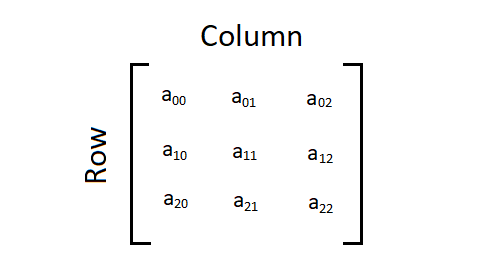

# Java Array Tutorial

**Java Array Tutorial** | The array in Java is a referenced data type used to create a fixed number of multiple variables or objects of the same type to store multiple values of similar type in contiguous memory locations with a single variable name.

- [Array Tutorial in Java](#array-tutorial-in-java)
- [Java Array Programs](#java-array-programs)
- [Java Matrix Programs](#java-matrix-programs)

In Java, the "array" is not a keyword rather it is a concept. It creates continuous memory locations using other primitive or reference data types. It is used to store a fixed number of multiple values and objects of the same types in contiguous memory locations. The size of the array is fixed, which means after the array creation we can't increase or decrease the size of the array.

---

## 1. Array Tutorial in Java

📦 **Must learn:**

1. [Array in Java](026_Java_Array_[With_Examples].md)
2. [Multidimensional Array](027_Multidimensional_Array_in_Java.md)
3. [Anonymous Array](028_Anonymous_Array_in_Java_With_Example.md)
4. [Array of Objects](029_Array_of_Objects_in_Java_With_Example.md)
5. [Jagged Array](030_Jagged_Array_in_Java_with_Example.md)
6. [System.arraycopy()](031_System.arraycopy()_in_Java_with_Examples.md)

📚 **Java Arrays Class:**

- [Arrays Class & Methods](033_Arrays_Class_Java_With_Examples.md)
- Arrays.toString()
- [Arrays.sort()](035_Arrays.sort()_in_Java_With_Examples.md)
- [Arrays.copyof()](036_Arrays.copyOf_in_Java_With_Example.md)
- [Arrays.copyOfRange()](037_Arrays.copyOfRange_in_Java_with_Example.md)
- [Arrays.fill()](038_Arrays.fill()_–_Fill_Java_Arrays.md)
- Arrays.equals()

🔧 **Other tutorial on Java array:**

- How to get Array Input
- [Return Array from a method](042_How_to_Return_an_Array_in_Java.md)
- [2D Array in Java](043_2D_Array_in_Java.md)
- [3D Array in Java](044_3D_Array_in_Java.md)
- [Matrix in Java](045_Matrix_in_Java.md)
- [Array of String in Java](046_String_Array_in_Java.md)
- [Array of double in Java](047_Double_Array_in_Java.md)

---

## 2. Java Array Programs

Increase your knowledge by solving programs on Java array. Read the problems, write the code and check the output.

💻 **Java programs on single dimensional (1D) array:**

- Find Length of Array in Java
- Different ways to Print Array
- Find the Sum of Array in Java
- Find the average of an Array
- Sum of Two Arrays Elements
- Compare Two Arrays in Java
- Copy Array in Java
- Merge 2 Arrays in Java
- Merge two sorted Arrays
- Largest Number in Array
- Smallest Number in Array
- 2nd Largest Number in Array
- [How to Sort an Array in Java](035_Arrays.sort()_in_Java_With_Examples.md)
- Reverse an Array in Java
- GCD of N Numbers in Java
- Linear Search in Java
- Binary Search Program in Java
- Remove Duplicates From Array
- Insert Element at Specific Position
- Add Element to Array in Java
- Remove Element From Array in Java
- Count Repeated Elements in Array

🔢 **More Simple Single Dimensional Array Programs in Java:**

- Count Even and Odd numbers in an Array
- Put Even and Odd Elements in 2 Separate Arrays
- Display Even and Odd numbers in an Array
- Sum of Even and Odd Numbers in Array in Java
- Remove odd numbers from an array java
- Count positive negative and zero from Array
- Print all negative elements in an array
- Separate positive and negative numbers in an array
- Find the sum of positive numbers in an array
- The cumulative sum of an array in Java
- Find numbers that are greater than the given number from an array
- Find average and numbers greater than average in array

---

### Java Matrix Programs

In Java, the matrices are the two-dimensional arrays. It has a row and column arrangement of its elements. A matrix with m rows and n columns can be called an m x n matrix. Individual entries in the matrix are called elements and can be represented by aij which suggests that the element a is present in the ith row and jth column.

🧮 **Multi-dimensional array and Matrix Programs in Java:**

- Print 2D array in Java
- Program to Print 3x3 Matrix
- Sum of matrix elements in Java
- Sum of Diagonal Elements of Matrix
- Row sum and Column sum of Matrix
- Matrix Addition in Java
- Subtraction of two matrices in Java
- Transpose of a Matrix in Java
- Matrix Multiplication in Java
- Menu-driven program for Matrix operations

---

> 📝 **Note:** This page contains links of all the posts (tutorial and programs) related to "Java array".

**JAVA PROGRAMS**
**# Java Array Tutorials**
[**# Java Array Programs**](026_Java_Array_[With_Examples].md)
- Find Length of Array
- Different ways to Print Array
- Sum of Array Elements
- Average of Array Elements
- Sum of Two Arrays Elements
- Compare Two Arrays in Java
- Second Largest Number in Array
- [How to Sort Array - Arrays.sort()](035_Arrays.sort()_in_Java_With_Examples.md)
- Reverse an Array in Java
- GCD of N Numbers in Java
- Linear Search Program in Java
- Binary Search Program in Java
- How to Copy Array in Java
- Merge 2 Arrays in Java
- Merge two sorted Arrays
- Find Largest Number in Array
- Find Smallest Number in Array
- Remove Duplicates From Array
- Insert Element at Specific Position
- Add Element to Array
- Remove Element From Array
- Count Repeated Elements in Array
- [**More Array Programs**](026_Java_Array_[With_Examples].md)

**Java Matrix Programs**
- [Matrix in Java](045_Matrix_in_Java.md)
- Print 2D array in Java
- Program to Print 3x3 Matrix
- Sum of matrix elements
- Sum of Diagonal Elements
- Row sum - Column sum of Matrix
- Matrix Addition in Java
- Subtraction of two matrices in Java
- Transpose of a Matrix in Java
- Matrix Multiplication in Java
- Menu-driven Matrix operations
