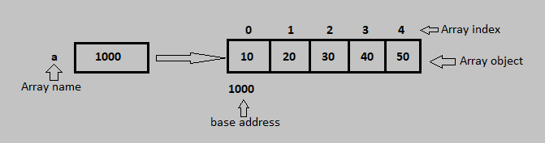
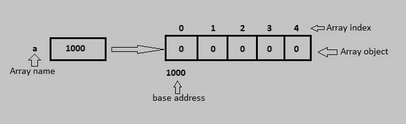

# Java Array [With Examples]

**Java Array [With Examples]** | The array in Java is a referenced data type used to create a fixed number of multiple variables or objects of the same type to store multiple values of similar type in contiguous memory locations with a single variable name.

- [Need of Array in Java](#need-of-array-in-java)
- [Array declaration in Java](#array-declaration-in-java)
- [Array object creation](#array-object-creation)
- [Storing, Reading, and Modifying Array values in Java](#storing-reading-and-modifying-array-values-in-java)
- [Different types of array referenced variables in Java](#different-types-of-array-referenced-variables-in-java)
- [Array declaration in Java as final](#array-declaration-in-java-as-final)
- [Difference between array declaration in Java vs C](#difference-between-array-declaration-in-java-vs-c)

Like other data-type in Java, the array is not a keyword rather it is a concept. It creates continuous memory locations using other primitive or reference data types. It is used to store a fixed number of multiple values and objects of the same types in contiguous memory locations. The size of the array is fixed, it means after the array creation we can't increase or decrease the size of the array.

---

## 1. Need of Array in Java

In Java, using primitive or class type variable we can store only one value or object. If we want to store 100 values then we need 100 variables. Similarly to store 100 object's value we need 100 objects. The variables and objects get memory locations randomly. Using primitive or class type variable we have below two problems:

- 🚫 We can't pass multiple values or objects as one value to a method as an argument.
- 🚫 We can't return multiple values or objects from a method at a time.

For example, if we write a method `m1(int a, int b)` then we can pass only two values to the method. To pass more value we need to write more parameters. The method can't return more than one value. Assume we have a method which calculates the sum, and multiplication of two numbers, Now we want to return both of result to the calling method. But we can't do it using primitive variables, because using primitive or class type variables we can return only one value.

**Example - limitation with primitive variables:**

```java
// We can pass only two
// int value to this method
int m1(int a, int b){
  int add = a+b;
  int multiply = a*b;
  /* We can return either add or multiply.
   * We can't return both at a time using
   * primitive variable
   */
  return add;
  or
  // return multiply;
}
```

```java
int m1(int a){}
/* we can pass only one int value
 * and m1 method can return
 * only one int value.
 */

void m2(int a, int b, int c){}
/* we can pass only three
 * int values to m2 method
 */

void m3(Sample s){}
/* we can pass only one
 * Sample class object to m3()
 */

void m4(Sample s1, Sample s2){}
/* we can pass only two
 * Sample class objects to m4()
 */
```

To solve these problems, we must group all values or objects to send them as a single unit from one application to another application as a method argument or return type. To group them as a single unit we must store them in contiguous memory locations. This can be possible by using the referenced data type array.

---

## 2. Array declaration in Java

📋 **Syntax to declare an array in Java:**

`<Accessibility modifier><Execution-level Modifiers> <datatype>[] <array variable name>;`

In the above declaration of an array, accessibility modifier and execution-level modifier both are optional except all others are mandatory.

**Example of an array declaration:**

`public static int[] arr;`
`public static Sample[] sp;`

Every array location has an index that always starts with 0. This array index is used for storing, reading, and modifying array values.

### Rules for array declaration in Java

1) Like C or C++, in Java we can't mention array size in declaration part (left side). If we don't follow this rule then it leads to a compile-time error: *not a statement*.

**Declaration rules:**

```java
int[] i; // valid
int[3] i; // error
int[3] a; // error
int a[3]; // error
```

2) `[]` is not allowed before data type. Violating this rule leads to a compile-time error: *illegal start of expression*.

We can place `[]`:

- After data type
- Before variable name
- After variable name
- But *not* before the data type

**Bracket placement:**

```java
int[]   a; // valid
int   []a; // valid
int   []   a; // valid
int   a[]; // valid
[]int  a;  // error
```

In Java language, `int[] a`, `int a[]` and `int []a` are the same and compiler convert all three as `int[] a`. But when there is more than one variable are there then it shows different behavior.

**Multiple variable declarations:**

1. `int i, j;` // both `i` and `j` are the variables of int data type
2. `int[] i, j;` // both `i,j` are of type `int[]` i.e. int array
3. `int i[], j;` // `i` is of type `int[]`, and `j` is of type int data type
4. `int []i, j;` // both `i` and `j` are type `int[]`

If we place `[]` before variable then it is applicable to data type not to the variable. In this case compiler moves `[]`, to after data type.

3) `[]` is allowed before the variable only for the first variable that is placed immediately after data-type. The `[]` is not allowed before the variable from the second variable onwards. Violation of this rule leads to compile-time error: *\<identifier\> expected*.

```java
int []i, j[]; // valid
int []i, []j; // error
```

> 📝 **Note:** If we are declaring more than one variable in a line, then it is good practice to write array symbol `[]` along with variables, not with data type. So, that other programmers will not get any confusion.

`int[] a, b; // not recommended`

---

## 3. Array object creation

We have three ways to create an array object.

1. 📦 Array creation with explicit values.
2. 📦 Array object creation without explicit values or array object creation with default values.
3. 📦 Anonymous array

---

### Java Array creation with explicit values

**Syntax:**

`<Accessibility-Modifier><Modifier> <data-type>[] <array-name> = { <list-of-values-with-comma-separator> };`

**Example - array creation with primitive data type:**

`int[] a` = { 10, 20, 30, 40, 50 } ;

In this array object creation, the array contains 5 continuous memory locations with some starting base address, and that address is stored in "a" variable.



In a similar way we can also create an array with a referenced data type. Learn more: [Array of objects in Java](029_Array_of_Objects_in_Java_With_Example.md).

In this array declaration in Java, it has a limitation i.e. we can use `{}` only with variable declaration like `int[] arr = {10, 15, 20};` We can't use this syntax as variable assignment. It means we can't declare an array variable in one place and performing assignment in another place with `{}`.

`int[]` arr; `//` array variable declared
arr = {10, 15, 20}; `//` error

**Other examples of Java Array creation with explicit values:**

`int[] a = {};` // we can create an empty array.
`char[]` ch = { 'k', 'n', 'o', 'w' };
`double[]` d = { 10, 15.9, 20, 25 };

---

### Java Array object creation without explicit values or with default values

**Syntax:**

`<Accessibility Modifier><Modifier><data-type>[] <array-name> = new [<size>];`

**Example - array creation with primitive type:**

`int[] a` = new `int[5];`

From the above statement array object is created with five int type variables. All locations are initialized with the default value (0) of the int data type. In a similar way, we can also create an [array of objects](029_Array_of_Objects_in_Java_With_Example.md).



#### Rules on Size

There are some rules about size, in the array object creation without explicit values or with default values. These rules are:

1) Array size is mandatory. If we do not pass array size it leads to a compile-time error: *array dimension missing*.

```java
int[] a1 = new int[5]; // valid
int[] a2 = new int[]; // error
```

2) We must specify array size only at that array object creation side, not at the declaration side, it leads to a compile-time error: *array dimension missing*.

```java
int[] a1 = new int[5]; // valid
int[5] a2 = new int[]; // error
```

3) Size should be "0" or any "positive int number". If we pass value greater than int data type range or incompatible type values then it leads to a compile-time error: *incompatible types: possible lossy conversion*. If we pass a negative value as size then program compiles fine but leads to an exception `java.lang.NegativeArraySizeException`.

```java
int[] a1 = new int[5]; // valid
int[] a2 = new int[0]; // valid

// error: incompatible types:
// possible lossy conversion
int[] a3 = new int[5L]; // error
int[] a4 = new int[5F]; // error
int[] a5 = new int[9.256]; //error
int[] a6 = new int[(int)5L]; // valid
int[] a7 = new int[(int)5F]; // valid
int[] a8 = new int[(int)9.256]; // valid

// error: incompatible types:
// boolean cannot be converted to int
int[] a9 = new int[false]; // error
int[] a10 = new int[true]; // error
int[] a11 = new int[(int)false]; // error
int[] a12 = new int[(int)true]; // error
int[] a13 = new int['A']; // valid
int[] a14 = new int['a']; // valid

// error: incompatible types:
// String cannot be converted to int
int[] a15 = new int["A"]; // error
int[] a16 = new int["a"]; // error
int[] a17 = new int[-5]; // exception:
// java.lang.NegativeArraySizeException
```

The number -5 is of int data type so the compiler doesn't give any error, but JVM gives exception: `java.lang.NegativeArraySizeException`

4) Source data type and destination data type must be *compatible*, else it leads to a compile-time error: *incompatible types*.

```java
// error: incompatible types
int[] a1 = new float[5]; // error
int[] a2 = new long[3]; // error
Example[] ex1 = new int[2]; // error
Example[] ex2 = new String[3]; // error
String[] ex3 = new Example[2]; // error

int[] a0 = null; // valid
int[] a1 = new int[5]; // valid
int[] a2 = new byte[5]; // error
int[] a3 = new short[3]; // error
int[] a4 = new char[3]; // error
```

> ⚠️ **Caution:** The int data type is compatible to byte, short and char data type, but when it comes to array then the int array is not compatible to byte array, short array and char array.

Learn more: [Anonymous Array in Java](028_Anonymous_Array_in_Java_With_Example.md)

---

### When we should use which way of creation of Array?

All three ways of creation of array object with the example:

1. 📦 Array creation with explicit values. Example: `int[] a = {1,2,3,4};`
2. 📦 Array creation without explicit values or with the default value. Example: `int[] a = new int[4];`
3. 📦 Anonymous array creation. Example: `new int[] {1,2,3,4};`

Now, question is when we should use which declaration?

- ✅ If we already know the type of values, number of values, and also the values of array at the time of array creation then we should use 1st way of creation i.e. array creation with explicit values.
- ✅ When we know only types of values and number of values to stored in the array then we should use the second way of creation i.e. array creation without an explicit value. Later we can update their value from the default value.
- ✅ If there is no use of array after some lines then we should use an [anonymous array in Java](028_Anonymous_Array_in_Java_With_Example.md). We can't access elements of an anonymous array using an index.

---

## 4. Storing, Reading, and Modifying Array values in Java

We can access elements of an array by using its indices. The index of array always start with 0. If the length of array **arr** is **n** then the first element of the array is `arr[0]` and last element of the array is `arr[n-1]`.

**Index example:**

```java
int[] arr = {9, 18, 27, 36};
// In this example,
// arr[0] = 9;
// arr[1] = 18;
// arr[2] = 27;
// arr[3] = 36;
```

**Store, read, and modify array values:**

```java
class Array{
  public static void main(String[] args) {
    // array object creation
    int[] ia = new int[4];
    // Storing values
    ia[0] = 9;
    ia[1] = 18;
    ia[2] = 27;
    ia[3] = 36;
    // reading and displaying values
    // from array
    for(int i=0; i < 4; i++){
      System.out.print(ia[i] + "t");
    }
    // modifying values
    ia[1] = 10;
    ia[2] = 20;
    // reading and displaying values
    // from array
    System.out.println("nAfter Modification,"
                 + " Array elements are: ");
    for(int i=0; i < 4; i++){
      System.out.print(ia[i]+"t");
    }
  }
}
```

📤 **Output:**

```
9 18 27 36
After Modification, Array elements are:
9 10 20 36
```

### ArrayIndexOutOfBoundsException

While storing, reading, and modifying array values, we must pass an array index within the range of `[0, lengthOfArray - 1]`. If we pass a negative value or value greater than the length of the array, it leads to run-time exception: `java.lang.ArrayIndexOutOfBoundsException`

**Exception example:**

```java
class Array{
  public static void main(String[] args) {
    int[] ia = {10, 15, 20};
    System.out.println(ia[-5]);
    System.out.println(ia[9]);
  }
}
```

```
Exception in thread "main" java.lang.ArrayIndexOutOfBoundsException:
 Index -5 out of bounds for length 3
	at Array.main(Example1.java:4)
Exception in thread "main" java.lang.ArrayIndexOutOfBoundsException:
 Index 9 out of bounds for length 3
	at Array.main(Example1.java:5)
```

**Zero-length array exception:**

```java
class Array1{
  public static void main(String[] args) {
    int[] a = new int[0];
    System.out.println(a[0]);
  }
}
```

```
Exception in thread "main" java.lang.ArrayIndexOutOfBoundsException:
 Index 0 out of bounds for length 0
	at Array.main(Example1.java:4)
```

### Length property

Length is a non-static final int type variable. Whenever we create an array object then it is created to store array size. We must use this variable for finding an array object size dynamically for retrieving its elements. Example: if we have a one-dimensional array `a1` then the size of this array is given as `a1.length`.

**Program - read and display array values statically and dynamically:**

```java
class ReadArray{
  public static void main(String[] args) {
    // defining array
    int[] a = {10,20,30,40,50};
    System.out.println("Reading array"
              + " statically: ");
    // reading statically
    for(int i=0; i<5; i++){
      System.out.print( a[i] + "t" );
    }
    System.out.println("nReading array"
              + " dynamically: ");
    //reading dynamically
    for(int i=0; i < a.length ; i++){
      System.out.print( a[i] + "t" );
    }
  }
}
```

📤 **Output:**

```
Reading array statically:
10 20 30 40 50
Reading array dynamically:
10 20 30 40 50
```

> 💡 **Tip:** For reading array elements dynamically, we should use length property. It is better to use length property instead of using static values.

### Program to read and display array in Java

**Program description:** Read integer number from end user and store it in Java program using array. Display the stored integer number.

```java
import java.util.Scanner;
class NumberReader{
  public static void main(String[] args) {
    // Scanner class object to read input
    Scanner scan = new Scanner(System.in);
    // ask size of array from user
    System.out.print("How many numbers "
            + "do you want to store? :: ");
    int n = scan.nextInt();
    // declare array
    int[] arr = new int[n];
    System.out.println("Array object is"
           + " created with length "+n);
    // read integer values from end-user
    // and store it in array
    System.out.println("Enter "+ n
              +" Integer numbers: ");
    for(int i=0; i < arr.length; i++){
      arr[i] = scan.nextInt();
    }
    //displaying array values
    System.out.println("Array elements"
                          +" are: ");
    for(int i=0; i < arr.length; i++){
      System.out.print(arr[i]+"t");
    }
  }
}
```

📤 **Output:**

```
How many numbers do you want to store? :: 5
Array object is created with length 5
Enter 5 Integer numbers:
11 15 19 35 98
Array elements are:
11 15 19 35 98
```

---

## 5. Different types of array referenced variables in Java

Like primitive and other referenced variables, we can store array referenced variables as **static**, **non-static**, and **local**.

If we create an array object with a **static** referenced variable, it is created at the time of class loading. That static referenced variable is created in the method area and its array object is created in the heap memory area. The static array can be accessed anywhere in the program without object creation.

**Static array example:**

```java
class ArrayExample1 {
  // static int array with values
  static int[] a1 = {10, 20, 30, 40};
  // static double array without
  // explicit values or with default
  // values
  static double[] a2 = new double[5];
  // main method
  public static void main(String[] args) {
    // display first array
    System.out.println("Array1 elements: ");
    for (int i=0; i < a1.length; i++) {
      System.out.print(a1[i]+"t");
    }
    // display second array
    System.out.println("nArray2 elements: ");
    for (int i=0; i < a2.length; i++) {
      System.out.print(a2[i]+"t");
    }
  }
}
```

📤 **Output:**

```
Array1 elements:
10 20 30 40
Array2 elements:
0.0 0.0 0.0 0.0 0.0
```

If we create an array object with a **non-static** referenced variable, it is created at the time of that enclosing class object creation. That referenced variable is created in the heap area in that enclosing class object and array object is also created in the heap memory area. To access non-static array we must create an object of the class.

**Non-static array example:**

```java
class ArrayExample2 {
  // non-static int array with values
  int[] a1 = {10, 20, 30, 40};
  // non-static double array without
  // explicit values or with default
  // values
  double[] a2 = new double[5];
  public static void main(String[] args) {
    // create current class object
    ArrayExample2 ae = new ArrayExample2();
    // display first array
    System.out.println("Array1 elements: ");
    for (int i=0; i < ae.a1.length ; i++) {
      System.out.print(ae.a1[i]+"t");
    }
    // display second array
    System.out.println("nArray2 elements: ");
    for (int i=0; i < ae.a2.length ; i++) {
      System.out.print(ae.a2[i]+"t");
    }
  }
}
```

📤 **Output:**

```
Array1 elements:
10 20 30 40
Array2 elements:
0.0 0.0 0.0 0.0 0.0
```

If we create an array object with a **local** referenced variable, it is created when that method is called. That referenced variable is created in that method's stack frame and the object is created in the heap memory area. The array created inside a method is a local array and it can be accessed only inside that method.

**Local array example:**

```java
class ArrayExample3 {
  public static void main(String[] args) {
    // local int array with values
    int[] a1 = {10, 20, 30, 40};
    // local double array without
    // explicit values or with default
    // values
    // display first array
    double[] a2 = new double[5];
    // display first array
    System.out.println("Array1 elements: ");
    for (int i=0; i < a1.length; i++) {
      System.out.print(a1[i]+"t");
    }
    // display second array
    System.out.println("nArray2 elements: ");
    for (int i=0; i < a2.length; i++) {
      System.out.print(a2[i]+"t");
    }
  }
}
```

📤 **Output:**

```
Array1 elements:
10 20 30 40
Array2 elements:
0.0 0.0 0.0 0.0 0.0
```

---

## 6. Array declaration in Java as final

It is possible to declare an array as final. If we declare an array as final then only array object referenced variable becomes final not the array locations. We can't declare array locations as final because we are not creating array locations.

**Example:**

`int[]` a1 = new `int[5];` // normal array, non-final array
`final int[]` a2 = new `int[5];` // final array

In the above example, we can change the array `a2` locations value but we can't assign a new array object reference variable. If we try to assign a new array object then it leads to a compile-time error.

**Final array example:**

```java
class FinalArray{
  public static void main(String[] args) {
    // final int array
    final int[] fa = new int[5];
    // it is valid to modifying array values
    fa[0] = 10;
    fa[1] = 20;
    fa[2] = 30;
    fa[3] = 40;
    fa[4] = 50;
    /*
    If we try to modify array reference value,
    then it leads to compile time error.
    error: cannot assign a value to
    final variable fa
    fa = new int[3];
    */
    //displaying array locations and
    // values at that locations
    for(int i=0; i < fa.length; i++){
      System.out.println(fa[i]+" ");
    }
  }
}
```

📤 **Output:**

```
10 20 30 40 50
```

---

## 7. Difference between array declaration in Java vs C

In C language, Array is a primitive data type whereas in Java array is a referenced data type. In C language, we create an array with just using variable declaration, we don't use the "new" keyword. Whereas in Java we declare an array variable and array object separately, we will use the "new" keyword in array object creation.

In C language, we will specify array size in variable declaration side, whereas in Java we must specify array size object creation side. `int[5] a = new int[5];`

| Array Creation 📋 | C language 🅰️ | Java language 🅱️ |
|---|---|---|
| **`int[5] arr;`** | ✅ Allowed | ❌️ Not allowed |
| **`int[] arr;`** | ❌️ Not allowed | ✅ Allowed |
| **`int[] arr = new arr[5];`** | ❌️ Not allowed | ✅ Allowed |

---

If you enjoyed this post, share it with your friends. Do you want to share more information about the topic discussed above or do you find anything incorrect? Let us know in the comments. Thank you!

**Java Tutorial**
**Java Programs**
- Array in Java
- [Multidimensional Array](027_Multidimensional_Array_in_Java.md)
- [Anonymous Array](028_Anonymous_Array_in_Java_With_Example.md)
- [Array of Objects](029_Array_of_Objects_in_Java_With_Example.md)
- [Jagged Array](030_Jagged_Array_in_Java_with_Example.md)
- [System.arraycopy()](031_System.arraycopy()_in_Java_with_Examples.md)
- **Java Array Programs**

**Java Arrays Class**
- [Arrays Class & Methods](033_Arrays_Class_Java_With_Examples.md)
- Arrays.toString()
- [Arrays.sort() Method](035_Arrays.sort()_in_Java_With_Examples.md)
- [Arrays.copyof()](036_Arrays.copyOf_in_Java_With_Example.md)
- [Arrays.copyOfRange()](037_Arrays.copyOfRange_in_Java_with_Example.md)
- [Arrays.fill()](038_Arrays.fill()_–_Fill_Java_Arrays.md)
- Arrays.equals() Method

**Others**
- Get Array Input in Java
- [Return Array From Method](042_How_to_Return_an_Array_in_Java.md)
- [2D Array in Java](043_2D_Array_in_Java.md)
- [3D Array in Java](044_3D_Array_in_Java.md)
- [Matrix Tutorial in Java](045_Matrix_in_Java.md)
- [Array of String in Java](046_String_Array_in_Java.md)
- [Array of double in Java](047_Double_Array_in_Java.md)
