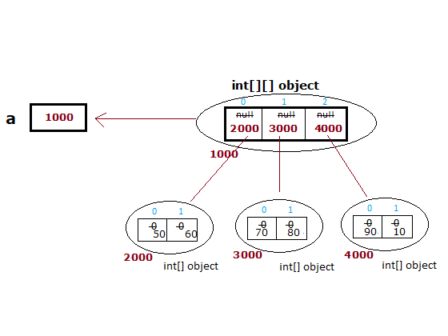
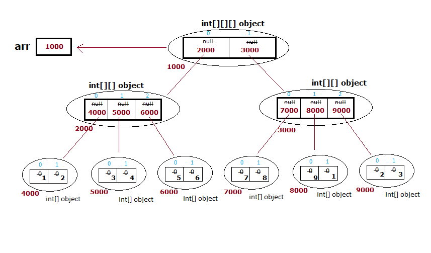
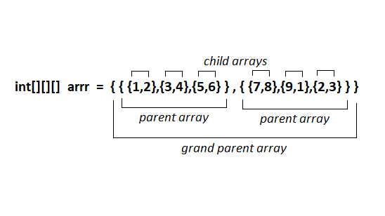

# Multidimensional Array in Java

**Multidimensional Array in Java** | An array of arrays used for representing data in table format, where dimensions mean levels in the array object memory.

- [Declaration of Multidimensional Array in Java](#declaration-of-multidimensional-array-in-java)
- [Multidimensional Array creation in Java](#multidimensional-array-creation-in-java)
- [Accessing, Modifying and Reading Two Dimensional Array in Java](#accessing-modifying-and-reading-two-dimensional-array-in-java)
- [Two Dimensional Array in Java Example Program](#two-dimensional-array-in-java-example-program)
- [Accessing, Modifying and Displaying Three Dimensional Array in Java](#accessing-modifying-and-displaying-three-dimensional-array-in-java)
- [Program for Three Dimensional Array](#program-for-three-dimensional-array)
- [Passing and Returning Multidimensional Array](#passing-and-returning-multidimensional-array)
- [Java Program to Find Sum of Two matrix](#java-program-to-find-sum-of-two-matrix)

In Java, a Multidimensional array is an array of arrays. Basically multidimensional arrays are used for representing data in table format. Here the dimensions mean level in the array object memory. If only one level is there, then it is a single-dimensional array, and If two levels are there, it is a two-dimensional array. Similarly, If three levels are there, it is a three-dimensional array.

Every Language support two types of arrays: single dimensional array and multidimensional array. An array that can store multiple values or multiple objects of a called single dimensional array. The single-dimensional array is also called an array of objects or values. An array that is meant for storing other arrays is called a multidimensional array. A multidimensional array is also called an **array of arrays**.

---

## 1. Declaration of Multidimensional Array in Java

📋 **Syntax for two dimensional array:**

`<Accessibility modifier><Execution-level Modifiers> <datatype>[][] <array variable name>;`

**Example of multidimensional array declaration:**

```java
// 2d array
public static int[][] n1;

// 3d array
public static float[][][] n2;
```

In the above declaration of array, accessibility modifier and execution-level modifier both are optional except are all mandatory.

The dimension or level is represented by `[]`. Single dimensional array contains `[]`, two dimensional array contains `[][]`, and three dimensional array contains `[][][]`, and so on.

### Rules in Declaration of Multidimensional Array in Java

1) Similarly like [single dimensional array in Java](026_Java_Array_[With_Examples].md), we can't place `[]` before data type, else it will give compile time error: *illegal start of expression*.

**Valid and invalid declarations:**

```java
int[][]  i; // valid
int[]  []i; // valid
int[]  i[]; // valid
int  [][]i; // valid
int  []i[]; // valid
int  i[][]; // valid
[]int  i[]; // error
[]int[]  i; // error
[][]int  i; // error
```

2) We can't mention size in declaration part. Violation of this rule leads to compile time error: *not a statement*.

```java
int[5][]  i; // error
int[][5]  i; // error
```

> ⚠️ **Caution:** Be careful at the time of declaration. There are different meaning for different declarations.

- `int[][] i, j;` // both i and j are of type `int[][]`
- `int[] i[], j;` // i is of type `int[][]`, but j is of type `int[]`
- `int[] i[][], j;` // i is of type `int[][][]`, and j is of type `int[]`

---

## 2. Multidimensional Array creation in Java

Similarly like one dimensional array, multidimensional array also can be created in three ways. We have three ways to create array object.

1️⃣ **Multidimensional array creation with values.**

📋 **Syntax to initialize two dimensional array in Java:**

`<Accessibility modifier><Execution-level Modifiers> <datatype>[][] <array-variable-name> = {<list-of-array-elements>};`

For example: `int[][] a = {{5,6},{7,8},{9,10}};`

2️⃣ **Array object creation without explicit values or with default values.**

📋 **Syntax for two dimensional array:**

`<Accessibility modifier><Execution-level Modifiers> <datatype>[][] <array-variable-name> = new <datatype>[<parent-array-size>][<child-array-size>];`

For example: `int[][] ia = new int[3][2];`

From this statement we can say:

- 📦 One parent array is created with 3 locations
- 📦 Three child arrays are created with 2 locations

Parent array size gives below two information:

- 🔢 Parent array's number of locations
- 🔢 Number of child array

In this way of multidimensional array creation in Java, the base/parent array size is mandatory where as child array size is optional.

**Valid and invalid creation:**

```java
int[][] a = new int[3][]; // valid
int[][] a = new int[][3]; // error
int[][][] a = new int[3][][]; // valid
int[][][] a = new int[][3][]; // error
int[][][] a = new int[3][3][]; // valid
int[][][] a = new int[][][3]; // error
```

> 💡 **Tip:** If we do not pass child array size, then child array objects are not created, only parent array object is created. Later developer has to pass array objects. If we pass child array size, all child array are created with same size. If we want to create child arrays with different sizes we must not pass child array size.

3️⃣ **Anonymous array.** Example: `new int[][] {{5,6},{7,8},{9,10}};`

---

## 3. Accessing, Modifying and Reading Two Dimensional Array in Java

The two dimensional array can be accessed using `<arrayName>[parent array location index][child array location index]`.

**Example:**

`int[][] a = new int[3][2];`

**Accessing and initializing above array:**

```java
a[0][0] = 50;
a[0][1] = 60;
a[1][0] = 70;
a[1][1] = 80;
a[2][0] = 90;
a[2][1] = 10;
```

It is similar to: `int[][] a = {{50,60},{70,80},{90,10}};`



To display the multidimensional array we can use for loop or for-each loop for easy purpose. If multidimensional array have 2 levels i.e. two dimensional than it required two for loop or for-each loop.

**Display 2D array using for loop:**

```java
// displaying two dimensional array in
// java using for loop and length property
for(int i=0; i < a.length; i++){
  for(int j=0; j < a[i].length; j++){
    System.out.println( a[i][j] );
  }
}
```

Above array is 2 dimensional so we required two for loops. The array is of size 3*2 so we can also directly use `i<3` and `j<2`, but it is better to use the length property. The `a.length` gives the size of parent array and `a[i].length` gives the size of child array. Note that here `i` is a variable used in outer for loop.

**Display 2D array using for-each loop:**

```java
// displaying two dimensional array
// using for-each loop
for(int[] i: a){
  for(int j : i){
     System.out.println(j);
  }
}
```

> 💡 **Tip:** To only display the multidimensional array it is better to use a for-each loop instead of using for loop. The above array is two-dimensional so we required two for-each loops. The array "a" is 2 dimensional so the first variable `i` iterates through parent array location hence, `int[] i : a` is used. The variable `j` will iterates child of `i` so `int j : i` is used.

---

## 4. Two Dimensional Array in Java Example Program

**Complete 2D array program:**

```java
class TwoDimensionalArray{

  public static void displayTwoDArray(int[][] a){
    for(int[] i: a){
      System.out.println();
      System.out.println("Parent array holds: " + i);
      for(int j : i){
        System.out.print(" "+j+"\t");
      }
    }
  }

  public static void main(String[] args) {

    // declare 2d array in Java
    int[][] a = new int[3][2];

    // Initializing the values
    a[0][0] = 50;
    a[0][1] = 60;
    a[1][0] = 70;
    a[1][1] = 80;
    a[2][0] = 90;
    a[2][1] = 10;

    // displaying 2d array
    System.out.println("Two dimensional array");
    displayTwoDArray(a);

    // modyfying some values
    a[0][1] = 609;
    a[1][0] = 107;
    a[2][1] = 190;

    // displaying 2d array after modification
    System.out.println("\n\nAfter modifying"
                        +"array values");
    System.out.println("The Two dimensional array is:");
    displayTwoDArray(a);
  }
}
```

📤 **Output:**

```
Two dimensional array

Parent array holds: [I@3cd1a2f1
50 60
Parent array holds: [I@3fee733d
70 80
Parent array holds: [I@5acf9800
90 10

After modifying array values
The Two dimensional array is:

Parent array holds: [I@3cd1a2f1
50 609
Parent array holds: [I@3fee733d
107 80
Parent array holds: [I@5acf9800
90 190
```

---

## 5. Accessing, Modifying and Displaying Three Dimensional Array in Java

**Three dimensional array creation:**

`int[][][] arr = new int[2][3][2];`

**Accessing and initializing above array:**

```
arr[0][0][0] = 1;
arr[0][0][1] = 2;
arr[0][1][0] = 3;
arr[0][1][1] = 4;
arr[0][2][0] = 5;
arr[0][2][1] = 6;
arr[1][0][0] = 7;
arr[1][0][1] = 8;
arr[1][1][0] = 9;
arr[1][1][1] = 1;
arr[1][2][0] = 2;
arr[1][2][1] = 3;
```

We can declare and initialize in a single line:

`int[][][] arr = { {{1,2},{3,4},{5,6}}, {{7,8},{9,1},{2,3}} };`



**Display 3D array using for-each loop:**

```java
// displaying three dimensional array in Java using
// for-each loop
for(int[][] i: arr){
  for(int[] j : i){
    for(int k: j){
      System.out.println(k);
    }
  }
}
```

**Display 3D array using for loop and length property:**

```java
// displaying three dimension array in Java
// using for loop and length property
for(int i=0; i < arr.length; i++){
  for(int j=0; j < arr[i].length; j++){
     for(int k=0; k < arr[i][j].length; k++){
        System.out.println( arr[i][j][k] );
     }
  }
}
```

---

## 6. Program for Three Dimensional Array

Program to create, modify and display the three dimensional array.



**3D array example program:**

```java
class ThreeDimensionalArray{

  public static void displayThreeDArray(int[][][] a){
    for(int[][] i: a){
      System.out.println();
      System.out.println("Grand parent array holds:" + i);
      for(int[] j : i){
        System.out.println("Parent array holds:" + j);
        for(int k: j){
          System.out.print(" "+k+"\t");
        }
        System.out.println();
      }
    }
  }

  public static void main(String[] args) {

    // declare 3d array
    int[][][] arr = new int[2][3][2];

    // initializing the value
    arr[0][0][0] = 1;
    arr[0][0][1] = 2;
    arr[0][1][0] = 3;
    arr[0][1][1] = 4;
    arr[0][2][0] = 5;
    arr[0][2][1] = 6;
    arr[1][0][0] = 7;
    arr[1][0][1] = 8;
    arr[1][1][0] = 9;
    arr[1][1][1] = 1;
    arr[1][2][0] = 2;
    arr[1][2][1] = 3;

    // displaying 3d Java array
    System.out.println("The three dimensional array");
    displayThreeDArray(arr);

    // modifying some values
    arr[0][0][0] = 9999;
    arr[0][1][1] = 4656;
    arr[1][1][1] = 1628;

    // displaying 3d array after modification
    System.out.println("\nAfter modifying some values");
    System.out.println("The three dimensional array is:");
    displayThreeDArray(arr);
  }
}
```

📤 **Output:**

```
The three dimensional array

Grand parent array holds:[[I@2f0e140b
Parent array holds:[I@7440e464
1 2
Parent array holds:[I@4617c264
3 4
Parent array holds:[I@36baf30c
5 6

Grand parent array holds:[[I@7a81197d
Parent array holds:[I@5ca881b5
7 8
Parent array holds:[I@24d46ca6
9 1
Parent array holds:[I@4517d9a3
2 3

After modifying some values
The three dimensional array is:

Grand parent array holds:[[I@2f0e140b
Parent array holds:[I@7440e464
9999 2
Parent array holds:[I@4617c264
3 4656
Parent array holds:[I@36baf30c
5 6

Grandparent array holds:[[I@7a81197d
Parent array holds:[I@5ca881b5
7 8
Parent array holds:[I@24d46ca6
9 1628
Parent array holds:[I@4517d9a3
2 3
```

---

## 7. Passing and Returning Multidimensional Array

Like single dimensional array, the multidimensional array in Java also can be passed to a method, and returned from a method. In the above programs we have passed multi-dimensional array to `display()` function to display the array. Now we develop another Java program.

### Passing multidimensional array to a method

**Passing 2D array to a method:**

```java
class TwoDArray{

  static void displayTwoDArray(int[][] a){
    // using for-each loop
    for(int[] i: a){
      for(int j : i){
        System.out.printf("%d\t",j);
      }
      System.out.println();
    }
  }

  public static void main(String[] args) {
    int[][] arr = {{50,60},{70,80},{90,10}};
    System.out.println("2D array values:");
    displayTwoDArray(arr);
  }

}
```

📤 **Output:**

```
2D array values:
50 60
70 80
90 10
```

The method `displayTwoDArray()` is developed to display the two dimensional array. The method has parameter `int[][] a`. In this method for-each loop is used to iterate the two dimensional array. Inside main method a two dimensional array `arr` is declared, created and initialized with explicit values.

### Returning Multidimensional Array from a method

**Returning 2D array from a method:**

```java
class TwoDArray{

  static int[][] initializeTwoDArray(){
    int[][] a = {{50,60},{70,80},{90,10}};
    return a;
  }

  public static void main(String[] args) {
    int[][] arr = initializeTwoDArray();
    System.out.println("2D array values:");
    for(int[] i: arr){
      for(int j : i){
        System.out.printf("%d\t",j);
      }
      System.out.println();
    }
  }

}
```

📤 **Output:**

```
2D array values:
50 60
70 80
90 10
```

In this program, one method is developed which create, declare, and initialize the two-dimensional array and returned to the caller method. It returns a dimensional array of int type so the return type of the method is `int[][]`. The remaining all are similar to previous programs.

---

## 8. Java Program to Find Sum of Two matrix

In this program we will demonstrate both operations (passing multidimensional array to a method and returning multidimensional array to a method) in a single program. For the addition of two matrices, both matrix should have equal size of row and column.

**Program description:** Develop a Java program to find the sum of two matrix. In this program two matrices should be passed to a method, and calculate the addition of both matrix inside the method and then return it to the caller method.

**Matrix sum program:**

```java
class TwoDArraySum {

  static void displayMatrix(int[][] a) {
    for(int[] i: a){
      for(int j : i){
        System.out.printf("%4d", j);
      }
      System.out.println();
    }
  }

  static int[][] sumOfMatrix(int[][] a, int[][] b){
    int[][] sum = new int[a.length][a[0].length];
    for(int i=0; i < a.length; i++){
      for(int j=0; j < a[0].length; j++){
        sum[i][j] = a[i][j] + b[i][j];
      }
    }
    return sum;
  }

  public static void main(String[] args) {
    int[][] a = {{1,2,3},{4,5,6}};
    int[][] b = {{4,2,5},{7,9,12}};
    // displaying both matrix
    System.out.println("First matrix is: ");
    displayMatrix(a);
    System.out.println("Second matrix is: ");
    displayMatrix(b);
    // Finding Sum of both matrix
    int[][] c = sumOfMatrix(a,b);
    // displaying sum
    System.out.println("Sum of both matrix is: ");
    displayMatrix(c);
  }

}
```

📤 **Output:**

```
First matrix is:
1 2 3
4 5 6
Second matrix is:
4 2 5
7 9 12
Sum of both matrix is:
5 4 8
11 14 18
```

### Explanation

In the above program two 2D array is created with explicit values. For better understanding purpose we print both matrix to the screen. Matrix is displayed using the method `displayMatrix()`, it is similar to passing the single dimensional array, Only one level (dimension) is increased for the 2D array. Inside this method `printf()` is used, it will format the output into 4 spaces.

In this program in main method, we required another 2D array which will store sum of both matrix, for this purpose matrix **c** is declared and it will initialized with values returning from the `sumOfMatrix()` method.

We passed a and b matrix to the method `sumOfMatrix()`. Inside this method we need a local 2D array which can store the sum values. So, one 2D matrix **sum** is created. It is initialized with default values, `a.length` gives the size of row of matrix **a** and `a[0].length` gives the size of first column of matrix **a**.

`int[][] sum = new int[a.length][a[0].length];`

> 📝 **Note:** The size of each column of matrix a will be same so we can choose first or second or any column, it will not create any problem (matrix each column is always of same size). Here, `a[0].length` and `a[1].length` gives same result.

Finally sum is calculated and stored in the array **sum** and it is returned to the main method. Inside main method using these returning values, the matrix **c** is initialized. Later, to display the result, the matrix c is passed to the method `displayMatrix()`.

A multi-dimensional array with different sizes child array is called a **[Jagged array](030_Jagged_Array_in_Java_with_Example.md)**. Learn more multidimensional array program in Java: Matrix Addition in Java, Transpose of a Matrix in Java, Matrix Multiplication in Java

---

If you enjoyed this post, share it with your friends. Do you want to share more information about the topic discussed above or do you find anything incorrect? Let us know in the comments. Thank you!

**Java Tutorial**
**Java Programs**
- [Array in Java](026_Java_Array_[With_Examples].md)
- Multidimensional Array
- [Anonymous Array](028_Anonymous_Array_in_Java_With_Example.md)
- [Array of Objects](029_Array_of_Objects_in_Java_With_Example.md)
- [Jagged Array](030_Jagged_Array_in_Java_with_Example.md)
- [System.arraycopy()](031_System.arraycopy()_in_Java_with_Examples.md)
- [**Java Array Programs**](026_Java_Array_[With_Examples].md)

**Java Arrays Class**
- [Arrays Class & Methods](033_Arrays_Class_Java_With_Examples.md)
- Arrays.toString()
- [Arrays.sort() Method](035_Arrays.sort()_in_Java_With_Examples.md)
- [Arrays.copyof()](036_Arrays.copyOf_in_Java_With_Example.md)
- [Arrays.copyOfRange()](037_Arrays.copyOfRange_in_Java_with_Example.md)
- [Arrays.fill()](038_Arrays.fill()_–_Fill_Java_Arrays.md)
- Arrays.equals() Method

**Others**
- Get Array Input in Java
- [Return Array From Method](042_How_to_Return_an_Array_in_Java.md)
- [2D Array in Java](043_2D_Array_in_Java.md)
- [3D Array in Java](044_3D_Array_in_Java.md)
- [Matrix Tutorial in Java](045_Matrix_in_Java.md)
- [Array of String in Java](046_String_Array_in_Java.md)
- [Array of double in Java](047_Double_Array_in_Java.md)
