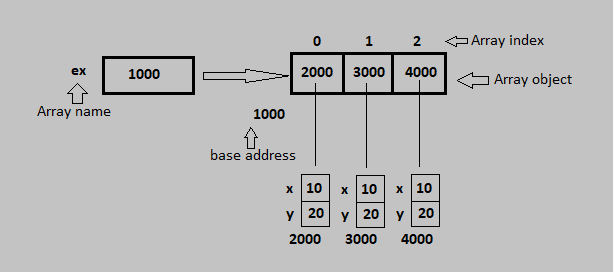
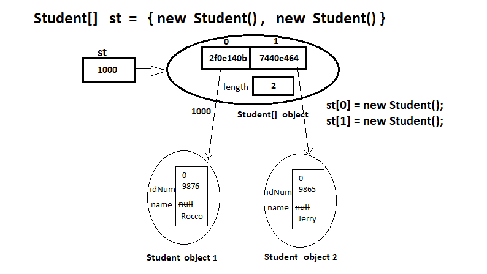
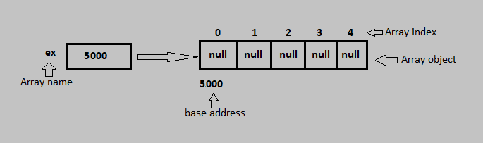
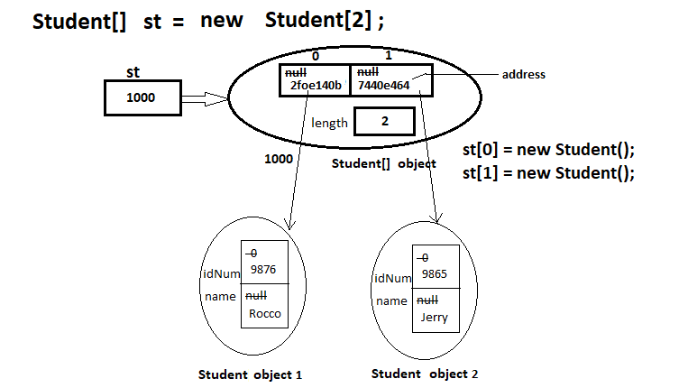

# Array of Objects in Java With Example

**Array of Objects in Java With Example** | Creating and using arrays of objects with practical examples including Student and Employee programs.

- [Array of objects creation in Java with explicit values](#array-of-objects-creation-in-java-with-explicit-values)
- [Objects of Array creation in Java without explicit values or with default values](#objects-of-array-creation-in-java-without-explicit-values-or-with-default-values)
- [Other Points on Array of objects](#other-points-on-array-of-objects)
- [Program3 - Array of Employee Objects in Java](#program3--array-of-employee-objects-in-java)
- [Program4](#program4)
- [Array of objects declaration as final in Java](#array-of-objects-declaration-as-final-in-java)

In Java, like primitive values, we can also create an array of objects. Here we will discuss an array of objects in java with the simple example program.

There are three ways to create an array of objects in Java:

1. 📦 The Array of objects created with values.
2. 📦 The Array of objects created without explicit values or with default values.
3. 📦 Anonymous array

---

## 1. Array of objects creation in Java with explicit values

**Example class and array creation:**

```java
class Example{
   int x = 10;
   int y = 20;
}

Example[] ex = { new Example(), new Example(), new Example()};
```

In this array object creation, the array contains 3 continuous memory locations with some starting base address, and that address is stored in "ex" referenced variable.



🔑 **Differences in creating array objects with primitive types and referenced types:**

If we create an array object with a **primitive type**, then all its **memory locations are of primitive type** variables, so values are stored **directly** in those locations. If we create an array object with a **referenced type**, all its memory locations are of referenced type variables, so **object reference is stored** in those locations, not the values. Also see: [One-dimensional array in Java](https://javahungry.blogspot.com/2020/12/one-dimensional-array-in-java.html)

In this array declaration in Java has a limitation i.e. we can use `{}` only with a variable declaration like `Example[] arr = {new Example(), new Example()};` We can't use this syntax as a variable assignment, It means array variable declared in one place and performing assignment in another place with `{}`.

```java
Example[] arr; // array variable declared
arr = {new Example(), new Example()}; // error
```

### Example program-1: Student Array Object Creation with Values

**Program Description:** Develop a program to create an array object to store Student class objects with student_idNumber and student_name properties.

**Student array with values:**

```java
class Student {
  int idNum;
  String name;
}

class College{
  public static void main(String[] args) {

    // declaring, creating and
    // initializating array objects
    Student[] st = {new Student(), new Student()};

    //displaying initialized values
    System.out.println("Initialized values of array:");
    for(int i=0; i < st.length; i++){
      System.out.print(st[i]+"\t");
    }

    //initializing Student objects
    st[0].idNum = 9876;
    st[0].name = "Rocco";
    st[1].idNum = 9865;
    st[1].name = "Jerry";

    //displaying Student objects values after initialization
    System.out.println("\n\nStudent details:");
    for (int i=0; i < st.length; i++) {
      System.out.println("Student" + (i+1)
                +" idNumber: "+st[i].idNum);
      System.out.println("Student"+(i+1)+" name: "+st[i].name);
    }
  }

}
```

📤 **Output:**

```
Initialized values of the array:
Student@2f0e140b Student@7440e464

Student details:
Student1 idNumber: 9876
Student1 name: Rocco
Student2 idNumber: 9865
Student2 name: Jerry
```



In this array program in Java, First, we create a Student class with properties student id number and student name. In the College class, we used the student class properties, and In the college class, one Student array objects with 2 locations of Student type with the default value null. Later Student objects are initialized and finally displayed. To access idNumber of student1 we use `st[0].idNum`

If we want to create 5 locations of Student type but only initialized 2 of them at the time of declaration then we can create it as:

`Student[] st = {new Student(), new Student(), null, null, null};`

---

## 2. Objects of Array creation in Java without explicit values or with default values

**Array creation with default values:**

```java
class Example{
   int x = 10;
   int y = 20;
}

Example[] ex = new Example[4];
```

From the above statement array object is created with four Example type variables. All locations are initialized with default value `null` because the array object is created with referenced datatype Example.



> 📝 **Note:** In this array object creation statement, Example class objects are not created rather only Example class type referenced variables are created to store Example class objects further.

Here Example class object is not created means that Example class non-static variables are not created. In the above syntax of array creation only we can specify size. It creates only variables, it will not allows us to store values or objects in the array creation syntax itself. If we want to store values or objects, we must perform the initialization operation in the next line separately as shown below:

```java
Example[] ex = new Example[4];
ex[0] =  new Example();
ex[1] =  new Example();
ex[2] =  new Example();
ex[3] =  new Example();
```

**Q) How many String objects are created from the below statements?**

`String[] st = new String[10];`

**Ans:** Zero. There is no **String object** created. It creates a String array object with 10 variables of string type with the default value `null`.

### Example program-2: Student Array Object creation without explicit values or with the default value

**Student array with default values:**

```java
class Student {
  int idNum;
  String name;
}

class Collage {

  static void displayDefault(Student[] s){
    for(int i=0; i < s.length; i++){
      System.out.print(s[i]+"\t");
    }
  }

  static void displayStudent(Student[] s){
    for (int i=0; i < s.length; i++) {
      System.out.println("Student" + (i+1) +
                 " idNumber: "+s[i].idNum);
      System.out.println("Student"+(i+1)+
                 " name: "+s[i].name);
    }
  }

  public static void main(String[] args) {
    //Declaring, and creating array objects
    Student[] st = new Student[2];

    //displaying default values of array
    System.out.println("Default values of array:");
    displayDefault(st);

    //initializing Student array locations
    st[0] = new Student();
    st[1] = new Student();

    //displaying initialized values of array
    System.out.println("\n\nInitialized values of array:");
    displayDefault(st);

    //displaying default values of Student objects
    System.out.println("\n\nDefault values of Student objects:");
    displayStudent(st);

    //initializing Student objects
    st[0].idNum = 9876;
    st[0].name = "Rocco";
    st[1].idNum = 9865;
    st[1].name = "Jerry";

    //displaying Student objects values after initialization
    System.out.println("\nStudent details:");
    displayStudent(st);
  }

}
```

📤 **Output:**

```
Default values of array:
null null

Initialized values of array:
Student@2f0e140b Student@7440e464

Default values of Student objects:
Student1 idNumber: 0
Student1 name: null
Student2 idNumber: 0
Student2 name: null

Student details:
Student1 idNumber: 9876
Student1 name: Rocco
Student2 idNumber: 9865
Student2 name: Jerry
```



In this array program in java, the Student array object with 2 locations of Student type with the default value null. Later they are initialized using `new Student();` So, the Student object is also initialized with their default values. Finally, Student objects are updated and displayed.

---

## 3. Other Points on Array of objects

Source data type and destination data type must be compatible, else it leads to a compile-time error: incompatible types.

**Inheritance hierarchy:**

```java
class A{}
class B extends A {}
class C extends B {}
class D extends C {}
```

There is a class A, B is a subclass of A, C is a subclass of B, and D is sub class of C.

**Compatibility rules:**

```java
class ArrayTest{

  public static void main(String[] args) {
    A[] a1 = null;// valid
    A[] a2 = new A[5]; // valid
    A[] a3 = new B[5]; // valid
    A[] a4 = new C[5]; // valid
    A[] a5 = new D[5]; // valid

    A[] a6 = new E[5]; // error: cannot find symbol
    B[] a7 = new A[5]; // error: incompatible types
    B[] a8 = new C[5]; // valid
    B[] a9 = new D[5]; // valid
    D[] a10 = new A[5]; // error: incompatible types
    D[] a11 = new C[5]; // error: incompatible types
  }

}
```

**Q) If we declare an array object of a class is its class bytecodes are loaded into JVM?**

**Ans:** No, if we create an Example class array object, Example class bytecode are not loaded into JVM. If we are creating and adding an "Example object", the Example class is loaded into JVM.

**Example class with static block:**

```java
class Example{
  static {
    System.out.println("Example is loaded.");
  }
}
```

**The below program does not load the Example class:**

```java
class ArrayTest{
  public static void main(String[] args) {
    Example[] e = new Example[5];
  }
}
```

📤 **Output:** no output

**Below program loads Example class:**

```java
class ArrayTest {
  public static void main(String[] args) {
     Example[] e = {new Example(), new Example()};
  }
}
```

📤 **Output:** Example is loaded.

**Program - Find the output of the below program:**

```java
class Example{
  int a = 9;
  int b = 18;
  void m1(){
    a = 10;
    b = 20;
  }
}

class Test{
  static void m1(Example[] e){
    e[1].m1();
  }
}

class Array{
  public static void main(String[] args) {
    Example[] ex = {new Example(), new Example(), new Example()};
    Test.m1(ex);
    for(int i=0; i < ex.length; i++){
      System.out.print(ex[i].a+"\t");
      System.out.print(ex[i].b+"\n");
    }
  }
}
```

📤 **Output:**

```
9 18
10 20
9 18
```

---

## 4. Program3 - Array of Employee Objects in Java

**Program description:** Develop a program to create array objects to store employee objects with properties employee_number and name. You must initialize the employee object at the time of object creation itself and also should display all values of the employee object in a single column.

**Employee array program:**

```java
class Employee {
  private int eNo;
  private String eName;

  // constructor
  public Employee(int eNo, String eName){
    this.eNo = eNo;
    this.eName = eName;
  }

  // method to display employee details
  public void display(){
      System.out.println("Employee Number: "+eNo);
      System.out.println("Employee Name: "+eName);
  }
}

class Company{
  public static void main(String[] args) {

    // declaring, and creating array objects
    Employee[] emp = new Employee[5];

    // displaying default values of array
    System.out.println("Default values of array:");
    for (int i=0; i < emp.length; i++) {
      System.out.print(emp[i] + " ");
    }

    // initializing Employee array locations
    //  and Employee objects
    emp[0] = new Employee(1025,"Emma");
    emp[1] = new Employee(9866,"Olivia");

    // displaying Employee objects values
    // after initialization
    System.out.println("\nEmployee details:");
    for(int i=0; i < emp.length; i++) {
      Employee e = emp[i];
      System.out.println("\nArray location: "+e);
      //checking array location is null or not
      if(e != null) e.display();
    }
  }

}
```

📤 **Output:**

```
Default values of array:
null null null null null

Employee details:

Array location: Employee@4b1210ee
Employee Number: 1025
Employee Name: Emma

Array location: Employee@76ed5528
Employee Number: 9866
Employee Name: Olivia

Array location: null

Array location: null

Array location: null
```

> 💡 **Tip:** In the above program, for displaying Employee objects we can use `emp[i]` directly but this has a performance issue because we are accessing the same object locations multiple times. These locations are stored in the JVM heap area. Instead of using this code, we should declare a local object `e` of Employee type which will store the value of `emp[i]`. Now inside for loop, each time we will use the local object instead of accessing the object directly.

---

## 5. Program4

In the below table, the details of the Employees are given.

| ID Number 🔢 | Name 👤 | Salary 💰 | Department 🏢 |
|---|---|---|---|
| **1001** | Olivia | 5000 | Core Java |
| **1002** | Amelia | 5500 | .Net |
| **1003** | Ella | 4500 | Oracle |
| **1004** | Amelia | 8000 | Core Java |
| **1005** | Grace | 5000 | HTML |
| **1006** | Olivia | 6500 | C++ |
| **1007** | Isla | 6000 | Advance Java |
| **1008** | Ada | 7500 | Oracle |
| **1009** | Myla | 7000 | C++ |

**Program description:** Develop a Java Program to create an array object for storing Employee objects given in the table. In the above table, after some time employees of department Java (both Core & Advance Java) and HTML changed their department to Python, except employee having the name "Amelia". The employees who changed their department got an increment of 500 in their salary. Display the original and modified details of Employee objects.

**Employee modification program:**

```java
class Employee{

  // variables
  private int no;
  private String name;
  private double sal;
  private String dept;

  //Constructor
  public Employee(int no, String name, double sal, String dept){
    this.no = no;
    this.name = name;
    this.sal = sal;
    this.dept = dept;
  }

  //Setter and getter methods
  public String getName(){
    return name;
  }
  public double getSal(){
    return sal;
  }
  public void setSal(double sal){
    this.sal = sal;
  }
  public String getDept(){
    return dept;
  }
  public void setDept(String dept){
    this.dept = dept;
  }

  // method to display employee details
  public void display(){
    System.out.printf("Employee details: ");
    System.out.printf("%d, %s, %.2f, %s\n",no, name, sal, dept);
  }

}

class Test{
  public static void main(String[] args) {

    Employee[] emp = new Employee[9];
    emp[0] = new Employee(1001, "Olivia", 5000, "Core Java");
    emp[1] = new Employee(1002, "Amelia", 5500, ".Net");
    emp[2] = new Employee(1003, "Ella", 4500, "Oracle");
    emp[3] = new Employee(1004, "Amelia", 8000, "Core Java");
    emp[4] = new Employee(1005, "Grace", 5000, "HTML");
    emp[5] = new Employee(1006, "Olivia", 6500, "C++");
    emp[6] = new Employee(1007, "Isla", 6000, "Advance Java");
    emp[7] = new Employee(1008, "Ada", 7500, "Oracle");
    emp[8] = new Employee(1009, "Myla", 7000, "C++");

    //displaying Original values
    System.out.println("Original Employee details: ");
    for(Employee e : emp){
      e.display();
    }

    //Modifying values
    for(Employee e: emp){
      if((e.getDept().toUpperCase().contains("JAVA")
       || e.getDept().toUpperCase().contains("HTML"))
       && (!e.getName().equalsIgnoreCase("Amelia"))){
         e.setDept("Python");
         e.setSal(e.getSal()+500);
       }
    }

    //displaying Modified values
    System.out.println("\nModified Employee details: ");
    for(Employee e : emp){
      e.display();
    }
  }

}
```

📤 **Output:**

```
Original Employee details:
Employee details: 1001, Olivia, 5000.00, Core Java
Employee details: 1002, Amelia, 5500.00, .Net
Employee details: 1003, Ella, 4500.00, Oracle
Employee details: 1004, Amelia, 8000.00, Core Java
Employee details: 1005, Grace, 5000.00, HTML
Employee details: 1006, Olivia, 6500.00, C++
Employee details: 1007, Isla, 6000.00, Advance Java
Employee details: 1008, Ada, 7500.00, Oracle
Employee details: 1009, Myla, 7000.00, C++

Modified Employee details:
Employee details: 1001, Olivia, 5500.00, Python
Employee details: 1002, Amelia, 5500.00, .Net
Employee details: 1003, Ella, 4500.00, Oracle
Employee details: 1004, Amelia, 8000.00, Core Java
Employee details: 1005, Grace, 5500.00, Python
Employee details: 1006, Olivia, 6500.00, C++
Employee details: 1007, Isla, 6500.00, Python
Employee details: 1008, Ada, 7500.00, Oracle
Employee details: 1009, Myla, 7000.00, C++
```

### Explanation

In this program, Every property of the Employee is declared with an access modifier `private`. Outside of the Employee class, these properties can't be directly accessed. To initialize the Employee object we used the constructor. After that original Employee objects are displayed. Now, remaining problem is, that employees of department Java (both Core & Advance Java) and HTML changed their department to Python, Except employees having the name "Amelia". The employees who changed their department got an increment of 500 in their salary.

We need to check every employee's department and name. If the department of an employee is Java or HTML and his/her name is not "Amelia" then modify their department to python using the setter method `setDept(-)`, and also modify their salary using the setter method `setSal(-)`. To modify their salary using the setter method `setSal()` the existing salary should be incremented by 500. The getter method `getSal()` returns the existing or original salary, 500 added with it and passed to the setter method `setSal()`. Finally, the Employee department changed and their salary also incremented. At last Modified values are displayed using a for-each loop.

---

## 6. Array of objects declaration as final in Java

We can declare a class referenced variable as final but in this case also only the class reference variable will become final not its object variables.

**Final reference variable:**

```java
class Test{
   int a;
   int b;
}

final Test ts = new Test();
```

Here, only class reference variable **ts** is final not the variables x and y. It is also possible to declare an object's variable as final. For this, we must declare the variables as final in the class definition.

**Final object variables:**

```java
class Test{
   final int a;
   final int b;
}

final Test ts = new Test();
```

> 📝 **Note:** Now, all three variables are final. We can't change the value of variables a and b after initialization. Similarly, we can't assign the new class to the referenced variable ts.

---

If you enjoyed this post, share it with your friends. Do you want to share more information about the topic discussed above or do you find anything incorrect? Let us know in the comments. Thank you!

**Java Tutorial**
**Java Programs**
- [Array in Java](026_Java_Array_[With_Examples].md)
- [Multidimensional Array](027_Multidimensional_Array_in_Java.md)
- [Anonymous Array](028_Anonymous_Array_in_Java_With_Example.md)
- Array of Objects
- [Jagged Array](030_Jagged_Array_in_Java_with_Example.md)
- [System.arraycopy()](031_System.arraycopy()_in_Java_with_Examples.md)
- [**Java Array Programs**](026_Java_Array_[With_Examples].md)

**Java Arrays Class**
- [Arrays Class & Methods](033_Arrays_Class_Java_With_Examples.md)
- Arrays.toString()
- [Arrays.sort() Method](035_Arrays.sort()_in_Java_With_Examples.md)
- [Arrays.copyof()](036_Arrays.copyOf_in_Java_With_Example.md)
- [Arrays.copyOfRange()](037_Arrays.copyOfRange_in_Java_with_Example.md)
- [Arrays.fill()](038_Arrays.fill()_–_Fill_Java_Arrays.md)
- Arrays.equals() Method

**Others**
- Get Array Input in Java
- [Return Array From Method](042_How_to_Return_an_Array_in_Java.md)
- [2D Array in Java](043_2D_Array_in_Java.md)
- [3D Array in Java](044_3D_Array_in_Java.md)
- [Matrix Tutorial in Java](045_Matrix_in_Java.md)
- [Array of String in Java](046_String_Array_in_Java.md)
- [Array of double in Java](047_Double_Array_in_Java.md)
