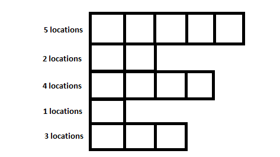
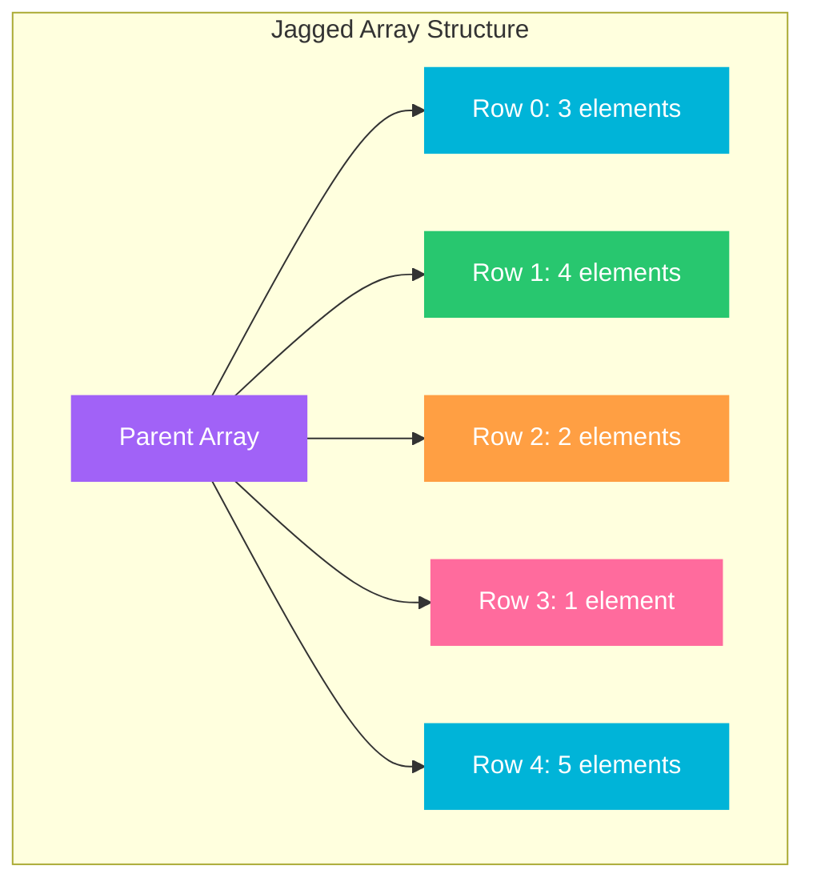
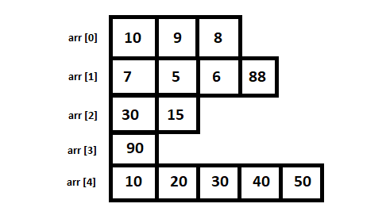
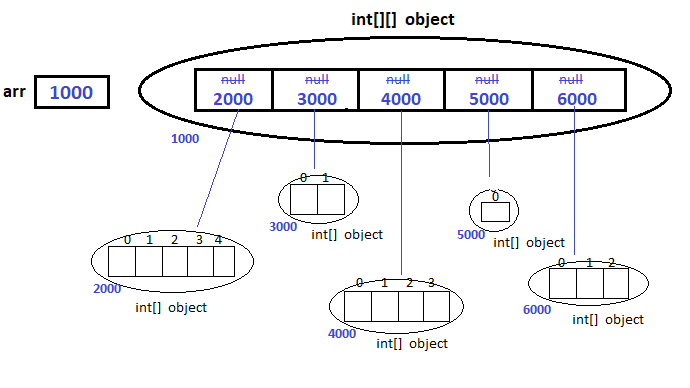

# Jagged Array in Java with Example

**Jagged Array in Java with Example** | A multi-dimensional array with different sizes child array, creating a table with different sizes of columns in a row.

- [Jagged Array Creation in Java](#jagged-array-creation-in-java)
- [Java Program Example](#java-program-example)

A multi-dimensional array with different sizes child array is called a Jagged array. It creates a table with different sizes of columns in a row. To create a jagged array, in [multidimensional array](027_Multidimensional_Array_in_Java.md) creation we must not specify child array size instead we must assign child array objects with different sizes. Here you will learn Jagged Array in Java with Example.

This image represents a jagged array.





---

## 1. Jagged Array Creation in Java

1️⃣ **Jagged array creation in Java with explicit values.**

We can directly create jagged array with values.

**Example:**

```java
int[][] arr = {{10,9,8},{7,5,6,88},{30,15},{50},{10,20,30,40,50}};
```



2️⃣ **Jagged array object creation in Java without explicit values or with default values.**

To create a jagged array without explicit values, we need to use the **_new_** keyword. In this way of creation don't mention child array size at the time of array declaration, leave it empty. Then in the next line initialize parent array locations with child array instances with different sizes.

**Create the base array:**

```java
int[][] arr = new int[5][]; // create the base array of size 5
```

Now we can create child array objects of any size.

**Initialize child arrays with different sizes:**

```java
arr[0] = new int[5];
arr[1] = new int[2];
arr[2] = new int[4];
arr[3] = new int[1];
arr[4] = new int[3];
```



---

## 2. Java Program Example

**Complete jagged array program:**

```java
class JaggedArray{

  public static void main(String[] args) {

    // declare and initialize array
    int[][] arr = {
                     {10,9,8},
                     {7,5,6,88},
                     {30,15},
                     {50},
                     {10,20,30,40,50}
                   };

    // displaying jagged array in Java
    // using for-each loop
    System.out.println("Jagged array is (using for-each loop):");
    for(int[] i: arr){
      for(int j : i){
        System.out.printf("%d\t",j);
      }
      System.out.println();
    }

    // displaying jagged array in Java
    // using for loop and length property
    System.out.println("\nJagged array is (using for loop):");
    for(int i=0; i < arr.length; i++){
      for(int j=0; j < arr[i].length; j++){
        System.out.printf("%d\t",arr[i][j]);
      }
      System.out.println();
    }
  }

}
```

📤 **Output:**

```
Jagged array is (using for-each loop):
10 9 8
7 5 6 88
30 15
50
10 20 30 40 50

Jagged array is (using for loop):
10 9 8
7 5 6 88
30 15
50
10 20 30 40 50
```

> 💡 **Tip:** In this program, we used length property to find the size of each parent and child array. Here, `arr[i].length` gives the size of the child array whose parent is "i", so for each parent, the `i` will be different and it will give the valid size of each child array.

---

If you enjoyed this post, share it with your friends. Do you want to share more information about the topic discussed above or do you find anything incorrect? Let us know in the comments. Thank you!

**Java Tutorial**
**Java Programs**
- [Array in Java](026_Java_Array_[With_Examples].md)
- [Multidimensional Array](027_Multidimensional_Array_in_Java.md)
- [Anonymous Array](028_Anonymous_Array_in_Java_With_Example.md)
- [Array of Objects](029_Array_of_Objects_in_Java_With_Example.md)
- Jagged Array
- [System.arraycopy()](031_System.arraycopy()_in_Java_with_Examples.md)
- [**Java Array Programs**](026_Java_Array_[With_Examples].md)

**Java Arrays Class**
- [Arrays Class & Methods](033_Arrays_Class_Java_With_Examples.md)
- Arrays.toString()
- [Arrays.sort() Method](035_Arrays.sort()_in_Java_With_Examples.md)
- [Arrays.copyof()](036_Arrays.copyOf_in_Java_With_Example.md)
- [Arrays.copyOfRange()](037_Arrays.copyOfRange_in_Java_with_Example.md)
- [Arrays.fill()](038_Arrays.fill()_–_Fill_Java_Arrays.md)
- Arrays.equals() Method

**Others**
- Get Array Input in Java
- [Return Array From Method](042_How_to_Return_an_Array_in_Java.md)
- [2D Array in Java](043_2D_Array_in_Java.md)
- [3D Array in Java](044_3D_Array_in_Java.md)
- [Matrix Tutorial in Java](045_Matrix_in_Java.md)
- [Array of String in Java](046_String_Array_in_Java.md)
- [Array of double in Java](047_Double_Array_in_Java.md)
