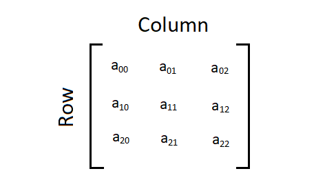

# Top 40+ Array Programs in Java

**Top 40+ Array Programs in Java** | The array in Java is a referenced data type used to create a fixed number of multiple variables or objects of the same type to store multiple values of similar type in contiguous memory locations with a single variable name.

- [Array Programs in Java](#array-programs-in-java)
- [Java Array Programs Examples](#java-array-programs-examples)
- [Multi-dimensional Array and Matrix Programs](#multi-dimensional-array-and-matrix-programs)

📚 **Pre-requisite to solve these array programs in Java:** [Array in Java](026_Java_Array_[With_Examples].md), [Multidimensional Array](027_Multidimensional_Array_in_Java.md), [Anonymous Array](028_Anonymous_Array_in_Java_With_Example.md), [Array of Objects](029_Array_of_Objects_in_Java_With_Example.md), [Jagged Array](030_Jagged_Array_in_Java_with_Example.md)

---

## 1. Array Programs in Java

💻 **Single-dimensional (1D) Array Programs in Java:**

1. Find Length of Array in Java
2. Get Array Input in Java
3. [Return Array from a method](042_How_to_Return_an_Array_in_Java.md)
4. Different ways to Print Array
5. Find the Sum of Array in Java
6. Find the average of an Array
7. Sum of Two Arrays Elements
8. Compare Two Arrays in Java
9. Copy Array in Java
10. Merge 2 Arrays in Java
11. Merge two sorted Arrays
12. Largest Number in Array
13. Smallest Number in Array
14. 2nd Largest Number in Array
15. [How to Sort an Array in Java](035_Arrays.sort()_in_Java_With_Examples.md)
16. Reverse an Array in Java
17. GCD of N Numbers in Java
18. Linear Search in Java
19. Binary Search Program in Java
20. Remove Duplicates From Array
21. Insert Element at Specific Position
22. Add Element to Array in Java
23. Remove Element From Array in Java
24. Count Repeated Elements in Array

🔢 **More Simple Single Dimensional Array Programs in Java:**

25. Count Even and Odd numbers in an Array
26. Put Even and Odd Elements in 2 Separate Arrays
27. Display Even and Odd numbers in an Array
28. Sum of Even and Odd Numbers in Array in Java
29. Remove odd numbers from an array Java
30. Count positive negative and zero from Array
31. Print all negative elements in an array
32. Separate positive and negative numbers in an array
33. Find the sum of positive numbers in an array
34. The cumulative sum of an array in Java
35. Find numbers that are greater than the given number from an array
36. Find average and numbers greater than average in array

---

🧮 **[Multi-dimensional array](027_Multidimensional_Array_in_Java.md) and [Matrix Programs in Java](045_Matrix_in_Java.md):**

37. Print 2D array in Java
38. Program to Print 3x3 Matrix
39. Sum of matrix elements in Java
40. Sum of Diagonal Elements of Matrix
41. Row sum and Column sum of Matrix
42. Matrix Addition in Java
43. Subtraction of two matrices in Java
44. Transpose of a Matrix in Java
45. Matrix Multiplication in Java
46. Menu-driven program for Matrix operations

---

## 2. Java Array Programs Examples

Read the problem, try to solve it by yourself, and then check the solution. All the below programs are same as given in the above links, but here you will get the program description with some examples. And moreover, they are given in order. Let us see Array programs in Java.

---

**1) Find Length of Array in Java** - Write a Java program to find the length or size of the different array. Example:

Array = {10, 20, 30, 40, 50}
The length of the given array = 5

---

**2) Different ways to Print Array** - Write an array program in Java to display a given array. Take an array, and display it using different approaches. To display an array you can use the while loop, for loop, for-each loop, or the toString() method given in [java.util.Arrays class](033_Arrays_Class_Java_With_Examples.md).

---

**3) Find the Sum of Array in Java** - Write Array programs in Java to find the sum of array elements in Java. Take array input from the end-user. Example:

Array = {10, 20, 30, 40, 50}
Sum of array elements = 150

---

**4) Find the average of an Array** - Write a Java program to find the average of an array. Take input from the end-user, find the sum and calculate the average. Example:

Array = {10, 20, 30, 40, 50}
then sum of array elements = 10 + 20 + 30 + 40 + 50 = 150
and the average of numbers = 150 / 5 = 30

---

**5) Count Even and Odd numbers in an Array** - Write Array programs in Java to count the even and odd numbers in the given array. Use a method to perform this operation. Take an array, count even-odd numbers, and display the count values. Example:

Array = {11, 12, 13, 14, 15}
Count of the even number = 2
Count of the odd number = 3

---

**6) Put Even and Odd Elements in 2 Separate Arrays** - Write a Java program to put even and odd elements of an array in 2 separate arrays. And display both arrays. Example:

Array = {11, 12, 13, 14, 15}
Even numbers: {12, 14}
Odd numbers: {11, 13, 15}

---

**7) Display Even and Odd numbers in an Array** - Write Array programs in Java to display even and odd numbers from a given array of numbers. Take an array, check each element of the array whether is it even or odd and display it. Display results in the given two different formats (write separate programs for them):

Array = {11, 12, 13, 14, 15}
11: odd, 12: even, 13: odd, 14: even, 15: odd

Array = {11, 12, 13, 14, 15}
Even numbers are: 12, 14
Odd numbers are: 11, 13, 15

---

**8) Sum of Even and Odd Numbers in Array in Java** - Write a Java program to find the sum of even and odd numbers in an array. Display the sum value. Example:

Array = {11, 12, 13, 14, 15}
Odd numbers sum = 39
Even numbers sum = 26

---

**9) Remove odd numbers from an array Java** - Write Array programs in Java to remove odd numbers from an array. Display the resultant array. Example:

Array = {11, 12, 13, 14, 15}
Array after removing odd numbers: {12, 14}

---

**10) Count positive negative and zero from Array** - Write a Java program to take an array and count positive, negative, and zero in the given array. Display the count values. Example:

Array = {-15, -10, -5, 0, 5, 10, 15}
Positive numbers in the array = 3
Negative numbers in the array = 3
Zero in the array = 1

---

**11) Print all negative elements in an array** - Write Array programs in Java to print all negative elements in an array. Take an array, write a method to perform the operation. If the array doesn't contain any negative number then it should display the appropriate message. Example:

Array = {-15, -10, -5, 0, 5, 10, 15}
Negative numbers = {-15, -10, -5}

Array = {10, 20, 30, 40, 50}
Array doesn't contain negative number.

---

**12) Separate positive and negative numbers in an array** - Write an array program in Java to separate positive and negative numbers in a given array. Display those separated arrays. 0 should be treated as a positive number. Example:

Array = {-10, 5, 0, -9, 18, 27, -36}
Positive numbers = [5, 0, 18, 27]
Negative numbers = [-10, -9, -36]

Array = {-50, -60, -70}
The given array contains only negative numbers
Array = [-50, -60, -70]

---

**13) Find the sum of positive numbers in an array** - Write Array programs in Java to find the sum of positive numbers in an array. Display the sum value. Example:

Array = {-10, 5, 0, -9, 18, 27, -36}
Sum of Positive numbers = 50

Array = {-50, -60, -70}
Sum of Positive numbers = 0

---

**14) Find the cumulative sum of an array in Java** - Write an array program in Java to find the cumulative sum of an array. Take the array, find the cumulative sum, insert them in the same array, and display the result. Example:

Array = {9, 8, 7, 0, -2, 5}
Cumulative sum = [9, 17, 24, 24, 22, 27]

---

**15) Find numbers that are greater than the given number from an array** - Write Array programs in Java to find the numbers which are greater than the given number from an array. Take an array and a number, compare the number with each element of the array. Example:

Array = {-10, 5, 0, -9, 18, 27, -36}
Number = 5
Numbers greater than given number = 18, 27

---

**16) Find average and numbers greater than average in the array** - Write an array program in Java to find the average of an array and numbers greater than the average in an array. Example:

Array = {9, 8, 7, 0, -2, 5}
Average = 4.0
Numbers greater than average = 9, 8, 7, 5

---

**17) Sum of Two Arrays Elements** - Write Array programs in Java to find the sum of two arrays elements.

To calculate the sum of two arrays element by element in Java both arrays must be of equal type and equal size. If they have different types or different sizes then we will get `IllegalArgumentException`. To solve this problem you have to create a third array of the same size and then store the sum of corresponding elements of the given arrays. Example:

Array1 = {10, 20, 30, 40, 50}
Array2 = {9, 18, 27, 36, 45}
The resultant array will be,
Array3 = {19, 38, 57, 76, 95}

---

**18) Compare Two Arrays in Java** - Write Array programs in Java to compare two arrays with respect to its elements. Compare using `==` operator, and `Arrays.equals()` method. For [multidimensional arrays](027_Multidimensional_Array_in_Java.md) use `Arrays.deepEquals()` method.

Array1 = {10,20,30,40,50}
Array2 = {15,25,35,45,55}
Then,
Array1 and Array2 are not same.

---

**19) Copy an Array in Java** - Write Java programs to copy an array. There are various in-built methods like [System.arraycopy()](031_System.arraycopy()_in_Java_with_Examples.md), [Arrays.copyOf()](036_Arrays.copyOf_in_Java_With_Example.md), [Arrays.copyOfRange()](037_Arrays.copyOfRange_in_Java_with_Example.md), and [clone() method](074_Clone()_Method_in_Java.md) which can be used to copy an array in Java. We can also copy the array by assigning each element to another array element. Example:

Original Array = [10, 20, 30, 40, 50]
Copied Array = [10, 20, 30, 40, 50]

---

**20) Merge 2 Arrays in Java** - Write a Java program to merge two given arrays. Merging of two arrays in Java also can be done by using pre-defined methods, or we can do it manually by using loops. Example:

Array1 = [10, 20, 30, 40, 50]
Array2 = [9, 18, 27, 36, 45]
Then the Result should be,
Merged Array = [10, 20, 30, 40, 50, 9, 18, 27, 36, 45]

---

**21) Merge two sorted Arrays** - Write Java to merge two sorted arrays. Take two sorted arrays and merge them into a new array. Display the new array, the resultant merged array also should be in the sorted form. Example:

Array1 = [10, 20, 30, 40, 50]
Array2 = [9, 18, 27, 36, 45]
Then the Result should be,
Merged Array = [9, 10, 18, 20, 27, 30, 36, 40, 45, 50]

---

**22) Find Largest Number in Array** - Write an array program in Java to find the largest number in the given array. Example:

Array: {10, 5, -15, 20, -30}
Largest element = 20

---

**23) Smallest Number in Array** - Write an array program in Java to find the smallest number in the given array. Example:

Array: {10, 5, -15, 20, -30}
Smallest element = -30

---

**24) Second Largest Number in Array** - Write an array program in Java to find the second largest number in the given array. Example:

Array: {10, 5, -15, 20, -30}
Second Largest element = 10

---

**25) [Sort an Array in Java](035_Arrays.sort()_in_Java_With_Examples.md)** - Write an array program in Java to sort the given array. You can use the predefined method [Arrays.sort()](035_Arrays.sort()_in_Java_With_Examples.md) for this purpose. Example:

Array: [50, 25, 30, 55, 15]
After Sorting: [15, 25, 30, 50, 55]

---

**26) Reverse an Array in Java** - Write basic array programs in Java to reverse a given array. Example:

Original array: { 10, 20, 30, 40, 50 }
Reverse of array: { 50, 40, 30, 20, 10 }

---

**27) GCD of N Numbers in Java** - Write an array program in Java to find the GCD(greatest common divisor) or HCF(highest common factor) of a given array of integer numbers. Example:

Numbers = 10 15 25
GCD = 5

---

**28) Linear Search in Java** - Write basic array programs in Java to implement the linear search or sequential search algorithm. Example: Array = {50, 90, 30, 70, 60};

Key to Search = 30
Output: 30 found at Index 2.

Key to Search = 10
Output: 10 not found.

---

**29) Binary Search Program in Java** - Write basic array programs in Java to implement the binary search algorithm. Example: Array = { 10, 20, 30, 40, 50, 60, 70, 80, 90, 100 };

Search key = 80
80 Found at 7 index.

Search key = 150
150 not Found.

---

**30) Remove Duplicates From Array** - Write an array program in Java to remove duplicates from a given array. Example:

Sorted array = {10, 10, 20, 30, 40, 40, 50}
After removing the duplicates from array = {10, 20, 30, 40, 50}

Unsorted Array = {30, 50, 20, 50, 10, 20, 30, 10, 10, 40}
After removing the duplicates from array = {30, 50, 20, 10, 40}

---

**31) Insert Element at Specific Position** - Write basic array programs in Java to insert an element at a specific position. Take element and index position and insert at the given place. Example:

Array = {10, 20, 30, 40, 50}
Element to be inserted = 99
Position = 3
Final result = {10, 20, 30, 99, 40, 50}

---

**32) Add Element to Array in Java** - Write basic array programs in Java to add an element to the given array i.e. insert the element at last in the given array. Example:

Array: [30, 50, 20, 40, 10]
Element to be added = 99
New array: [30, 50, 20, 40, 10, 99]

---

**33) Remove Element From Array in Java** - Write an array program in Java to remove an element from an array. Remove elements either with respect to the given index or with respect to the given element. Example:

Original array: [10, 20, 30, 40, 50]
Index to remove = 3
New array: [10, 20, 30, 50]

Array: [50, 20, 10, 40, 30]
Element to remove = 40
New array: [50, 20, 10, 30]

---

**34) Count Repeated Elements in Array** - Write an array program in Java to count the repeated elements in the given array. Example:

Array = { 50, 20, 10, 40, 20, 10, 10, 60, 30, 70 };
Total Repeated elements: 2
Repeated elements are: 20 10

Array = { 10, 10, 10, 20, 20, 30, 40, 50, 60, 70 };
Total Repeated elements: 2
Repeated elements are: 10 20

---

## 3. Multi-dimensional Array and [Matrix Programs](045_Matrix_in_Java.md)

Before solving this problem, you should have knowledge of how to declare and initialize a matrix in Java, how to take input for a matrix from the end-user, and what are the different ways to display it. How to find the length or size of a matrix in Java? How to pass and return a matrix in Java. To learn them see: [**Matrix in Java**](045_Matrix_in_Java.md). Now, let us see multi-dimensional array and matrix programs in Java.

---

**35) Print 2D array in Java** - Write a Java program to print the [two-dimensional array (2D array)](043_2D_Array_in_Java.md). Take a 2D array from the end-user and display it.

---

**36) Program to Print 3x3 Matrix** - Write a Java program to print a 3x3 matrix. Take a 3x3 matrix from the end-user and display it.

---

**37) Sum of matrix elements in Java** - Write a Java program to find the sum of matrix elements. Take a matrix from the end-user, calculate the sum of the elements and display the result.

Matrix =
1 2 3
4 5 6
7 8 9
Sum of matrix elements = 45

---

**38) Sum of Diagonal Elements of Matrix** - Write a Java program to find the sum of the diagonal elements of a given matrix.

In a matrix the elements located at the position aij where i=j are called diagonal elements. For example, In the matrix "a" the elements located at positions a00, a11, a22 are diagonal elements. Example:

Matrix =
1 2 3
4 5 6
7 8 9
Then the diagonal elements are: 1, 5, 9
Sum of diagonal elements = 1+5+9 = 15

---

**39) Row sum and Column sum of Matrix** - Write a Java program to find the sum of each row and the sum of each column in a given matrix. Display the resultant values. Example:

Matrix =
20 19 18
17 16 15
14 13 12
Row-1 sum = 20+19+18 = 57
Column-1 sum = 20+17+14 = 51
Row-2 sum = 17+16+15 = 48
Column-2 sum = 19+16+13 = 48
Row-3 sum = 14+13+12 = 39
Column-3 sum = 18+15+12 = 45

---

**40) Matrix Addition in Java** - Write a Java program to find the addition of two matrices. Take two matrices, create a new matrix to store the result, add the elements.

Let A =[aij] and B =[bij] be m x n matrices. The sum of A and B, denoted by A + B, is the m x n matrix that has aij + bij as its (i, j)th element. In other words, A + B =[aij + bij]. Example:

A = [[1, 3], [7, 5]]
B = [[6, 8], [4, 2]]
C = [[7, 11], [11, 7]]

---

**41) Subtraction of two matrices in Java** - Write a Java program to find the subtraction of two matrices. Take two matrices, declare the third matrix to store the result value.

Let A =[aij] and B =[bij] be m x n matrices. The subtract of A and B, denoted by A - B, is the m x n matrix that has aij - bij as its (i, j)th element. In other words, A - B =[aij - bij]. Example:

Matrix A:
20 19 18
17 16 15
14 13 12
Matrix B:
10 11 12
13 15 15
10 11 10
Subtraction (C):
10 8 6
4 1 0
4 2 2

---

**42) Transpose of a Matrix in Java** - Write a Java program to find the transpose of a matrix.

Let A =[aij] be an m x n matrix. The transpose of A, denoted by At, is the n x m matrix obtained by interchanging the rows and columns of A. In other words, if At =[bij], then bij = aji for i = 1,2,...,n and j = 1,2,...,m. Example:

A = [[1, 2], [8, 9]]
Transpose = [[1, 8], [2, 9]]

---

**43) Matrix Multiplication in Java** - Write a Java program to find the multiplication of two matrices. Take two matrices, declare the third matrix to store the result value.

Let **A** be an m x k matrix and **B** be a k x n matrix. The product of **A** and **B**, denoted by **AB**, is the m x n matrix with its (i, j)th entry equal to the sum of the products of the corresponding elements from the ith row of **A** and the jth column of **B**.

A =
1 3
7 5
B =
6 8
4 2
C =
18 14
62 66

---

**44) Menu-driven program for Matrix operations** - Write a Java program for the menu-driven program for matrix operations. Perform matrix addition, subtraction, multiplication, and transpose using the switch case statement. Take the help of user-defined methods, i.e. define methods for each operation and call them in the switch case statement.

A = [[5, 6, 7], [8, 9, 10], [3, 1, 2]]
B = [[1, 2, 3], [4, 5, 6], [7, 8, 9]]

Choose the matrix operation,
1. Addition
2. Subtraction
3. Multiplication
4. Transpose
5. Exit

---

If you enjoyed this post, share it with your friends. Do you want to share more information about the topic discussed above or do you find anything incorrect? Let us know in the comments. Thank you!

**JAVA PROGRAMS**
[**# Java Array Tutorials**](025_Java_Array_Tutorial.md)
[**# Java Array Programs**](026_Java_Array_[With_Examples].md)
- Find Length of Array
- Different ways to Print Array
- Sum of Array Elements
- Average of Array Elements
- Sum of Two Arrays Elements
- Compare Two Arrays in Java
- Second Largest Number in Array
- [How to Sort Array - Arrays.sort()](035_Arrays.sort()_in_Java_With_Examples.md)
- Reverse an Array in Java
- GCD of N Numbers in Java
- Linear Search Program in Java
- Binary Search Program in Java
- How to Copy Array in Java
- Merge 2 Arrays in Java
- Merge two sorted Arrays
- Find Largest Number in Array
- Find Smallest Number in Array
- Remove Duplicates From Array
- Insert Element at Specific Position
- Add Element to Array
- Remove Element From Array
- Count Repeated Elements in Array
- [**More Array Programs**](026_Java_Array_[With_Examples].md)

**Java Matrix Programs**
- [Matrix in Java](045_Matrix_in_Java.md)
- Print 2D array in Java
- Program to Print 3x3 Matrix
- Sum of matrix elements
- Sum of Diagonal Elements
- Row sum - Column sum of Matrix
- Matrix Addition in Java
- Subtraction of two matrices in Java
- Transpose of a Matrix in Java
- Matrix Multiplication in Java
- Menu-driven Matrix operations
