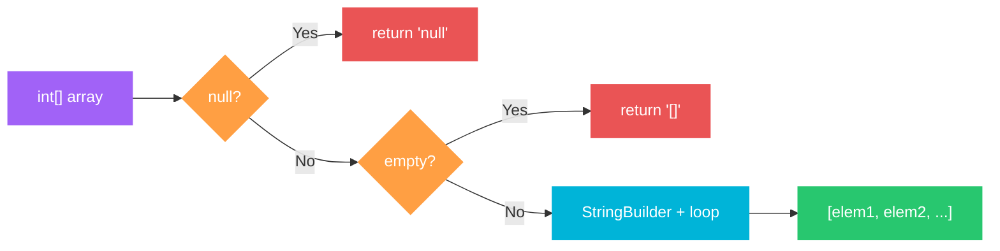

# Arrays.toString Java – Array to String Examples

**Arrays.toString Java** | In Java, the `Arrays.toString()` method is given to convert the array to string. Most of the time the `toString()` method of `Arrays` class is used to display the array elements.

- [Overloaded Forms of toString()](#overloaded-forms-of-tostring)
- [Arrays to String in Java Examples](#arrays-to-string-in-java-examples)
- [Example of Arrays.toString() with Object Array](#example-of-arraystostring-with-object-array)
- [How toString() is Implemented](#how-tostring-is-implemented)
- [toString() vs deepToString()](#tostring-vs-deeptostring)
- [Related Links](#related-links)

---

## 1. Overloaded Forms of toString()

There are many overloaded forms of the `toString()` method in the `Arrays` class. The `Arrays.toString()` with all forms were introduced in the Java 1.5 version. They are listed here:

- `public static String toString(byte[] a)`
- `public static String toString(short[] a)`
- `public static String toString(int[] a)`
- `public static String toString(long[] a)`
- `public static String toString(float[] a)`
- `public static String toString(double[] a)`
- `public static String toString(char[] a)`
- `public static String toString(boolean[] a)`
- `public static String toString(Object[] a)`

📖 The `Arrays.toString()` method returns a string representation of the contents of the specified array. The string representation consists of a list of the array's elements, enclosed in square brackets `[]` and the adjacent elements are separated by the characters ", " (a comma followed by a space). It returns `"null"` if the passed array is `null`.

---

## 2. Arrays to String in Java Examples

Let us see a Java program to demonstrate the `Arrays.toString()` method.

**Basic int array example:**

```java
import java.util.Arrays;
public class ArrayTest {
  public static void main(String[] args) {
    // int array
    int[] arr = {10, 20, 30, 40, 50};
    System.out.println("Array = " + Arrays.toString(arr));
  }
}
```

📤 **Output:**

```
Array = [10, 20, 30, 40, 50]
```

Now, let us demonstrate the byte, short, long, float, double, char, boolean array.

**Byte array:**

```java
// byte array
byte[] byteArr = {11, 12, 13, 14, 15};
System.out.println("Byte Array = " + Arrays.toString(byteArr));
```

📤 **Output:** `Byte Array = [11, 12, 13, 14, 15]`

**Short array:**

```java
// short array
short[] shortArr = {100, 200, 300, 400, 500};
System.out.println("Short Array = " + Arrays.toString(shortArr));
```

📤 **Output:** `Short Array = [100, 200, 300, 400, 500]`

**Long array:**

```java
// long array
long[] longArr = {999999999, 10, 500, -888888888, 0};
System.out.println("Long Array = " + Arrays.toString(longArr));
```

📤 **Output:** `Long Array = [999999999, 10, 500, -888888888, 0]`

**Float array:**

```java
// float array
float[] floatArr = {10.5f, 15.9f, 500, -88888, 0.9f};
System.out.println("Float Array = " + Arrays.toString(floatArr));
```

📤 **Output:** `Float Array = [10.5, 15.9, 500.0, -88888.0, 0.9]`

**Double array:**

```java
// double array
double[] doubleArr = {10.5, 15.9, 500, -88888, 0.9};
System.out.println("Double Array = " + Arrays.toString(doubleArr));
```

📤 **Output:** `Double Array = [10.5, 15.9, 500.0, -88888.0, 0.9]`

**Char array:**

```java
// char array
char[] charArr = {'K','n','o','w','P','r','o','g','r',97,'m'};
System.out.println("Char Array = " + Arrays.toString(charArr));
```

📤 **Output:** `Char Array = [K, n, o, w, P, r, o, g, r, a, m]`

**Boolean array:**

```java
// boolean array
boolean[] boolArr = {true, false, true, true, false};
System.out.println("Boolean Array = " + Arrays.toString(boolArr));
```

📤 **Output:** `Boolean Array = [true, false, true, true, false]`

---

## 3. Example of Arrays.toString() with Object Array

In the case of an [Object Array](029_Array_of_Objects_in_Java_With_Example.md), if the array contains other arrays as elements, they are converted to strings by the `Object.toString()` method inherited from `Object`, which describes their identities rather than their contents.

**Student class:**

```java
// Student class
class Student {
   int idNum;
   String name;
}
```

**Display Object array using Arrays.toString():**

```java
import java.util.Arrays;
public class Collage {
   public static void main(String[] args) {
      // array of Student objects
      Student[] st = {new Student(), new Student(), new Student()};
      System.out.println("Student Array = " + Arrays.toString(st));
   }
}
```

📤 **Output:**

```
Student Array = [Student@6ff3c5b5, Student@3764951d, Student@4b1210ee]
```

⚠️ **Caution:** The above outputs are not meaningful messages. It displays Student object references, not data. If we want to return the object's state from this method we must override it in the subclass.

**Override toString() in Student class:**

```java
class Student {
   int idNum;
   String name;

   @Override
   public String toString() {
      return "[" + idNum + ", " + name + "]";
   }
}
```

After adding `toString()` in Student class, again run the Collage class and you will get:

📤 **Output:** `Student Array = [[0, null], [0, null], [0, null]]`

**Complete example with initialized Student objects:**

1️⃣ **Student class with constructor:**

```java
class Student {
  private int idNum;
  private String name;

  // constructor
  public Student(int idNum, String name) {
    this.idNum = idNum;
    this.name = name;
  }

  @Override
  public String toString() {
    return "[" + idNum + ", " + name + "]";
  }
}
```

2️⃣ **Test class:**

```java
import java.util.Arrays;
public class Collage {
  public static void main(String[] args) {

    // array of Student objects
    Student[] st = new Student[3];

    // initialize Student object
    st[0] = new Student(100, "Emma");
    st[1] = new Student(110, "Noah");
    st[2] = new Student(235, "Amelia");

    // display Student details
    System.out.println("Student Array = " + Arrays.toString(st));
  }
}
```

📤 **Output:**

```
Student Array = [[100, Emma], [110, Noah], [235, Amelia]]
```

---

## 4. How toString() is Implemented

Whenever we call the `toString()` method of `Arrays` class then:

- 🔍 It checks if the passed argument is `null` or not. If it is `null` then it returns `"null"`.
- 📏 Calculate the length of the array: `iMax = a.length - 1`
- 📦 If `iMax` is `-1` (i.e. the length of the array is 0) then it returns `"[]"`.
- 🏗️ It creates an object of `StringBuilder` class (let us call it, object `b`).
- ➕ Append the `StringBuilder` object `b` by adding `[`.
- 🔄 Iterate through the array, and append the object `b` by adding the next array element. The elements are converted to strings by `String.valueOf()`.
- ✂️ Add `", "` (one comma and one space) after every array element.
- 🔚 After adding all array elements, add `]` to the `b` object.
- 🔤 Convert `StringBuilder` object `b` to `String` class object and return it.

**Internal implementation (int[] version):**

```java
public static String toString(int[] a) {
    if (a == null)
        return "null";
    int iMax = a.length - 1;
    if (iMax == -1)
        return "[]";

    StringBuilder b = new StringBuilder();
    b.append('[');
    for (int i = 0; ; i++) {
        b.append(a[i]);
        if (i == iMax)
            return b.append(']').toString();
        b.append(", ");
    }
}
```

💡 **Tip:** The remaining overloaded forms of the `Arrays.toString()` method are also implemented in a very similar way.



---

## 5. toString() vs deepToString()

> 📝 **Note:** `Arrays.toString()` method is capable of converting a single-dimension array to string, but it can't convert a [multidimensional Java array](027_Multidimensional_Array_in_Java.md) to string. For converting the multidimensional array to string, `deepToString()` method is given in the `Arrays` class.

| Feature | `toString()` 🔤 | `deepToString()` 📦 |
|---------|-----------------|---------------------|
| **Dimension** | Single-dimension only | Multi-dimension supported |
| **Nested arrays** | Shows references | Shows actual content |
| **Use case** | 1D arrays | 2D, 3D, and nested arrays |

In Print Matrix or 2D array in Java we had discussed how to use `Arrays.deepToString()` to display 2D array. In a [3D array in Java](044_3D_Array_in_Java.md), you can see how to use `deepToString()` to convert three-dimensional array to Java.

---

## 6. Related Links

- [Array in Java](026_Java_Array_[With_Examples].md)
- [Multidimensional Array](027_Multidimensional_Array_in_Java.md)
- [Anonymous Array](028_Anonymous_Array_in_Java_With_Example.md)
- [Array of Objects](029_Array_of_Objects_in_Java_With_Example.md)
- [Jagged Array](030_Jagged_Array_in_Java_with_Example.md)
- [System.arraycopy()](031_System.arraycopy()_in_Java_with_Examples.md)
- [Arrays Class & Methods](033_Arrays_Class_Java_With_Examples.md)
- [Arrays.sort() Method](035_Arrays.sort()_in_Java_With_Examples.md)
- [Arrays.copyOf()](036_Arrays.copyOf_in_Java_With_Example.md)
- [Arrays.copyOfRange()](037_Arrays.copyOfRange_in_Java_with_Example.md)
- [Arrays.fill()](038_Arrays.fill()_–_Fill_Java_Arrays.md)
- Arrays.equals() Method
