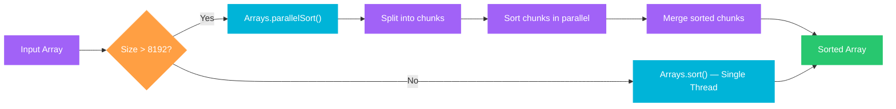
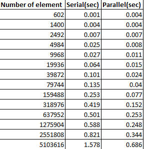

# Arrays.sort() in Java With Examples

**Arrays.sort() in Java with Examples** | In this post, we will discuss how to sort an array using `Arrays.sort()` in Java, how to use `Arrays.parallelSort()`, and the differences between them.

- [Sorting Algorithms and Quicksort](#sorting-algorithms-and-quicksort)
- [Overloaded sort() Methods](#overloaded-sort-methods)
- [Program to Sort Array Using Arrays.sort()](#program-to-sort-array-using-arrayssort)
- [Sorting Example Using Arrays.sort(array, fromIndex, toIndex)](#sorting-example-using-arrayssortarray-fromindex-toindex)
- [Arrays.parallelSort() in Java](#arraysparallelsort-in-java)
- [Arrays.sort() vs Arrays.parallelSort()](#arrayssort-vs-arraysparallelsort)
- [Related Links](#related-links)

---

## 1. Sorting Algorithms and Quicksort

There are many sorting algorithms available to solve only one problem i.e. sort an array. They have different time complexity and space complexity. But **among all sorting algorithms Quick Sort gives the best performance.**

🚀 The **time complexity of Quicksort** is **O(n log n)** in the best case, O(n log n) in the average case, and O(n^2) in the worst case. But because it has the best performance in the average case for most inputs, **Quicksort is generally considered the "fastest" sorting algorithm.**

In the [java.util.Arrays class](033_Arrays_Class_Java_With_Examples.md) there are several `sort()` methods available. All of them use dual-pivot Quicksort. The **Dual-Pivot Quicksort** is given by Vladimir Yaroslavskiy, Jon Bentley, and Josh Bloch. This algorithm offers **O(n log(n)) performance** on all data sets and is typically faster than traditional (one-pivot) Quicksort implementations.

> ⚠️ **Caution:** Dual pivot quicksort is a little bit faster than the original single-pivot quicksort. But still, the worst case will remain O(n^2) when the array is already sorted in an increasing or decreasing order.

> 💡 **Tip:** While working with [Java arrays](026_Java_Array_[With_Examples].md), no need to write your own logic to implement any sorting algorithm. Just import the `Arrays` class and use `Arrays.sort()` which gives the best performance in most cases.

---

## 2. Overloaded sort() Methods

In `Arrays` class there are several overloaded `sort()` methods available:

| # | Method Signature 🏷️ | Description 📋 |
|---|---------------------|----------------|
| 1 | `sort(byte[] a)` | Sort full byte array |
| 2 | `sort(short[] a)` | Sort full short array |
| 3 | `sort(int[] a)` | Sort full int array |
| 4 | `sort(long[] a)` | Sort full long array |
| 5 | `sort(float[] a)` | Sort full float array |
| 6 | `sort(double[] a)` | Sort full double array |
| 7 | `sort(char[] a)` | Sort full char array |
| 8 | `sort(Object[] a)` | Sort full Object array |
| 9-16 | `sort(type[] a, int fromIndex, int toIndex)` | Sort partial array (range) |

- 📦 **`Arrays.sort(array)`** — Sorts the full array into ascending order.
- ✂️ **`Arrays.sort(array, fromIndex, toIndex)`** — Sorts only the elements from `fromIndex` to `toIndex`.

---

## 3. Program to Sort Array Using Arrays.sort()

Let us demonstrate an example of sorting an array using `Arrays.sort()` in Java.

**Sort full int array:**

```java
import java.util.Arrays;

public class SortArray {

  // main method
  public static void main(String[] args) {

    // declare and initialize arrays
    int arr[] = {50, 25, 30, 55, 15};

    // display array before sorting
    System.out.println("Before Sorting: " + Arrays.toString(arr));

    // sort array
    Arrays.sort(arr);

    // display array after sorting
    System.out.println("After Sorting: " + Arrays.toString(arr));
  }
}
```

📤 **Output:**

```
Before Sorting: [50, 25, 30, 55, 15]
After Sorting: [15, 25, 30, 50, 55]
```

Now, let us demonstrate the byte, short, long, float, double, char, boolean array.

**Sort byte array:**

```java
// byte array
byte[] byteArr = {15, 12, 11, 14, 13};
Arrays.sort(byteArr);
System.out.println("Byte Array = " + Arrays.toString(byteArr));
```

📤 **Output:** `Byte Array = [11, 12, 13, 14, 15]`

**Sort short array:**

```java
// short array
short[] shortArr = {400, 200, 100, 300, 500};
Arrays.sort(shortArr);
System.out.println("Short Array = " + Arrays.toString(shortArr));
```

📤 **Output:** `Short Array = [100, 200, 300, 400, 500]`

**Sort long array:**

```java
// long array
long[] longArr = {999999999, 10, 500, -888888888, 0};
Arrays.sort(longArr);
System.out.println("Long Array = " + Arrays.toString(longArr));
```

📤 **Output:** `Long Array = [-888888888, 0, 10, 500, 999999999]`

**Sort float array:**

```java
// float array
float[] floatArr = {15.9f, 10.5f, 500, -88888, 0.9f};
Arrays.sort(floatArr);
System.out.println("Float Array = " + Arrays.toString(floatArr));
```

📤 **Output:** `Float Array = [-88888.0, 0.9, 10.5, 15.9, 500.0]`

**Sort double array:**

```java
// double array
double[] doubleArr = {10.5, 15.9, 500, -88888, 0.9};
Arrays.sort(doubleArr);
System.out.println("Double Array = " + Arrays.toString(doubleArr));
```

📤 **Output:** `Double Array = [-88888.0, 0.9, 10.5, 15.9, 500.0]`

**Sort char array:**

```java
// char array
char[] charArr = {'K','n','o','w','P','r','o','g','r',97,'m'};
Arrays.sort(charArr);
System.out.println("Char Array = " + Arrays.toString(charArr));
```

📤 **Output:** `Char Array = [K, P, a, g, m, n, o, o, r, r, w]`

> ⚠️ **Caution:** The sorting operation is not applicable to `boolean` values. The `boolean` value can contain either `true` or `false`. Therefore, the `Arrays` class doesn't contain any method to sort the boolean array.

```java
// boolean array
boolean[] boolArr = {true, false, true, true, false};
Arrays.sort(boolArr); // error
```

> 📝 **Note:** If the specified array is referenced to `null` then `Arrays.sort()` doesn't give any error or exception.

```java
int arr[] = null;
Arrays.sort(arr); // valid
```

---

## 4. Sorting Example Using Arrays.sort(array, fromIndex, toIndex)

Using `Arrays.sort(array, fromIndex, toIndex)` in Java, we can sort only the elements between a particular range.

- 📥 **`fromIndex`** — index of the first element, **inclusive**
- 📤 **`toIndex`** — index of the last element, **exclusive**

**Sort partial int array (index 0 to 3):**

```java
import java.util.Arrays;

public class SortArray {

  // main method
  public static void main(String[] args) {

    // declare and initialize arrays
    int arr[] = {50, 25, 30, 55, 15};

    // display array before sorting
    System.out.println("Before Sorting: " + Arrays.toString(arr));

    // sort array
    Arrays.sort(arr, 0, 3);

    // display array after sorting
    System.out.println("After Sorting: " + Arrays.toString(arr));
  }
}
```

📤 **Output:**

```
Before Sorting: [50, 25, 30, 55, 15]
After Sorting: [25, 30, 50, 55, 15]
```

**Sort partial char array (index 4 to end):**

```java
// char array
char[] charArr1 = {'k','n','o','w','p','r','o','g','r','a','m'};
// sort only {'p','r','o','g','r',97,'m'}
Arrays.sort(charArr1, 4, charArr1.length);
System.out.println("Char Array = " + Arrays.toString(charArr1));
```

📤 **Output:** `Char Array = [k, n, o, w, a, g, m, o, p, r, r]`

**Sort partial char array (index 1 to 7):**

```java
// char array
char[] charArr2 = {'k','n','o','w','p','r','o','g','r','a','m'};
// sort only {'n','o','w','p','r','o'}
Arrays.sort(charArr2, 1, 7);
System.out.println("Char Array = " + Arrays.toString(charArr2));
```

📤 **Output:** `Char Array = [k, n, o, o, p, r, w, g, r, a, m]`

### Exceptions Thrown by Arrays.sort(array, fromIndex, toIndex)

- 🚨 **`IllegalArgumentException`** — if `fromIndex > toIndex`
- 🚨 **`ArrayIndexOutOfBoundsException`** — if `fromIndex < 0` or `toIndex > a.length`

**Example — fromIndex > toIndex:**

```java
int arr[] = {50, 25, 30, 55, 15};
Arrays.sort(arr, 5, 0);
```

📤 **Output:** `Exception in thread "main" java.lang.IllegalArgumentException: fromIndex(5) > toIndex(0)`

**Example — negative fromIndex:**

```java
int arr[] = {50, 25, 30, 55, 15};
Arrays.sort(arr, -9, 5);
```

📤 **Output:** `Exception in thread "main" java.lang.ArrayIndexOutOfBoundsException: Array index out of range: -9`

**Example — toIndex exceeds array length:**

```java
int arr[] = {50, 25, 30, 55, 15};
Arrays.sort(arr, 0, 7);
```

📤 **Output:** `Exception in thread "main" java.lang.ArrayIndexOutOfBoundsException: Array index out of range: 7`

---

## 5. Arrays.parallelSort() in Java

The `java.util.Arrays` class also contains `parallelSort()` method to sort an array. It also sorts the specified array into ascending numerical order. It was added in Java 8.

🔗 **Similarity with `Arrays.parallelSort()` and `Arrays.sort()`:**

- ✅ Both can be used to sort objects and primitive arrays.
- ✅ By default, both methods sort an array into ascending order.

Unlike `Arrays.sort()` (which is based on a single thread), `parallelSort()` uses **multiple threads**. And for executing parallel tasks it uses the ForkJoin pool. It uses a sort-merge technique that divides the specified array into chunks of some size and sorts each chunk individually. Finally, the sorted chunks are merged using the merge logic from the Merge-sort algorithm.

🔧 **The implementation in JDK 8 uses this approach:**

1️⃣ Divide the array into 4 parts.
2️⃣ Sort the first two parts and then merge them.
3️⃣ Sort the next two parts and then merge them.

The above steps are repeated recursively with each part until the size of the part to sort is not lesser than the threshold value calculated above.

> 🔑 **Key Point:** `Arrays.parallelSort()` uses parallelism only when certain conditions are met. **If the array size is less than or equal to 8192 or the processor has only one core, then it internally uses `Arrays.sort()` method.**

Similar to `Arrays.sort()`, it also has two variants:

- 📦 **`Arrays.parallelSort(array)`** — Sorts the full array into ascending order.
- ✂️ **`Arrays.parallelSort(array, fromIndex, toIndex)`** — Sorts only the elements from fromIndex to toIndex.

**parallelSort full array:**

```java
import java.util.Arrays;

public class CompareArray {

  // main method
  public static void main(String[] args) {

    // declare and initialize arrays
    int arr[] = {50, 30, 25, 55, 15};

    // sort array
    Arrays.parallelSort(arr);

    // display array after sorting
    System.out.println(Arrays.toString(arr));
  }
}
```

📤 **Output:**

```
[15, 25, 30, 50, 55]
```

**parallelSort partial array (index 1 to 3):**

```java
// declare and initialize arrays
int arr[] = {50, 30, 25, 55, 15};

// sort array using parallelSort()
Arrays.parallelSort(arr, 1, 3);

// display array after sorting
System.out.println(Arrays.toString(arr));
```

📤 **Output:**

```
[50, 25, 30, 55, 15]
```

---

## 6. Arrays.sort() vs Arrays.parallelSort()

| Feature | `Arrays.sort()` 🔹 | `Arrays.parallelSort()` 🔸 |
|---------|--------------------|-----------------------------|
| **Threading** | Single thread — sorting is done sequentially | Multiple threads — sorting is done in parallel |
| **Small datasets** | ⚡ Faster for smaller array sizes | 🐢 Slower for smaller data sets |
| **Large datasets** | 🐢 Less performance, takes longer | ⚡ Better performance for large-size arrays |
| **CPU cores** | ❌️ Doesn't utilize multiple cores | ✅ Utilizes multiple cores of the system |
| **Threshold** | N/A | Falls back to `sort()` if size <= 8192 |



[Source](https://www.javacodegeeks.com/2013/04/arrays-sort-versus-arrays-parallelsort.html)

---

## 7. Related Links

- [Array in Java](026_Java_Array_[With_Examples].md)
- [Multidimensional Array](027_Multidimensional_Array_in_Java.md)
- [Anonymous Array](028_Anonymous_Array_in_Java_With_Example.md)
- [Array of Objects](029_Array_of_Objects_in_Java_With_Example.md)
- [Jagged Array](030_Jagged_Array_in_Java_with_Example.md)
- [System.arraycopy()](031_System.arraycopy()_in_Java_with_Examples.md)
- [Arrays Class & Methods](033_Arrays_Class_Java_With_Examples.md)
- Arrays.toString()
- [Arrays.copyOf()](036_Arrays.copyOf_in_Java_With_Example.md)
- [Arrays.copyOfRange()](037_Arrays.copyOfRange_in_Java_with_Example.md)
- [Arrays.fill()](038_Arrays.fill()_–_Fill_Java_Arrays.md)
- Arrays.equals() Method
