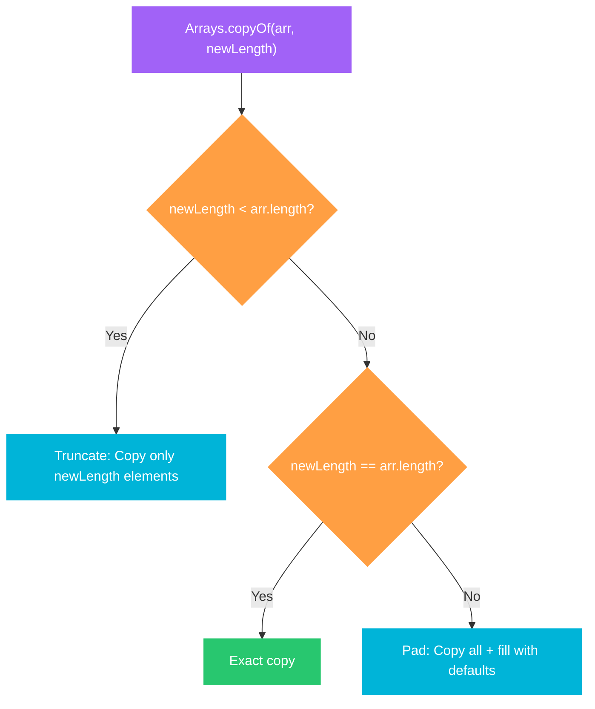

# Arrays.copyOf in Java With Example

**Arrays.copyOf in Java With Example** | The `copyOf()` method of [java.util.Arrays class](033_Arrays_Class_Java_With_Examples.md) copies the specified array, truncating or padding with zeros/nulls (if necessary). Internally, this method calls the [System.arraycopy() method of Java](031_System.arraycopy()_in_Java_with_Examples.md).

- [Overloaded Forms of copyOf()](#overloaded-forms-of-copyof)
- [Basic copyOf() Example](#basic-copyof-example)
- [How Arrays.copyOf() is Implemented](#how-arrayscopyof-is-implemented)
- [Examples to Copy Double and Char Array](#examples-to-copy-double-and-char-array-using-arrayscopyof)
- [Additional Points](#additional-points)
- [Copy Multidimensional Array](#copy-multidimensional-array-using-copyof-of-java-arrays)
- [Copy Array of Objects](#copy-array-of-objects)
- [Related Links](#related-links)

---

## 1. Overloaded Forms of copyOf()

There is a total of 10 overloaded forms of `Arrays.copyOf()` method:

- `public static byte[] copyOf(byte[] original, int newLength)`
- `public static short[] copyOf(short[] original, int newLength)`
- `public static int[] copyOf(int[] original, int newLength)`
- `public static long[] copyOf(long[] original, int newLength)`
- `public static char[] copyOf(char[] original, int newLength)`
- `public static float[] copyOf(float[] original, int newLength)`
- `public static double[] copyOf(double[] original, int newLength)`
- `public static boolean[] copyOf(boolean[] original, int newLength)`
- `public static <T> T[] copyOf(T[] original, int newLength)`
- `public static <T,U> T[] copyOf(U[] original, int newLength, Class<? extends T[]> newType)`

📥 **Parameters:**

- `original` — The array to be copied
- `newLength` — The length of the copy to be returned

---

## 2. Basic copyOf() Example

Let us see a demonstration of the `copyOf()` method of `Arrays` class.

**Copying int array with different lengths:**

```java
import java.util.Arrays;

public class ArrayTest {
  public static void main(String[] args) {

    // original array
    int[] arr = {10, 20, 30, 40, 50};
    System.out.println("Original array = " +
                        Arrays.toString(arr));

    // Example1
    int[] newArray1 = Arrays.copyOf(arr, 3);
    System.out.println("NewArray1 = " +
                        Arrays.toString(newArray1));

    // Example2
    int[] newArray2 = Arrays.copyOf(arr, 5);
    System.out.println("NewArray2 = " +
                        Arrays.toString(newArray2));

    // Example3
    int[] newArray3 = Arrays.copyOf(arr, 7);
    System.out.println("NewArray3 = " +
                        Arrays.toString(newArray3));

  }
}
```

📤 **Output:**

```
Original array = [10, 20, 30, 40, 50]
NewArray1 = [10, 20, 30]
NewArray2 = [10, 20, 30, 40, 50]
NewArray3 = [10, 20, 30, 40, 50, 0, 0]
```

How these different outputs are coming? To understand these, we need to see how `copyOf()` method is implemented.

---

## 3. How Arrays.copyOf() is Implemented

Whenever we call `Arrays.copyOf(arr, newLength)` then:

1️⃣ One local array variable is created with the size of passed length `newLength`
2️⃣ Then it internally calls [System.arraycopy() method](031_System.arraycopy()_in_Java_with_Examples.md)
3️⃣ Return the copied array

**Source code for copyOf() with int[] array:**

```java
public static int[] copyOf(int[] original, int newLength) {
     int[] copy = new int[newLength];
     System.arraycopy(original, 0, copy, 0,
                  Math.min(original.length, newLength));
     return copy;
}
```

💡 **Tip:** All the overloaded forms of `Arrays.copyOf()` method are implemented in a similar way. In `System.arraycopy()` method the last argument is the length. The `Arrays.copyOf()` method internally finds the minimum value between original array length and `newLength`.



### When newLength < original.length (Truncation)

If `newLength` is minimum compared to the length of the original array then only that portion of array elements will be copied.

**Truncation example:**

```java
// original array
int[] arr = {10, 20, 30, 40, 50};
// new array
int[] newArray = Arrays.copyOf(arr, 3);
System.out.println(Arrays.toString(newArray));
```

📤 **Output:** `[10, 20, 30]`

🔍 The length of the original array `arr` is 5. We want to copy only 3 elements therefore we are calling `Arrays.copyOf(arr, 3)`. Internally this method will find `Math.min(5, 3)` => 3, and since 3 is lesser, it will call `System.arraycopy(arr, 0, copy, 0, 3)`. Only three elements will be copied.

### When newLength > original.length (Padding)

If the original array length is minimum compared to the `newLength` then the remaining elements will be filled by default values.

**Padding example:**

```java
// original array
int[] arr = {10, 20, 30, 40, 50};
// new array
int[] newArray = Arrays.copyOf(arr, 7);
System.out.println(Arrays.toString(newArray));
```

📤 **Output:** `[10, 20, 30, 40, 50, 0, 0]`

🔍 In this example, we passed `newLength` as 7. The length of the original array is 5 but we are passing 7. Internally after calling `Arrays.copyOf(arr, 7)`:

- 📦 One `copy[]` will be created with length 7. Since it is array creation with default value, the copy array will hold `[0, 0, 0, 0, 0, 0, 0]` because `0` is the default value of `int` data type.
- 🔄 Now, it calls `System.arraycopy(arr, 0, copy, 0, 5)`, and all five elements of the original array will be copied to `copy[]`.
- 📝 The remaining 2 elements will remain as is.

---

## 4. Examples to Copy Double and Char Array Using Arrays.copyOf()

**Copy double array:**

```java
// double array
double[] doubleArr = {10.5, 15.9, 500, -88888, 0.9};
System.out.println("Double Array = " + Arrays.toString(doubleArr));

// copy array
double[] arr1 = Arrays.copyOf(doubleArr, 3);
System.out.println("Arr1 = " + Arrays.toString(arr1));

double[] arr2 = Arrays.copyOf(doubleArr, doubleArr.length);
System.out.println("Arr2 = " + Arrays.toString(arr2));

double[] arr3 = Arrays.copyOf(doubleArr, 7);
System.out.println("Arr3 = " + Arrays.toString(arr3));
```

📤 **Output:**

```
Double Array = [10.5, 15.9, 500.0, -88888.0, 0.9]
Arr1 = [10.5, 15.9, 500.0]
Arr2 = [10.5, 15.9, 500.0, -88888.0, 0.9]
Arr3 = [10.5, 15.9, 500.0, -88888.0, 0.9, 0.0, 0.0]
```

**Copy char array:**

```java
// char array
char[] charArr = {'K','n','o','w','P','r','o','g','r','a','m'};
System.out.println("Char Array = " + Arrays.toString(charArr));

// copy array
char[] arr1 = Arrays.copyOf(charArr, 4);
System.out.println("Arr1 = " + Arrays.toString(arr1));

char[] arr2 = Arrays.copyOf(charArr, charArr.length);
System.out.println("Arr2 = " + Arrays.toString(arr2));

char[] arr3 = Arrays.copyOf(charArr, 15);
System.out.println("Arr3 = " + Arrays.toString(arr3));
```

📤 **Output:**

```
Char Array = [K, n, o, w, P, r, o, g, r, a, m]
Arr1 = [K, n, o, w]
Arr2 = [K, n, o, w, P, r, o, g, r, a, m]
Arr3 = [K, n, o, w, P, r, o, g, r, a, m, \0, \0, \0, \0]
```

---

## 5. Additional Points

- 📜 The `copyOf()` method with all its overloaded forms was introduced in **Java 1.6** version.
- 🚨 This method throws `NullPointerException` if the passed original array is `null`. Therefore, it is better to check `if(original != null)` and then call `copyOf()`.
- ⚠️ It also throws `NegativeArraySizeException` if the passed length (i.e. `newLength`) is negative.

**NullPointerException example:**

```java
import java.util.Arrays;
public class ArrayTest {
  public static void main(String[] args) {
    int[] arr = null;
    int[] newArray1 = Arrays.copyOf(arr, 3);
  }
}
```

📤 **Output:**

```
Exception in thread "main" java.lang.NullPointerException: Cannot read the array length because "original" is null
at java.base/java.util.Arrays.copyOf(Arrays.java:3585)
at ArrayTest.main(ArrayTest.java:5)
```

**NegativeArraySizeException example:**

```java
import java.util.Arrays;
public class ArrayTest {
  public static void main(String[] args) {
    int[] arr = null;
    int[] newArray1 = Arrays.copyOf(arr, -3);
  }
}
```

📤 **Output:**

```
Exception in thread "main" java.lang.NegativeArraySizeException: -3
at java.base/java.util.Arrays.copyOf(Arrays.java:3584)
at ArrayTest.main(ArrayTest.java:5)
```

---

## 6. Copy Multidimensional Array Using copyOf() of Java Arrays

The `Arrays.copyOf()` method also can be used to copy the [Java multidimensional array](027_Multidimensional_Array_in_Java.md) like [2D Java array](043_2D_Array_in_Java.md) and [3D Java array](044_3D_Array_in_Java.md).

**Copy 2D array:**

```java
import java.util.Arrays;

public class ArrayTest {
  public static void main(String[] args) {

    // original 2D array 3x2
    int matrix[][] = { { 1, 2 }, { 4, 5 }, { 7, 8 } };
    System.out.println("Original = " +
               Arrays.deepToString(matrix));

    // Example1
    int[][] newMatrix1 = Arrays.copyOf(matrix, 1);
    System.out.println("newMatrix1 = " +
               Arrays.deepToString(newMatrix1));

    // Example2
    int[][] newMatrix2 = Arrays.copyOf(matrix, 3);
    System.out.println("newMatrix2 = " +
               Arrays.deepToString(newMatrix2));

    // Example3
    int[][] newMatrix3 = Arrays.copyOf(matrix, 5);
    System.out.println("newMatrix3 = " +
               Arrays.deepToString(newMatrix3));

  }
}
```

📤 **Output:**

```
Original = [[1, 2], [4, 5], [7, 8]]
newMatrix1 = [[1, 2]]
newMatrix2 = [[1, 2], [4, 5], [7, 8]]
newMatrix3 = [[1, 2], [4, 5], [7, 8], null, null]
```

**Copy 3D array:**

```java
import java.util.Arrays;

public class ArrayTest {
  public static void main(String[] args) {

    // 3D array 2x3x2
    int[][][] arr = {{{1,2},{3,4},{5,6}},{{7,8},{9,1},{2,3}}};
    System.out.println("Original = " +
               Arrays.deepToString(arr));

    // Example1
    int[][][] newArr1 = Arrays.copyOf(arr, 1);
    System.out.println("newArr1 = " +
               Arrays.deepToString(newArr1));

    // Example2
    int[][][] newArr2 = Arrays.copyOf(arr, 2);
    System.out.println("newArr2 = " +
               Arrays.deepToString(newArr2));

    // Example3
    int[][][] newArr3 = Arrays.copyOf(arr, 4);
    System.out.println("newArr3 = " +
               Arrays.deepToString(newArr3));

  }
}
```

📤 **Output:**

```
Original = [[[1, 2], [3, 4], [5, 6]], [[7, 8], [9, 1], [2, 3]]]
newArr1 = [[[1, 2], [3, 4], [5, 6]]]
newArr2 = [[[1, 2], [3, 4], [5, 6]], [[7, 8], [9, 1], [2, 3]]]
newArr3 = [[[1, 2], [3, 4], [5, 6]], [[7, 8], [9, 1], [2, 3]], null, null]
```

---

## 7. Copy Array of Objects

Using the `Arrays.copyOf()` method, we can also copy the [array of objects](029_Array_of_Objects_in_Java_With_Example.md). It is very similar to the previous programs. In the Arrays.toString() method, we have discussed how to display an array of objects.

1️⃣ **Student class:**

```java
class Student {
  private int idNum;
  private String name;

  // constructor
  public Student(int idNum, String name) {
    this.idNum = idNum;
    this.name = name;
  }

  @Override
  public String toString() {
    return "[" + idNum + ", " + name + "]";
  }
}
```

2️⃣ **Test class:**

```java
import java.util.Arrays;

public class Collage {
  public static void main(String[] args) {

    // array of Student objects
    Student[] st = new Student[3];

    // initialize Student object
    st[0] = new Student(100, "Emma");
    st[1] = new Student(115, "Alex");
    st[2] = new Student(225, "Amelia");

    // display Student details (Original)
    System.out.println("Array = " + Arrays.toString(st));

    // Example1:- copy only first Student objects
    Student[] st1 = Arrays.copyOf(st, 1);
    // display new array
    System.out.println("St1 = " + Arrays.toString(st1));

    // Example2:- copy all Student objects
    Student[] st2 = Arrays.copyOf(st, st.length);
    // display new array
    System.out.println("St2 = " + Arrays.toString(st2));

    // Example3:- copy more than 3 Student objects
    Student[] st3 = Arrays.copyOf(st, 5);
    // display new array
    System.out.println("St3 = " + Arrays.toString(st3));
  }
}
```

📤 **Output:**

```
Array = [[100, Emma], [115, Alex], [225, Amelia]]
St1 = [[100, Emma]]
St2 = [[100, Emma], [115, Alex], [225, Amelia]]
St3 = [[100, Emma], [115, Alex], [225, Amelia], null, null]
```

---

## 8. Related Links

- [Array in Java](026_Java_Array_[With_Examples].md)
- [Multidimensional Array](027_Multidimensional_Array_in_Java.md)
- [Anonymous Array](028_Anonymous_Array_in_Java_With_Example.md)
- [Array of Objects](029_Array_of_Objects_in_Java_With_Example.md)
- [Jagged Array](030_Jagged_Array_in_Java_with_Example.md)
- [System.arraycopy()](031_System.arraycopy()_in_Java_with_Examples.md)
- [Arrays Class & Methods](033_Arrays_Class_Java_With_Examples.md)
- Arrays.toString()
- [Arrays.sort() Method](035_Arrays.sort()_in_Java_With_Examples.md)
- [Arrays.copyOfRange()](037_Arrays.copyOfRange_in_Java_with_Example.md)
- [Arrays.fill()](038_Arrays.fill()_–_Fill_Java_Arrays.md)
- Arrays.equals() Method
