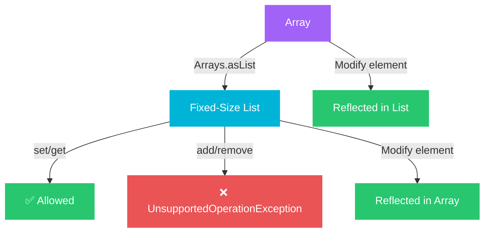

# Java Arrays.asList() Method

**Java Arrays.asList() Method** | The `Arrays` class contains useful methods for array manipulation operations like sorting, searching, copying, comparing, converting to string, and more. It also contains the `asList()` method which is used to return a list representation of the given array.

- [Limitation of Arrays.asList()](#limitation-of-arraysaslist)
- [UnsupportedOperationException By Java Arrays.asList() Method](#unsupportedoperationexception-by-java-arraysaslist-method)

---

`Arrays.asList()` method returns a fixed-size list backed by the specified array. The changes made to the array will be visible in the returned list, and changes made to the list will be visible in the array. The list returned by the `Arrays.asList()` method is modifiable. Also see: ~~How to convert list to an array using toArray() method~~.

The returned list is `Serializable` and implements `RandomAccess`. This method acts as the bridge between array-based and collection-based APIs, in combination with `Collection.toArray()`. The `Arrays.asList()` method runs in O(1) time.

**Method signature:**

```java
public static <T> List<T> asList(T... a) {
   return new ArrayList<>(a);
}
```

> 📝 **Note:** The `Arrays.asList()` method will throw `NullPointerException` if the specified array is `null`.

Let us see some examples of converting different types of arrays as Lists using the `Arrays.asList()` method.

**Convert Integer array to List:**

```java
import java.util.Arrays;
import java.util.List;

public class Main {
   public static void main(String[] args) {
      // Integer array
      Integer[] arr = { 11, 12, 13, 14, 15 };
      System.out.println(arr.getClass().getName());

      // convert Integer array to list
      List<Integer> list = Arrays.asList(arr);

      // display list
      System.out.println("List = " + list);
      System.out.println(list.getClass().getName());
   }
}
```

📤 **Output:**

```
[Ljava.lang.Integer;
List = [11, 12, 13, 14, 15]
java.util.Arrays$ArrayList
```

If we have multiple values and want to create a list from them then there is no need to create the array. We can directly pass those values to the `asList()` method and we will have a list representing those values.

**Create List directly from values:**

```java
import java.util.Arrays;
import java.util.List;

public class Main {
   public static void main(String[] args) {
      List<Integer> numbers = Arrays.asList(10, 20, 30, 40, 50);
      System.out.println("List: " + numbers);
   }
}
```

📤 **Output:**

```
List: [10, 20, 30, 40, 50]
```

**Convert String Array to List of String:**

```java
// String array
String[] arr = {"Java", "Python", "C++"};
// convert String array to list
List<String> list = Arrays.asList(arr);
// display list
System.out.println("List = " + list);
```

📤 **Output:**

```
List = [Java, Python, C++]
```

---

## 1. Limitation of Arrays.asList()

Be careful while using the `Arrays.asList()` method because the changes made to the array will be visible in the returned list, and changes made to the list will be visible in the array.

**Array-List mutual modification example:**

```java
Integer[] array = { 11, 12, 13, 14, 15 };
List<Integer> numbers = Arrays.asList(array);

// modifying array
array[0] = 90;

System.out.println("Array: " + numbers);
System.out.println("List: " + numbers);
```

📤 **Output:**

```
Array: [90, 12, 13, 14, 15]
List: [90, 12, 13, 14, 15]
```

> 💡 **Tip:** It is not recommended to convert the array to a list using the `Arrays.asList()` method if you are going to modify the array/list later. In that case, you can use **List.of() method** which creates `ImmutableCollections` i.e. once created, they cannot be modified.

⚠️ **Caution:** In the case of primitive data types, the type of the specified array must be a Wrapper Class (`Integer`, `Double`, etc). If we pass `int a[]` to `Arrays.asList()` method, then it will return a `List` and not `List<Integer>`, as "autoboxing" doesn't happen in this case. The `int a[]` is itself identified as an object, and a List of int arrays is returned, instead of the list of integers, which will give an error in various Collection functions.

**Primitive array pitfall:**

```java
int[] array = { 11, 12, 13, 14, 15 };
List<?> numbers = Arrays.asList(array);

System.out.println(Arrays.toString(array));
System.out.println(numbers);
```

📤 **Output:**

```
[11, 12, 13, 14, 15]
[[I@aec6354]
```

---

## 2. UnsupportedOperationException By Java Arrays.asList() Method

As we know, in Java the [array](026_Java_Array_[With_Examples].md) size is fixed and we can't modify the array size once initialized. After initialization, we cannot increase or decrease its size. In order to add or remove elements from the existing array we have to create another array.

Whereas we can modify the size of the [list](195_List_Interface_in_Java.md) after initialization. We can add more elements to the list and we can remove elements from it. The modification is applied to the same list.

`Arrays.asList()` method acts as a bridge between array and list but this is the situation where they conflict with each other. Array size can't be modified whereas the list size can be modified. `Arrays.asList()` has given us a list presentation of the array elements.

After converting the array to a list using the `Arrays.asList()` method, if we try to add or remove elements from the list then we will get `java.lang.UnsupportedOperationException`.

**Attempting to add elements:**

```java
Integer[] array = { 11, 12, 13, 14, 15 };
List<Integer> numbers = Arrays.asList(array);
// modifying list
numbers.add(100);
```

🚨 **Exception:**

```
Exception in thread "main" java.lang.UnsupportedOperationException
```

**Attempting to remove elements:**

```java
Integer[] array = { 11, 12, 13, 14, 15 };
List<Integer> numbers = Arrays.asList(array);
// modifying list
numbers.remove(0);
```

🚨 **Exception:**

```
Exception in thread "main" java.lang.UnsupportedOperationException
```



> 🔑 **Key Point:** The list returned by `Arrays.asList()` supports `set()` but does not support `add()` or `remove()` because the underlying array cannot change size.

If you enjoyed this post, share it with your friends. Do you want to share more information about the topic discussed above or do you find anything incorrect? Let us know in the comments. Thank you!
