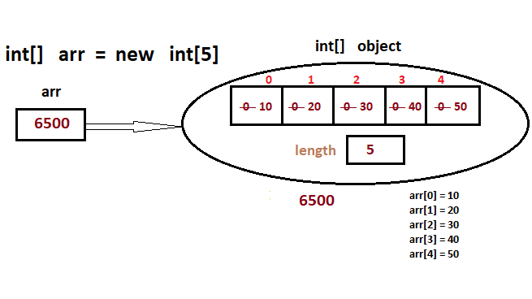

# Take Array Input in Java

**Take Array Input in Java** | [Array Programs in Java - 2](026_Java_Array_[With_Examples].md) | In the previous Java program, we have seen how to find the length of an array in Java. Now in this post, we will see how to take array input in Java.

- [Java Program to Get Array Input From End-user](#java-program-to-get-array-input-from-end-user)
- [Passing Array as Argument](#passing-array-as-argument)

---

We can get array input in Java from the end-user or from a method. First, we will develop a program to get array input from the end-user through the keyboard, and later we will develop a Java program to take an array as an argument.

Prerequisite: [Array in Java](026_Java_Array_[With_Examples].md)

## 1. Java Program to Get Array Input From End-user

To get input from the end-user we can use the `Scanner` class. For this, first, we need to create an object for the `Scanner` class and call the appropriate method to read the input value.

**Read int array from keyboard:**

```java
import java.util.Scanner;
public class Test {
  public static void main(String[] args) {

    // Scanner class object to read input
    Scanner scan = new Scanner(System.in);

    // declaring and creating array objects
    int[] arr = new int[5];

    // displaying default values
    System.out.println("Default values of array:");
    for (int i=0; i < arr.length; i++) {
      System.out.print(arr[i]+"\t");
    }

    // initializing array
    System.out.println("\n\n***Initializing Array***");
    System.out.println("Enter "+ arr.length
                     + " integer values:");

    for(int i=0; i < arr.length; i++) {
      // read input
      arr[i] = scan.nextInt();
    }
    System.out.println("***Initialization completed***\n");

    //displaying initialized values
    System.out.println("Array elements are:");
    for (int i=0; i < arr.length; i++) {
      System.out.print(arr[i]+"\t");
    }

  }
}
```

📤 **Output:**

```
Default values of array:
0 0 0 0 0
***Initializing Array***
Enter 5 integer values:
10
20
30
40
50
***Initialization completed***
Array elements are:
10 20 30 40 50
```



📝 **Note:** In this array program, array elements are not initialized with explicit values, they are initialized with a default value. The default value of the `int` data type is 0, so they are initialized with 0. Later we updated array elements with values 10, 20, 30, 40, and 50.

---

## 2. Passing Array as Argument

To pass an array object as an argument the method parameters must be the passed array object type or its superclass type.

**Program 2: Display array elements through a method:**

```java
public class ArrayMethod {

  public static void main(String[] args) {
    int[] array={5, 10, 20, 30, 55};
    display(array);
  }

  static void display(int[] a) {
    for(int i=0; i< a.length; i++) {
      System.out.print(a[i]+"\t");
    }
  }

}
```

📤 **Output:**

```
5 10 20 30 55
```

**Program 3: Find the sum of array elements using a user-defined method:**

```java
public class ArraySum {

  // main method
  public static void main(String[] args) {
    // array with explicit values
    int[] array = {5,15,25,35,45,55,65};
    int sum = 0;
    sum = sumOfArrayElements(array);
    System.out.println("\nSum of"
       + " array elements: " + sum);
  }

  // method to display array elements
  // and calculate sum
  static int sumOfArrayElements(int[] a) {
    int sum=0;
    // display array and calculate sum
    for(int i=0; i< a.length; i++){
      System.out.print(a[i]+"\t");
      sum += a[i];
    }
    return sum;
  }

}
```

📤 **Output:**

```
5 15 25 35 45 55 65
Sum of array elements: 245
```

> 🔑 **Key Point:** When we pass an array object as an argument into a method, and if we modify array object values with method parameters then the modification is effected to the original referenced variable.

**Guess the output:**

```java
public class Array {

  public static void main(String[] args) {
    int[] a = {10,20,30,40};
    m1(a);
    for(int i=0; i < a.length; i++){
      System.out.print(a[i]+"\t");
    }
  }

  static void m1(int[] ia){
    ia[1] = 4;
    ia[2] = 5;
  }
}
```

You may think the output 10, 20, 30, and 40 but it is the wrong output. **The actual output is: 10 4 5 40.** The Java language uses pass by reference not the pass by value. That's why we get this output.

**Program: Read double array and find sum:**

```java
import java.util.Scanner;
class Test{

  // method to display array elements
  public static void display(double[] a) {
    for (int i=0; i < a.length; i++) {
      System.out.print(a[i]+"\t");
    }
  }

  // method to find sum of array elements
  public static double sumOfArray(double[] a) {
    double sum = 0.0;
    for (int i=0; i < a.length; i++) {
      sum += a[i];
    }
    return sum;
  }

  // main method
  public static void main(String[] args) {

    // Scanner class object to read input
    Scanner scan = new Scanner(System.in);

    // declare variables
    int n = 0;
    double[] arr = null;
    double sum = 0.0;

    // read number of elements
    System.out.print("How many numbers" +
             " you want to enter:: ");
    n = scan.nextInt();
    // declare array
    arr = new double[n];

    // initializing array
    System.out.println("Enter "+ arr.length
                     + " numbers:");
    for(int i=0; i < arr.length; i++) {
      // read input
      arr[i] = scan.nextDouble();
    }

    // pass array to find sum
    sum = sumOfArray(arr);

    // display array
    System.out.println("Array elements are:");
    display(arr);

    // display sum value
    System.out.println("\nSum = " + sum);
  }
}
```

📤 **Output:**

```
How many numbers you want to enter:: 5
Enter 5 numbers:
12.5
19.8
10
20
58
Array elements are:
12.5 19.8 10.0 20.0 58.0
Sum = 120.3
```

If you enjoyed this post, share it with your friends. Do you want to share more information about the topic discussed above or do you find anything incorrect? Let us know in the comments. Thank you!
