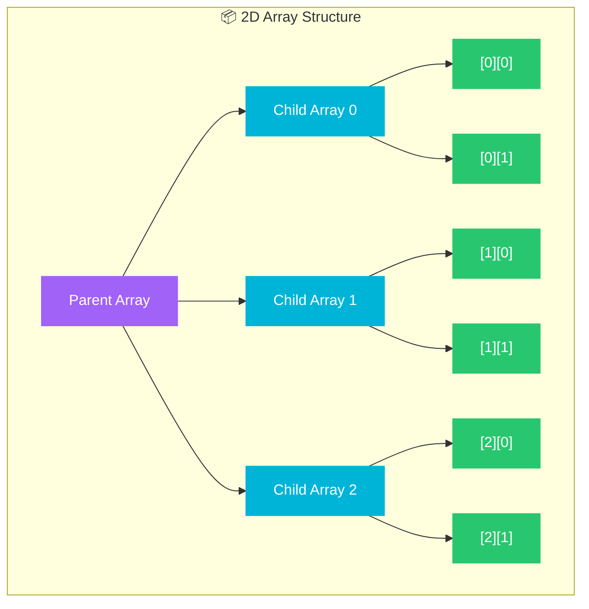
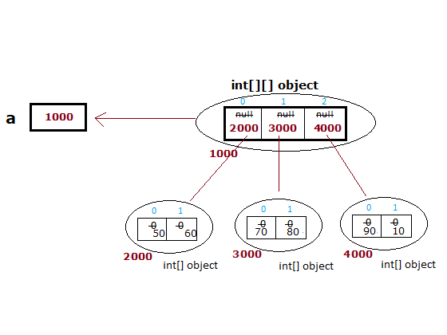

# 2D Array in Java

**2D Array in Java** | A two-dimensional array is a collection of single-dimensional arrays, therefore it also can be called an array of arrays. It is specified by using two subscripts: row size and column size.

- [Declare 2D Array in Java](#declare-2d-array-in-java)
- [Initialize 2D Array Java](#initialize-2d-array-java)
- [Access Modify Two Dimensional Array](#access-modify-two-dimensional-array)
- [Length or Size of 2D Array Java](#length-or-size-of-2d-array-java)
- [How to Print a 2D Array in Java](#how-to-print-a-2d-array-in-java)
- [Two Dimensional Array Example in Java](#two-dimensional-array-example-in-java)
- [Example Program](#example-program)
- [Pass and Return Two Dimensional Array](#pass-and-return-two-dimensional-array)
- [Two Dimensional Array in Java Example Program](#two-dimensional-array-in-java-example-program)

---

More dimensions in an array mean more data can be stored in that array.

Basically multidimensional arrays are used for representing data in table format. Here the dimensions mean level in the array object memory. If only one level is there, then it is a single-dimensional array, and if two levels are there, it is a two-dimensional array.



## 1. Declare 2D Array in Java

Before using any variable we must declare the variable. The full syntax to declare the 2-dimensional array is:

`<Accessibility-modifier><Execution-level-Modifiers> <datatype>[][] <array variable name>;`

In this syntax the accessibility-modifier and execution-level-modifiers are optional, but the remaining are mandatory.

**Declaration examples:**

```java
int[][] arr1;
float[][] n1;
public static int[][] arr2;
public static float[][] n2;
```

The dimension or level is represented by `[]`. Therefore the two-dimensional array will contain `[][]`. The single-dimensional array contains `[]`, the three-dimensional array contains `[][][]`, and so on.

**Rules for declaring two dimensional array in Java:**

1) `[][]` can't be placed before the data type, else it will give the compile-time error: *illegal start of expression*. The `[][]` can be placed after the data type, before variable-name, or after variable-name.

```java
int[][]  a1; // valid
int[]  []a2; // valid
int[]  a3[]; // valid
int  [][]a4; // valid
int  []a5[]; // valid
int  a6[][]; // valid
/*
[]int  a7[]; // error
[]int[]  a8; // error
[][]int  a9; // error
*/
```

> 💡 **Tip:** In these examples many forms are valid but they can create confusion. Therefore it is recommended to use `[][]` after data type or variable name. Example: `int[][] a1;` *or* `int a6[][];`

2) Size can't be mentioned in the declaration part. Violation of this rule leads to a compile-time error: *not a statement.*

```java
int[2][]  b1; // error
int[][2]  b2; // error
int[2][2] b3; // error
```

⚠️ **Caution:** Be careful at the time of declaration. There are different meanings for different declarations:

- `int[][] i, j;` — both `i` and `j` are of `int[][]` type
- `int[] i[], j;` — `i` is of `int[][]` type, but `j` is of `int[]` type
- `int i, j[][];` — `i` is of `int` type but `j` is of `int[][]` type

---

## 2. Initialize 2D Array Java

We can initialize a 2D array in 3 ways:

- 📦 2D array initialization with explicit values
- 📦 2D array initialization with default values (i.e. without explicit value)
- 📦 Using [Anonymous Array](028_Anonymous_Array_in_Java_With_Example.md)

### 1) 2D array initialization with explicit values

Full syntax: `<Accessibility modifier><Execution-level Modifiers> <datatype>[][] <array variable name> = {<list-of-array-elements>};`

**Example:**

```java
int[][] a1 = {{5,6},{7,8}};
public static int[][] a2 = {{5,6},{7,8}};
```

In this way of 2D array initialization, the array is declared and initialized in the same line, because array constants can only be used in initializers. The accessibility modifier and execution level modifiers are optional. We can use this approach only if the values are known at the time of two-dimensional array declaration.

### 2) Two-dimensional array initialization with default values

In this way, we can declare the array and initialize it later.

Syntax: `<array-variable-name> = new <datatype>[<parent-array-size>][<child-array-size>];`

**Example:**

```java
// declare a two dimensional array
int[][] arr = null;
// initialize 2D array with default values
arr = new int[3][2];
```

In this example, first, we had declared a 2D array then we had initialized it with the default value. It is a 3x2 matrix. Since it is an array of `int` data type and the default value for `int` is 0, therefore this array is initialized with 0. Later we can update the values by accessing the array elements.

Instead of two lines, we can declare and initialize the array within a single line: `int[][] arr = new int[3][2];`

From this example we can say:

- 🔢 One parent array is created with 3 locations
- 🔢 Three child arrays are created with 2 locations

Parent array size gives two pieces of information:

- Parent array's number of locations
- Number of child arrays

In this way of 2D array initialization in Java, the base/parent array size is mandatory whereas child array size is optional.

```java
int[][] a1 = new int[3][]; // valid
int[][] a2 = new int[3][3]; // valid
/*
int[][] a3 = new int[][3]; // error
int[][] a4 = new int[][]; // error
*/
```

> 📝 **Note:** If we do not pass child array size, then child array objects are not created, only parent array object is created. Later we should pass array objects. If we pass the child array size, all child arrays are created with the same size. If we want to create child arrays with different sizes we must not pass child array size.

### 3) Initialize 2D array using Anonymous Array

**Example:**

```java
// declare a 2D array
int[][] arr = null;
// create array with explicit values
arr = new int[][] {{5,6},{7,8}};
```

✅ **Advantage of this approach:** In the first way of 2D array initialization i.e. while initializing the 2D array with explicit values, we must declare and initialize the array in a single line else we will get an error. But using this approach we can declare and initialize with explicit value at different lines.

---

## 3. Access Modify Two Dimensional Array

The two-dimensional array can be accessed using `<array-variable>[parent-array-index][child-array-index]`. Now, let us see it through an example.

**Declare 2D array of size 3x2 and initialize it with default value:**

```java
int[][] a = new int[3][2];
```

**Accessing and updating the array:**

```java
a[0][0] = 50;
a[0][1] = 60;
a[1][0] = 70;
a[1][1] = 80;
a[2][0] = 90;
a[2][1] = 10;
```

It is similar to:

```java
int[][] a = {{50,60},{70,80},{90,10}};
```



---

## 4. Length or Size of 2D Array Java

To access the length or size of parent use `<array-variable>.length`, example: `arr.length`. Similarly to access the child array size use `<array-variable>[index].length`.

**Java program to find the length or size of 2D array:**

```java
public class TwoDArray {
  public static void main(String[] args) {

    // declare a 2D array
    // and initialize with explicit values
    int[][] arr = {{50,60},{70,80},{90,10}};

    System.out.println("Parent size = " + arr.length);
    System.out.println("Child-1 size = " + arr[0].length);
    System.out.println("Child-2 size = " + arr[1].length);
    System.out.println("Child-3 size = " + arr[2].length);
  }
}
```

📤 **Output:**

```
Parent size = 3
Child-1 size = 2
Child-2 size = 2
Child-3 size = 2
```

---

## 5. How to Print a 2D Array in Java

To display a two-dimensional array we can use loops or pre-defined methods. Since it is a two-dimensional array (i.e. 2 levels) therefore it required two loops to access the elements. The loop can be for-loop, for-each loop, while loop, or do-while loop. While using loops we will use the `length` property of the Java 2D array.

**Print Two Dimensional Array using for loop:**

```java
public class TwoDArray {
  public static void main(String[] args) {

    // declare a 2D array
    // and initialize with explicit values
    int[][] arr = {{50,60},{70,80},{90,10}};

    // display 2D array using for loop
    for (int i = 0; i < arr.length; i++) {
      for (int j = 0; j < arr[i].length; j++) {
        System.out.print(arr[i][j] + " ");
      }
      System.out.println(); // new line
    }
  }
}
```

📤 **Output:**

```
50 60
70 80
90 10
```

**Print 2D Array using for-each loop:**

```java
public class TwoDArray {

  public static void main(String[] args) {

    // declare a 2D array
    // and initialize with explicit values
    int[][] arr = { { 50, 60 }, { 70, 80 }, { 90, 10 } };

    // display 2D array using for-each loop
    for (int[] i : arr) {
      for (int j : i) {
        System.out.print(j + " ");
      }
      System.out.println(); // new line
    }
  }
}
```

📤 **Output:**

```
50 60
70 80
90 10
```

**Print 2D Array using `Arrays.deepToString()` method:**

In addition to these ways, we have the `Arrays` class defined in `java.util` package which contains lots of pre-defined methods related to the array. In this class `deepToString()` method is given to display the multidimensional array.

```java
import java.util.Arrays;

public class TwoDArray {

  public static void main(String[] args) {

    // declare a 2D array
    // and initialize with explicit values
    int[][] arr = { { 50, 60 }, { 70, 80 }, { 90, 10 } };

    // display 2D array using Arrays.toString()
    System.out.println(Arrays.deepToString(arr));
  }
}
```

📤 **Output:**

```
[[50, 60], [70, 80], [90, 10]]
```

---

## 6. Two Dimensional Array Example in Java

Let us develop a Java program to read input for a two-dimensional array from the end-user and display it to the screen. To read you can use command-line argument, `Scanner` class, [BufferedReader class](067_BufferedReader_in_Java.md), or others. And to display you can use a loop or pre-defined method `Arrays.deepToString()`. In this program, we will use `Scanner` class and for-each loop.

**Read and display 2D array:**

```java
import java.util.Scanner;

public class TwoDArray {
  public static void main(String[] args) {

    // declare variables
    int[][] arr = null; // 2D array
    int row = 0;
    int column = 0;
    Scanner scan = null;

    // create Scanner class object to read input
    scan = new Scanner(System.in);

    // read row and column size
    System.out.print("Enter row and column size: ");
    row = scan.nextInt();
    column = scan.nextInt();

    // initailze 2D array
    arr = new int[row][column];

    // read input for 2D array
    System.out.println("Enter 2D array elements,");
    for (int i = 0; i < row; i++) {
      for (int j = 0; j < column; j++) {
        System.out.print("Element["+i+"]["+j+"]:");
        arr[i][j] = scan.nextInt();
      }
    }

    // display 2D array using for-each loop
    System.out.println("\nEntered 2D array is,");
    for (int[] i : arr) {
      for (int j : i) {
        System.out.print(j + " ");
      }
      System.out.println(); // new line
    }

    // close Scanner
    scan.close();
  }
}
```

📤 **Output:**

```
Enter row and column size: 2 2
Enter 2D array elements,
Element[0][0]:10
Element[0][1]:20
Element[1][0]:30
Element[1][1]:40

Entered 2D array is,
10 20
30 40
```

---

## 7. Example Program

In this example, we will demonstrate accessing, modifying, and displaying the two-dimensional array. We will see that the parent array holds the location, not the value.

**Access, modify, and display 2D array:**

```java
public class TwoDArray {
  public static void displayTwoDArray(int[][] a) {
    for (int[] i : a) {
      System.out.println();
      System.out.println("Parent array holds: " + i);
      for (int j : i) {
        System.out.print(" " + j + "\t");
      }
    }
  }

  public static void main(String[] args) {

    // declare 2d array in Java
    int[][] a = new int[3][2];

    // Initializing the values
    a[0][0] = 50;
    a[0][1] = 60;
    a[1][0] = 70;
    a[1][1] = 80;
    a[2][0] = 90;
    a[2][1] = 10;

    // displaying 2d array
    System.out.println("Two-dimensional array");
    displayTwoDArray(a);

    // modyfying some values
    a[0][1] = 609;
    a[1][0] = 107;
    a[2][1] = 190;

    // displaying 2d array after modification
    System.out.println("\n\nAfter modifying" + "array values");
    System.out.println("The Two-dimensional array is:");
    displayTwoDArray(a);
  }

}
```

📤 **Output:**

```
Two-dimensional array

Parent array holds: [I@d716361
50 60
Parent array holds: [I@6ff3c5b5
70 80
Parent array holds: [I@3764951d
90 10

After modifying array values
The Two-dimensional array is:

Parent array holds: [I@d716361
50 609
Parent array holds: [I@6ff3c5b5
107 80
Parent array holds: [I@3764951d
90 190
```

---

## 8. Pass and Return Two Dimensional Array

Let us demonstrate a Java program to see how to pass a two-dimensional array to a method and how to return a two-dimensional array from a method.

**Pass and return 2D array:**

```java
public class TwoDArray {

  public static void main(String[] args) {

    // declare 2D array variable
    int[][] arr = null;

    // create 2D array with 2x2 size
    arr = new int[2][2];

    // take input for 2D array
    // call read2DArray() method
    arr = read2DArray();

    // display 2D array
    // pass to display2DArray() method
    display2DArray(arr);
  }

  // method to return 2D array
  public static int[][] read2DArray() {
    // read input from end-user or
    // initialize explicitly
    int[][] temp = { { 5, 6 }, { 7, 8 } };

    // return array
    return temp;

    // Or,
    // directly return annonymous array
    // return new int[][] {{5,6},{7,8}};
  }

  // method to take 2D array and display it
  public static void display2DArray(int[][] arr) {
    System.out.println("2D array,");
    for (int[] i : arr) {
      for (int j : i) {
        System.out.print(j + " ");
      }
      System.out.println(); // new line
    }

  }

}
```

📤 **Output:**

```
2D array,
5 6
7 8
```

Also See: Program to Print 3x3 Matrix, Matrix Addition in Java, Transpose of a Matrix in Java, Matrix Multiplication in Java

---

## 9. Two Dimensional Array in Java Example Program

**Write a Java program to find the subtraction of two matrices.**

Let **A** =[aij] and **B** =[bij] be m x n matrices. The subtract of **A** and **B**, denoted by **A - B**, is the m x n matrix that has aij - bij as its (i, j)th element. In other words, **A - B = [aij - bij]**.

The subtraction of two matrices of the same size is obtained by subtracting elements in the corresponding positions.

⚠️ **Caution:** Condition for matrix subtraction: Both matrices should have the same size. Matrices of different sizes cannot be subtracted.

**Subtraction formula:**

```
         a11  a12            b11  b12
    A =                B =
         a21  a22            b21  b22

            a11-b11  a12-b12
    A - B =
            a21-b21  a22-b22
```

**Java program to find the subtraction of two matrices:**

```java
import java.util.Scanner;

public class Matrix {

  // create Scanner class object to read input
  private static Scanner scan = new Scanner(System.in);

  // main method
  public static void main(String[] args) {

    // declare variables
    int row = 0;
    int column = 0;
    int a[][] = null; // first matrix
    int b[][] = null; // second matrix
    int c[][] = null; // resultant matrix

    // ask row and column size
    System.out.println("Enter row and column size: ");
    row = scan.nextInt();
    column = scan.nextInt();

    // initialize matrices
    a = new int[row][column];
    b = new int[row][column];
    c = new int[row][column];

    // read matrix A and B
    System.out.println("Enter Matrix A: ");
    a = readMatrix(a);
    System.out.println("Enter Matrix B: ");
    b = readMatrix(b);

    // Subtraction of matrix
    c = subMatrix(a, b);

    // display resultant matrix
    System.out.println("Subtraction (C): ");
    for(int i=0; i<c.length; i++) {
      for(int j=0; j<c[0].length; j++) {
        System.out.print(c[i][j]+" ");
      }
      System.out.println(); // new line
    }
  }

  // method to read matrix elements as input
  public static int[][] readMatrix(int[][] temp) {
    for(int i=0; i<temp.length; i++) {
      for(int j=0; j<temp[0].length; j++) {
        // read matrix elements
        temp[i][j] = scan.nextInt();
      }
    }
    return temp;
  }

  // method to calculate the subtraction of two matrix
  public static int[][] subMatrix(int[][] a, int[][] b) {
    // calculate row and column size
    int row = a.length;
    int column = a[0].length;

    // declare a matrix to store resultant
    int sub[][] = new int[row][column];

    // calculate subtraction of two matrices
    // outer loop for row
    for(int i=0; i<row; i++) {
      // inner loop for column
      for(int j=0; j<column; j++) {
        // formula
        sub[i][j] = a[i][j] - b[i][j];
      }
    }

    // return resultant matrix
    return sub;
  }

}
```

📤 **Output:**

```
Enter row and column size:
3 3
Enter Matrix A:
20 19 18
17 16 15
14 13 12
Enter Matrix B:
10 11 12
13 15 15
10 11 10
Subtraction (C):
10 8 6
4 1 0
4 2 2
```

📝 **Note:** In this program, we created the `Scanner` class object as a `private static` variable which is outside of the main method because we need to read input values in two methods, in the main method to read row and column values and in `readMatrix()` method to read matrix elements. Therefore instead of creating `Scanner` class objects in both classes separately, it is better to create them as a static variable only once and use it multiple times anywhere in the program.

If you enjoyed this post, share it with your friends. Do you want to share more information about the topic discussed above or do you find anything incorrect? Let us know in the comments. Thank you!
