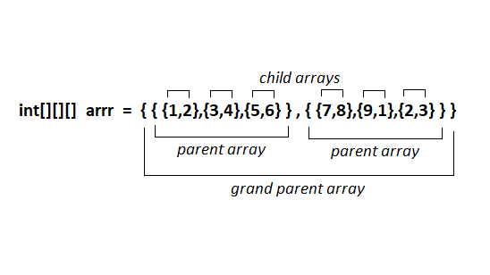
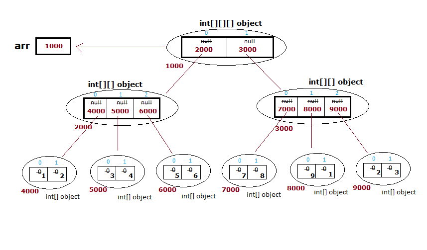

# 3D Array in Java

**3D Array in Java** | A three-dimensional array is a collection of 2D arrays. It is specified by using three subscripts: block size, row size, and column size. More dimensions in an array mean more data can be stored in that array.

- [Declare 3D Array in Java](#declare-3d-array-in-java)
- [Initialize 3 Dimensional Array in Java](#initialize-3-dimensional-array-in-java)
- [Access Array Elements](#access-array-elements)
- [Java 3D Array Length](#java-3d-array-length)
- [How to Print 3D Array in Java](#how-to-print-3d-array-in-java)
- [Java Program to Take Input from user for 3 Dimensional Array](#java-program-to-take-input-from-user-for-3-dimensional-array)
- [Pass and Return 3 Dimensional Array](#pass-and-return-3-dimensional-array)
- [Program for Three Dimensional Array](#program-for-three-dimensional-array)

---

## 1. Declare 3D Array in Java

Before using any variable we must declare the variable. The full syntax to declare the 3 dimensional array is:

`<Accessibility-modifier><Execution-level-Modifiers> <datatype>[][][] <array variable name>;`

In this syntax the accessibility modifier and execution level modifiers are optional, but the remaining are mandatory.

**Declaration examples:**

```java
int[][][] arr1;
float[][][] n1;
public static int[][][] arr2;
public static float[][][] n2;
```

The dimension or level is represented by `[]`. Therefore the three-dimensional array will contain `[][][]`. The single-dimensional array contains `[]`, the two-dimensional array contains `[][]`, and so on.

**Rules for declaring 3 dimensional array in Java:**

1) `[][][]` can't be placed before data type, else it will give the compile-time error: *illegal start of expression*. The `[][][]` can be placed after the data type, before variable-name, or after variable-name.

```java
int[][][]  i1; // valid
int  [][][]  i2; // valid
int  [][][]i3; // valid
int  i4[][][]; // valid
int[][]  []i5; // valid
int[][]  i6[]; // valid
int[]  [][]i7; // valid
int[]  []i8[]; // valid
int[]  i9[][]; // valid
/*
[]int[][]  i10; // error
[][]int  i11[]; // error
[][][]int  i12; // error
*/
```

> 💡 **Tip:** These examples have many valid forms but they can create confusion. Therefore it is recommended to use `[][][]` after data type or variable name. Example: `int[][][] i1;` *or* `int i3[][][];`

2) Size can't be mentioned in the declaration part. Violation of this rule leads to a compile-time error: *not a statement*.

```java
int[2][2][2]  i1; // error
int[][3][3]  i2; // error
int[][][4]  i3; // error
```

⚠️ **Caution:** Be careful at the time of declaring more than one array variable in a single statement. There are different meanings for different declarations:

- `int i[], j[][][];` — `i` is of type `int[]` but `j` is of `int[][][]`
- `int[][][] i, j;` — both `i` and `j` are of type `int[][][]`
- `int[][] i[], j;` — `i` is of type `int[][][]`, but `j` is of type `int[][]`
- `int[] i[][], j;` — `i` is of type `int[][][]`, and `j` is of type `int[]`

---

## 2. Initialize 3 Dimensional Array in Java

Similar to single dimensional array the 3D array also can be initialized in three ways:

1. With explicit values
2. Without values or with default values
3. [Anonymous array](028_Anonymous_Array_in_Java_With_Example.md)

### 1) Three dimensional array initialization with explicit values

Full syntax: `<Accessibility modifier><Execution-level Modifiers> <datatype>[][][] <array variable name> = {<list-of-array-elements>};`

**Example:**

```java
int[][][] arr = {{{1,2},{3,4},{5,6}},{{7,8},{9,1},{2,3}}};
public static int[][][] arr1 =
       {{{1,2},{3,4},{5,6}},{{7,8},{9,1},{2,3}}};
```

In this way of array initialization, the array is declared and initialized in the same line because array constants can only be used in initializers. The accessibility modifier and execution level modifiers are optional. We can use this approach only if the values are known at the time of three-dimensional array declaration.



### 2) Three-dimensional array initialization with default values

In this way we can declare the array and initialize it later.

Syntax: `<array-variable-name> = new <datatype>[<grand-parent-array-size>][<parent-array-size>][<child-array-size>];`

**Example:**

```java
// decalre a 3D array
int[][][] arr = null;
// create array with default values
arr = new int[2][3][2];
```

Since it is an array of `int` data type and the default value for `int` is 0, therefore this array is initialized with 0. Later we can update the values by accessing the array elements.

Instead of two lines, we can declare and create an array within a single line: `int[][][] arr = new int[2][3][2];`

We can say:

- 🔢 One grand-parent array is created with 2 locations
- 🔢 Two parent arrays are created with 3 locations
- 🔢 Three child arrays are created with 2 locations

In this way of 3D array creation in Java, the base (grand-parent) array size is mandatory whereas parent and child array size is optional. We can declare them later.

```java
int[][][] a1 = new int[2][][]; // valid
int[][][] a2 = new int[][2][]; // error
int[][][] a3 = new int[][][2]; // error
int[][][] a4 = new int[2][2][]; // valid
int[][][] a5 = new int[2][2][2]; // valid
```

### 3) Initialize using anonymous array

**Example:**

```java
// decalre a 3D array
int[][][] arr = null;
// create array with explicit values
arr = new int[][][] {{{1,2},{3,4},{5,6}},{{7,8},{9,1},{2,3}}};
```

✅ **Advantage of this approach:** While 3D array initialization with explicit values (1st way), we must declare and initialize the array in a single line else we will get error. But using this approach we can declare and initialize with explicit value at different lines.

---

## 3. Access Array Elements

The three dimensional array can be accessed using `<array-variable>[grand-parent-index][parent-index][child-index]`. Now, let us see it through an example.

**Three dimensional array creation:**

```java
int[][][] arr = new int[2][3][2];
```

**Accessing and initializing the array:**

```java
arr[0][0][0] = 1;
arr[0][0][1] = 2;
arr[0][1][0] = 3;
arr[0][1][1] = 4;
arr[0][2][0] = 5;
arr[0][2][1] = 6;
arr[1][0][0] = 7;
arr[1][0][1] = 8;
arr[1][1][0] = 9;
arr[1][1][1] = 1;
arr[1][2][0] = 2;
arr[1][2][1] = 3;
```

We can declare and initialize in a single line:

```java
int[][][] arr = { {{1,2},{3,4},{5,6}}, {{7,8},{9,1},{2,3}} };
```



---

## 4. Java 3D Array Length

To access the length or size of grand-parent use `<array-variable>.length`, example: `arr.length`. Similarly to access the parent length use `<array-variable>[index].length`, example: `arr[0].length`, `arr[1].length`. And to access the child array size use `<array-variable>[index1][index2].length`.

**Java program to find the length or size of 3D array:**

```java
public class ThreeDArray {

  public static void main(String[] args) {

    // 3D array
    int[][][] arr = {{{1,2},{3,4},{5,6}},{{7,8},{9,1},{2,3}}};

    System.out.println("Grandparent size = " + arr.length);
    System.out.println("Parent-1 size = " + arr[0].length);
    System.out.println(
             "Child-1 of Parent-1 size = " + arr[0][0].length);
  }

}
```

📤 **Output:**

```
Grandparent size = 2
Parent-1 size = 3
Child-1 of Parent-1 size = 2
```

> 📝 **Note:** In this example, all parents have size 3 and all children have similar size of 2. But for [Jagged array](030_Jagged_Array_in_Java_with_Example.md) the size can vary.

---

## 5. How to Print 3D Array in Java

To print 3 dimensional array in Java, we can use loops or pre-defined function. The loops can be for loop, for-each loop, while loop, or do-while loop.

**Print three dimensional array using for loop:**

```java
public class ThreeDArray {

  public static void main(String[] args) {

    // 3D array 2x3x2
    int[][][] arr = {{{1,2},{3,4},{5,6}},{{7,8},{9,1},{2,3}}};

    // displaying three dimension array in Java
    // using for loop and length property
    for(int i=0; i < arr.length; i++){
      for(int j=0; j < arr[i].length; j++){
         for(int k=0; k < arr[i][j].length; k++){
            System.out.print( arr[i][j][k] + " ");
         }
         System.out.println(); // new line
      }
      System.out.println(); // new line
    }
  }

}
```

📤 **Output:**

```
1 2
3 4
5 6

7 8
9 1
2 3
```

**Print three dimensional array using for-each loop:**

```java
public class ThreeDArray {

  public static void main(String[] args) {

    // 3D array 2x3x2
    int[][][] arr = {{{1,2},{3,4},{5,6}},{{7,8},{9,1},{2,3}}};

    // displaying three dimensional array in Java using
    // for-each loop
    for(int[][] i: arr){
      for(int[] j : i){
        for(int k: j){
          System.out.print(k + " ");
        }
        System.out.println(); // new line
      }
      System.out.println(); // new line
    }
  }

}
```

📤 **Output:**

```
1 2
3 4
5 6

7 8
9 1
2 3
```

In addition to this, we have the `Arrays` class defined in `java.util` package which contains lots of pre-defined methods related to the array. In this class `deepToString()` method is given to display the multidimensional array.

**Display three dimensional array using `Arrays.deepToString()` method:**

```java
import java.util.Arrays;

public class ThreeDArray {

  public static void main(String[] args) {

    // 3D array 2x3x2
    int[][][] arr = {{{1,2},{3,4},{5,6}},{{7,8},{9,1},{2,3}}};

    // displaying three dimensional array in Java using
    // Arrays.deepToString()
    System.out.println(Arrays.deepToString(arr));
  }

}
```

📤 **Output:**

```
[[[1, 2], [3, 4], [5, 6]], [[7, 8], [9, 1], [2, 3]]]
```

---

## 6. Java Program to Take Input from user for 3 Dimensional Array

Let us develop a Java program to demonstrate how to take input from the end-user for a 3D array and display it.

**Read and display 3D array:**

```java
import java.util.Scanner;

public class ThreeDArray {

  public static void main(String[] args) {

    // declare variables
    int[][][] arr = null; // 3D array
    int grandParentSize = 0;
    int parentSize = 0;
    int childSize = 0;
    Scanner scan = null;

    // create Scanner class object to read input
    scan = new Scanner(System.in);

    // Take sizes from the user
    System.out.print(
        "Enter grandparent parent and child size = ");
    grandParentSize = scan.nextInt();
    parentSize = scan.nextInt();
    childSize = scan.nextInt();

    // create 3D array with given sizes
    arr = new int[grandParentSize][parentSize][childSize];

    // read input value for the 3D array
    System.out.println("Enter array elements: ");
    for(int i=0; i<grandParentSize; i++) {
      for(int j=0; j<parentSize; j++) {
        for(int k=0; k<childSize; k++) {
          System.out.print("Element["+i+"]["+j+"]["+k+"]: ");
          arr[i][j][k] = scan.nextInt();
        }
      }
    }

    // displaying three dimensional array in Java using
    // for-each loop
    System.out.println("\nEntered 3D array,");
    for(int[][] i: arr){
      for(int[] j : i){
        for(int k: j){
          System.out.print(k + " ");
        }
        System.out.println(); // new line
      }
      System.out.println(); // new line
    }

    // close Scanner
    scan.close();
  }

}
```

📤 **Output:**

```
Enter grandparent parent and child size = 2 2 2
Enter array elements:
Element[0][0][0]: 10
Element[0][0][1]: 20
Element[0][1][0]: 35
Element[0][1][1]: 45
Element[1][0][0]: 9
Element[1][0][1]: 18
Element[1][1][0]: 90
Element[1][1][1]: 81

Entered 3D array,
10 20
35 45

9 18
90 81
```

---

## 7. Pass and Return 3 Dimensional Array

Like a single-dimensional array, the three-dimensional array in Java also can be passed to a method and returned from a method. We will develop a program that takes input from another method (i.e. returning 3D array) and pass it to another method to display.

**Pass and return 3D array:**

```java
public class ThreeDArray {

  public static void main(String[] args) {

    // declare variables
    int[][][] arr = null; // 3D array

    // create 3D array with 2x2x2 size
    arr = new int[2][2][2];

    // take input for 3D array
    // call read3DArray() method
    arr = read3DArray();

    // display 3D array
    // pass to display3DArray() method
    display3DArray(arr);
  }

  // method to return 3D array
  public static int[][][] read3DArray() {
    // read input from end-user or
    // initialize explicitly
    int[][][] temp = {{{1,2},{3,4}},{{5,6},{7,8}}};

    // return array
    return temp;

    // Or,
    // directly return annonymous array
    // return new int[][][] {{{1,2},{3,4}},{{5,6},{7,8}}};
  }

  // method to take 3D array and display it
  public static void display3DArray(int[][][] arr) {
    System.out.println("3D array,");
    for (int[][] i : arr) {
      for (int[] j : i) {
        for (int k : j) {
          System.out.print(k + " ");
        }
        System.out.println(); // new line
      }
      System.out.println(); // new line
    }
  }

}
```

📤 **Output:**

```
3D array,
1 2
3 4

5 6
7 8
```

---

## 8. Program for Three Dimensional Array

**Java program to create, modify and display the three dimensional array:**

```java
public class ThreeDimensionalArray {

  public static void main(String[] args) {

    // declare 3d array
    int[][][] arr = new int[2][3][2];

    // initializing the value
    arr[0][0][0] = 1;
    arr[0][0][1] = 2;
    arr[0][1][0] = 3;
    arr[0][1][1] = 4;
    arr[0][2][0] = 5;
    arr[0][2][1] = 6;
    arr[1][0][0] = 7;
    arr[1][0][1] = 8;
    arr[1][1][0] = 9;
    arr[1][1][1] = 1;
    arr[1][2][0] = 2;
    arr[1][2][1] = 3;

    // displaying 3d Java array
    System.out.println("Three Dimensional Array is, ");
    displayThreeDArray(arr);

    // modifying some values
    arr[0][0][0] = 9999;
    arr[0][1][1] = 4656;
    arr[1][1][1] = 1628;

    // displaying 3d array after modification
    System.out.println("\nAfter modifying some values");
    System.out.println("Three Dimensional Array is, ");
    displayThreeDArray(arr);
  }

  // method to display 3D array
  public static void displayThreeDArray(int[][][] a) {
    for (int[][] i : a) {
      System.out.println();
      System.out.println("Grand parent array holds:" + i);
      for (int[] j : i) {
        System.out.println("Parent array holds:" + j);
        for (int k : j) {
          System.out.print(" " + k + "\t");
        }
        System.out.println();
      }
    }
  }
}
```

📤 **Output:**

```
Three Dimensional Array is,

Grand parent array holds:[[I@d716361
Parent array holds:[I@6ff3c5b5
 1	 2
Parent array holds:[I@3764951d
 3	 4
Parent array holds:[I@4b1210ee
 5	 6

Grand parent array holds:[[I@4d7e1886
Parent array holds:[I@3cd1a2f1
 7	 8
Parent array holds:[I@2f0e140b
 9	 1
Parent array holds:[I@7440e464
 2	 3

After modifying some values
Three Dimensional Array is,

Grand parent array holds:[[I@d716361
Parent array holds:[I@6ff3c5b5
 9999	 2
Parent array holds:[I@3764951d
 3	 4656
Parent array holds:[I@4b1210ee
 5	 6

Grand parent array holds:[[I@4d7e1886
Parent array holds:[I@3cd1a2f1
 7	 8
Parent array holds:[I@2f0e140b
 9	 1628
Parent array holds:[I@7440e464
 2	 3
```

If you enjoyed this post, share it with your friends. Do you want to share more information about the topic discussed above or do you find anything incorrect? Let us know in the comments. Thank you!
