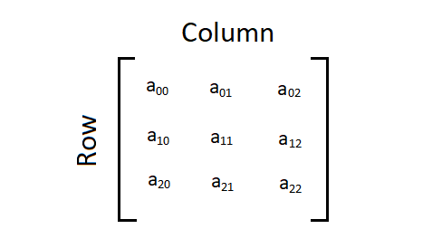
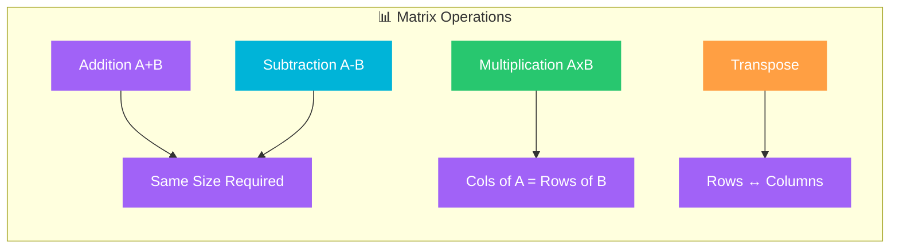

# Matrix in Java

**Matrix in Java** | Matrices are [two-dimensional arrays](043_2D_Array_in_Java.md). The matrix has a row and column arrangement of its elements. A matrix with m rows and n columns can be called an m x n matrix.

- [Create Matrix in Java](#create-matrix-in-java)
- [Initialize Matrix in Java](#initialize-matrix-in-java)
- [Access Modify Matrix](#access-modify-matrix)
- [Length or Size of Matrix in Java](#length-or-size-of-matrix-in-java)
- [Print Matrix in Java](#print-matrix-in-java)
- [Matrix Example in Java](#matrix-example-in-java)
- [Pass and Return Matrix in Java](#pass-and-return-matrix-in-java)
- [Sum of Matrix Elements in Java](#sum-of-matrix-elements-in-java)
- [Sum of Diagonal Elements of a Matrix in Java](#sum-of-diagonal-elements-of-a-matrix-in-java)
- [Addition of Two Matrix in Java](#addition-of-two-matrix-in-java)
- [Subtraction of Two Matrix in Java](#subtraction-of-two-matrix-in-java)
- [Matrix Multiplication in Java](#matrix-multiplication-in-java)
- [Transpose of a Matrix in Java](#transpose-of-a-matrix-in-java)

---

Individual entries in the matrix are called elements and can be represented by aij which suggests that the element a is present in the ith row and jth column.

## 1. Create Matrix in Java

Before using the matrix we must declare the variable. The full syntax to declare the matrix is:

`<Accessibility-modifier><Execution-level-Modifiers> <datatype>[][] <array variable name>;`

In this syntax the accessibility-modifier and execution-level-modifiers are optional, but the remaining are mandatory.

**Declaration examples:**

```java
int[][] mtrx1;
float[][] mtrx2;
public static int[][] mtrx3;
public static float[][] mtrx4;
```



In this matrix Row-1 contains {a00, a01, a02}, and the column-1 contains {a00, a10, a20}.

---

## 2. Initialize Matrix in Java

We can initialize a matrix in 3 ways:

- 📊 Matrix initialization with explicit values.
- 📊 Matrix initialization with default values (i.e. without explicit value).
- 📊 [Using Anonymous Array.](028_Anonymous_Array_in_Java_With_Example.md)

### 1) Matrix initialization with explicit values

Full syntax: `<Accessibility modifier><Execution-level Modifiers> <datatype>[][] <matrix-variable-name> = {<list-of-array-elements>};`

**Example:**

```java
int[][] mtrx1 = {{5,6},{7,8}};
public static int[][] mtrx2 = {{5,6},{7,8}};
```

In this way of matrix initialization, the matrix is declared and initialized in the same line, because array constants can only be used in initializers. The accessibility modifier and execution level modifiers are optional. We can use this approach only if the values are known at the time of matrix declaration.

> 📝 **Note:** If a matrix is having row and column equal then it is called a square matrix, else the matrix is called a non-square matrix. For example: 2x2, 3x3, 4x4 are called square matrices, but 2x3, 3x2, 2x4, 4x2, 4x3 are called non-square matrices.

### 2) Matrix initialization with default values

In this way, we can declare the matrix and initialize it later.

Syntax: `<matrix-variable-name> = new <datatype>[<row-size>][<column-size>];`

**Example:**

```java
// declare a matrix
int[][] mtrx = null;
// initialize matrix with default values
mtrx = new int[3][2];
```

In this example, first, we had declared a matrix then we had initialized it with the default value. It is a 3x2 non-square matrix. Since it is a matrix of `int` data type and the default value for `int` is 0, therefore this matrix is initialized with 0. Later we can update the values by accessing the array elements.

Instead of two lines, we can declare and initialize the matrix within a single line:

```java
int[][] mtrx = new int[3][2];
```

From this example we can say:

- 🔢 The row size of the matrix is 3
- 🔢 Column size of the matrix is 2

### 3) Initialize matrix using Anonymous Array

**Example:**

```java
// declare a matrix
int[][] mtrx = null;
// create matrix with explicit values
// (anonymous array)
mtrx = new int[][] {{5,6},{7,8}};
```

✅ **Advantage of this approach:** In the first way of matrix initialization i.e. while initializing the matrix with explicit values, we must declare and initialize the matrix in a single line else we will get an error. But using this approach we can declare and initialize with explicit value at different lines.

---

## 3. Access Modify Matrix

Individual entries in the matrix are called elements and can be represented by aij which suggests that the element a is present in the ith row and jth column.

The matrix can be accessed using `<matrix-variable>[row-index][column-index]`. Now, let us see it through an example.

**Declare 3x2 matrix and initialize it with default value:**

```java
int[][] mtrx = new int[3][2];
```

**Accessing and updating the array:**

```java
mtrx[0][0] = 50;
mtrx[0][1] = 60;
mtrx[1][0] = 70;
mtrx[1][1] = 80;
mtrx[2][0] = 90;
mtrx[2][1] = 10;
```

It is similar to:

```java
int[][] mtrx = {{50,60},{70,80},{90,10}};
```

---

## 4. Length or Size of Matrix in Java

To access the length or size of row use `<matrix-variable>.length`, example: `mtrx.length`. Similarly to access the column size use `<matrix-variable>[row-index].length`.

**Java Program to find the length or size of a matrix:**

```java
public class Matrix {
  public static void main(String[] args) {

    // declare a matrix
    // and initialize with explicit values
    int[][] mtrx =
      { { 50, 60, 70 }, { 80, 90, 10 }, { 20, 30, 40 } };

    System.out.println("Row size = " + mtrx.length);
    System.out.println("Column-1 size = " + mtrx[0].length);
    System.out.println("Column-2 size = " + mtrx[1].length);
    System.out.println("Column-3 size = " + mtrx[2].length);
  }
}
```

📤 **Output:**

```
Row size = 3
Column-1 size = 3
Column-2 size = 3
Column-3 size = 3
```

---

## 5. Print Matrix in Java

To display a matrix we can use loops or pre-defined methods. Since it is a [two-dimensional array](043_2D_Array_in_Java.md) (i.e. 2 levels) therefore it required two loops to access the elements. The loop can be for-loop, for-each loop, while loop, or do-while loop. While using loops we will use the `length` property of the Java 2D array.

**Print matrix using for loop:**

```java
public class Matrix {
  public static void main(String[] args) {

    int[][] mtrx =
      { { 50, 60, 70 }, { 80, 90, 10 }, { 20, 30, 40 } };

    // display matrix using for loop
      for (int i = 0; i < mtrx.length; i++) {
        for (int j = 0; j < mtrx[i].length; j++) {
          System.out.print(mtrx[i][j] + " ");
        }
        System.out.println(); // new line
      }
  }
}
```

📤 **Output:**

```
50 60 70
80 90 10
20 30 40
```

**Print matrix using for-each loop:**

```java
public class Matrix {
  public static void main(String[] args) {

    int[][] mtrx =
      { { 50, 60, 70 }, { 80, 90, 10 }, { 20, 30, 40 } };

    // display matrix using for-each loop
    for (int[] i : mtrx) {
      for (int j : i) {
        System.out.print(j + " ");
      }
      System.out.println(); // new line
    }
  }
}
```

📤 **Output:**

```
50 60 70
80 90 10
20 30 40
```

**Print matrix using `Arrays.deepToString()` method:**

In addition to these ways, we have the [Arrays class](033_Arrays_Class_Java_With_Examples.md) defined in the `java.util` package. The `java.util.Arrays` class contains many methods related to array operations like [sort an array using sort()](035_Arrays.sort()_in_Java_With_Examples.md), [copy an array copyOf()](036_Arrays.copyOf_in_Java_With_Example.md) or [copyOfRange()](037_Arrays.copyOfRange_in_Java_with_Example.md), search an element in array using binary search, and more. Learn more about: [Arrays class and methods in Java](033_Arrays_Class_Java_With_Examples.md). It contains a toString() method to convert arrays to String. In this class `deepToString()` method is given to display the multidimensional array.

```java
import java.util.Arrays;
public class Matrix {
  public static void main(String[] args) {

    int[][] mtrx =
      { { 50, 60, 70 }, { 80, 90, 10 }, { 20, 30, 40 } };

    // display matrix using Arrays.deepToString()
    System.out.println(Arrays.deepToString(mtrx));
  }
}
```

📤 **Output:**

```
[[50, 60, 70], [80, 90, 10], [20, 30, 40]]
```

---

## 6. Matrix Example in Java

Let us develop a Java program to read input for a matrix from the end-user and display it to the screen. To read you can use command-line argument, `Scanner` class, [BufferedReader class](067_BufferedReader_in_Java.md), or others. And to display you can use a loop or pre-defined method `Arrays.deepToString()`. In this program, we will use a `Scanner` class and for-each loop.

**Read and display matrix:**

```java
import java.util.Scanner;

public class Matrix {
  public static void main(String[] args) {

    // declare variables
    int[][] mtrx = null;
    int row = 0;
    int column = 0;
    Scanner scan = null;

    // create Scanner class object to read input
    scan = new Scanner(System.in);

    // read row and column size
    System.out.print("Enter row and column size: ");
    row = scan.nextInt();
    column = scan.nextInt();

    // initialize matrix
    mtrx = new int[row][column];

    // read input for matrix
    System.out.println("Enter matrix elements,");
    for (int i = 0; i < row; i++) {
      for (int j = 0; j < column; j++) {
        System.out.print("Element["+i+"]["+j+"]: ");
        mtrx[i][j] = scan.nextInt();
      }
    }

    // display matrix using for-each loop
    System.out.println("\nEntered matrix is,");
    for (int[] i : mtrx) {
      for (int j : i) {
        System.out.print(j + " ");
      }
      System.out.println(); // new line
    }

    // close Scanner
    scan.close();
  }
}
```

📤 **Output:**

```
Enter row and column size: 3 2
Enter matrix elements,
Element[0][0]: 5
Element[0][1]: 10
Element[1][0]: 15
Element[1][1]: 20
Element[2][0]: 25
Element[2][1]: 30

Entered matrix is,
5 10
15 20
25 30
```

---

## 7. Pass and Return Matrix in Java

Let us demonstrate a Java program to see how to pass a matrix to a method and how to return a matrix from a method.

**Pass and return matrix:**

```java
public class Matrix {
  public static void main(String[] args) {

    // declare a matrix variable
    int[][] mtrx = null;

    // create matrix with 3x3 size
    mtrx = new int[2][2];

    // take input for matrix
    mtrx = readMatrix();

    // display matrix
    displayMatrix(mtrx);
  }

  // method to return matrix
  public static int[][] readMatrix() {
    // read input from end-user or
    // initialize explicitly
    int[][] temp = { { 9, 8 }, { 2, 3 } };

    // return matrix
    return temp;

    // Or,
    // directly return anonymous matrix
    // return new int[][] {{5,6},{7,8}};
  }

  // method to take matrix and display it
  public static void displayMatrix(int[][] mtrx) {
    System.out.println("Matrix,");
    for (int[] i : mtrx) {
      for (int j : i) {
        System.out.print(j + " ");
      }
      System.out.println(); // new line
    }
  }
}
```

📤 **Output:**

```
Matrix,
9 8
2 3
```

📊 **Matrix Programs in Java:**

1. **Program to Print 3x3 Matrix**
2. **Sum of matrix elements**
3. **Sum of Diagonal Elements of Matrix**
4. **Row sum and column sum of a matrix**
5. **Matrix Addition Program**
6. **Subtraction of two matrices**
7. **Transpose of a Matrix**
8. **Matrix Multiplication Program**
9. **Menu-driven program for Matrix operations**

The above programs are discussed in detail in their own post. Here we will develop only the required method.

---

## 8. Sum of Matrix Elements in Java

Write a Java program to find the sum of matrix elements and display the result.

To solve this problem we will take a matrix, a `sum` variable to store the result value, iterate through the matrix using a loop and add an element of the matrix to the sum variable.

**Java Program to find sum of matrix elements:**

```java
public class Matrix {
  // main method
  public static void main(String[] args) {

    // declare and initialize a matrix
    int a[][] = { { 1, 3 }, { 7, 5 } };

    // find sum of matrix elements
    int sum = matrixSum(a);

    // display result
    System.out.println("The sum of matrix elements = " + sum);
  }

  // method to find sum of matrix elements
  public static int matrixSum(int[][] a) {
    int sum = 0;
    for (int[] row : a) {
      for (int element : row) {
        sum += element;
      }
    }
    return sum;
  }
}
```

📤 **Output:**

```
The sum of matrix elements = 16
```

---

## 9. Sum of Diagonal Elements of a Matrix in Java

Write a Java program to find the sum of diagonal elements of a matrix. The elements located at aij where i=j are called diagonal elements. Example: a11, a22, a33 are diagonal elements of the matrix.

**Example with a matrix:**

```
1 2 3
4 5 6
7 8 9
```

Here the diagonal elements are: 1, 5, and 9. Therefore the sum of diagonal elements = 1+5+9 = 15.

> 📝 **Note:** This operation can't be performed by using a for-each loop because we need an index. Therefore we will use a for loop.

**Java program to find the sum of diagonal elements of a matrix:**

```java
public class Matrix {

  // main method
  public static void main(String[] args) {

    // declare and initialize matrix
    int a[][] =  { { 1, 2, 3 }, { 4, 5, 6 }, { 7, 8, 9 } };

    // find sum of diagonal elements
    int sum = diagonalSum(a);

    // display result
    System.out.println("Sum of diagonal elements = " + sum);
  }

  // method to find sum of diagonal elements of matrix
  public static int diagonalSum(int[][] a) {
    int sum = 0;
    for (int i = 0; i < a.length; i++) {
      for (int j = 0; j < a[i].length; j++) {
        if(i == j) sum += a[i][j];
      }
    }
    return sum;
  }
}
```

📤 **Output:**

```
Sum of diagonal elements = 15
```

---

## 10. Addition of Two Matrix in Java

The sum of two matrices of the same size is obtained by adding elements in the corresponding positions. See: matrix addition in Java by taking input from the end-user.

Let A =[aij] and B =[bij] be m x n matrices. The sum of A and B, denoted by A + B, is the m x n matrix that has aij + bij as its (i, j)th element. In other words, A + B = [aij + bij].

⚠️ **Caution:** Condition for matrix addition: Both matrices should have the same row and column size. Matrices of different sizes cannot be added.

**Java program for matrix addition:**

```java
import java.util.Arrays;

public class Matrix {

  // main method
  public static void main(String[] args) {

    // declare and initialize two matrices
    int a[][] = { { 1, 3 }, { 7, 5 } };
    int b[][] = { { 6, 8 }, { 4, 2 } };

    // find row and column size
    // (Assuming both matrix have same size)
    int row = a.length;
    int column = a[0].length;

    // declare new matrix to store result
    int c[][] = new int[row][column];

    // sum of matrix
    c = addMatrix(a, b);

    // display all matrices
    System.out.println("A = " + Arrays.deepToString(a));
    System.out.println("B = " + Arrays.deepToString(b));
    System.out.println("C = " + Arrays.deepToString(c));
  }

  // method to calculate the addition of two matrix
  public static int[][] addMatrix(int[][] a, int[][] b) {

    // calculate row and column size
    int row = a.length;
    int column = a[0].length;

    // declare a matrix to store resultant
    int sum[][] = new int[row][column];

    // calculate sum of two matrices
    // outer loop for row
    for(int i=0; i<row; i++) {
      // inner loop for column
      for(int j=0; j<column; j++) {
        // formula
        sum[i][j] = a[i][j] + b[i][j];
      }
    }

    // return resultant matrix
    return sum;
  }
}
```

📤 **Output:**

```
A = [[1, 3], [7, 5]]
B = [[6, 8], [4, 2]]
C = [[7, 11], [11, 7]]
```

---

## 11. Subtraction of Two Matrix in Java

The matrix subtraction is very similar to the matrix addition program. Just subtract the matrix elements in place of addition. See [Java program for matrix subtraction by taking input from the end-user](043_2D_Array_in_Java.md).

**Method for matrix subtraction:**

```java
// method to calculate the subtraction of two matrix
public static int[][] subMatrix(int[][] a, int[][] b) {
  // calculate row and column size
  int row = a.length;
  int column = a[0].length;

  // declare a matrix to store resultant
  int sub[][] = new int[row][column];

  // calculate subtraction of two matrices
  // outer loop for row
  for (int i = 0; i < row; i++) {
    // inner loop for column
    for (int j = 0; j < column; j++) {
      // formula
      sub[i][j] = a[i][j] - b[i][j];
    }
  }

  // return resultant matrix
  return sub;
}
```

**The passed matrices are:**

```java
int a[][] = { { 1, 3 }, { 7, 5 } };
int b[][] = { { 6, 8 }, { 4, 2 } };
```

📤 **Output:**

```
A = [[1, 3], [7, 5]]
B = [[6, 8], [4, 2]]
C = [[-5, -5], [3, 3]]
```

---

## 12. Matrix Multiplication in Java

Let **A** be an m x k matrix and **B** be a k x n matrix. The product of **A** and **B**, denoted by **AB**, is the m x n matrix with its (i, j)th entry equal to the sum of the products of the corresponding elements from the ith row of **A** and the jth column of **B**. In other words, if **AB = [cij]**, then **cij = ai1*b1j + ai2*b2j + ... + aik*bkj**.

⚠️ **Caution:** The product of two matrices is not defined when the number of columns in the first matrix and the number of rows in the second matrix are not the same. The matrix multiplication in Java with user-input is discussed in detail here.

**Java method to find matrix multiplication of two square matrices:**

```java
// method to calculate product of two matrix
public static int[][] multiplyMatrix(int[][] a, int[][] b) {

   // find size of matrix
   // (Assuming both matrix is square matrix
   // of same size)
   int size = a.length;

   // declare new matrix to store result
   int product[][] = new int[size][size];

   // find product of both matrices
   // outer loop
   for (int i = 0; i < size; i++) {

     // inner-1 loop
     for (int j = 0; j < size; j++) {

       // assign 0 to the current element
       product[i][j] = 0;

       // inner-2 loop
       for (int k = 0; k < size; k++) {
         product[i][j] += a[i][k] * b[k][j];
       }
     }
   }

   return product;
}
```

**The passed matrices are:**

```java
int a[][] = { { 1, 3 }, { 7, 5 } };
int b[][] = { { 6, 8 }, { 4, 2 } };
```

📤 **Output:**

```
C (Product) = [[18, 14], [62, 66]]
```

---

## 13. Transpose of a Matrix in Java

Let A = [aij] be an m x n matrix. The transpose of A, denoted by At, is the n x m matrix obtained by interchanging the rows and columns of A. In other words, if At = [bij], then bij = aji for i = 1,2,...,n and j = 1,2,...,m. The transpose of a matrix in Java is discussed in detail here.

**For 3x2 Matrix:**

```
Original Matrix       Transpose Matrix
a11 a12               a11 a21 a31
a21 a22               a12 a22 a32
a31 a32
```

**Java method to find transpose of a matrix:**

```java
// method to calculate the transpose of a matrix
public static int[][] transposeMatrix(int[][] a) {

   // calculate row and column size
   int row = a.length;
   int column = a[0].length;

   // declare a matrix to store resultant
   int temp[][] = new int[row][column];

   // calculate transpose of matrix
   // outer loop for row
   for (int i = 0; i < row; i++) {
     // inner loop for column
     for (int j = 0; j < column; j++) {
       // formula
       temp[i][j] = a[j][i];
     }
   }

   // return resultant matrix
   return temp;
}
```

**The passed matrix is:**

```java
int a[][] = { { 1, 2 }, { 8, 9 } };
```

📤 **Output:**

```
Transpose = [[1, 8], [2, 9]]
```



If you enjoyed this post, share it with your friends. Do you want to share more information about the topic discussed above or do you find anything incorrect? Let us know in the comments. Thank you!
