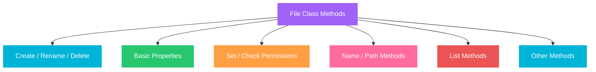

# File Class in Java

**File Class in Java** | The `File` class in `java.io` package is used to represent file and directory paths, create/delete/rename files and directories, and retrieve file properties.

- [Java File Class Constructor](#java-file-class-constructor)
- [File Object Creation with Complete Path](#file-object-creation-with-complete-path)
- [File Separators](#file-separators)
- [Java File Methods](#java-file-methods)
- [Methods to Create, Rename, Delete Files and Directories](#methods-to-create-rename-delete-files-and-directories)
- [Java File Class Methods for Basic File Properties](#java-file-class-methods-for-basic-file-properties)
- [Methods to Check and Set File Properties](#methods-to-check-and-set-file-properties)
- [Java File Class Methods to Get File Name and Path](#java-file-class-methods-to-get-file-name-and-path)
- [Java File Class Methods to List Files and Subdirectories](#java-file-class-methods-to-list-files-and-subdirectories)
- [Other Methods of File Class in Java](#other-methods-of-file-class-in-java)

---

## 1. Java File Class Constructor

The `File` class in Java is used to represent the files and directories paths but not the data of the file. Basically, this class is used to create, delete, and rename the files and directories. It is also used to know information about files and directories like whether the given name represents a file or directory, last-modified time, is file read-only, is file writable, display all directories and files in a given folder, etc.

📄 Instances of the `File` class are immutable; i.e. once created, the abstract pathname represented by a `File` object will never change, because we do not have a setter method to change the file name in this `File` object. But we have a getter method to get the file name.

The `File` class implements `Serializable`, `Comparable` interfaces and it is available since JDK 1.0.

> 📝 **Note:** In Unix, everything is treated as a file. Java's File concept is implemented based on the Unix operating system, hence file objects can be used to represent both files and directories. In Windows, directories are also called folders. In this topic whenever a "File" word is used, it represents both file and directory.

The `File` class has the following constructors to create its object:

| Constructor 🏗️ | Description 📋 |
|----------------|---------------|
| `File(String pathname)` | Creates a new `File` instance with the given file name |
| `File(String parent, String child)` | Creates a new `File` instance with the given parent path and child path |
| `File(File parent, String child)` | Creates a new `File` instance with the given parent `File` object and child path |
| `File(URI uri)` | Creates a new `File` instance by converting the given `file:` URI into an abstract pathname |

> ⚠️ **Caution:** File class object creation does **not** create any physical files, it only creates an instance of the `File` class.

**`File(String pathname)`** — Used to create a new `File` instance with the given file name. The `"xyz.txt"` file is used from the current working directory.

```java
File f = new File("xyz.txt");
```

**`File(String parent, String child)`** — Creates a new `File` instance with the given parent and child path. The `"xyz.txt"` file is used from the `"workspace"` folder in the current working directory.

```java
File f = new File("workspace", "xyz.txt");
```

**`File(File parent, String child)`** — Creates a new `File` instance with the given parent `File` object and child path. The parent file name must be passed as a `File` class object.

```java
File f1 = new File("workspace");
File f2 = new File(f1, "xyz.txt");
```

**`File(URI uri)`** — Creates a new `File` instance by converting the given `file:` URI into the abstract pathname.

```java
File f1 = new File("xyz.txt");
File f2 = new File(f1.toURI());
```

### Important Points While Using These Constructors

1. If we pass `null` as parent or file then it gives an ambiguous error because it matches with multiple constructors.

```java
File f1 = new File(null);           // ambiguous error
File f2 = new File(null, "xyz.txt"); // ambiguous error
```

2. If we pass `null` as the child argument then it doesn't give a compile-time error but it throws `NullPointerException`.

```java
File f3 = new File("workspace", null); // NullPointerException
File f = new File("pqr");
File f4 = new File(f, null);           // NullPointerException
```

### Program to Create File Class Objects and Display Them

When a `File` class object is created, JVM just creates a `File` class object with the given name as that object's state. It **won't check for the file or directory with the given name to exist or not**.

**File constructors example:**

```java
import java.io.File;
public class FileConstructorsTest {
   public static void main(String[] args) {

      File f1 = new File("xyz.txt");
      System.out.println("f1: "+f1);
      File f2 = new File("pqr");
      System.out.println("f2: "+f2);

      File f3 = new File("workspace", "abc.txt");
      System.out.println("f3: "+f3);

      File f4 = new File(f2,"abc.txt");
      System.out.println("f4: "+f4);

      File f5 = new File(f1.toURI());
      System.out.println("f5: "+f5);
      File f6 = new File(f2.toURI());
      System.out.println("f6: "+f6);
      File f7 = new File(f3.toURI());
      System.out.println("f7: "+f7);
      File f8 = new File(f4.toURI());
      System.out.println("f8: "+f8);

      File f9 = new File(f5.toURI());
      System.out.println("f9: "+f9);
   }
}
```

📤 **Output in Linux** (current working directory: `/home/user/java`):

```
f1: xyz.txt
f2: pqr
f3: workspace/abc.txt
f4: pqr/abc.txt
f5: /home/user/java/xyz.txt
f6: /home/user/java/pqr
f7: /home/user/java/workspace/abc.txt
f8: /home/user/java/pqr/abc.txt
f9: /home/user/java/xyz.txt
```

📤 **Output in Windows** (current working directory: `D:\java\`):

```
f1: xyz.txt
f2: pqr
f3: workspace\abc.txt
f4: pqr\abc.txt
f5: D:\java\xyz.txt
f6: D:\java\pqr
f7: D:\java\workspace\abc.txt
f8: D:\java\pqr\abc.txt
f9: D:\java\xyz.txt
```

While executing the above program, JVM just creates a `File` class object with the given name as that object's state. If the file `"xyz.txt"` and directory `"workspace"` do not exist in the current working directory, we will not get any exception and it doesn't create a file or directory.

> 🔑 **Key Point:** `File` class object creation statement doesn't create files. To create files we need to use the `createNewFile()` method.

---

## 2. File Object Creation with Complete Path

To create a file object for a normal file or directory that exists in another directory, we must pass the complete file path. For example, if a file is located at `D:\java\test\read.txt` then we must pass the full path.

**Incorrect approach (causes compile-time error):**

```java
import java.io.File;
public class fileSeperators {
   public static void main(String[] args) {
      File f = new File("D:\java\workspace\read.txt");
      System.out.println("f: "+f);
   }
}
```

This program gives compile-time error: `illegal escape character`

To separate the parent and child directory in Windows we use file separator `\`, but in a Java program to represent `\` we need to use the escape sequence character `\\`.

**Correct approach:**

```java
import java.io.File;
public class fileSeperators {
   public static void main(String[] args) {
      File f = new File("D:\\java\\workspace\\read.txt");
      System.out.println("f: "+f);
   }
}
```

📤 **Output:**

```
f: D:\java\workspace\read.txt
```

---

## 3. File Separators

We can use the above program only in Windows. The file separators are platform dependent. In Windows we must use `\`, and in Linux, we must use `/`. So, when we are moving our project from Windows to Linux or vice-versa then in all Java files we must change file separators. Since it is a manual task, it requires a lot of testing and leads to a lot of maintenance costs.

To solve this problem, the `File` class provides two variables to retrieve file separators dynamically specific to the current platform:

```java
public static final char separatorChar
public static final String separator
```

**Platform-independent file path example:**

```java
import java.io.File;
public class fileSeperators {
   public static void main(String[] args) {
      String s = File.separator;
      File f = new File("java"+s+"workspace"+s+"read.txt");
      System.out.println(f);
   }
}
```

📤 **Output in Windows:**

```
java\workspace\read.txt
```

📤 **Output in Linux:**

```
java/workspace/read.txt
```

> 💡 **Tip:** Always use `File.separator` instead of hardcoding `/` or `\` to make your code platform-independent.

---

## 4. Java File Methods

The `File` class has methods to perform different operations on regular files and directories including creating, deleting, and renaming files and directories. Let us categorize them to remember those methods easily.



---

### Methods to Create, Rename, Delete Files and Directories

**Methods to create new files and directories:**

| Method 🛠️ | Return Type | Description 📋 |
|-----------|-------------|---------------|
| **`createNewFile()`** | `boolean` | Creates an empty normal file with the given name in the given path. Throws `IOException`. |
| **`mkdir()`** | `boolean` | Creates a directory with the given name in the given path |
| **`mkdirs()`** | `boolean` | Creates both parent and child directories with given names in the given path |

> 📝 **Note:** In the above three methods, if the file/directory already exists in the given path then it returns `false`, else it returns `true` and creates the file/directory with the given name.

**Methods to create temporary files:**

- `public static File createTempFile(String prefix, String suffix, File directory) throws IOException`
- `public static File createTempFile(String prefix, String suffix) throws IOException`

📖 Learn more: [Java program to create File and directory](049_Java_Program_to_Create_File.md)

**Method to rename the file/directory:**

| Method 🛠️ | Return Type | Description 📋 |
|-----------|-------------|---------------|
| **`renameTo(File f)`** | `boolean` | Renames the current file with the given name |

**Methods to delete file or directory:**

| Method 🛠️ | Return Type | Description 📋 |
|-----------|-------------|---------------|
| **`delete()`** | `boolean` | Deletes the file immediately |
| **`deleteOnExit()`** | `void` | Deletes the file after JVM terminates |

📖 Learn more: [Java program to delete File and directory](051_Java_Program_to_Delete_Files_and_Directories.md)

---

### Java File Class Methods for Basic File Properties

**Methods to check basic things about a file or directory:**

| Method 🛠️ | Return Type | Description 📋 |
|-----------|-------------|---------------|
| **`exists()`** | `boolean` | Checks whether a file exists with the given name or not |
| **`isFile()`** | `boolean` | Returns `true` if the given filename denotes a normal file |
| **`isDirectory()`** | `boolean` | Returns `true` if the given filename denotes a directory |
| **`lastModified()`** | `long` | Returns the last modified time of the file in milliseconds |
| **`length()`** | `long` | Returns the length of the file (number of characters). Return value is unspecified if this pathname denotes a directory. |

> ⚠️ **Caution:** If the file or directory doesn't exist then all the above methods return `false`. `length()` and `lastModified()` values will be `0`.

Created `"dir1"` folder and `"hello.java"` file manually in the current working directory. The below program checks the given file properties.

**File properties example:**

```java
import java.io.File;
public class FileProperties {
   public static void main(String[] args) {

      File f1 = new File("hello.java");
      File f2 = new File("dir1");

      // checking properties for "hello.java" file
      System.out.println(f1.exists());       // true
      System.out.println(f1.isFile());        // true
      System.out.println(f1.isDirectory());   // false
      System.out.println(f1.lastModified());  // 1602122877950
      System.out.println(f1.length());        // 1581
      System.out.println();

      // checking properties for directory "dir1"
      System.out.println(f2.exists());        // true
      System.out.println(f2.isFile());        // false
      System.out.println(f2.isDirectory());   // true
      System.out.println(f2.lastModified());  // 1602122877950
      System.out.println(f2.length());        // 4096
   }
}
```

The `exists()` method checks with the exact passed value. Since strings are case-sensitive, we will get `false` for a string in different cases. For example, the actual file name is `"hello.java"`, so `exists()` returns `false` for `"Hello.java"`.

```java
File f1 = new File("Hello.java");
System.out.println(f1.exists()); // false
```

> 📝 **Note:** The return type of the `length()` method in the `File` class is `long` (not `int`) because the number of characters present in the file may exceed the `int` range.

To get the exact last modified time we can use `java.sql.Timestamp` as shown below:

**Getting formatted last modified time:**

```java
File f1 = new File("Hello.java");

System.out.println(f1.lastModified());
// returns: 1602122877950

System.out.println(new java.sql.Timestamp(f1.lastModified()));
// returns: 2020-10-08 07:37:57.95
```

---

### Methods to Check and Set File Properties

**Methods to set file properties:**

| Method 🛠️ | Return Type | Description 📋 |
|-----------|-------------|---------------|
| **`setReadOnly()`** | `boolean` | Sets file to readable only; after this call we can't write data to this file |
| **`setWritable(boolean writable, boolean ownerOnly)`** | `boolean` | Sets the owner's or everybody's write permission |
| **`setWritable(boolean writable)`** | `boolean` | Convenience method to set the owner's write permission |
| **`setReadable(boolean readable, boolean ownerOnly)`** | `boolean` | Sets the owner's or everybody's read permission |
| **`setReadable(boolean readable)`** | `boolean` | Convenience method to set the owner's read permission |
| **`setExecutable(boolean executable, boolean ownerOnly)`** | `boolean` | Sets the owner's or everybody's execute permission |
| **`setExecutable(boolean executable)`** | `boolean` | Convenience method to set the owner's execute permission |
| **`setLastModified(long time)`** | `boolean` | Sets the last-modified time of the file or directory |

These `setXxx()` methods return `true` if the operation succeeds, otherwise return `false`. Both return `false` if the user does not have permission to change the access permissions of this abstract pathname.

**Methods to check file or folder permissions:**

| Method 🛠️ | Return Type | Description 📋 |
|-----------|-------------|---------------|
| **`canRead()`** | `boolean` | Checks if the file is readable |
| **`canWrite()`** | `boolean` | Checks if the file is writable |
| **`canExecute()`** | `boolean` | Checks if the file is executable |
| **`isHidden()`** | `boolean` | Checks if the file is hidden |

> 📝 **Note:** If the file or directory doesn't exist then these four methods don't throw any exception; rather they return `false`.

**File permissions example:**

```java
import java.io.File;
import java.sql.Timestamp;
public class FileProperties {

   public static void main(String[] args) {

      System.out.println("canRead() canWrite()" +
                         " canExecute() isHidden");

      // checking properties for "hello.java" file
      File f1 = new File("Hello.java");
      System.out.println(display(f1));

      // setting file permissions
      f1.setReadOnly(); // true
      System.out.println(display(f1));

      f1.setWritable(true); // true
      System.out.println(display(f1));

      f1.setReadable(true); // true
      System.out.println(display(f1));

      System.out.println(new Timestamp(f1.lastModified()));
      f1.setLastModified(1692199977950L);
      System.out.println(new Timestamp(f1.lastModified()));
   }

   private static String display(File f) {
      return  f.canRead()+"       " +
              f.canWrite()+"       " +
              f.canExecute()+"       " +
              f.isHidden();
   }
}
```

📤 **Output:**

```
canRead() canWrite() canExecute() isHidden
true       true       false       false
true       false       false       false
true       true       false       false
true       true       false       false
2020-10-08 07:37:57.95
2023-08-16 21:02:57.95
```

---

### Java File Class Methods to Get File Name and Path

**Methods to get file name and path:**

| Method 🛠️ | Return Type | Description 📋 |
|-----------|-------------|---------------|
| **`getName()`** | `String` | Returns the relative path of the file, i.e. only the filename |
| **`getAbsolutePath()`** | `String` | Returns the absolute path of the file (complete path including name) as `String` |
| **`getAbsoluteFile()`** | `File` | Returns the absolute path of the file as `File` object |
| **`getCanonicalPath()`** | `String` | Returns the absolute path as `String` with system-dependent drive name. Throws `IOException`. |
| **`getCanonicalFile()`** | `File` | Returns the absolute path as `File` object with system-dependent drive name. Throws `IOException`. |
| **`isAbsolute()`** | `boolean` | Returns `true` if the file was created with an absolute path |
| **`getParent()`** | `String` | Returns parent directory name as `String`, `null` if it doesn't have a parent |
| **`getParentFile()`** | `File` | Returns parent directory name as `File` object, `null` if it doesn't have a parent |
| **`getPath()`** | `String` | Returns path in `String` form |

**Methods to check disk space:**

| Method 🛠️ | Return Type | Description 📋 |
|-----------|-------------|---------------|
| **`getTotalSpace()`** | `long` | Returns the size of the partition in bytes |
| **`getFreeSpace()`** | `long` | Returns the number of unallocated bytes on the partition |
| **`getUsableSpace()`** | `long` | Returns the number of available bytes on the partition |

> 📝 **Note:** The above three methods return `0L` if the abstract path doesn't name a partition or if the size can't be obtained. On systems where available byte information is not available, `getUsableSpace()` will be equivalent to `getFreeSpace()`.

**File name and path example:**

```java
import java.io.File;
import java.io.IOException;
public class FileProperties {
   public static void main(String[] args) throws Exception {

      File f1 = new File("input.txt");
      System.out.println(f1.exists());
      System.out.println(f1.getName());
      System.out.println(f1.getAbsolutePath());
      System.out.println(f1.getAbsoluteFile());
      System.out.println(f1.getCanonicalPath());
      System.out.println(f1.getCanonicalFile());
      System.out.println(f1.isAbsolute());
      System.out.println(f1.getParent());
      System.out.println(f1.getParentFile());
      System.out.println(f1.getPath());
      System.out.println(f1.getTotalSpace());
      System.out.println(f1.getFreeSpace());
      System.out.println(f1.getUsableSpace());

      // creating object with absolute path
      File f2 = new File("/home/user/workspace/java/dir2");
      System.out.println(f2.getName());
      System.out.println(f2.isAbsolute());
   }
}
```

📤 **Output:**

```
true
input.txt
D:\java\input.txt
D:\java\input.txt
D:\java\input.txt
D:\java\input.txt
false
null
null
input.txt
198003650560
124712775680
124712775680
dir2
false
```

---

### Java File Class Methods to List Files and Subdirectories

**Methods to list files and subdirectories in a given directory:**

| Method 🛠️ | Return Type | Description 📋 |
|-----------|-------------|---------------|
| **`list()`** | `String[]` | Returns all file names as `String` objects in a `String` array |
| **`list(FilenameFilter filter)`** | `String[]` | Returns file names matching the given filter as `String` array |
| **`listFiles()`** | `File[]` | Returns all file names as `File` objects in a `File` array |
| **`listFiles(FilenameFilter filter)`** | `File[]` | Returns file names matching the given `FilenameFilter` as `File` array |
| **`listFiles(FileFilter filter)`** | `File[]` | Returns file names matching the given `FileFilter` as `File` array |

> 📝 **Note:** The array will be empty if the directory is empty. It returns `null` if the abstract pathname is not a directory, or if an I/O error occurs.

| Method 🛠️ | Return Type | Description 📋 |
|-----------|-------------|---------------|
| **`listRoots()`** | `File[]` | Returns an array of `File` objects denoting the available file system roots, or `null` if the set of roots could not be determined. The array will be empty if there are no file system roots. |

📖 Learn more: [Java program to get files and directory](050_Java_Program_to_List_Files_And_Directories.md)

---

### Other Methods of File Class in Java

| Method 🛠️ | Return Type | Description 📋 |
|-----------|-------------|---------------|
| **`compareTo(File pathname)`** | `int` | Compares the file name lexicographically. Returns `0` for same, less than zero if this pathname is lexicographically less than the argument, greater than zero otherwise. |
| **`toPath()`** | `Path` | Returns a `Path` constructed from this abstract path |
| **`toString()`** | `String` | Returns `getPath()` |
| **`equals(Object obj)`** | `boolean` | Calls `compareTo()` if passed value is `instanceof File`, else returns `true` |

**Methods to convert file path to URL/URI:**

- `public java.net.URL toURL() throws java.net.MalformedURLException` — *This method is deprecated*
- `public java.net.URI toURI()`

> 💡 **Tip:** Prefer `toURI()` over the deprecated `toURL()` method. You can convert a URI to URL using `uri.toURL()` if needed.

If you enjoyed this post, share it with your friends. Do you want to share more information about the topic discussed above or do you find anything incorrect? Let us know in the comments. Thank you!
