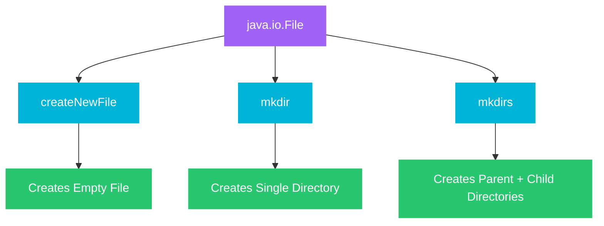

# Java Program to Create File

**Java Program to Create File** | Creating files and directories in Java using `createNewFile()`, `mkdir()`, and `mkdirs()` methods from the `java.io.File` class.

- [File Creation Methods](#file-creation-methods)
- [Java Create File Using createNewFile() Method](#java-create-file-using-createnewfile-method)
- [Create Different Types of Empty Files](#create-different-types-of-empty-files)
- [Java mkdir() Method to Create Directory](#java-mkdir-method-to-create-directory)
- [Java mkdirs() Method to Create Directories](#java-mkdirs-method-to-create-directories)
- [Java Program with All Methods](#java-program-with-all-methods)

---

## 1. File Creation Methods

In Java, we can create a file either in the current working directory or in some other location. Similar to the file we are also able to create a directory in the current working directory or in some other given location. Different methods to create file or directory are:

| Return Type 🔄 | Method 🛠️ | Description 📋 |
|----------------|-----------|----------------|
| `boolean` | `createNewFile()` throws `IOException` | Creates an empty normal file with the given name in the given path |
| `boolean` | `mkdir()` | Creates a directory with the given name in the given path |
| `boolean` | `mkdirs()` | Creates both parent and child directories with the given names in the given path |

📝 **Note:** In the above methods, if the file/directory already exists in the given path then it returns `false` else it returns `true` and creates the file/directory with the given name. The `createNewFile()` method throws `IOException` when an I/O error occurs. All three methods throw `SecurityException` if the security manager exists and does not permit the named directory to be created.



---

## 2. Java Create File Using createNewFile() Method

The `createNewFile()` method is given in the `java.io.File` class to create file either in current working directory or in some other location.

🏷️ **Method prototype:** `public boolean createNewFile() throws IOException`

If the file already exists in the folder then `createNewFile()` method returns `false` else it returns `true` and creates an empty file with the given name in the given path. It throws `IOException` if an I/O error occurs and throws `SecurityException` if a security manager exists.

**Java program to create file in current directory:**

To create the file in the current working directory the following constructor is used: `File(String pathname)`. [See all constructors of java.io.File class](048_File_Class_in_Java.md)

```java
import java.io.File;
import java.io.IOException;

public class FileCreationInCurrentDir {
   public static void main(String[] args) {

      try {
         // creating file object
         File f1 = new File("abc.txt");

         // create new file with given name
         boolean flag = f1.createNewFile();

         // display message
         if(flag) {
            System.out.println("File created.");
            System.out.println("f1: "+f1);
         } else {
            System.out.println("File/directory already exist");
         }

      } catch (IOException ioe) {
         ioe.printStackTrace();
      } catch (Exception e) {
         e.printStackTrace();
      }
   }
}
```

📤 **Output (first-time execution):**

```
File created.
f1: abc.txt
```

📤 **Output (second-time execution):**

```
File/directory already exist
```

When we execute the above program for the first time, at that time `abc.txt` file does not exist in the current directory so `createNewFile()` method creates the file. Later when we execute the same program for the second time, the `abc.txt` file already exists in the current directory. Hence, it will not create again and return `false`. The `createNewFile()` method throws `IOException` so it is a better idea to catch those exceptions.

---

## 3. Create Different Types of Empty Files

Using `createNewFile()` method we can create files with different extensions, but those files will be empty. The `createNewFile()` method of `java.io.File` is used for creating empty files.

**Creating files with various extensions:**

```java
import java.io.File;
import java.io.IOException;

public class DifferentFileCreation {
   public static void main(String[] args) {

      try {

         File file1 = new File("HelloWorld.java");
         System.out.println(file1.createNewFile());
         System.out.println("file1: "+file1);

         File file2 = new File("program.pdf");
         System.out.println(file2.createNewFile());
         System.out.println("file2: "+file2);

         File file3 = new File("hello.class");
         System.out.println(file3.createNewFile());
         System.out.println("file3: "+file3);

         File file4 = new File("index.html");
         System.out.println(file4.createNewFile());
         System.out.println("file4: "+file4);

         File file5 = new File("image.png");
         System.out.println(file5.createNewFile());
         System.out.println("file5: "+file5);

      } catch (IOException ioe) {
         ioe.printStackTrace();
      } catch (Exception e) {
         e.printStackTrace();
      }
   }
}
```

📤 **Output on first run:**

```
true
file1: HelloWorld.java
true
file2: program.pdf
true
file3: hello.class
true
file4: index.html
true
file5: image.png
```

The above program creates `HelloWorld.java`, `program.pdf`, `hello.class`, `index.html`, and `image.png` files in the current working directory. When we execute this program for the second time it won't create new files because they already exist, this time `createNewFile()` method returns `false`.

💡 **Tip:** In this program we have hardcoded the names of the files for understanding purposes, you can read the names of the files dynamically from the end-user. We can use `OutputStream` classes or `Writer` class to insert the data in these files.

---

## 4. Java mkdir() Method to Create Directory

We can also create a file inside a directory. To create a file inside a directory first we should learn how to create a directory. To create a directory `mkdir()` method is given in the `File` class.

🔧 **Constructors used:**

```java
public File(String parent, String child)
public File(File parent, String child)
```

**Creating directory and file inside it:**

```java
import java.io.File;
import java.io.IOException;

public class CreateFileDirectory {
   public static void main(String[] args) {

      // create directory
      File dir1 = new File("directory1");
      System.out.println(dir1.mkdir());
      System.out.println("dir1: "+ dir1);

      try {
         // create file inside "directory1"
         File f = new File(dir1,"program.java");
         System.out.println(f.createNewFile());
         System.out.println(f);

      } catch(IOException ioe) {
         ioe.printStackTrace();
      } catch(Exception e) {
         e.printStackTrace();
      }
   }
}
```

📤 **Output on run1:**

```
true
dir1: directory1
true
directory1\program.java
```

📤 **Output on run2:**

```
false
dir1: directory1
false
f: directory1\program.java
```

---

## 5. Java mkdirs() Method to Create Directories

We can create two directories at a time. For this purpose `mkdirs()` method is given in the `java.io.File` class.

**Creating parent and child directories:**

```java
import java.io.File;
import java.io.IOException;

public class CreateMultipleDirectory {
   public static void main(String[] args) {

      // creating directories
      File f1 = new File("dirX","dirY");
      System.out.println(f1.mkdirs());
      System.out.println("f1: "+f1);

      // creating directories when
      // parent directory is already exist
      File f2 = new File("dirX","dirZ");
      System.out.println(f2.mkdirs());
      System.out.println("f2: "+f2);

      try {
         // creating files in the child directories
         File f3 = new File(f1, "1.txt");
         f3.createNewFile();
         System.out.println("f3: "+f3);

         File f4 = new File(f2, "2.txt");
         f4.createNewFile();
         System.out.println("f4: "+f4);

      } catch(IOException ioe) {
         ioe.printStackTrace();
      } catch(Exception e) {
         e.printStackTrace();
      }
   }
}
```

📤 **Output on run1:**

```
true
f1: dirX\dirY
true
f2: dirX\dirZ
f3: dirX\dirY\1.txt
f4: dirX\dirZ\2.txt
```

---

## 6. Java Program with All Methods

Java program to demonstrate `createNewFile()`, `mkdir()` and `mkdirs()` methods:

**Complete demonstration:**

```java
import java.io.File;
import java.io.IOException;

class CreateFileParentDirectory {
   public static void main(String[] args) {

      try {
         // creating files
         File f1 = new File("abc.txt");
         f1.createNewFile();
         System.out.println("f1: "+f1);

         // creating directory
         File f2 = new File("dir1");
         f2.mkdir();
         System.out.println("f2: "+f2);

         // Creating files inside directory
         File f3 = new File(f2,"program.java");
         f3.createNewFile();
         System.out.println("f3: "+f3);

         // creating parent and child directories
         File f4 = new File("dir2","dir3");
         f4.mkdirs();
         System.out.println("f4: "+f4);

         // creating child directory
         // when parent is already exist
         File f5 = new File("dir2","dir4");
         f5.mkdirs();
         System.out.println("f5: "+f5);

      } catch(IOException ioe) {
         ioe.printStackTrace();
      } catch(Exception e) {
         e.printStackTrace();
      }
   }
}
```

📤 **Output:**

```
f1: abc.txt
f2: dir1
f3: dir1\program.java
f4: dir2\dir3
f5: dir2\dir4
```
