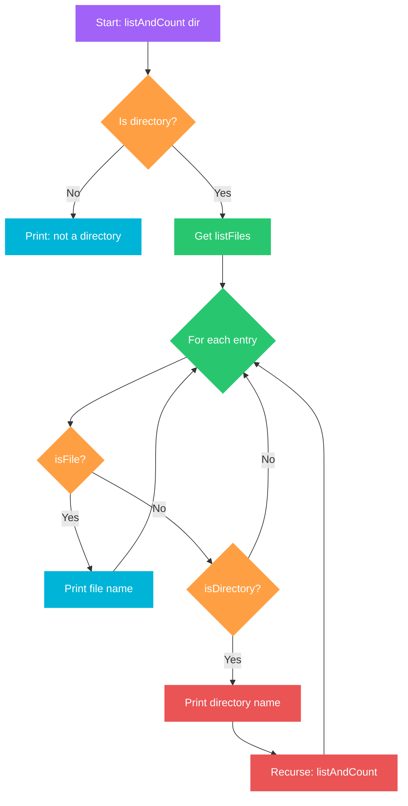

# Java Program to List Files And Directories

**Java Program to List Files And Directories** | Using `list()` and `listFiles()` methods from the `java.io.File` class to retrieve files and directories.

- [File Listing Methods](#file-listing-methods)
- [Simple Java Program to Display All Files and Directory](#simple-java-program-to-display-all-files-and-directory)
- [Java Program to Get All Files and Directory](#java-program-to-get-all-files-and-directory)
- [Java Program to Get the List of All Files in Directory and Subdirectories](#java-program-to-get-the-list-of-all-files-in-directory-and-subdirectories)
- [Get Files Based on an Extension](#get-files-based-on-an-extension)

---

## 1. File Listing Methods

In the [java.io.File class](048_File_Class_in_Java.md), methods `list()` and `listFiles()` are given with their overloaded forms to list the files and directory. We can use them in our program to get all files and directories in a particular directory or to get all files in directory and subdirectories. We can also get them through file extension.

| Return Type 🔄 | Method 🛠️ | Description 📋 |
|----------------|-----------|----------------|
| `String[]` | `list()` | Returns all file and subdirectory names as `String` objects using String array |
| `String[]` | `list(FilenameFilter filter)` | Returns all file and subdirectory names matched with given filter as `String` objects |
| `File[]` | `listFiles()` | Returns all file and subdirectory names as `File` objects using File array |
| `File[]` | `listFiles(FilenameFilter filter)` | Returns all file and subdirectory names matched with a given filter as `File` objects |
| `File[]` | `listFiles(FileFilter filter)` | Returns all file and subdirectory names matched with given `FileFilter` as `File` objects |

📝 **Note:** The array will be empty if the directory is empty. They return `null` if abstract path name is not a directory, or if an I/O error occurs.

| Return Type 🔄 | Method 🛠️ | Description 📋 |
|----------------|-----------|----------------|
| `File[]` | `listRoots()` | Returns an array of `File` objects denoting the available file system roots, or `null` if the set of roots could not be determined. The array will be empty if there are no file system roots. |

### Test Directory Structure

Assume we have a `TestFile` directory in our current working directory. The hierarchy of `TestFile` directory is:

- 📄 `abc.txt`
- 📄 `Hello.java`
- 📄 `index.html`
- 📂 `dir1`
  - 📄 `abc11.txt`
  - 📂 `dir11`
    - 📄 `abc111.txt`
    - 📄 `abc112.java`
  - 📂 `dir12`
- 📂 `dir2`
  - 📂 `dir21`
    - 📄 `abc211.txt`
  - 📂 `dir22`
    - 📂 `dir221`
    - 📄 `abc2211.pdf`
  - 📂 `dir23`

---

## 2. Simple Java Program to Display All Files and Directory

**Basic file listing:**

```java
import java.io.File;
public class DisplayFiles {

   public static void main(String[] args) {

      int count = 0;
      File dir = new File("TestFile");
      String[] file = dir.list();

      for(String str: file) {
         count++;
         System.out.print(str+" ");
      }

      System.out.println("\nTotal files = "
                          + file.length );
   }
}
```

📤 **Output:**

```
dir2 Hello.java input.txt dir1 index.html abc.txt xyz.txt
Total files = 7
```

⚠️ **Caution:** This is a very simple Java program that displays files and directories in the given directory. It doesn't tell which one is a file or directory. It doesn't show files inside subdirectories. It doesn't display the correct result when we pass `abc.txt` which is a file rather than a directory, or when the passed directory is empty.

---

## 3. Java Program to Get All Files and Directory

**Improved listing with file/directory detection:**

```java
import java.io.File;

public class DisplayFiles {

   public static void main(String[] args) {

      int dirCount = 0;
      int fileCount = 0;

      File dir = new File("abc");
      File[] files = dir.listFiles();

      if(files == null) {
         System.out.println( dir +
             " is not a directory");
      } else {

         for(File f: files){

            if(f.isFile()) {
               fileCount++;
               System.out.println( f +
                         " is a file");

            } else if(f.isDirectory()) {
               dirCount++;
               System.out.println( f +
                    " is a directory");
            }
         }

         System.out.println("Total file = "
                               + fileCount );
         System.out.println("Total directory = "
                                 + dirCount );
      }
   }
}
```

📤 **Output:**

```
TestFile/dir2 is a directory
TestFile/Hello.java is a file
TestFile/dir1 is a directory
TestFile/index.html is a file
TestFile/abc.txt is a file
Total file = 3
Total directory = 2
```

📤 **Output (empty directory):**

```
Total file = 0
Total directory = 0
```

📤 **Output (passing a file instead of directory):**

```
abc.txt is not a directory
```

💡 **Tip:** This Java program gets list of files and directories, displays name and their count inside a directory only. It doesn't list the subdirectories and their files. The next program addresses this limitation using recursion.

---

## 4. Java Program to Get the List of All Files in Directory and Subdirectories

In the previous program, whenever a sub-directory is encountered the program just reads the name and displays it, but this time the program should go inside the subdirectory. In the subdirectory list all files and sub-sub-directories, and for those also go to those sub-sub-directories. It is a recursive problem, the program needs to do the same thing in the subdirectory which it did in the parent directory i.e. list the files, directories and go inside the directories.

To solve this problem we should use the recursion technique. In the below program we define a recursive method `listAndCount()` which calls itself whenever it encounters a directory.

**Recursive file listing:**

```java
import java.io.File;
public class DisplayFiles {

   static int dirCount;
   static int fileCount;

   public static void main(String[] args) {

      File dir = new File("TestFile");
      listAndCount(dir);

      System.out.println("Total files = "
                                + fileCount );
      System.out.println("Total directories = "
                                + dirCount );
   }

   // recursive method
   public static void listAndCount(File dir) {

      File[] files = dir.listFiles();

      if(files == null) {
         System.out.println(dir +
             " is not a directory");
      } else {

         for(File f: files){

            if(f.isFile()) {
               fileCount++;
               System.out.println( f +
                         " is a file");

            } else if(f.isDirectory()) {
               dirCount++;
               System.out.println( f +
                    " is a directory");

               // go to inside the directory
               listAndCount(f);
            }
         }
      }
   }
}
```

📤 **Output:**

```
TestFile/dir2 is a directory
TestFile/dir2/dir23 is a directory
TestFile/dir2/dir21 is a directory
TestFile/dir2/dir21/abc211.txt is a file
TestFile/dir2/dir22 is a directory
TestFile/dir2/dir22/dir221 is a directory
TestFile/dir2/dir22/abc2211.pdf is a file
TestFile/Hello.java is a file
TestFile/dir1 is a directory
TestFile/dir1/abc11.txt is a file
TestFile/dir1/dir11 is a directory
TestFile/dir1/dir11/abc111.txt is a file
TestFile/dir1/dir11/abc112.java is a file
TestFile/dir1/dir12 is a directory
TestFile/index.html is a file
TestFile/abc.txt is a file
Total files = 8
Total directories = 8
```

📤 **Output (passing a file `abc.txt`):**

```
abc.txt is not a directory
Total file = 0
Total directory = 0
```

📤 **Output (empty directory):**

```
Total files = 0
Total directories = 0
```



---

## 5. Get Files Based on an Extension

In `TestFile`:

- 📄 `abc.txt`
- 📄 `Hello.java`
- 📄 `index.html`
- 📄 `xyz.txt`
- 📄 `input.txt`

In the `TestFile` directory there are multiple `.txt` files. Let us develop a program to display all files having a particular extension in the directory.

**Filter files by extension using `FilenameFilter`:**

```java
import java.io.File;
import java.io.FilenameFilter;

class FileExtension implements FilenameFilter {

   String extFile;

   public FileExtension(String extFile) {
      this.extFile = "."+extFile;
   }

   public boolean accept(File dir, String name) {
      return name.endsWith(extFile);
   }
}

public class DisplayFiles {

   public static void main(String[] args) {
      File dir = new File("TestFile");

      if(dir.isFile()) {
         System.out.println(dir + " is a file.");
         return;
      }

      String extension = "txt";
      FilenameFilter onlyFile = new FileExtension(extension);

      String[] strFile = dir.list(onlyFile);
      System.out.println("The files in "+ dir +
             " with ."+ extension +" extension are : ");

      for(String s: strFile) {
         System.out.print(s +"  ");
      }

      System.out.println("\nTotal files = " + strFile.length);
   }
}
```

📤 **Output:**

```
The files in TestFile with .txt extension are :
input.txt abc.txt xyz.txt
Total files = 3
```
