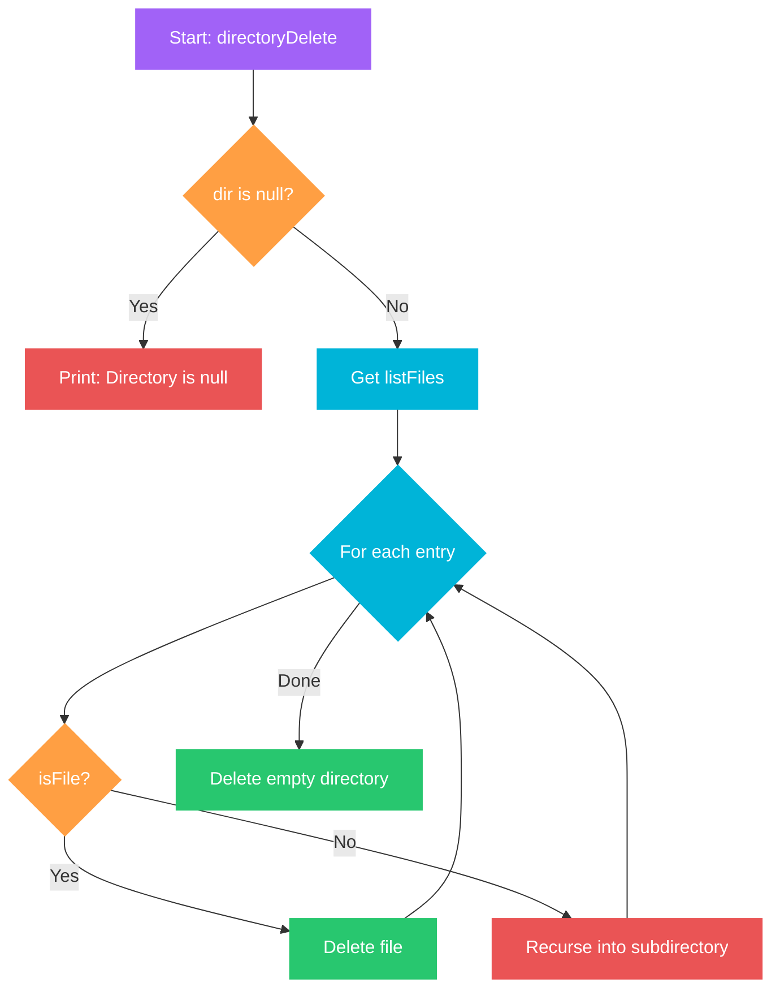

# Java Program to Delete Files and Directories

**Java Program to Delete Files and Directories** | Using `delete()` and `deleteOnExit()` methods from the `java.io.File` class to remove files and directories permanently.

- [Delete Methods Overview](#delete-methods-overview)
- [delete() Method](#delete-method)
- [deleteOnExit() Method](#deleteonexit-method)
- [Java Program to Delete Files if Exists](#java-program-to-delete-files-if-exists)
- [Delete Empty Folder](#delete-empty-folder)
- [Java Program to Delete Directory with Files](#java-program-to-delete-directory-with-files)

---

## 1. Delete Methods Overview

To delete files or directory using Java, `delete()` and `deleteOnExit()` methods are given in the [java.io.File class](048_File_Class_in_Java.md). Using these methods we can also delete the directory with all files. First, let us demonstrate the method and then develop the program to delete all files in a directory.

| Method 🛠️ | Description 📋 |
|-----------|----------------|
| `public boolean delete()` | Deletes files immediately |
| `public void deleteOnExit()` | Deletes file after JVM terminates |

---

## 2. delete() Method

The `delete()` method returns `true` if and only if the file or directory is successfully deleted, else it returns `false`. If the given pathname represents a directory not a file then in order to delete it, the directory must be empty.

- 🚨 The `delete()` method can throw `IOException` if the file can't be deleted. It is useful for error reporting and to diagnose why a file cannot be deleted.
- 🔒 It can also throw `SecurityException` if there is a security manager that exists and it denies delete access to the file.

---

## 3. deleteOnExit() Method

The `deleteOnExit()` method requests that the file or directory denoted by this abstract pathname be deleted when the virtual machine terminates. Files (or directories) are deleted in the reverse order that they are registered. Invoking this method to delete a file or directory that is already registered for deletion has no effect. Deletion will be attempted only for normal termination of the virtual machine.

- ⚠️ Once deletion has been requested through `deleteOnExit()` method then it is not possible to cancel the request. This method should therefore be used with care.
- 🔒 This method should not be used for file-locking, as the resulting protocol cannot be made to work reliably. The `FileLock` facility should be used instead.
- 🚨 It also throws `SecurityException` if there is a security manager that exists and it denies delete access to the file.

💡 **Tip:** File-level locking is a mechanism that restricts access to a computer file, or to a region of a file, by allowing only one user or process to modify or delete it in a specific time and to prevent reading of the file while it's being modified or deleted. For example, open any file and try to delete from the file, we can't do it because the file is locked.

> ⚠️ **Warning:** Both methods delete files/directories permanently.

---

## 4. Java Program to Delete Files if Exists

Previously we have written different programs to create folder, you can use them or create file manually. See: [Create File in Java.](049_Java_Program_to_Create_File.md)

In current working directory:

- 📄 `Hello.java`
- 📄 `Hello.class`

**Deleting files with `delete()` and `deleteOnExit()`:**

```java
import java.io.File;
import java.io.IOException;
public class DeleteFile {
   public static void main(String[] args) {

      File f1 = new File("Hello.java");
      File f2 = new File("Hello.class");

      if(f1.exists()){
         f1.delete(); // delete immediately
         System.out.println(f1 + " deleted");
         System.out.println("f1 exists: " + f1.exists());
      } else {
         System.out.println(f1 + " doesn't exist");
      }

      if(f2.exists()){
         f2.deleteOnExit(); // delete after JVM termination
         System.out.println(f2 + " deletion requested on exit");
         System.out.println("f2 exists: " + f2.exists());
      } else {
         System.out.println(f2 + " doesn't exist");
      }
   }
}
```

📤 **Output:**

```
Hello.java deleted
f1 exists: false
Hello.class deletion requested on exit
f2 exists: true
```

If we run the program for the second time then the file is not available, that's why it displays:

```
File doesn't exist.
```

---

## 5. Delete Empty Folder

When the directory is non-empty then both `delete()` and `deleteOnExit()` method returns `false` and doesn't delete the directory or folder. Therefore, we must check the directory is empty or not.

In current working directory:

- 📂 `dir1`
- 📂 `dir2`
  - 📄 `test.txt`

**Deleting empty directory:**

```java
import java.io.File;
public class DeleteDirectory {
   public static void main(String[] args) {

      File f1 = new File("dir1");
      // File f1 = new File("dir2");
      boolean flag = false;

      if(f1.exists()){
         flag = f1.delete();
         if(flag){
            System.out.println(f1 + " deleted");
         } else {
            // check is it directory
            if(f1.isDirectory())
            System.out.println(f1 + " is not empty");
         }
      } else {
         System.out.println(f1 + " doesn't exist");
      }
   }
}
```

📤 **Output for run1:**

```
dir1 deleted
```

📤 **Output for run2:**

```
dir1 doesn't exist
```

Now, let us try to delete `dir2` which is not empty. In this case, the output is:

```
dir2 is not empty
```

---

## 6. Java Program to Delete Directory with Files

A directory can contain multiple files and directories, those child directories can be empty or have multiple files and directories. So, we have to develop a program in such a way that it checks each folder and files and then deletes them.

🔑 **Procedure:**

1. Go to a directory
2. List all files and directories
3. If it is a file then delete it
4. If it is a directory then again start from step 1
5. If the directory is empty then delete the directory

We need to use recursion technique to solve the problem. In recursion technique, we define a method that calls itself within a certain condition.

**Recursive delete method:**

```java
// method to delete files and folders recursively
public void directoryDelete(File dir) throws Exception {
   if(dir != null) {
      File dirList[] = dir.listFiles();
      if(dirList != null) {
         for(File f : dirList) {
            if(f.isFile()) f.delete();
            else directoryDelete(f);
         }
      }
      dir.delete();
   }
}
```



Current Working directory contains `TestFile` directory:

- 📂 `dir1`
  - 📄 `abc11.txt`
  - 📂 `dir11`
    - 📄 `abc111.txt`
    - 📄 `abc112.java`
  - 📂 `dir12`
- 📂 `dir2`
  - 📂 `dir21`
  - 📂 `dir22`
    - 📂 `dir221`
    - 📄 `abc2211.pdf`
  - 📂 `dir23`

**Complete program:**

```java
import java.io.File;

class Test {
   public static void main(String[] args) {
      DeleteDirectory dir = new DeleteDirectory();
      try {
         dir.directoryDelete("TestFile");
      } catch(Exception e) {
         e.printStackTrace();
      }
   }
}

class DeleteDirectory {
   public void directoryDelete(String file)
                                   throws Exception {
      directoryDelete(new File(file));
   }

   public void directoryDelete(File dir)
                                   throws Exception {
      if(dir != null) {
         File dirList[] = dir.listFiles();

         if(dirList != null) {
            for(File f : dirList) {
               if(f.isFile()) {
                  f.delete();
                  // to see deletion order
                  System.out.println(f + " file deleted");
               } else {
                  directoryDelete(f);
               }
            }
         }

         if(dir.delete()) {
            // to see deletion order
            System.out.println(dir + " directory deleted");
         } else {
            if(!dir.exists())
            System.out.println(dir + " not exist");
         }

      } else {
         System.out.println("Directory is null");
      }
   }
}
```

📤 **Output for run1:**

```
TestFile\dir1\abc11.txt file deleted
TestFile\dir1\dir11\abc111.txt file deleted
TestFile\dir1\dir11\abc112.java file deleted
TestFile\dir1\dir11 directory deleted
TestFile\dir1\dir12 directory deleted
TestFile\dir1 directory deleted
TestFile\dir2\dir21 directory deleted
TestFile\dir2\dir22\abc2211.pdf file deleted
TestFile\dir2\dir22\dir221 directory deleted
TestFile\dir2\dir22 directory deleted
TestFile\dir2\dir23 directory deleted
TestFile\dir2 directory deleted
TestFile directory deleted
```

📤 **Output for run2:**

```
TestFile not exist
```
