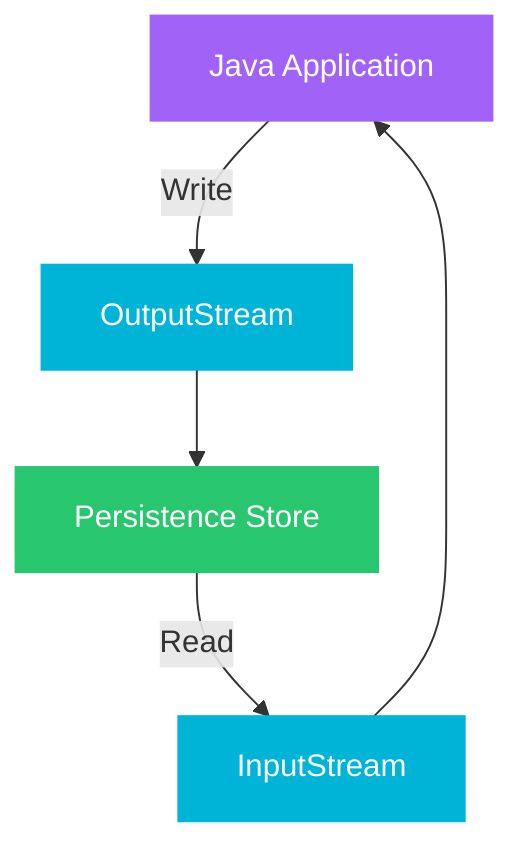

# IOStream in Java

**IOStream in Java** | Storing data permanently to files, performing persistence operations, reading values from the keyboard, and displaying values to the console.

- [Terminologies Used in Java IOStream](#terminologies-used-in-java-iostream)
- [Streams and its Types](#streams-and-its-types)
- [Java IOStream Classes](#java-iostream-classes)
- [Closing the Java IOStream Objects](#closing-the-java-iostream-objects)
- [Important Points](#important-points)

---

## 1. Overview

In Java, all pre-defined classes belonging to the `java.io` package are called IOStream. IOStream is meant for storing the data permanently to the file, performing persistence operations on a file, reading values from the keyboard, and displaying values to the console. I => Input, O => Output, Stream => Connection.

It is also called **File Handling** or **File IO** or **File IO stream**. The `java.io` package does not only have pre-defined classes for reading and storing data to a file but also has pre-defined classes for reading data from the keyboard and displaying data to the console, so it is better to call IOStreams rather than File IO or File Handling.

In Java IOStream, we will learn how to store data permanently to the file, and how to read those permanent data from the file. How to read data from the console and display data on the console. What is happening when we use `System.in`, `System.out` and `System.err` in our program, internally which class objects are used?

Java IOStream is used to read/write data in a **flat file**. By default, IOStreams supports only flat files. The file that doesn't support any special format and contains only plain text is called flat files. The flat files are platform-independent and can work in all operating systems. It can be opened by any text editor software. Flat files can contain any extension but generally, it contains `.txt` extension.



---

## 2. Terminologies Used in Java IOStream

🧠 **In Simple Words:** The values stored in a program either in variables/objects are available temporarily, only during the program execution. Once program execution is completed the variables/objects memory is destroyed and all values are lost, later we can't get those data. Program execution is done in RAM which stores values only for a temporary period. If we want to get values/data/results, even after the program execution is completed then we must store those values in a permanent place i.e. persistence store. After storing data in a persistent store, later we can perform read and write operations.

- 💾 **Persistence Store:** The environment that allows us to store data permanently. We can store data permanently in three places: File, Database, Remote Computer.
- 🔄 **Persistence:** The process of storing and managing data permanently in a persistence store for a long time.
- 💻 **Persistence Logic:** The logic that persists data in a persistence store. Example: IOStreams code, JDBC code, Hibernate code, Spring JDBC code, Networking code.
- 🛠️ **Persistence Operations:** Insert, update, delete, select operations are called persistence operations. These are also called CRUD operations. C => create, R => read, U => update, D => delete.

### Persistence Technologies in Java

The technology that provides API to develop persistence logic is called persistence technology. In Java, well-known persistence technologies are:

- 📄 **IOStreams:** To persist the data in flat files.
- 🗄️ **JDBC, Spring JDBC, ORM (Hibernate), Spring ORM, Spring Data:** To persist data in the database.
- 🌐 **Networking:** To persist data in the remote computer.

Persistence technologies provide API to developing persistence logic, not to develop the business logic.

🔑 **Key Point:** If we want to store a small amount of data without bothering the security of those data, in that case, we can work with the file. Example: desktop games, mobile games. In these places, they have to store the top 10 players' names and scores, score/power given to players, etc. These data can be easily stored in the file, and it doesn't require security. But if we want to store a large amount of data with security then we must choose a database.

> ⚠️ **Caution:** Generally, we don't use Java IOStream to store important data to the file because the file has several problems like security issues (anyone can access the file and read the data), can't maintain data in particular columns and rows order. By increasing the data size the file size also increases and it can create a reading problem, inside a file we don't have a searching algorithm. Flat files are not used to store business value rather they use databases.

---

## 3. Streams and its Types

🔄 **Streams:** Stream is a logical connection between Java application and file/console/network through which we can transfer the data either for storing or reading.

The stream can be defined as "It is a continuous flow of data between Java program and persistence store". Or we can say "Stream is a Java object that allows reading and writing data to a persistence store".

> 📝 **Note:** We need separate streams to read input and write the output.

### Types Based on Data Flow

- 📥 **Input Stream:** The stream through which we can read data from the persistence store to the Java application.
- 📤 **Output Stream:** The stream through which we can write data from the Java application to the persistence store for storing those data.

### Types Based on Data Format

- 🔢 **Binary Stream:** The streams which can read and write data in the form of bytes. It contains data in 0 and 1 format.
- 🔤 **Character Streams:** The streams which read and write data in the form of characters/text/string.

📝 **Note:** Binary Stream classes are available from the JDK1.0 version onwards but Character Streams classes are introduced in the JDK1.1 version because some characters like `\n`, `\t`, `\a` etc. are not interpreted correctly.

| Criteria ⚖️ | Binary Stream 🔢 | Character Stream 🔤 |
|-------------|-------------------|---------------------|
| **Use case** | Read/write Number/Object data | Read/write text/character/String data |
| **Available since** | JDK 1.0 | JDK 1.1 |
| **Data format** | Bytes (0 and 1) | Characters/text |

---

## 4. Java IOStream Classes

Based on different sources and destinations to read and write data, different sub-classes are given in the `java.io` package. Different sources and destinations can be:

- 📥 **Source:** Keyboard, File, Database, Socket(computer), Object, Array, String, and StringBuffer.
- 📤 **Destination:** Monitor, File, Database, Socket(computer), Object, Array, String, and StringBuffer.

Based on data flow **Binary streams** are of two types:

- 📥 [**InputStream**](054_InputStream_in_Java.md): To read binary data from the persistence store.
- 📤 [**OutputStream**](053_OutputStream_in_Java.md): To write binary data to the persistence store.

Both `InputStream` and `OutputStream` are abstract classes and based on different sources and formats multiple subclasses are there. `InputStream` class is the superclass for all binary input stream classes. `OutputStream` class is the superclass for all binary output stream classes.

Similarly, based on data flow **Character streams** are of two types:

- 📥 [**Reader**](062_Reader_Class_in_Java.md): To read character data from the persistence store.
- 📤 [**Writer**](061_Writer_Class_in_Java.md): To write character data to the persistence store.

Both `Reader` and `Writer` are abstract classes and based on different sources and formats multiple subclasses are there. `Reader` class is the superclass for all Character input stream classes. `Writer` class is the superclass for all character output stream classes.

`InputStream` and `Reader` classes have `read()` method to read data from a source. In `InputStream` class it returns one byte at a time and in the `Reader` class, it returns one character at a time.

Similarly, `OutputStream` and `Writer` classes have the `write()` method to write data to a destination. In `OutputStream` class it writes one byte at a time and in `Writer` class it writes one character at a time.

💡 **Tip:** While storing data in the binary form we can store value 97 as int, long, float, double which requires different byte sizes but in character form, it can be stored only in Unicode character form.

### Classes to Write Binary Data

- 📤 [**OutputStream**](053_OutputStream_in_Java.md) (Superclass)
  - [**FileOutputStream**](055_Java_FileOutputStream.md)
  - `ByteArrayOutputStream`
  - `FilterOutputStream`
    - [**DataOutputStream**](057_DataOutputStream_in_Java.md)
    - `BufferedOutputStream`
    - **PrintStream**
  - `ObjectOutputStream`
  - `PipedOutputStream`

### Classes to Read Binary Data

- 📥 [**InputStream**](054_InputStream_in_Java.md) (Superclass)
  - [**FileInputStream**](056_FileInputStream_in_Java.md)
  - `ByteArrayInputStream`
  - `FilterInputStream`
    - [**DataInputStream**](058_DataInputStream_in_Java.md)
    - `BufferedInputStream`
    - `LineNumberInputStream`
    - `PushbackInputStream`
  - `ObjectInputStream`
  - `PipedInputStream`
  - `SequenceInputStream`
  - `StringBufferInputStream`

### Classes to Write Character/Text Data

- 📤 [**Writer**](061_Writer_Class_in_Java.md) (Superclass)
  - `CharArrayWriter`
  - `OutputStreamWriter`
    - [**FileWriter**](064_FileWriter_in_Java.md)
  - [**BufferedWriter**](066_Java_BufferedWriter.md)
  - `FilterWriter`
  - `PipedWriter`
  - `StringWriter`
  - [**PrintWriter**](068_PrintWriter_in_Java.md)

### Classes to Read Character/Text Data

- 📥 [**Reader**](062_Reader_Class_in_Java.md) (Superclass)
  - [**BufferedReader**](067_BufferedReader_in_Java.md)
    - `LineNumberReader`
  - `CharArrayReader`
  - [**InputStreamReader**](063_InputStreamReader_in_Java.md)
    - [**FileReader**](065_Java_FileReader.md)
  - `FilteredReader`
    - `PushBackReader`
  - `PipedReader`
  - `StringReader`

---

## 5. Closing the Java IOStream Objects

All IOStream classes are connection-based objects which use different resources. That's why after completion of its uses we should close the connection. Up to 1.4 version every abstract class has its own `close()` method definition. In the Java 1.5 version, a `Closeable` marker interface was introduced in `java.io` which contains only the `close()` method. Therefore every class of `java.io` package implements the `Closeable` interface (up to Java 1.6).

In Java 1.7 version `AutoCloseable` interface was introduced in `java.lang` to support the try-with-resource concept. The try-with-resource concept is given for closing the connection object automatically after the execution of the try/catch block. The `AutoCloseable` is a super interface for closing the connection and now the `Closeable` interface is the sub-interface of `AutoCloseable`.

**AutoCloseable interface:**

```java
package java.lang;
public interface AutoCloseable {
    void close() throws Exception;
}
```

**Closeable interface:**

```java
package java.io;
public interface Closeable extends AutoCloseable {
   public void close() throws IOException;
}
```

Now, all input and output related classes of `java.io` package implement `Closeable` interface and `Closeable` extended from `AutoCloseable` interface.

---

## 6. Important Points

Since all IOStream classes are connection-based, where one end is a Java application and another end is a persistent store. We must always pass the persistent store information to the constructor. Therefore, none of these classes contains a 0 parameter constructor.

- 📥 To read character data from a file/console use **BufferedReader**.
- 📤 To write character data from a file/console use **PrintWriter**.

🔑 **Key Point:** In order to read/write character/text/string data, the `BufferedReader` and `PrintWriter` classes give high performance compared to the other classes.
