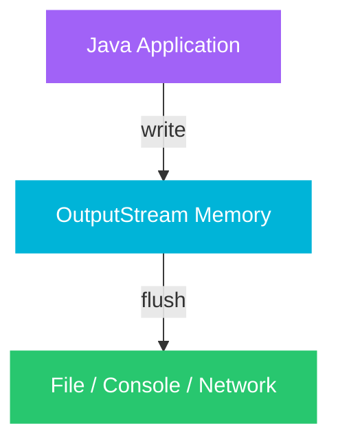

# OutputStream in Java

**OutputStream in Java** | An abstract class for writing binary data from a Java application to a file, console, or network.

- [Overview](#overview)
- [Java OutputStream Class Methods](#java-outputstream-class-methods)
- [Sub Classes of Java OutputStream](#sub-classes-of-java-outputstream)
- [InputStream vs OutputStream](#inputstream-vs-outputstream)

---

## 1. Overview

`OutputStream` class in Java is an abstract class that is meant for writing the binary data from Java application to a file/console/network. It is a superclass of all output stream classes used to write binary data and contains methods for writing binary data into the file/console/network. It implements `Closeable` and `Flushable` interface.

```java
public abstract class OutputStream
extends Object
implements Closeable, Flushable
```

When we write data into the stream then data is not saved in the file directly, it is stored only in the output stream memory, and to save those data from that memory to the file, the `flush()` method must be called. Whenever we call the `write()` method then data is first saved inside the output stream memory and to save those data from the output stream memory to file we must call `flush()` method.

Up to Java 1.4 version `flush()` method was directly available in the `OutputStream` class, but in Java 1.5 version `Flushable` interface was introduced which contains `flush()` method. And `OutputStream` class implements the `Flushable` interface.

**Flushable interface:**

```java
package java.io;
import java.io.IOException;
public interface Flushable {
    void flush() throws IOException;
}
```

**OutputStream class declaration:**

```java
package java.io;
public abstract class OutputStream
implements Closeable, Flushable {
      ………
}
```



---

## 2. Java OutputStream Class Methods

There are methods available in `OutputStream` class:

| Modifier and Type 🔄 | Method 🛠️ | Description 📋 |
|----------------------|-----------|----------------|
| `abstract void` | `write(int b)` | Write specified byte |
| `void` | `write(byte[] b)` | Write `b.length` bytes from the specified byte array |
| `void` | `write(byte[] b, int offset, int len)` | Writes `len` bytes from the specified byte array starting at offset `off` |
| `void` | `flush()` | Flushes this output stream and forces any buffered output bytes to be written out |
| `void` | `close()` | Closes the stream and releases any system resources associated with it |
| `OutputStream` | `nullOutputStream()` | Returns a new OutputStream which discards all bytes (Since Java 11) |

💡 **Tip:** The `write()` method directly can't save the data to the file. It can store data only to the stream so to move data from the stream into the file we must call the `flush()` method.

---

## 3. Sub Classes of Java OutputStream

Java `OutputStream` class has different sub classes based on the sources and formats of the data. These sub classes are:

- 📄 [**FileOutputStream**](055_Java_FileOutputStream.md)
- 🗂️ `ByteArrayOutputStream`
- 🔧 `FilterOutputStream`
  - 🔢 [**DataOutputStream**](057_DataOutputStream_in_Java.md)
  - ⚡ `BufferedOutputStream`
  - 🖨️ **PrintStream**
- 📦 `ObjectOutputStream`
- 🔗 `PipedOutputStream`

Among these 8 classes `FileOutputStream`, `DataOutputStream`, `PrintStream` and `ObjectOutputStream` are important classes:

| Class 🏷️ | Description 📋 |
|-----------|----------------|
| **FileOutputStream** | Writes one-byte data to the file. It is the basic destination for the file. |
| **DataOutputStream** | Writes data in primitive (int, long, ..) size format. Used to add the capability to another output stream to write data as primitive types. |
| **BufferedOutputStream** | Writes data in buffers. Used to improve the writing performance of other streams. |
| **PrintStream** | Writes data as it is. It is the most useful output stream class to write data. |
| **ObjectOutputStream** | Writes data in Object format. Used for serialization. |

📝 **Note:** None of these subclasses have a 0 parameter constructor because it is a stream-based connection where one end is a Java application. Therefore second end information must be passed as input to the constructor.

🔑 **Key Point:** Among all 8 OutputStream subclasses, only `FileOutputStream` can directly connect to the file. The remaining all other 7 classes need the help from `FileOutputStream` class to connect to the file. They connect to `FileOutputStream` and `FileOutputStream` connects to the file. So, we can say the basic source of connecting to file and writing data is `FileOutputStream` class and the remaining classes are depending on it.

💡 **Tip:** Why is `SequenceInputStream` there but `SequenceOutputStream` is not? `SequenceInputStream` reads input from multiple streams sequentially one after one with a single stream. But there is no need for writing the same data in multiple streams, that's why `SequenceOutputStream` is not given. Similarly, `StringBufferInputStream` is there but `StringBufferOutputStream` is not.

### DataOutputStream and ObjectOutputStream

The `DataOutputStream` and `ObjectOutputStream` class are implemented from `DataOutput` and `ObjectOutput` interface respectively. And the `ObjectOutput` interface is a sub-interface of the `DataOutput` interface.

- 🔗 `ObjectOutput` => `ObjectOutputStream`
- 🔗 `DataOutput` => `DataOutputStream`

**DataOutput interface:**

```java
// DataOutput.java
package java.io;
interface DataOutput {
   ……
}
```

**ObjectOutput interface:**

```java
// ObjectOutput.java
package java.io;
public interface ObjectOutput extends
DataOutput, AutoCloseable {
   ……
}
```

---

## 4. InputStream vs OutputStream

| Feature ⚖️ | InputStream 📥 | OutputStream 📤 |
|------------|----------------|-----------------|
| **Implements** | `Closeable` interface | `Closeable` and `Flushable` interface |
| **Purpose** | Reading binary data from the file | Writing binary data into the file |
| **Role** | Superclass of all input stream type classes for reading binary data | Superclass of all output stream type classes for writing binary data |
| **Subclasses** | 9 sub classes. Important: `FileInputStream`, `DataInputStream`, `ObjectInputStream` | 8 sub classes. Important: `FileOutputStream`, `DataOutputStream`, `PrintStream`, `ObjectOutputStream` |
| **Basic source** | `FileInputStream` is the basic source for connecting to the file to read data. Without it we can't read data from the file. | `FileOutputStream` is the basic source for connecting to the file to write data. Without it we can't write data to the file. |

✅ **Similarity:**

- Both are subclasses of `java.lang.Object` class and implement the `Closeable` interface.
- Both belong to the `java.io` package.
- They are abstract classes.
