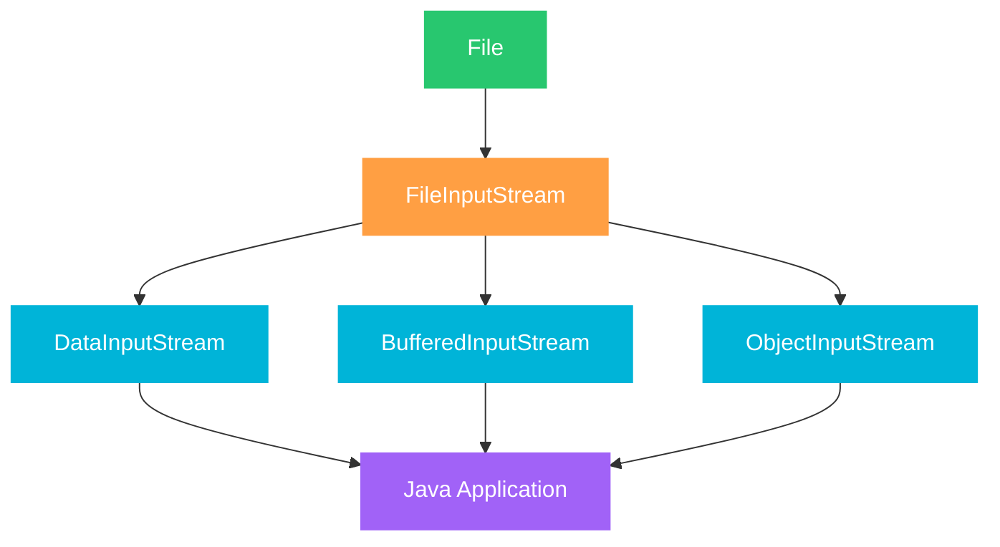

# InputStream in Java

**InputStream in Java** | An abstract class for reading binary data from a file to a Java application.

- [Java InputStream Class Methods](#java-inputstream-class-methods)
- [Sub Classes of Java InputStream](#sub-classes-of-java-inputstream)
- [InputStream vs OutputStream](#inputstream-vs-outputstream)

---

## 1. Overview

`InputStream` class in Java is an abstract class that is meant for reading binary data from a file to a Java application. It is the superclass of all Java Input stream classes and contains methods for reading binary data from the file.

`InputStream` class in Java is defined in `java.io` package and it implements the `Closeable` interface. `InputStream` and all its subclasses are available from the initial version of Java.

---

## 2. Java InputStream Class Methods

There are different methods available in the `InputStream` class. Among these methods, only the `read()` method is an abstract method and the remaining all are concrete methods. Except for `markSupported()`, and `mark()` method all other methods throw `IOException`.

| Modifier and Type 🔄 | Method 🛠️ | Description 📋 |
|----------------------|-----------|----------------|
| `int` | `available()` | Returns number of bytes that can be read or skipped over from the input stream without blocking |
| `abstract int` | `read()` | Reads the next one byte of data from the input stream |
| `int` | `read(byte[] b)` | Reads some number of bytes and stores them into the buffer array `b` |
| `int` | `read(byte[] b, int offset, int len)` | Reads up to `len` bytes of data from the input stream and stores them into the buffer array `b` |
| `boolean` | `markSupported()` | Checks if mark and reset methods are supported or not |
| `void` | `mark(int readlimit)` | Marks the current position in this input stream |
| `void` | `reset()` | Resets the cursor position |
| `long` | `skip(long n)` | Skips over and discards `n` bytes of data from the input stream |
| `void` | `skipNBytes(long n)` | Skips over and discards exactly `n` bytes of data from the input stream |
| `void` | `close()` | Closes the stream and releases any system resources associated with the stream |

💡 **Tip:** Difference between `read()` and `read(byte[] b)`? Both methods return type is an `int` but `read()` is an abstract method and generally, it returns the one-byte value from the file as `int` data type value. Whereas `read(byte[] b)` returns the number of bytes read from the stream into a byte array.

### Methods Added After Java 1.8

| Return Value 🔄 | Method 🛠️ | Description 📋 | Since ☕ |
|-----------------|-----------|----------------|---------|
| `int` | `readAllBytes()` | Reads all remaining bytes from the input stream | 9 |
| `byte[]` | `readNBytes(int len)` | Reads up to a specified number of bytes | 11 |
| `int` | `readNBytes(byte[] b, int off, int len)` | Reads the requested number of bytes into the given byte array | 9 |
| `long` | `transferTo(OutputStream out)` | Reads all bytes from the input stream and writes them to the given output stream | 9 |
| `static InputStream` | `nullInputStream()` | Returns a new `InputStream` that reads no bytes | 11 |

---

## 3. Sub Classes of Java InputStream

It has different sub classes based on the sources and formats of the data. It has totally 9 sub classes:

- 📄 [**FileInputStream**](056_FileInputStream_in_Java.md)
- 🗂️ `ByteArrayInputStream`
- 🔧 `FilterInputStream`
  - 🔢 [**DataInputStream**](058_DataInputStream_in_Java.md)
  - ⚡ `BufferedInputStream`
  - 📜 `LineNumberInputStream`
  - 🔙 `PushbackInputStream`
- 📦 `ObjectInputStream`
- 🔗 `PipedInputStream`
- 🔄 `SequenceInputStream`
- 📝 `StringBufferInputStream`

Among these 9 classes `FileInputStream`, `DataInputStream` and `ObjectInputStream` are important classes:

| Class 🏷️ | Description 📋 |
|-----------|----------------|
| **FileInputStream** | Reads one-byte data from the file as it is in raw format. It is the basic data source for all other Input stream classes. |
| **DataInputStream** | Reads data in primitive data (int, long, ..) size format. Used to add the capability to another input stream to read data as primitive types. |
| **ObjectInputStream** | Reads data in Object format. Used to perform Object Serialization. |
| **BufferedInputStream** | Reads data as buffers. Used to improve the performance of other streams. |
| **SequenceInputStream** | Used to read data from multiple InputStreams sequentially. |

The `DataInputStream` and `ObjectInputStream` class are implemented from `DataInput` and `ObjectInput` interface respectively. And the `ObjectInput` interface is a sub-interface of `DataInput` interface.

- 🔗 `ObjectInput` => `ObjectInputStream`
- 🔗 `DataInput` => `DataInputStream`

**DataInput interface:**

```java
// DataInput.java
package java.io;
interface DataInput {
   ……
}
```

**ObjectInput interface:**

```java
// ObjectInput.java
package java.io;
public interface ObjectInput extends
DataInput, AutoCloseable {
   ……
}
```

📝 **Note:** None of these subclasses have a 0 parameter constructor because it is a stream-based connection where one end is a Java application. Therefore second end information must be passed as input to the constructor.

🔑 **Key Point:** Among all 9 Input Stream subclasses, only `FileInputStream` can directly connect to the file. The remaining all other 8 classes need the help from `FileInputStream` class to connect to the file. Therefore, the basic source of connecting to file and reading data is `FileInputStream` class and the remaining classes are depending on it.



---

## 4. InputStream vs OutputStream

| Feature ⚖️ | InputStream 📥 | OutputStream 📤 |
|------------|----------------|-----------------|
| **Implements** | `Closeable` interface | `Closeable` and `Flushable` interface |
| **Purpose** | Reading binary data from the file | Writing binary data into the file |
| **Role** | Superclass of all input stream type classes for reading binary data | Superclass of all output stream type classes for writing binary data |
| **Subclasses** | 9 sub classes. Important: `FileInputStream`, `DataInputStream`, `ObjectInputStream` | 8 sub classes. Important: `FileOutputStream`, `DataOutputStream`, `PrintStream`, `ObjectOutputStream` |
| **Basic source** | `FileInputStream` is the basic source for connecting to the file to read data. Without it we can't read data from the file. | `FileOutputStream` is the basic source for connecting to the file to write data. Without it we can't write data to the file. |

✅ **Similarity:**

- Both are subclasses of `java.lang.Object` class and implement the `Closeable` interface.
- Both belong to the `java.io` package.
- They are abstract classes.
