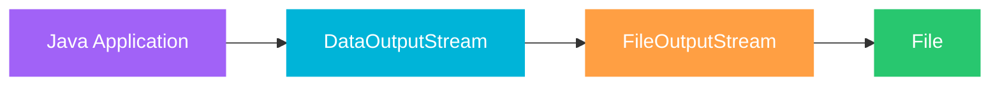

# DataOutputStream in Java

**DataOutputStream in Java** | Writing data in primitive type size bytes to files using the `DataOutputStream` class.

- [Overview](#overview)
- [Java DataOutputStream Class Methods](#java-dataoutputstream-class-methods)
- [Java Program Example Using DataOutputStream](#java-program-example-using-dataoutputstream)
- [Important Points](#important-points)
- [Limitations](#limitations)

---

## 1. Overview

The `DataOutputStream` in Java is used to write data in primitive type size bytes from the underlying OutputStreams. It has special methods to write primitive type size bytes.

It is a subclass of `FilterOutputStream` and implements the `DataOutput` interface. `FilterOutputStream` is the subclass of [**OutputStream**](053_OutputStream_in_Java.md). These all classes are available from Java 1.0 version onwards. `OutputStream` class is used to write data in binary form. `DataOutput` interface is used for converting data from any of the Java primitive types to a stream of bytes and writing these bytes to a binary output stream. Other implemented interfaces are: `Closeable`, `AutoCloseable`, `Flushable`.

```java
public class DataOutputStream
extends FilterOutputStream
implements DataOutput
```

### Constructors

The `FileOutputStream` is a basic source for all output stream classes which can directly make a connection between Java application and file. Similar to all other output stream classes, `DataOutputStream` class also depends on the `FileOutputStream` class to make a connection between Java application and file. `DataOutputStream` class has only one constructor which needs `OutputStream` as a parameter.

**Constructor:**

```java
public DataOutputStream(OutputStream out) {
      super(out);
}
```



---

## 2. Java DataOutputStream Class Methods

The `writeXxx()` methods are given to write the different primitive type values. Since all methods are for writing purposes, they don't return any value and the return type is `void`. All `writeXxx()` methods throw `IOException` if an I/O error occurs.

### Write Methods for Primitive Types

| Method 🛠️ | Description 📋 |
|-----------|----------------|
| `writeByte(int v)` | Writes a byte as a 1-byte value |
| `writeShort(int v)` | Writes a short as 2 bytes value, high byte first |
| `writeInt(int v)` | Writes an int as 4 bytes value, high byte first |
| `writeLong(long v)` | Writes long as 8 bytes value, high byte first |
| `writeFloat(float v)` | Converts float to int using `floatToIntBits` method in class `Float`, and then writes int value as 4 bytes quantity, high byte first |
| `writeDouble(double v)` | Converts double to long using `doubleToLongBits` method in class `Double`, and then writes long value as an 8 bytes quantity, high byte first |
| `writeChar(int v)` | Writes a char as 2 bytes value, high byte first |
| `writeBoolean(boolean v)` | Writes a boolean as a 1-byte value |
| `writeUTF(String str)` | Writes a string using modified UTF-8 encoding in a machine-independent manner |
| `writeBytes(String s)` | Writes string as a sequence of bytes |
| `writeChars(String s)` | Writes string as a sequence of characters |

⚠️ **Caution:** The `writeUTF(String str)` method also throws `UTFDataFormatException` if the modified UTF-8 encoding of passed string would exceed 65535 bytes in length.

### Other Methods

| Return Type 🔄 | Method 🛠️ | Description 📋 |
|----------------|-----------|----------------|
| `void` | `flush()` | Flushes data from output stream |
| `int` | `size()` | Returns the current value of the counter written, the number of bytes written to this data output stream so far |
| `void` | `write(int b)` | Writes the specified byte |
| `void` | `write(byte[] b, int off, int len)` | Writes `len` bytes from the given byte array starting at offset `off` to the underlying output stream |

Among these methods except `size()`, all other methods throw `IOException` when an I/O error occurs.

📝 **Note:** In `FilterOutputStream` classes, `close()` method itself calls `flush()` method. `DataOutputStream` class uses `close()` method from `FilterOutputStream`.

---

## 3. Java Program Example Using DataOutputStream

Below application demonstrates writing data in primitive type size bytes using `DataOutputStream` class.

**Writing primitive types to a file:**

```java
import java.io.FileOutputStream;
import java.io.DataOutputStream;
import java.io.IOException;
import java.io.FileNotFoundException;

public class DOSTest{
   public static void main(String[] args)
          throws IOException, FileNotFoundException{

      // create FileOutputStream object
      // constructor for overridden mode
      FileOutputStream fos = new FileOutputStream("output.txt");

      // constructor for append mode
      /* FileOutputStream fos =
           new FileOutputStream("output.txt", true); */

      // create DataOutputStream object
      DataOutputStream dos = new DataOutputStream(fos);

      // write different types of primitive data
      dos.writeInt(97); // int
      System.out.print(dos.size() + " ");

      dos.writeLong(100L); // long
      System.out.print(dos.size() + " ");

      dos.writeFloat(99.9f); // float
      System.out.print(dos.size() + " ");

      dos.writeDouble(95.5); // double
      System.out.print(dos.size() + " ");

      dos.writeChar('a'); // char
      System.out.print(dos.size() + " ");

      dos.writeBoolean(true); // boolean
      System.out.print(dos.size() + " ");

      dos.writeUTF("knowprogram.com"); // string
      System.out.print(dos.size() + " ");

      dos.writeBytes("Hello, world!"); // string
      System.out.print(dos.size() + " ");

      dos.writeChars("Java program"); // string
      System.out.print(dos.size() + " ");

      dos.write(97); // normal write() method
      System.out.println(dos.size());

      // display some message for confirmation
      System.out.println("Data is saved to the file");

      // close stream
      dos.close();
   }
}
```

📤 **Console Output:**

```
4 12 16 24 26 27 44 57 81 82
Data is saved to the file
```

📤 **Data in `output.txt` file (hex):**

```
0000 0061 0000 0000 0000 0064 42c7 cccd
4057 e000 0000 0000 0061 0100 0f6b 6e6f
7770 726f 6772 616d 2e63 6f6d 4865 6c6c
6f2c 2077 6f72 6c64 2100 4a00 6100 7600
6100 2000 7000 7200 6f00 6700 7200 6100
6d61
```

Since we are using one parameter constructor of [**FileOutputStream**](055_Java_FileOutputStream.md) which by default creates a connection in override mode, so if we execute the same application multiple times then every time data will be overridden to the file. To append data in the file, use a two-parameter constructor, and pass `true` as the second parameter value.

In this program total of 82 bytes have been written to the file, so the file size is 82 bytes. Note that when we call `writeInt(97)` then it takes 4 bytes but at last when we call `write(97)` then it only takes 1 byte because 97 belongs to byte-range so it can be treated as byte data type, compiler/JVM itself converts them.

💡 **Tip:** From this program, we can say boolean takes 1 byte, and the minimum memory location size in Java is 1 byte. For storing data including double quotes ("") JVM provides 1 byte for each character to it in a file.

---

## 4. Important Points

One value can be stored using different data types and they require different byte sizes. For example, we can store 97 value in different formats byte, short, int, long, float, and double, which requires 1, 2, 4, 8, 4 and 8 byte size respectively. While reading these values using `DataInputStream`, we must read that particular byte only else we will get unexpected results.

**Byte sizes for value 97:**

```java
dos.writeByte(97);   // a          (1 byte)
dos.writeShort(97);  // 0061       (2 bytes)
dos.writeInt(97);    // 0000 0061  (4 bytes)
dos.writeLong(97);   // 0000 0000 0000 0061 (8 bytes)
dos.writeFloat(97);  // 42c2 0000  (4 bytes)
dos.writeDouble(97); // 4058 4000 0000 0000 (8 bytes)
dos.writeChar(97);   // 0061       (2 bytes)
dos.writeBoolean(97); // error
dos.writeUTF(97);     // error
```

---

## 5. Limitations

- 🚨 If the data is written as int type i.e. only 4 bytes then we can't read it using `readLong()` which needs 8 bytes, because 8 bytes are not available. Hence it will throw **EOFException**. EOF => End-Of-File.
- ⚠️ While working with `DataInputStream` and `DataOutputStream` classes, whatever `writeXxx()` method called in the same order `readXxx()` method must be called. If the order is not the same then we will get either the wrong result or `EOFException`.
- 🔗 We have to first write the data using `DataOutputStream` then only we can read them using `DataInputStream` class.

> 📝 **Note:** Without writing primitive data in binary format using `DataOutputStream` class, we can't call `readXxx()` methods of [DataInputStream](058_DataInputStream_in_Java.md) class. Both classes must be used in combination.
