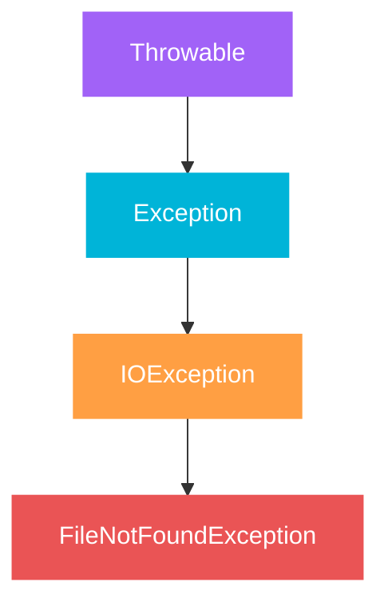

# FileNotFoundException in Java

**FileNotFoundException in Java** | A checked exception thrown when a file with the specified pathname does not exist or cannot be opened.

- [Unhandled Exception Type FileNotFoundException](#unhandled-exception-type-filenotfoundexception)
- [Unreported Exception FileNotFoundException](#unreported-exception-filenotfoundexception)
- [Different Reasons to Get FileNotFoundException in Java](#different-reasons-to-get-filenotfoundexception-in-java)

---

## 1. Overview

`FileNotFoundException` is a checked exception therefore we must catch or handle it. It is a subclass of `IOException` and is defined in the `java.io` package. Generally, `FileNotFoundException` will be thrown by the [FileInputStream](056_FileInputStream_in_Java.md), [FileReader](065_Java_FileReader.md), and `RandomAccessFile` constructors, where file information is the source and must be passed to the constructor.



---

## 2. Unhandled Exception Type FileNotFoundException

`FileNotFoundException` is a checked exception, and at compile time the compiler checks whether we are handling `FileNotFoundException` or not.

It means if there is a chance to raise `FileNotFoundException` in the statement then we must handle the `FileNotFoundException` either by using try-catch block or by using the `throws` keyword.

---

## 3. Unreported Exception FileNotFoundException

If we don't handle `FileNotFoundException` then the compiler gives the compile-time error: **unreported exception FileNotFoundException; must be caught or declared to be thrown.**

🛠️ **Example:** `FileReader` class is used to read character data from the file. The constructor of `FileReader` class throws `FileNotFoundException`.

**Code without exception handling (causes compile error):**

```java
import java.io.FileReader;
public class Test {
   public static void main(String[] args) {
      FileReader fr = new FileReader("data.txt");
      // .......
   }
}
```

🚨 **Compile-time error:**

```
FileReaderDemo.java:6: error: unreported exception
FileNotFoundException; must be caught or declared to be thrown
FileReader fr = new FileReader("data.txt");
^
1 error
```

✅ **Solutions:**

- Catch this exception using try/catch block
- Handle this exception using `throws`

📝 **Note:** Before catching and handling the exception we must import `FileNotFoundException` or `java.io` package. While catching or handling the exception we can also use superclass exception, `Exception`, or `Throwable`. The `Throwable` is the superclass for all Exceptions.

**Solution 1 — Using `throws`:**

```java
// Java program to handle the exception
import java.io.FileReader;
import java.io.FileNotFoundException;
public class Test {
   public static void main(String[] args)
                throws FileNotFoundException {
      FileReader fr = new FileReader("data.txt");
      // .......
   }
}
```

Using `throws` we are informing the caller method that the called method may throw `FileNotFoundException`. Now, it's the responsibility of the caller method to catch or handle the exception.

**Solution 2 — Using try/catch:**

```java
import java.io.FileReader;
import java.io.FileNotFoundException;
public class Test {
   public static void main(String[] args) {
      try {
         FileReader fr = new FileReader("data.txt");
         // .......
      } catch (FileNotFoundException fnfe) {
         fnfe.printStackTrace();
      }
   }
}
```

Using try/catch block we are catching the exception. We can use `finally` block to close the stream also.

---

## 4. Different Reasons to Get FileNotFoundException in Java

We will get runtime exception in the following cases:

- 🚨 The passed named file is not available
- 📂 Available but it is a directory rather than a normal file
- 🔒 The file doesn't have reading/writing permission
- ❌️ Access permission is not there

If the given name is a directory/folder, not a file then also we will get the same exception with "Access is denied".

### Writer and Output Classes

In all Writer and Output classes, we won't get `FileNotFoundException` because the file is not available. These classes are made for writing the data and need destination file information, if the file is not available then their constructors can create an empty file with the given name itself, and then write the data into the file. They throw `FileNotFoundException` for other reasons like:

- 🔒 File creation permission is not there
- 📂 It is available but represents a directory/folder
- ✏️ File is available but writing permission is not there

> ⚠️ **Caution:** Most of the time, Windows C drive doesn't allow creating a file, it only gives permission to create a directory. In this case, we can get `FileNotFoundException`. We can get an exception: `Exception in thread "main" java.io.FileNotFoundException: C:\xyz.txt (Access is denied)`. Similarly, in Linux/Unix OS, we can't create files in other user directories.

### Reader and Input Classes

In all Reader and Input classes, the file is the source from where the Java application will collect the data. And in this case, the file must be available else we will get `FileNotFoundException`. Other reasons are:

- 📂 It is a folder rather than a file
- 🔒 Access permission is not there

| Class Type ⚖️ | File Not Found? 🚨 | Other Reasons 📋 |
|---------------|---------------------|------------------|
| **Writer/Output classes** | ❌️ Creates file automatically | Throws if no creation permission, is a directory, or no write permission |
| **Reader/Input classes** | ✅ Throws FileNotFoundException | Also throws if it's a directory or no read permission |
