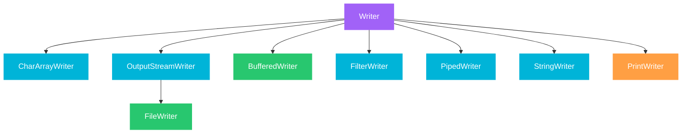

# Writer Class in Java

**Writer Class in Java** | Abstract superclass for all character output streams in the `java.io` package

- [Java Writer Class Methods](#java-writer-class-methods)
- [flush() Method](#flush-method)
- [close() Method](#close-method)
- [Subclasses of Java Writer Class](#subclasses-of-java-writer-class)

---

## 1. Java Writer Class Methods

The `Writer` class in Java is an abstract class defined in the `java.io` package and superclass for all character output streams. The writer and all its subclasses were introduced in Java 1.1 version. It implements `Appendable`, `Closeable`, and `Flushable` interfaces, they have `append()` with overloaded forms, `close()`, and `flush()` methods respectively.

**Class declaration:**

```java
public abstract class Writer
extends Object
implements Appendable, Closeable, Flushable
```

The `Writer` and all its sub classes are used to **write character/text data** to the file or console or network.

There are different overloaded methods of `write()` to write the data. Since they are defined for writing the data so, they don't return any value.

**Write methods:**

| Modifier and Type 🏷️ | Method 🛠️ | Description 📋 |
|----------------------|-----------|----------------|
| `void` | `write(int c)` | It writes a single character |
| `void` | `write(char cbuf[])` | It writes an array of characters |
| `abstract void` | `write(char[] ch, int off, int len)` | It writes a portion of an array of characters |
| `void` | `write(String str)` | It writes a string |
| `void` | `write(String str, int off, int len)` | It writes a portion of a string |

**Append, flush, and close methods:**

| Modifier and Type 🏷️ | Method 🛠️ | Description 📋 |
|----------------------|-----------|----------------|
| `Writer` | `append(char ch)` | It appends the specified character to this writer |
| `Writer` | `append(CharSequence seq)` | It appends the specified character sequence to this writer |
| `Writer` | `append(CharSequence seq, int off, int len)` | It appends a subsequence of the specified character sequence to this writer |
| `void` | `flush()` | It flushes the stream |
| `void` | `close()` | It closes the stream, flushing it first |

**Java 11 addition:**

| Modifier and Type 🏷️ | Method 🛠️ | Description 📋 |
|----------------------|-----------|----------------|
| `public static Writer` | `nullWriter()` | It returns a Writer that discards all characters |

> ⚠️ **Caution:** In `Writer` class in Java, **except `nullWriter()` method all other methods throw `IOException`** when an input/output error occurs.

---

## 2. flush() Method

When we write data into the stream then data is not saved in the file directly, it is stored only in the output stream memory, and to save those data from that memory to the file/console, the `flush()` method must be called. The `flush()` method flushes the stream. If the stream has saved any characters from the various `write()` methods in a buffer, write them immediately to their intended destination. Then, if that destination is another character or byte stream, flush it. Thus one `flush()` invocation will flush all the buffers in a chain of Writers and OutputStreams.

If the intended destination of this stream is an abstraction provided by the underlying operating system, for example, a file, then flushing the stream guarantees only that bytes previously written to the stream are passed to the operating system for writing; it does not guarantee that they are actually written to a physical device such as a disk drive.

💡 **Tip:** Up to Java 1.4 version the `flush()` method was directly available in the `Writer` class, but in Java 1.5 version `Flushable` interface was introduced which contains `flush()` method, and `Writer` class implements `Flushable` interface.

**Flushable interface:**

```java
package java.io;
import java.io.IOException;
public interface Flushable {
    void flush() throws IOException;
}
```

---

## 3. close() Method

Since it is a connection based object and uses different resources of the computer like file/console. Therefore, after completion of the program, those connections should be closed and all related resources should be released. For this, `close()` is given and it is defined in the `Closeable` interface. The actual `close()` method is defined in the `AutoCloseable` marker interface which was introduced in Java 1.7 version. The `Closeable` interface is extended from the `AutoCloseable` interface.

📝 **Note:** Whenever we call the **`close()` method** on `Writer` and its subclass object then **first** it **calls** the **`flush()` method to flush the stream**, and then close the stream. Once the stream has been closed, further `write()` or `flush()` invocations will cause an `IOException` to be thrown. Closing a previously closed stream has no effect.

---

## 4. Subclasses of Java Writer Class

The `Writer` class hierarchy:



- 📄 `CharArrayWriter`
- 🔄 `OutputStreamWriter`
  - ✍️ [FileWriter](064_FileWriter_in_Java.md)
- 🗂️ [BufferedWriter](066_Java_BufferedWriter.md)
- 🔧 `FilterWriter`
- 🔗 `PipedWriter`
- 📝 `StringWriter`
- 🖨️ [PrintWriter](068_PrintWriter_in_Java.md)

> 📝 **Note:** None of these subclasses have a 0 parameter constructor because it is a stream-based connection object where one end is Java application. Therefore second end information must be passed as input to the constructor.

The main problem with the `FileWriter` is, we have to insert a line separator or new line manually, which is varied from system to system and it is a burden to the programmer. Using `FileWriter` class we can write data only to the file not to the console because it doesn't contain any constructor which can connect with any Streams. We can solve this problem by using `BufferedWriter` classes. `BufferedWriter` class has a `newLine()` method which writes system-based new line character.

But `BufferedWriter` class also has some problem. Whenever we want a new line then every time we have to call `newLine()` method explicitly, which is burden for us.

In both `FileWriter` and `BufferedWriter` classes, we can't write primitive data directly, we must convert them to String. For example: if we want to write data 100 to the file then we must pass `"100"` as String. If we pass `100` directly then it will be stored as the character `'d'`. To solve these problems `PrintWriter` class can be used.

🔑 **Key Point:** Among all these sub classes [PrintWriter](068_PrintWriter_in_Java.md) class is the most enhanced way to write character/text/string data.
