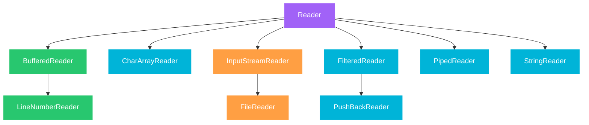

# Reader Class in Java

**Reader Class in Java** | Abstract superclass for all character input streams in the `java.io` package

- [Java Reader Class Methods](#java-reader-class-methods)
- [Subclasses of Reader](#subclasses-of-reader)

---

## 1. Java Reader Class Methods

The `Reader` class in Java is an abstract class defined in `java.io` package and superclass for all character input streams. The reader class and all its subclasses were introduced in Java 1.1. It implements `Readable` and `Closeable` marker interfaces. `Readable` interface defines `read()` method and `Closeable` interface defines `close()` method.

**Class declaration:**

```java
public abstract class Reader
extends Object
implements Readable, Closeable
```

All subclasses of `Reader` are **used to read** the **character/text data** from the file or keyboard or network.

In `Reader` class there are different overloaded `read()` methods:

**Read methods:**

| Modifier and Type 🏷️ | Method 🛠️ | Description 📋 |
|----------------------|-----------|----------------|
| `int` | `read()` | It reads a single character at a time |
| `int` | `read(char[] ch)` | It reads characters, stores them to the passed char array, and returns the number of characters it read |
| `abstract int` | `read(char[] ch, int off, int len)` | It reads characters from offset to len, stores them to the passed char array, and returns the number of characters it read |
| `int` | `read(CharBuffer target)` | It reads characters into the specified character buffer. Returns number of characters added to the buffer |

All overloaded forms of the read methods will read data until some input is available, an I/O error occurs, or the end of the stream is reached. They return `-1` when the end of the stream has been reached.

**Other methods:**

| Modifier and Type 🏷️ | Method 🛠️ | Description 📋 |
|----------------------|-----------|----------------|
| `boolean` | `ready()` | Tells whether the stream is ready to be read |
| `long` | `skip(long n)` | It skips number of given characters |
| `boolean` | `markSupport()` | Tells whether this stream supports the `mark()` operation. Default implementation always returns `false` |
| `void` | `mark(int readAheadLimit)` | It marks the present position in the stream |
| `void` | `reset()` | It resets the stream |
| `abstract void` | `close()` | It closes the stream and releases any system resources associated with it |

**Java 10 addition - `transferTo()` method:**

| Modifier and Type 🏷️ | Method 🛠️ | Description 📋 |
|----------------------|-----------|----------------|
| `long` | `transferTo(Writer out)` | It reads all characters from the reader and writes the characters to the given writer in the order that they are read |

📝 **Note:** The `transferTo()` method doesn't close either the `Reader` or `Writer`. It throws `NullPointerException` if the passed `Writer` object out is `null`, otherwise it returns number of characters transferred.

> ⚠️ **Caution:** **Except `markSupport()` all other methods of `java.io.Reader` class throw `IOException`.**

Since it is a connection based object and uses different resources of the computer. Therefore, after completion of the program, those connections should be closed and all related resources should be released. For this, `close()` is given and it is defined in the `Closeable` interface. The actual `close()` method is defined in the `AutoCloseable` marker interface which was introduced in Java 1.7 version. The `Closeable` interface is extended from the `AutoCloseable` interface.

---

## 2. Subclasses of Reader



- 📖 [BufferedReader](067_BufferedReader_in_Java.md)
  - 🔢 `LineNumberReader`
- 📄 `CharArrayReader`
- 🔄 [InputStreamReader](063_InputStreamReader_in_Java.md)
  - 📁 [FileReader](065_Java_FileReader.md)
- 🔧 `FilteredReader`
  - ↩️ `PushBackReader`
- 🔗 `PipedReader`
- 📝 `StringReader`

The `LineNumberReader` class is subclass of `BufferedReader`, `PushBackReader` is the sub class of `FilteredReader`, and `FileReader` is the subclass of `InputStreamReader`. The `BufferedReader`, `InputStreamReader` and `FileReader` are the most important sub classes of the `Reader`.

> 📝 **Note:** None of these subclasses have a 0 parameter constructor because it is a stream-based connection where one end is Java application. Therefore second end information must be passed as input to the constructor.

Among all these subclasses only `FileReader` class can directly communicate with files. `FileReader` class has several constructors with `File` as parameters. Similarly, only `InputStreamReader` can directly communicate to the console. The remaining subclasses are dependent on the `FileReader` class to communicate with the file, dependent on `InputStreamReader` to communicate with the console.

🔄 The `InputStreamReader` is a bridge from byte streams to character streams. It reads bytes and decodes them into characters using a specified charset.

🔑 **Key Point:** Among all these subclasses [BufferedReader](067_BufferedReader_in_Java.md) is the most convenient way to read character or text data. It has a method to read one line at a time, which makes our tasks very easy compared to other classes.
