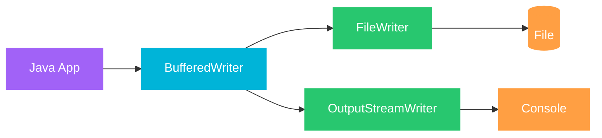

# Java BufferedWriter

**Java BufferedWriter** | Writing character/text data to file or console with buffered output in the `java.io` package

- [Methods of BufferedWriter Class](#methods-of-bufferedwriter-class)
- [Java BufferedWriter Example](#java-bufferedwriter-example)
- [BufferedWriter Example Using Console](#bufferedwriter-example-using-console)
- [Limitations](#limitations)

---

## 1. Methods of BufferedWriter Class

The `BufferedWriter` class in Java is used to write character or text data to the file/console/network. The `BufferedWriter` class is defined in the `java.io` package and it is a subclass of [Writer class](061_Writer_Class_in_Java.md).

Since `BufferedWriter` is a connection based, where one end is a Java application and another end is a file or console. We must always pass the file or console information to the constructor. Therefore, it doesn't contain 0 parameter constructor.

**Constructors:**

- 🏗️ `public BufferedWriter(Writer out)`
- 🏗️ `public BufferedWriter(Writer out, int size)`

`BufferedWriter` can't communicate file or console directly, it can communicate via some `Writer` object. We generally use [FileWriter](064_FileWriter_in_Java.md) class to communicate with the file, and `OutputStreamWriter` class to communicate with the console. `FileWriter` and [FileReader](065_Java_FileReader.md) class can directly communicate with the file. `OutputStreamWriter` is a bridge from character streams to byte streams and [InputStreamReader](063_InputStreamReader_in_Java.md) is a bridge from byte streams to character streams.



Compared to `FileWriter` class it has only one extra method **`newLine()`** which is used to insert a line separator or new line. The line separator string is defined by the system property `line.separator`, and is not necessarily a single newline (`'\n'`) character. Remaining all methods are the same as in `Writer` and `FileWriter` class.

**Important methods:**

| Method 🛠️ | Description 📋 |
|-----------|----------------|
| `newLine()` | It writes a line separator |
| `write(int c)` | Writes a single character at a time |
| `write(char cbuf[])` | It writes an array of characters |
| `write(char[] ch, int off, int len)` | It writes a portion of an array of characters |
| `write(String str)` | Writes a string |
| `write(String str, int off, int len)` | It writes a portion of a string |
| `flush()` | Flushes the stream |
| `close()` | Closes the stream, flushing it first |

📝 **Note:** All these methods return type is `void`.

---

## 2. Java BufferedWriter Example

**Java program to use `BufferedWriter` class to save data to the file:**

```java
import java.io.FileWriter;
import java.io.BufferedWriter;
import java.io.IOException;
public class BufferedWriterDemo {

   public static void main(String[] args)
                    throws IOException {

      // create FileWriter and BufferedWriter objects
      FileWriter fw = new FileWriter("output.txt");
      BufferedWriter bw = new BufferedWriter(fw);

      // write data to the file
      bw.write(97);
      bw.newLine();
      char[] ch1 = {'a', 'b', 'c', 'd'};
      bw.write(ch1);
      bw.newLine();
      bw.write("knowprogram");
      bw.newLine();
      bw.write("Hello, World!");

      // close stream
      bw.close();
   }
}
```

📄 **Data in output.txt after execution:**

```
a
abcd
knowprogram
Hello, World!
```

If the `output.txt` file doesn't exist then constructor will create the file itself.

📝 **Note:** Whenever the `close()` method is invoked on the `BufferedWriter` class object then first it calls the `flush()` method to flush the stream and then closes the connection, releases all the resources.

We can write data to the file in overridden mode where after every execution of the program, data will be saved from the beginning, or we can write data in append mode, where data will be written from the end of the file.

**Override vs Append mode:**

```java
FileWriter fw = new FileWriter("output.txt");       // override mode
FileWriter fw = new FileWriter("output.txt", true); // append mode
```

💡 **Tip:** Whenever we are closing `BufferedWriter` then automatically internal `FileWriter` also will be closed and we are not required to close them explicitly.

---

## 3. BufferedWriter Example Using Console

**Java program to use `BufferedWriter` class to write data to the console:**

To create `BufferedWriter` class object connecting to the console:

1. Pass `System.out` as argument to `OutputStreamWriter` object creation
2. Pass `OutputStreamWriter` as argument to `BufferedWriter` object creation

**Connection setup:**

```java
OutputStreamWriter osw = new OutputStreamWriter(System.out);
BufferedWriter bw = new BufferedWriter(osw);
```

**Complete console example:**

```java
import java.io.OutputStreamWriter;
import java.io.BufferedWriter;
import java.io.IOException;
public class BufferedWriterDemo {

   public static void main(String[] args)
                    throws IOException {

      // create BufferedWriter object
      BufferedWriter bw = new BufferedWriter(
             new OutputStreamWriter(System.out) );

      // write data to the file
      bw.write(97);
      bw.newLine();
      char[] ch1 = {'a', 'b', 'c', 'd'};
      bw.write(ch1);
      bw.newLine();
      bw.write("knowprogram");
      bw.newLine();
      bw.write("Hello, World!");

      // display some message
      System.out.println("Data is written to console");

      // close stream
      bw.close();
   }
}
```

📤 **Output on the console:**

```
Data is written to console
a
abcd
knowprogram
Hello, World!
```

Though the `println()` method is called after calling the `write()` method then also text of `println()` is displayed first. This result came because of the `flush()` method. The `close()` method itself calls `flush()` method, but in our program we are calling `close()` after calling `println()` method. If we call the `flush()` method before calling `println()` method then it will display the text of `println()` method at last.

**Flush before print:**

```java
bw.flush();
System.out.println("Data is written to console");
bw.close();
```

Now, the `flush()` method is called two times. Once we call explicitly before calling `println()` and again by `close()` method. But if we call the `close()` method before calling `println()` method then what will be the output?

**Close before print:**

```java
bw.close();
System.out.println("Data is written to console");
```

Since `BufferedWriter` is using `System.out` resource, so whenever we call the `close()` method on `BufferedWriter` object then it not only closes the connection but also releases all the resources related to it. That's why the `System.out` resource is already closed before calling `println()` method but `println()` is trying to use that resource. Hence this line won't give any output.

🔑 **Key Point:** Summary of behavior:

```java
bw.write('a');
System.out.print("b");
bw.close();
// Output: ba

bw.write('a');
bw.close();
System.out.print("b");
// Output: a

bw.write('a');
bw.flush();
System.out.print("b");
// Output: ab
```

**Advantage of `BufferedWriter` over `FileWriter`:**

- ✅ `newLine()` method is given for line separator
- ✅ `BufferedWriter` can write data both on file or console, but `FileWriter` can write data only to the file

---

## 4. Limitations

1. ❌️ Whenever we want a new line then every time we have to call `newLine()` method explicitly, which is burden for the programmers.

2. ❌️ We can't write primitive data directly, we must convert them to String. For example: if we want to write data 100 to the file then we must pass `"100"` as String. If we pass `100` directly then it will be stored as character `'d'`.

**Primitive data behavior:**

```java
bw.write(100);    // 'd'
bw.write("100");  // 100
bw.write(10.5);   // error
bw.write("10.5"); // 10.5
bw.write(true);   // error
bw.write("true"); // true
```

💡 **Tip:** To solve these problems we can use the [PrintWriter class](068_PrintWriter_in_Java.md). `PrintWriter` class is the most enhanced way to write character or text data to the file. It has several methods to write primitive values directly with or without a new line.
