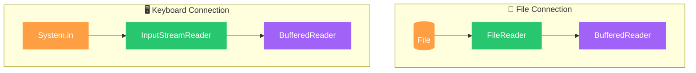

# BufferedReader in Java

**BufferedReader in Java** | The most enhanced way to read character/text data from file or keyboard in the `java.io` package

- [BufferedReader Methods](#bufferedreader-methods)
- [BufferedReader readLine() Method](#bufferedreader-readline-method)
- [BufferedReader Object Creation Syntax](#bufferedreader-object-creation-syntax)
- [Java BufferedReader readLine](#java-bufferedreader-readline)
- [InputStreamReader and BufferedReader in Java](#inputstreamreader-and-bufferedreader-in-java)
- [Program to Add Two Numbers](#program-to-add-two-numbers)
- [Important Points](#important-points)
- [Java BufferedReader Example](#java-bufferedreader-example)

---

## 1. BufferedReader Methods

In Java, `BufferedReader` class is the most enhanced way to read the character or text data from the file/keyboard/network. The main advantage of `BufferedReader` compared to [FileReader class](065_Java_FileReader.md) is: in addition to a single character, we can also read one line of data. The `BufferedReader` class is defined in the `java.io` package and it is a subclass of the [Reader class](062_Reader_Class_in_Java.md). It is available from Java 1.1 version onwards.

**Class declaration:**

```java
public class BufferedReader
extends Reader
```

### Constructors of BufferedReader Class

Since `BufferedReader` is a connection based, where one end is a Java application and another end is a file or keyboard. We must always pass that information to the constructor. Therefore, it doesn't contain 0 parameter constructor.

It contains two constructors:

- 🏗️ `public BufferedReader(Reader in)`
- 🏗️ `public BufferedReader(Reader in, int size)`

`BufferedReader` can't communicate file or keyboard directly, it can communicate via some `Reader` object. We generally use `FileReader` class to communicate with the file, and `InputStreamReader` class to communicate with the keyboard. `FileWriter` and `FileReader` class can directly communicate with the file. `OutputStreamWriter` is a bridge from character streams to byte streams and `InputStreamReader` is a bridge from byte streams to character streams.

**Important methods:**

| Modifier and Type 🏷️ | Method 🛠️ | Description 📋 |
|----------------------|-----------|----------------|
| `int` | `read()` | It reads a single character at a time |
| `int` | `read(char[] ch, int off, int len)` | Reads characters into a portion of an array |
| `String` | `readLine()` | It reads a line of text |
| `long` | `skip(long n)` | It skips characters |
| `boolean` | `ready()` | Tells whether this stream is ready to be read |
| `boolean` | `markSupported()` | Tells whether this stream supports the `mark()` operation |
| `void` | `mark(int readAheadLimit)` | It marks the present position in the stream |
| `void` | `reset()` | It resets the stream to the most recent mark |

> ⚠️ **Caution:** All these methods throw `IOException` when an input or output error occurs.

---

## 2. BufferedReader readLine() Method

The `readLine()` method is the most important method of `BufferedReader` class. **It reads a line of text.** A line is considered to be terminated by any one of a line feed (`'\n'`), a carriage return (`'\r'`), a carriage return followed immediately by a line feed, or by reaching the end-of-file (EOF).

It returns a string containing the contents of the line, **not including any line-termination characters**, or `null` if the end of the stream has been reached without reading any characters. It throws `IOException` when an input or output error occurs.

---

## 3. BufferedReader Object Creation Syntax

To connect `BufferedReader` object to file:

1. Create a `FileReader` object by passing a valid file name
2. Create a `BufferedReader` object by using `FileReader` class object

**Syntax to connect to file:**

```java
// create BufferedReader and FileReader object
FileReader fr = new FileReader("filename.txt");
BufferedReader br = new BufferedReader(fr);
```

**Single-line syntax:**

```java
// In single line,
BufferedReader br = new BufferedReader(new FileReader("filename.txt"));
```

To connect `BufferedReader` object with Keyboard:

1. Pass `System.in` as argument to `InputStreamReader` object creation
2. Pass `InputStreamReader` object as argument to `BufferedReader` object creation

**Syntax to connect to keyboard:**

```java
// create BufferedReader and InputStreamReader object
InputStreamReader isr = new InputStreamReader(System.in);
BufferedReader br = new BufferedReader(isr);
```

**Single-line syntax:**

```java
// In one line
BufferedReader br = new BufferedReader(new InputStreamReader(System.in));
```



---

## 4. Java BufferedReader readLine

We can use the `BufferedReader` class to read a complete line using the `readLine()` method. The file `data.txt` is available in the current directory. The characters in `data.txt`:

```
10 20 30 40 50 60 70
Hello, World!
20.5 99.99
```

**Reading file line by line:**

```java
import java.io.BufferedReader;
import java.io.FileReader;
import java.io.IOException;
public class BufferedReaderDemo {

   public static void main(String[] args)
                    throws IOException {

      // create BufferedReader and FileReader object
      FileReader fr = new FileReader("data.txt");
      BufferedReader br = new BufferedReader(fr);

      // read line from the file
      String line = br.readLine();
      while (line != null) {
         // display
         System.out.println(line);
         line = br.readLine();
      }

      // close stream
      br.close();
   }
}
```

💡 **Tip:** Whenever we are closing `BufferedReader` then automatically internal `FileReader` also will be closed and we are not required to close them explicitly.

**Alternative logic:**

```java
// create BufferedReader object
BufferedReader br = new BufferedReader(new FileReader("data.txt"));
// read line from the file
String line;
while ((line = br.readLine()) != null) {
   // display
   System.out.println(line);
}
// close stream
br.close();
```

**Using ready() method:**

```java
// read line from the file and display
while (br.ready()) {
   System.out.println(br.readLine());
}
```

**Complete program using ready():**

```java
import java.io.BufferedReader;
import java.io.FileReader;
import java.io.IOException;
public class BufferedReaderDemo {
   public static void main(String[] args)
                    throws IOException {

      // create BufferedReader and FileReader object
      BufferedReader br = new BufferedReader(
                      new FileReader("data.txt"));

      // read line from the file and display
      while (br.ready()) {
         System.out.println(br.readLine());
      }

      // close stream
      br.close();
   }
}
```

---

## 5. InputStreamReader and BufferedReader in Java

If we want to read data from the keyboard at runtime while using `BufferedReader` then we must use [InputStreamReader](063_InputStreamReader_in_Java.md) class. `InputStreamReader` is a bridge from byte streams to character streams. Keyboard given values are passed as binary form and `InputStream` converts them to String. Finally, `BufferedReader` can read them as String values.

**Reading data from keyboard:**

```java
import java.io.BufferedReader;
import java.io.InputStreamReader;
import java.io.IOException;
public class BufferedReaderDemo {
   public static void main(String[] args)
                    throws IOException {

      // create BufferedReader object
      BufferedReader br = new BufferedReader(
            new InputStreamReader(System.in));

      // read one line from the console
      System.out.print("Enter data: ");
      String str = br.readLine();

      // display data
      System.out.println("Entered data is: ");
      System.out.println(str);

      // close stream
      br.close();
   }
}
```

📤 **Output (run-1):**

```
Enter data: 10 20 30 40.5 22.9
Entered data is:
10 20 30 40.5 22.9
```

📤 **Output (run-2):**

```
Enter data: Hello, World!
Entered data is:
Hello, World!
```

---

## 6. Program to Add Two Numbers

Java program to add two numbers by reading its values from the keyboard.

**Procedure:**

1. Create a `BufferedReader` object using `InputStreamReader` by passing `System.in`
2. Read the first number and store into a string
3. Read the second number and store into the string
4. Convert string to a number, if stored values can't be converted to a number then it throws `NumberFormatException`, and program execution terminates
5. Add both values and display them

**Basic version:**

```java
import java.io.BufferedReader;
import java.io.InputStreamReader;
import java.io.IOException;
public class BufferedReaderDemo {
  public static void main(String[] args) throws IOException {
      // create BufferedReader object
      BufferedReader br = new BufferedReader(
                       new InputStreamReader(System.in));

      // read data from the console
      System.out.print("Enter first integer value: ");
      String firstNumber = br.readLine();
      System.out.print("Enter second integer value: ");
      String secondNumber = br.readLine();

      // convert string to integer
      int n1 = Integer.parseInt(firstNumber);
      int n2 = Integer.parseInt(secondNumber);

      // calculate sum value
      int sum = n1 + n2;

      // display result
      System.out.println("Sum= " + sum);

      // close stream
      br.close();
  }
}
```

📤 **Output:**

```
Enter first integer value: 10
Enter second integer value: 20
Sum= 30
```

> ⚠️ **Caution:** In the above program, we are directly converting the input value to `int` type value, if it is not a valid `int` type value then it will throw `NumberFormatException`.

**Error scenario:**

```
Enter first integer value: a
Enter second integer value: b
Exception in thread "main" java.lang.NumberFormatException: For input string: "a"
```

To solve this problem we can use Exception handling concept. We can use the try-catch block or try-with resources.

**Version with exception handling:**

```java
import java.io.BufferedReader;
import java.io.InputStreamReader;
import java.io.IOException;

public class BufferedReaderDemo {
  public static void main(String[] args) {

    // create BufferedReader object
    BufferedReader br = new BufferedReader(
        new InputStreamReader(System.in));

    try {
      // read data from the console
      System.out.print("Enter first integer value: ");
      String firstNumber = br.readLine();
      System.out.print("Enter second integer value: ");
      String secondNumber = br.readLine();

      // convert string to integer
      int n1 = Integer.parseInt(firstNumber);
      int n2 = Integer.parseInt(secondNumber);

      // calculate sum value
      int sum = n1 + n2;

      // display result
      System.out.println("Sum= " + sum);

    } catch (NumberFormatException nfe) {
      System.out.println("Pass only integer numbers");
      nfe.printStackTrace();
    } catch (IOException ioe) {
      ioe.printStackTrace();
    }
    finally {
      // close stream
      try {
        if(br != null) br.close();
      } catch(IOException ioe) {
        ioe.printStackTrace();
      }
    }
  }
}
```

📤 **Test with invalid inputs:**

```
Enter first integer value: a
Enter second integer value: b
Pass only integer numbers
java.lang.NumberFormatException: For input string: "a"
```

---

## 7. Important Points

Since all data are read as String, therefore converting from String to primitive type is the most important work while working with `BufferedReader` class.

**String to primitive conversion methods:**

| Return Type 🏷️ | Method 🛠️ |
|----------------|-----------|
| `int` | `Integer.parseInt(line)` |
| `long` | `Long.parseLong(line)` |
| `float` | `Float.parseFloat(line)` |
| `double` | `Double.parseDouble(line)` |
| `boolean` | `Boolean.parseBoolean(line)` |
| `char[]` | `line.toCharArray()` |

Another important work is to convert lines into tokens. For this, we can use the `split()` method of the `String` class. Let us understand it through an example.

**Input:**

```
10 20 30 40 50
```

**Problem description:** Read these values using `readLine()` of `BufferedReader` and store them to an `int` array.

We know that `readLine()` reads one line at a time as a String.

**Step 1 - Read line:**

```java
// read line,
String line = br.readLine();
```

Currently, `line = "10 20 30 40 50"`. Now, split this string based on the space (`" "`), using `split()` method of the String class.

**Step 2 - Split into tokens:**

```java
// split into String array
String str[] = line.split(" ");
```

Now:
- `str[0] = "10"`
- `str[1] = "20"`
- `str[2] = "30"`
- `str[3] = "40"`
- `str[4] = "50"`

Using `Integer.parseInt()` we can convert them to `int` type value. To store them in an array, first, create an `int` type array with a size of the `str[]` array.

**Step 3 - Create int array:**

```java
// create int array with given size
int arr[] = new int[str.length];
```

**Step 4 - Convert and assign:**

```java
// Convert str[i] to int and
// assign them to array
for (int i = 0; i < size; i++) {
   arr[i] = Integer.parseInt(str[i]);
}
```

Finally: `arr[0] = 10`, `arr[1] = 20`, `arr[2] = 30`, `arr[3] = 40`, `arr[4] = 50`

---

## 8. Java BufferedReader Example

**Java program to find sum of array elements using `BufferedReader`:**

Program description: Write a Java program to find the sum of array elements. The array size and elements will be given by the end-user, read those input values using `BufferedReader` class. *In input, the first line gives the size of the array, and the second line contains array elements.*

**Sample Input:**

```
5
10 20 30 40 50
```

**Expected Output:**

```
150
```

**Complete program:**

```java
import java.io.BufferedReader;
import java.io.IOException;
import java.io.InputStreamReader;

public class BufferedReaderDemo {
  public static void main(String[] args)
                        throws IOException {

    // create BufferedReader object
    BufferedReader br = new BufferedReader(
        new InputStreamReader(System.in));

    // read size of the array (first line)
    String line1 = br.readLine();
    // convert String to int type
    int size = Integer.parseInt(line1);

    // create int array object with given size
    int arr[] = new int[size];

    // read array elements (second line)
    String line2 = br.readLine();
    // convert line2 to tokens
    String[] str = line2.split(" ");

    // update array
    for (int i = 0; i < size; i++) {
      // convert string str[i] to int
      // and assign to array element arr[i]
      arr[i] = Integer.parseInt(str[i]);
    }

    // calculate sum of array elements
    int sum = 0;
    for (int i = 0; i < size; i++) {
      sum = sum + arr[i];
    }

    // display result (sum of array elements)
    System.out.println(sum);

    // close the stream
    br.close();
  }
}
```
