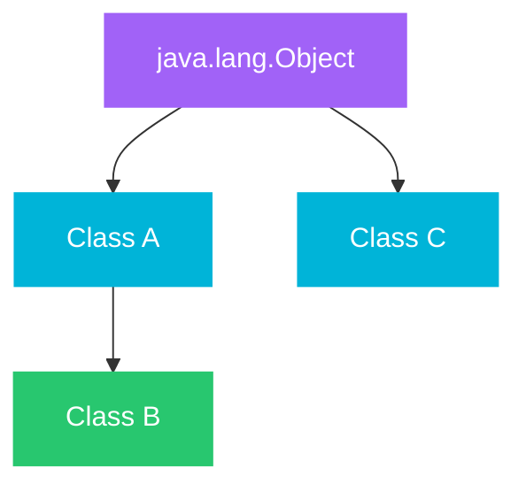

# Object Class in Java

**Object Class in Java** | The root superclass of all Java classes in `java.lang` package

- [All Classes in Java Are Inherited from Which Class?](#all-classes-in-java-are-inherited-from-which-class)
- [Object Class Methods in Java](#object-class-methods-in-java)
- [Overriding Object Class Methods](#overriding-object-class-methods)

---

## 1. All Classes in Java Are Inherited from Which Class?

**What is object class in Java?** In Java, the `Object` class is the root or superclass of all classes. Directly or indirectly every predefined and user-defined Java class is a subclass of the `Object` class. `Object` class contains the most commonly required methods for every Java class.

The most commonly required methods for every Java class (whether it is a predefined class or a customized class) are defined in a separate class which is nothing but an `Object` class.

🧠 **In Simple Words:** This class name is chosen as `Object`, because as per coding standards, generally name will be chosen based on the operations it is performing. This class has methods to perform operations related to the object of a class, so its name is chosen as `Object`.

All classes in Java are inherited from `java.lang.Object` class. Every class in Java is the child class of `java.lang.Object` class either directly or indirectly. Therefore, `Object` class methods are directly available for every Java class. Hence `Object` class is considered as the root of all Java classes.

**Inheritance example:**

```java
class A {}
class B extends A {}
```

Here class `A` is a direct subclass of the `Object` class. Class `B` is a subclass of `A`, so indirectly `B` class is also the subclass of `Object`.

If our class doesn't extend any class then only, our class is the direct child class of the `Object` class. For example, in the above case, class `A` is the direct subclass of the `Object` class. But if our class extends any other class then our class is an indirect child class of the `Object` class. For example in the above case, `B` is the subclass of `A`, and class `A` is the subclass of the `Object` class. Hence it is an indirect child class of the `Object` class. It is called a multi-level inheritance.

**Equivalent class declarations:**

```java
class A { }
class A extends Object { }
class A extends java.lang.Object { }
```

📝 **Note:** These three are the same class declaration, there is no difference between them.



### Reasons to Create Object Class as Super Class

`Object` class is created as the superclass for all java classes due to 2 reasons:

1. 🔄 **To achieve reusability to subclasses:** Every object will have some common behaviors. These common behaviors must be implemented in every class with the same signature by every class developer. So for informing these methods signature and to reduce the burden in implementing these methods, SUN developed a class called `Object` by implementing all these common behaviors with some methods common to all classes. All these methods have generic logic common for all subclasses. If this logic is not satisfying to subclass requirement then the subclass should override these methods.

2. 🔗 **To achieve loose coupling and runtime polymorphism in user class:** If we want to define a method to receive and to return any type of object, and further to invoke and execute from this passed object class, we must have one common superclass to all classes.

---

## 2. Object Class Methods in Java

Every object will contain some common operations. To perform these operations separate methods are given.

| Method 🛠️ | Description 📋 |
|-----------|----------------|
| Class<?> getClass() | Returns the runtime class of this Object |
| [int hashCode()](071_Hashcode_in_Java_–_hashCode()_Method.md) | Returns a hash code value for the object |
| boolean equals(Object obj) | It is used to compare two objects. Returns `true` if this object is the same as the obj argument; `false` otherwise |
| String toString() | Returns a string representation of the object |
| [Object clone()](074_Clone()_Method_in_Java.md) | Creates and returns a copy of this object |
| `void finalize()` | It is used to execute object clean-up code just before the object is being destroyed |
| `void notify()` / `void notifyAll()` | Notifying about object lock availability to waiting threads |
| `void wait()` / `void wait(long mills)` / `void wait(long mills, int nanos)` | Releasing object lock and sending thread to waiting-state |

These methods are discussed in detail in their own topic, all links are given. The `finalize()` method is related to the garbage collection features of Java. The `notify()`, `notifyAll()`, and `wait()` methods are related to the multi-threading feature of Java OOP.

> ⚠️ **Caution:** The `finalize()` method is **deprecated since Java 9.** The finalization mechanism is inherently problematic. Finalization can lead to performance issues, deadlocks, and hangs. Errors in finalizers can lead to resource leaks.

**All 11 methods of the `Object` class in Java:**

```java
public final native Class<?> getClass();
public native int hashCode();
public boolean equals(Object obj)
public String toString()
protected native Object clone() throws CloneNotSupportedException;
protected void finalize() throws Throwable { }
public final native void notify();
public final native void notifyAll();
public final void wait() throws InterruptedException
public final native void wait(long timeoutMillis) throws InterruptedException;
public final void wait(long timeoutMillis, int nanos) throws InterruptedException
```

### Java Object Class Methods Demonstration

- 🔍 The `getClass()` method is used to get class information.
- 🔑 In the `Object` class `hashCode()` method is implemented to return the reference of the object as an integer number format.
- ⚖️ The `equals()` method is implemented to compare two objects based on their reference. If two objects are having the same reference then the `equals()` method returns `true` else it returns `false`.
- 📝 The `toString()` method of `java.lang.Object` class internally calls `getClass()` and `hashCode()` method of `Object` class to return `getClass().getName() + "@" + Integer.toHexString(hashCode())` value.
- 📋 The `clone()` method is used to create duplicate objects.

**Demonstrating methods of `java.lang.Object` class:**

```java
class Student {
   int id;
   Student(int id) {
      this.id = id;
   }
}

public class Test {
  public static void main(String[] args) {

     Student s1 = new Student(1001);
     Student s2 = new Student(1002);
     Student s3 = new Student(1001);
     Student s4 = s1;

     // getClass() method
     Class cls = s1.getClass();
     String name = cls.getName();
     System.out.println("Class name of s1:: "
                       + name );

     // invoke hashCode() method
     System.out.println("hashCode():: " +
                    s1.hashCode() + " " +
                    s2.hashCode() + " " +
                    s3.hashCode() + " " +
                    s4.hashCode() );

     // invoke equals() method
     System.out.println("equals():: " +
                  s1.equals(s2) + " " +
                  s1.equals(s3) + " " +
                  s1.equals(s4) );

     // toString() method
     System.out.println("toString():: " +
                    s1.toString() + " " +
                    s2.toString() + " " +
                    s3.toString() );
  }
}
```

📤 **Output:**

```
Class name of s1:: Student
hashCode():: 1259475182 1300109446 1020371697 1259475182
equals():: false false true
toString():: Student@4b1210ee Student@4d7e1886 Student@3cd1a2f1
```

**Demonstrating `clone()` method of `java.lang.Object` class:**

To invoke the `clone()` method on an object, the class must implement the `Cloneable` interface. Since it is a `protected` method so we can call it only within the subclass, not in the user class.

```java
class Student implements Cloneable {

   int id;
   Student(int id) {
      this.id = id;
   }

   public static void main(String[] args)
          throws CloneNotSupportedException {

      Student s1 = new Student(1001);
      // clone() method
      Student s2 = (Student) s1.clone();

      System.out.println(s1 + " " + s2);
      System.out.println(s1.id + " " + s2.id);
   }
}
```

📤 **Output:**

```
Student@5acf9800 Student@4617c264
1001 1001
```

---

## 3. Overriding Object Class Methods

In the `Object` class, all the above methods logic is implemented based on the object's reference common to all subclasses. If we want these methods to perform operations based on the object's state, we must override these methods in subclasses. For example, consider the `toString()` method, this method has logic to display current objects `classname@hashcode` and output will be displayed based on the object's reference. Rather than displaying `classname@hashcode`, if we want to display data of the object then we must override the `toString()` method in the subclass.

We can override only non-final methods. Among these 11 methods, 6 methods are the final methods. Therefore we can override only five methods, they are not given as the final methods:

1. ⚖️ equals() Method
2. 🔑 [hashCode() Method](071_Hashcode_in_Java_–_hashCode()_Method.md)
3. 📝 toString() Method
4. 📋 [clone() Method](074_Clone()_Method_in_Java.md)
5. 🗑️ `finalize()` Method

💡 **Tip:** To learn more on these methods see: getClass(), [hashCode()](071_Hashcode_in_Java_–_hashCode()_Method.md), toString(), equals(), == vs equals(), Relation between hashCode() & equals(), [Clone()](074_Clone()_Method_in_Java.md)
